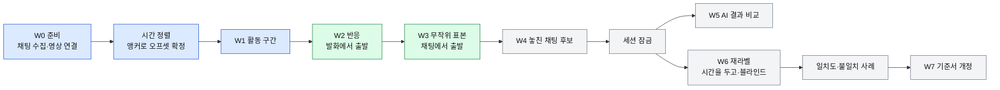

# 안내서 분석과 제품 아이디어

상태: 설계 초안 (2026-10-19) · 아직 구현되지 않음

이 문서는 [라벨링 안내서 v0.1](../labeling-guide/v0.1.md)과 [v0.1 검토 의견](../labeling-guide/v0.1-review.md)을 프로그램 관점에서 읽는다. 다루는 것은 네 가지다.

- 안내서가 프로그램에 무엇을 요구하는가
- 안내서의 빈틈을 프로그램이 어떻게 막는가
- 무엇을 먼저 만들고, 무엇을 만들지 않는가
- 시범 라벨링을 시작할 수 있는 최소 범위는 어디까지인가

구현 방법은 아래 문서에 있다. 같은 내용은 반복하지 않고 링크로 넘긴다.

| 문서 | 내용 |
|---|---|
| 01 안내서 분석과 제품 아이디어 (이 문서) | 요구사항·불변 규칙, 빈틈과 대응, 제품 아이디어·우선순위, MVP 범위 |
| [02 아키텍처](./02-architecture.md) | 스택·모듈·폴더·데이터 흐름·화면 구성 |
| [03 데이터 모델](./03-data-model.md) | 엔터티·저장 형식·버전·병합, JSON 스키마 |
| [04 업데이트와 릴리스](./04-update-and-release.md) | 릴리스 파이프라인·업데이터·서명 |
| [05 보안](./05-security.md) | 위협 모델, 확정 항목(S-xx), 개인정보 |
| [06 평가와 일치도](./06-evaluation-and-agreement.md) | 일치도·AI 비교 지표·표본 추출 |
| [07 로드맵](./07-roadmap.md) | 단계별 계획·일정·열린 질문 |
| [안내서 v0.2 개정안](../labeling-guide/v0.2-draft.md) | 이 문서의 'v0.2 후보' 를 안내서 문장으로 옮긴 것 |
| [README](../../README.md) | 저장소 첫 화면 |

---

## 0. 요약

- 도구가 하는 일은 하나다. 안내서를 누가 적용해도 같은 라벨이 나오도록 돕고, 그 라벨을 AI 평가의 정답으로 쓸 수 있게 기록한다.
- **도구는 안내서보다 앞서가지 않는다.** v0.1 에 없는 판정 항목은 필수 입력으로 만들지 않는다. 빈틈은 자동 계산·기록으로 자료만 남기거나 v0.2 후보로 넘긴다.
  이유: 시범 라벨링은 v0.1 을 검증하는 일이다. 도구가 기준을 먼저 바꾸면 무엇을 검증했는지 흐려진다.
- **등급은 제안하지 않는다.** 체크한 증거로 각 등급의 조건이 충족됐는지만 보여 주고, 등급은 라벨러가 고른다. 조건을 넘는 선택은 막고, 조건보다 낮은 선택은 사유를 받는다 (3-1).
- **판단은 대신하지 않는다. 실수를 막고, 본 것을 기록한다.** 프로그램이 맡는 일은 강제·경고·자동 계산·표시·기록 다섯 방식으로 나눈다 (1-3).
- **범위는 세 단계다.** MVP-0(활동 구간만 시범) → MVP(안내서 8장 시범 라벨링) → v1(잠금·재라벨·일치도·AI 비교·출처 대조). 검토 의견 결론 "지금은 코드보다 안내서가 실제 방송에서 일관되게 적용되는지 확인이 우선" 을 따라, 3장(활동 구간)을 실제 방송에 먼저 적용해 볼 수 있는 최소 도구부터 만든다.

---

## 1. 안내서가 프로그램에 요구하는 것

### 1-1. 다루는 대상과 규모

| 대상 | 안내서 근거 | 프로그램이 하는 일 | 규모 |
|---|---|---|---|
| 방송(VOD) | 0장 | 치지직 VOD 번호와 로컬 영상 파일을 묶는다. 영상은 복사하지 않고 경로·지문으로 참조한다 | 한 편 최대 10시간 이상 |
| 채팅 로그 | 2장, 7-1 | 치지직 VOD 채팅을 전량 받아 원문을 보존한다. 후원·구독·시스템 메시지를 자동으로 구분한다 | 조사 단계 실측 채널 35~208건/분 → 10시간에 약 2.1만~3.6만 건. 대형 채널 20만~36만 건 (추정, 확인 필요) |
| 스트리머 발화 | 4-1, 4-3, 7-1 | 라벨러가 직접 듣고 시작·끝 시각과 말한 내용을 적는다. 한 발화에 여러 채팅이 연결될 수 있다 | 반응 라벨 수만큼 |
| 활동 구간 | 3장 | 방송 전체를 빈틈없이 나눈다 | 방송당 수십 개 |
| 라벨 | 3~7장 | 구간·반응·이어짐·후보, (v0.2) 출처. 지우지 않고 추가만 한다 | 방송당 수백~수천 건 |
| 라벨러·세션 | 7-1, 7-3 | 누가, 언제, 어떤 기준서로, 1차인지 재라벨인지 | 라벨러 수는 확인 필요 |

참고: ClipSlicer 의 채팅 수집 코드(`app/chat.py`)는 (초, 본문, 닉네임) 세 값만 남기고(276-299행), (초, 본문, 닉네임)이 같은 메시지를 합치며(313-328행), 20만 건을 넘으면 솎아낸다(37·68행). 라벨링에서는 메시지 유형·사용자 식별 해시·상태값이 모두 필요하므로 수집기는 새로 쓴다. 엔터티 정의는 [03](./03-data-model.md)에 있다.

### 1-2. 단계와 산출물

| 안내서 단계 | 하는 일 | 결과물 | 프로그램 작업 흐름 | 시기 |
|---|---|---|---|---|
| (안내서에 없음) | 채팅 수집, 영상 연결, 시간 정렬, 기준서 버전 고정, 라벨러 선택 | 프로젝트 | W0 준비 | MVP-0 |
| 1 | 방송 전체를 훑으며 활동 구간 표시 | 구간표 | W1 활동 구간 | MVP-0 |
| 2 | 발화에서 출발해 반응한 채팅 찾기 | 반응 라벨 (+이어짐) | W2 반응 | MVP |
| 3 | 구간당 무작위 표본을 채팅에서 출발해 판정 | 표본 라벨 | W3 표본 | MVP |
| 4 | 반응이 연결되지 않은 채팅 중 놓친 채팅 후보 판정 | 후보 라벨 | W4 후보 | v1 |
| 5 | 일부를 다시 라벨링해 일관성 확인 | 일치도 | W6 재라벨 | 최소 기능은 MVP 끝, 계산은 v1 |
| (7-3 끝) | 사람 정답과 AI 비교 | 엄격·참고 점수 | W5 잠금·AI 비교 | v1 |
| (8장) | 시범 후 점검과 개정 | v0.2 | W7 기준서 개정 | v1 |

파랑 = MVP-0, 초록 = MVP, 회색 = v1. 화살표는 '앞 단계가 끝나야 다음 단계 라벨을 만들 수 있다' 는 뜻이다 (원칙 5).

### 1-3. 불변 규칙과 프로그램의 처리 방식

프로그램이 규칙을 다루는 방식은 다섯 가지다.

| 방식 | 뜻 |
|---|---|
| 강제 | 프로그램이 막는다. 저장하거나 다음 단계로 갈 수 없다 |
| 경고 | 막지 않는다. 알린 뒤 사유를 받는다 |
| 자동 계산 | 사람이 입력하지 않는다. 프로그램이 값을 만든다 |
| 표시 | 판정을 돕는 정보를 화면에 보여 준다. 판정은 사람이 한다 |
| 기록 | 나중에 점검할 수 있게 남긴다 |

| # | 규칙 | 안내서 | 프로그램 처리 | 방식 |
|---|---|---|---|---|
| 1 | 순서: 활동 구간 → 반응 → 후보 | 원칙 5 | 구간표가 없는 시간대에는 반응·표본·후보 라벨을 만들 수 없다. 구간 경계를 나중에 고치면 걸린 라벨에 '구간 재확인 필요' 를 붙인다(지우지 않음) | 강제·기록 |
| 2 | 구간은 스트리머의 활동으로만 정한다 | 원칙 6 | 채팅 밀도·반응 유무로 구간을 나누거나 분류를 바꾸는 기능을 두지 않는다 | 강제(기능 없음) |
| 3 | 반응·표본·후보는 저스트채팅 구간 안 채팅만 | 2장, 6장 ① | 다른 구간 채팅은 대상에서 빠진다 | 강제 |
| 4 | 경계 완충(전환 앞뒤 10초) 안 채팅은 평가에서 제외 | 3장 | 완충을 자동 생성해 흐리게 표시하고 제외 건수를 센다 | 자동 계산·표시·기록 |
| 5 | 후원·시스템 메시지는 따로 표시, 판정 제외 | 2장 | 메시지 유형으로 자동 구분해 색으로 표시, 후보 사유 F 자동 | 자동 계산·표시 |
| 6 | 강한 증거 없이는 직접 반응을 주지 않는다 | 4-2 | 강한 증거 0개면 '직접 반응' 을 고를 수 없다 | 강제 |
| 7 | 연결 가능성 높음 = 강 0 + 중 2 이상 + 비슷한 다른 채팅 없음 | 4-2 | 조건이 안 되면 고를 수 없다 (3-1) | 강제 |
| 8 | 시간이 가깝다는 사실만으로 등급을 올리지 않는다 | 4-2 | 시간 증거는 자동 계산하고 중간 증거 1개로만 센다. 시간 증거 하나로는 '연결 가능성 높음' 조건이 안 된다 | 자동 계산 |
| 9 | 불명확 = 후보는 있는데 가릴 수 없음. 후보가 없으면 등급 없이 '반응 미확인' | 4-2 | 후보 0개면 등급 칸이 꺼지고 '반응 미확인' 으로 저장된다. 후보 1개 이상이어야 '불명확' 을 고를 수 있다 | 강제 |
| 10 | 확신도는 등급과 별개, 모든 라벨에 적는다 | 5장 | 별도 칸, 기본값 없음, 빈칸이면 저장 불가. 등급에서 확신도를 유도하지 않는다 | 강제 |
| 11 | '판단 불가' 는 언제든 고를 수 있다 | 원칙 2 | 확신도·분류·후보 사유에서 항상 한 번에 고를 수 있게 둔다 | 강제 |
| 12 | 이어짐은 직접·연결 가능성 높음에만, 구간 끝에서 자르고 표시 | 4-3 | 다른 등급이면 이어짐 편집기가 꺼진다. 구간 끝을 넘으면 자동으로 자르고 '잘림' 표시 | 강제·자동 계산 |
| 13 | 표본은 라벨러가 고르지 않고 무작위로 | 2장 | 시드로 뽑고 다시 뽑기 버튼을 두지 않는다 | 강제 |
| 14 | 후보는 네 조건 모두 충족 시에만, 아니면 사유 코드, 확신도 필수 | 6장 | 조건 ①은 자동 계산(라벨러가 못 바꿈). 사유 코드·확신도 빈칸이면 저장 불가 | 강제·자동 계산 (v1) |
| 15 | 직접·연결 가능성 높음은 최소 두 번 본다 | 7-2 | 저장은 허용하되 '재확인 대기' 상태로 둔다. 재확인 기록 2건이 없으면 세션을 잠글 수 없다 | 기록·강제(잠금 시) |
| 16 | 소리를 직접 듣는다 | 원칙 4, 7-2 | 실제로 재생된 범위를 기록한다. 확인 범위를 듣지 않고 저장하면 경고 | 기록·경고 |
| 17 | 판단이 바뀌면 처음 판단도 남긴다 | 7-2 | 재확인에서 등급·확신도가 바뀌면 처음 판단을 자동으로 함께 저장 | 자동 계산 |
| 18 | AI 판정을 보지 않고 먼저 라벨링 | 원칙 3 | 세션을 잠그기 전에는 AI 결과를 가져올 수 없다 | 강제 |
| 19 | 이전 버전 라벨은 지우지 않는다 | 0장 | 라벨 파일은 추가만 한다. 수정은 새 라벨이 옛 라벨을 대체하는 형태 | 강제 |
| 20 | 라벨러·일시·기준서 버전 | 7-1 | 저장할 때 자동으로 채우고 사용자가 지울 수 없다. 기준서 본문 해시와 시작값 해시도 함께 (05 S-36) | 자동 계산 |
| 21 | 닉네임 가림 처리 | 7-1 | 화면과 내보내기 모두 기본 가림. 원 닉네임 보기는 기록 | 자동 계산·기록 |
| 22 | 구간의 20~30% 를 시간을 두고(3일 이상) 다시 라벨링 | 7-3 | 무작위 선정, 3일 미만이면 경고하고 기록 | 자동 계산·경고 (v1) |
| 23 | 일치율은 등급 같음과 한 단계 어긋남을 나눠 센다 | 7-3 | 종류별로 따로 계산 → [06](./06-evaluation-and-agreement.md) | 자동 계산 (v1) |
| 24 | 엄격 점수는 '확실함' 만, '아마도' 는 따로, '판단 불가' 는 제외 | 7-3 | 두 점수와 제외 건수를 함께 낸다 → [06](./06-evaluation-and-agreement.md) | 자동 계산 (v1) |
| 25 | 숫자는 시작값, 바꾸면 버전을 올린다 | 0장, 8장 | 프로젝트를 만들 때 시작값을 고정한다. 설정에서 바꾸면 새 기준서 버전으로만 저장되고 해시가 달라진다. 이미 프로젝트에 붙은 버전은 바뀌지 않고, 기존 프로젝트에는 새 버전을 추가해 새 세션부터 적용한다 ([03](./03-data-model.md) 9-2·9-3) | 강제 |

### 1-4. 시작값 목록

안내서의 모든 숫자는 시작값이다. 프로그램은 이 값을 코드에 박지 않고 기준서 설정 파일(guide-config)에 둔다. 왼쪽 키는 이 문서가 처음 제안한 이름이다. 최종 키는 guide-config 의 `values` 아래 경로이고, 형식은 [guide-config 스키마](../../schemas/guide-config.schema.json)와 [03](./03-data-model.md) 9장이 정한다. 다른 문서에서 왼쪽 이름이 보이면 오른쪽 키로 읽는다.

| 키 (제안) | 최종 키 (guide-config) | 시작값 | 안내서 위치 |
|---|---|---|---|
| `segment.silence_keep_max_sec` | 같음 | 30 | 3장 저스트채팅: 30초 미만 침묵은 활동 유지 |
| `segment.song_interlude_merge_max_sec` | 같음 | 60 | 3장 노래: 곡 사이 1분 미만 멘트는 노래 |
| `segment.long_silence_review_sec` | 같음 | 120 | 3장 기타: 2분 이상 침묵. 검토 의견 2 에 따라 재검토 신호로만 |
| `segment.boundary_buffer_sec` | 같음 | 10 | 3장 경계 완충 |
| `segment.min_length_sec` | 같음 | 30 | 3장 짧은 구간 합치기 |
| `reaction.direct_min_strong` | 같음 | 1 | 4-2 직접 반응 |
| `reaction.likely_min_medium` | 같음 | 2 | 4-2 연결 가능성 높음 |
| `reaction.medium_evidence_window_sec` | `reaction.time_window_sec` | 20 | 4-1 시간 증거 |
| `continuation.short_max_sec` | 같음 | 60 | 4-3 짧게 이어짐 / 확장됨 |
| `continuation.extended_min_other_chats` | 같음 | 3 | 4-3 확장됨 |
| `sample.per_segment` | 같음 | 100 | 2장 3단계 |
| `missed.min_visible_sec` | 같음 | 10 | 6장 ② |
| `missed.prior_handling_window_sec` | 같음 | 120 | 6장 ④ |
| `recheck.pre_roll_sec` | 같음 | 10 | 7-2 확인 범위 시작 |
| `recheck.post_roll_sec` | 같음 | 30 | 7-2 확인 범위 끝 |
| `recheck.min_views_direct_likely` | 같음 | 2 | 7-2 |
| `relabel.fraction_min` / `relabel.fraction_max` | 같음 | 0.20 / 0.30 | 7-3 |
| `relabel.min_interval_days` | 같음 | 3 | 7-3 |
| `pilot.target_direct_reaction_count` | 같음 | 30 | 8장 |

guide-config 에는 이 표에 없는 묶음(증거 강도 표 등)도 있다. 전체 목록은 스키마가 정한다.

아래는 안내서에 없는데 프로그램이 동작하려면 필요한 값이다. 판정에 쓰이는 값은 guide-config 에, 판정 기준이 아닌 도구 설정은 `data\settings.ini` 에 둔다. 둘 다 시범 뒤 v0.2 에서 다시 본다.

| 키 (제안) | 최종 키 · 사는 곳 | 시작값 | 왜 필요한가 |
|---|---|---|---|
| `reaction.similar_chat_window_sec` | 같음 · guide-config | 미정 (`null`). 제안 60 (확인 필요) | 4-2 '같은 시간대' 의 창 길이. 안내서에 숫자가 없다 |
| `missed.visible_lines` | 같음 · guide-config | 미정 (`null`, 확인 필요) | 6장 ② 노출 시간 추정에 쓰는 '채팅창에 보이는 줄 수' (G20) |
| `missed.max_chat_rate` | `missed.max_chat_rate_per_10s` · guide-config | 미정 (`null`, 확인 필요) | 6장 ② '너무 빠르게' 의 수치 (G20) |
| `calibration.min_anchors` | 같음 · `data\settings.ini` | 3 | 채팅↔영상 오프셋을 확정하는 앵커 수 (G1). 실제로 쓴 앵커는 보정 기록에 남는다 ([02](./02-architecture.md) 6-4) |
| `transcription.heard_text_soft_max_chars` | 같음 · `data\settings.ini` | 30 | 말한 내용이 이보다 길면 경고만 (G23) |
| `session.break_reminder_min` | 같음 · `data\settings.ini` | 50 | 휴식 알림 (G22) |

| 사는 곳 | 담는 값 | 바꾸면 |
|---|---|---|
| guide-config | 판정에 쓰이는 값. 안내서에 숫자가 없으면 `null`(미정)이고, `null` 인 값에 기대는 자동 제안은 하지 않는다 ([03](./03-data-model.md) 9-3) | 기준서 버전을 올린다. 이미 프로젝트에 붙은 값은 바뀌지 않는다 (1-3 규칙 25) |
| `data\settings.ini` ([02](./02-architecture.md) 5-2) | 판정 기준이 아닌 도구 동작 값. 키의 앞부분이 ini 섹션 이름이다 (예: `[calibration]` 의 `min_anchors`). 키 이름은 제안 | 그 PC 에만 적용된다. 기준서 해시에 들어가지 않고 기준서 버전도 올리지 않는다 |

수치가 없는 서술('한두 문장', '같은 유형이 반복되면')은 설정값으로 만들지 않고 서술로 둔다. 숫자로 바꿀지는 시범 뒤 결정한다.

---

## 2. 빈틈과 프로그램의 대응

빈틈은 세 갈래로 처리한다.

1. 프로그램이 정해도 판정이 바뀌지 않는 것(예: 완충을 양쪽에 둘지): 설정값으로 두고 기록한다.
2. 사람의 판단 기준이 바뀌는 것(예: 비언어 반응을 증거로 볼지): v0.1 그대로 두고 v0.2 후보로 넘긴다. 필요하면 선택 입력으로만 자료를 모은다.
3. 도구로 막을 수 없는 것(예: 개발자 편향): 막을 수 없다고 적고, 기록과 절차로 대응한다 (2-3).

'시기' 칸의 MVP-0 / MVP / v1 은 5장에서 정의한다. 'v0.2 후보' 칸은 [안내서 v0.2 개정안](../labeling-guide/v0.2-draft.md)에서 문장으로 다룬다.

### 2-1. 검토 의견 3개

| 의견 | v0.1 상태 | 프로그램 대응 | 방식 | 시기 | v0.2 후보 |
|---|---|---|---|---|---|
| 1. 실제·가상 채팅 출처 판정 | 없음. 후원·시스템 분리만 있음 | 출처는 채팅 필드가 아니라 출처 판정 세션이 만드는 `origin` 라벨(실제 / 가상 / 판별 불가)로 둔다 → [03](./03-data-model.md) 5-6, 6-11. 출처 라벨이 없는 채팅은 '출처 라벨 없음' 이다. 저장하는 값이 아니라 라벨이 없다는 사실에서 계산하는 파생 상태이고, MVP 에서는 모든 채팅이 이 상태다. [06](./06-evaluation-and-agreement.md) 2-2 의 `origin_unknown` 집계가 이것이다. 가상 채팅 생성 기록(·OCR)과 대조하는 도구는 주입 경로가 정해진 뒤 v1 에서 만든다. 반응 라벨링 중에는 출처를 숨긴다(편향 방지). 판별 불가·가상은 실제 소통 통계에서 기본 제외하고 건수를 따로 낸다 | 기록·자동 계산·표시 | 판정·대조 v1 (MVP 에는 출처 라벨이 없다) | 출처 판정 단계 신설 |
| 2. 긴 침묵은 재검토 신호로만 | '2분 이상 침묵 → 기타 후보' | 무음 탐지 결과를 타임라인에 '긴 침묵(재검토)' 마커로만 표시한다. 분류는 자동으로 바꾸지 않는다. 분류를 바꿀 때는 근거 한 줄(시각 포함)이 이미 필수다 | 표시·강제 | MVP-0 | '재검토 신호' 원칙 문장 |
| 3. 연결 등급과 확신도 구분 유지 | 잘 정리됨 | 두 칸을 분리하고 기본값을 두지 않는다. 확신도를 등급에서 유도하지 않는다. 등급×확신도 교차표로 두 축이 굳는지 점검한다 | 강제·자동 계산 | MVP (교차표 v1) | 예시 보강 (G15) |

### 2-2. 방법론 비평의 빈틈

| # | 빈틈 (왜 문제인가) | 프로그램 대응 | 방식 | 시기 | v0.2 후보 |
|---|---|---|---|---|---|
| G1 | '화면에 처음 뜬 시각' 정의가 없다. 시청자는 방송 지연만큼 늦게 보므로, 시청자가 스트리머 말을 따라 친 채팅을 '스트리머의 되풀이' 로 뒤집어 읽을 수 있다 | 기준을 API 의 `playerMessageTime` + 영상 오프셋으로 고정하고 화면에 그 정의를 적는다. 앵커(닉네임 호명처럼 시각이 분명한 순간) 3개(시작값)로 오프셋을 확정하기 전에는 반응 라벨링을 잠근다. 건너뛰려면 사유를 적는다. '문구 되풀이' 를 체크했는데 발화가 채팅보다 앞서면 '시청자가 따라 친 채팅일 수 있음' 경고. 방송 지연 값은 v1 에서 앵커로 재서 기록 | 강제·경고·기록 | MVP-0 (지연 측정 v1) | '처음 뜬 시각' 정의, 되풀이 방향 규칙 |
| G2 | 반응 시각 '한 점' 이 첫 음절인지, 채팅을 언급한 단어인지 정해져 있지 않다. 재라벨 때 2~5초씩 달라진다 | 라벨러가 찍은 위치를 그대로 저장한다. 발화의 시작·끝을 둘 다 받는다. 발화 시작에 붙이는 자석 기능은 기본 꺼짐이고 v1 이후 | 기록 | MVP | '첫 음절' 정의 |
| G3 | 경계를 화면·말·행동 중 어느 신호로 볼지, 30초 미만 구간을 앞뒤 어디로 합칠지, 완충이 양쪽인지 정해져 있지 않다 | 30초 미만 구간을 찾아 병합을 제안한다(같은 분류 쪽, 없으면 앞 구간). 완충은 경계 양쪽 각 10초로 자동 생성해 음영 표시. 경계 신호 종류(화면·소리·말·행동)는 선택 입력 | 자동 계산·표시 | MVP-0 | 병합 규칙, 완충 양쪽, 신호 종류 |
| G4 | 등급·증거가 채팅에 붙는지 (채팅, 발화) 짝에 붙는지 정해져 있지 않다. 한 발화가 여러 채팅에 답하는 경우가 흔하다 | 발화를 독립 단위로 두고 채팅과 연결한다. 증거는 (채팅, 후보 발화) 짝마다, 등급·확신도·이어짐과 '반응 미확인' 같은 채팅 결과는 채팅에 붙인다. 한 발화에 여러 채팅, 한 채팅에 여러 발화 후보를 넣을 수 있다 → [03](./03-data-model.md) 6-7. **채택됨 (D2, 사용자 확정 전 — 반대하면 되돌림, [07](./07-roadmap.md) ADR-21·질문 7)**: 반응 라벨은 채팅 1건당 1건이고, 연결 후보 발화를 `candidates[]` 에 두어 후보마다 발화 시각·전사·강/중/약 증거 체크를 적는다. 불명확이면 후보를 전부 적는다. v0.2 초안 4-1 [제안]의 짝 단위 기록을 받아들인 것이다 | 강제(데이터 구조) | MVP | 기록 단위 문장 |
| G5 | 웃음·끄덕임 같은 비언어 반응을 다루지 않는다. 표본에서 '반응 미확인' 으로 가 정답이 낮아진다 | '비언어' 태그를 선택 입력으로만 둔다. 등급 조건에는 쓰지 않는다 | 기록 | MVP | 반응 양식(언어/비언어), 등급 상한 |
| G6 | 후원 TTS 가 채팅을 읽은 소리를 '스트리머가 읽음' 으로 오인할 수 있다. 후원 응답을 전부 빼면 소통 통계가 어긋난다 | 후원·구독·시스템 메시지를 색으로 구분하고 판정 대상에서 뺀다. 'TTS·다른 소리' 구간 표시와 그 안의 '되풀이' 체크 경고는 v1 | 자동 계산·표시·경고 | MVP (구간 표시 v1) | '스트리머 본인 음성만 증거', 후원 응답 분리 집계 |
| G7 | 라이브 때 보였지만 VOD 에 없는 채팅(삭제·블라인드)에 답하면 기록할 방법이 없다 | API 의 상태값을 보존하고 블라인드 채팅을 표시한다. 연결 채팅 없이 발화만 남기려면 '대응 채팅이 VOD 에 없음' 메모를 받는다 | 기록·표시 | MVP | 발화 쪽 결과 코드 |
| G8 | 이모티콘만·'ㅋㅋㅋ'·한 문장을 나눠 친 채팅이 표본을 채운다. 사유 C 와 E 의 경계가 흐리다 | 채팅 종류(일반 / 이모티콘만 / 명령어 등)를 자동 분류해 표시만 한다. 표본에서 빼지 않는다 (v0.1 그대로) | 자동 계산·표시 | MVP | 층화 표본, C·E 경계 |
| G9 | 구간 크기와 상관없이 100개다. 짧은 구간 처리 규칙이 없다 | v0.1 그대로 100개, 적격 채팅(경계 완충·후원·시스템을 뺀 일반 채팅)이 100개 이하면 전부. 표본 크기 계산은 v1 → [06](./06-evaluation-and-agreement.md) | 강제 | MVP | 전수 기준, 시간 층화 |
| G10 | 무작위 표본을 어떻게 재현하는지 없다. 구간 경계를 고치면 표본이 바뀐다 | 시드(project.json 의 `sample_seed`)는 프로젝트를 만들 때 한 번 만들어 고정하고, 구간·기준서 버전은 넣지 않는다. 순서 키는 `sha256(sample_seed\|draw_no\|chat_id)` 다. 그래서 라벨러가 달라도, 구간을 쪼개거나 합쳐도, v0.2 로 다시 매겨도 같은 채팅 순서를 쓴다 → [06](./06-evaluation-and-agreement.md) 2-1. 적격 채팅은 구간 안 일반 채팅에서 경계 완충·후원·시스템을 뺀 것이고, 출처는 뽑기 조건이 아니라 판정 뒤 집계에서 가른다. τ = 적격 중 100번째 key, 표본 = key ≤ τ 라서 처음 판정 수는 정확히 100개다. 경계가 바뀌어도 τ 가 내려가지 않아 뽑힌 표본은 유지되고, sample_rev 를 올린 새 매니페스트를 쓴다(06 2-6). **채택됨 (D1 `sha256-tau-v1`, 사용자 확정 전 — 반대하면 되돌림, [07](./07-roadmap.md) 질문 42·ADR-09)**. '재현 검증' 버튼을 표본 화면에 둔다 | 강제·자동 계산·기록 | MVP | — |
| G11 | 같은 채팅이 2단계에서 직접 반응, 3단계에서 반응 미확인이 될 수 있다. 2단계가 놓친 비율을 모른다 | 표본 화면에서는 2단계 라벨을 숨긴다. 충돌 목록·조정 기록·2단계 누락률 계산은 v1 | 강제(숨김)·자동 계산 | MVP (계산 v1) | 충돌 처리 규칙 |
| G12 | 4단계가 미연결 채팅 전부인지 표본만인지 없다. 전부면 수천 건이라 눈에 띄는 것만 고르게 된다 | 4단계 작업 목록을 '표본 안의 반응 미확인·관련성만·불명확 채팅' 으로 만든다. 표본 밖에서 찾은 것은 '추가 후보' 로 따로 센다 | 강제·기록 | v1 | 4단계 모집단 문장 |
| G13 | '같은 주제', '같은 시간대 비슷한 채팅' 의 기준이 없다 | '같은 시간대' 창을 설정값 `reaction.similar_chat_window_sec` 로 둔다. 안내서에 숫자가 없어 guide-config 에서는 미정(`null`)이고, 제안 60초는 확인 필요다(1-4 표). 값이 정해지면 반응 앞 창의 채팅을 자동으로 나열해 '비슷한 채팅 없음' 체크를 돕는다. `null` 인 동안은 자동으로 나열하지 않는다. 주제 태그는 v0.2 후보 | 표시·기록 | MVP | 주제 태그, 창 길이 |
| G14 | 시간 근접을 중간 증거로 넣으면서 '시간만으로 올리지 않는다' 고 해 서로 긴장한다. 증거 체크와 등급이 어긋난 라벨이 생긴다 | 시간 증거는 체크가 아니라 자동 계산한다. 등급은 조건 충족 표시 + 상한 강제 + 하한 사유 (3-1). 체크한 증거마다 시각 메모를 받는다 | 자동 계산·강제·경고 | MVP | 시간 근접을 '조건' 으로 바꿀지, '다른 관찰에서만 각각 인정' |
| G15 | 예시 2 가 '연결 가능성 높음 / 아마도' 로만 짝지어 있어 등급→확신도 대응을 학습할 위험이 있다 | 두 칸을 따로 두고 기본값을 두지 않는다. 등급×확신도 교차표를 점검 화면에 둔다 | 강제·자동 계산 | MVP (교차표 v1) | 예시 추가 |
| G16 | 재라벨 대상의 선정 방법·단위가 없다. 원 라벨을 열어 볼 수 있으면 블라인드가 깨진다 | 10분 블록 단위 무작위 선정(→ [06](./06-evaluation-and-agreement.md)). 재라벨 세션은 다른 세션의 라벨 파일을 아예 열지 않는다(05 S-11). 1차 구간 경계를 넘겨주지 않고 블록 안에서 경계부터 다시 매긴다(05 S-33). 3일 미만이면 경고하고 기록 | 강제·경고·기록 | 최소 기능 MVP 끝, 나머지 v1 | 선정 단위, 간격 |
| G17 | 일치도를 계산하려면 두 라벨이 '같은 것' 인지 먼저 정해야 하는데 규칙이 없다 | 채팅 단위는 chat_id 로, 발화는 시작 시각 차 5초 안에서 맞춘다. 구간 경계는 30초 안에서 1:1 로 맞추고, 그중 10초(완충) 안 비율을 따로 낸다(분석 설정 시작값) → [06](./06-evaluation-and-agreement.md) 4-0 | 자동 계산 | v1 | — |
| G18 | AI 블라인드가 라벨러의 의지에 달려 있다. 엔진 제작자가 라벨링하면 엔진 규칙 쪽으로 라벨이 쏠린다 | 세션 잠금 전에는 AI 결과를 가져올 수 없다. 기준서 해시·시작값 해시를 라벨마다 남겨 '라벨링 전에 정한 기준' 을 증명한다. 개발자 편향 자체는 도구로 못 막는다 (2-3) | 강제·기록 | 잠금 개념 MVP, 가져오기 v1 | — |
| G19 | 이어짐이 '1분 미만/이상' 범주로만 저장되면 시작값을 바꿨을 때 다시 분류할 수 없다 | 원시값(증거 체크, 지연 ms, 이어진 길이, 후속 채팅 수)과 라벨러의 최종 판정을 함께 저장한다 → [03](./03-data-model.md) | 기록 | MVP | — |
| G20 | '화면에 10초 이상 보임' 은 VOD 에서 관찰할 수 없다. '너무 빠르게' 의 수치가 없다 | 노출 시간 추정(이후 N줄이 올라오기까지의 시간)과 직전 10초 채팅 수를 자동 계산해 보여 준다. N 과 기준 수치는 미정 (확인 필요) | 자동 계산·표시 | v1 | 노출 추정 정의 |
| G21 | 저스트채팅 구간만 평가하면 게임 중 채팅 읽기가 빠진다 | 게임 구간의 '채팅 대화 활발' 표시를 v0.1 대로 받는다. 구간별 반응 발화 수 자동 집계는 v1 | 기록·자동 계산 | MVP (집계 v1) | 채팅 소통 수준 2차 축 |
| G22 | 몇 시간짜리 방송을 앞에서부터 하면 후반 발견률이 떨어지는데 알 방법이 없다 | 세션 시작·끝과 라벨 저장 시각을 기록하고 50분(시작값) 휴식 알림. 블록 순서 무작위화와 방송 위치별 반응 밀도는 v1 | 기록·표시 | MVP (분석 v1) | 블록 순서 |
| G23 | '말한 내용' 의 길이 규칙이 없다. 닉네임 가림이 데이터에서 어떻게 되는지 없다 | 말한 내용은 30자(시작값)를 넘으면 경고만 한다. 닉네임은 수집 시점에 가명으로 바꾸고 화면·내보내기 모두 가명이 기본이다. 원 닉네임 보기는 기록 → [05](./05-security.md) | 경고·자동 계산·기록 | MVP | 전사 규칙 |

### 2-3. 도구가 막지 못하는 것

정직하게 적는다. 아래는 기록으로 드러낼 수는 있어도 프로그램이 막지는 못한다.

| 위험 | 왜 못 막는가 | 대신 하는 것 |
|---|---|---|
| 개발자 편향 | 엔진·도구·라벨을 같은 사람이 만들면 엔진 규칙(예: 20초 창)을 알고 라벨링한다. 블라인드로 막을 수 없다 | 시작값을 라벨링 전에 고정하고 해시로 기록. 외부 라벨러 1명이 최소 1블록을 독립 라벨링 (열린 질문 1) |
| 전처리 공유에 따른 상관 오류 | 도구의 무음 탐지·음성 인식이 엔진과 같으면 엔진이 놓친 발화를 사람도 놓치기 쉽다 | 자석·자막은 기본 꺼짐. 썼는지를 라벨에 기록 (05 S-12) |
| 앱 밖에서 파일 열기 | 1차 라벨 파일을 메모장으로 열 수 있다 | 앱 안에서는 열지 않는 구조 + 열람 기록. '앱 안에서 보지 않았다' 까지만 보장 |
| 현저성 편향 | 2단계는 눈에 띄는 발화에서 출발하므로 짧은 반응을 놓친다 | 3단계 표본에서 2단계 누락률을 측정 (v1) |
| 치지직 API 변경 | 비공식 엔드포인트라 필드·규칙이 예고 없이 바뀔 수 있다 | 응답 원문 보존, 수집 시각·엔드포인트 기록 |

---

## 3. 제품 아이디어

### 3-1. 등급 판정: 제안 대신 조건 충족 표시

반응 편집기에서 라벨러가 증거를 체크하면, 프로그램은 등급을 미리 고르지 않는다. 각 등급의 조건이 지금 충족됐는지만 보여 준다.

**제안하지 않는 이유**

1. 제안된 답을 보면 그쪽으로 쏠린다. 원칙 3 이 AI 판정에 대해 경계하는 것과 같은 효과다 (05 S-12).
2. 등급 조건 중 일부는 사람만 정할 수 있다. '같은 시간대에 비슷한 다른 채팅이 없음', '스트리머가 이미 그 주제를 이야기하던 중', '이 채팅이 계기인가' 는 프로그램이 셀 수 없다. 셀 수 있는 부분만 보고 제안하면 틀린 제안이 나온다.
3. 제안을 받아들인 라벨과 사람이 판정한 라벨이 섞이면, 나중에 시작값을 바꿔 재분류할 때 무엇이 사람의 판단이었는지 알 수 없다.

**화면에 보이는 것** (예: 강한 증거 1개 체크, 후보 발화 1개)

| 등급 | 안내서 조건 | 프로그램이 세는 부분 | 사람이 정하는 부분 | 지금 상태 |
|---|---|---|---|---|
| 직접 반응 | 강한 증거 1개 이상 | 강한 증거 수 | 증거가 맞는지 | 충족 |
| 연결 가능성 높음 | 강 0 + 중 2 이상 + 비슷한 채팅 없음 | 강·중 수 (시간 증거는 자동) | '비슷한 채팅 없음' 체크 | 미충족 (중 0) |
| 관련성만 있음 | 약한 증거만, 또는 중 1, 또는 이미 그 주제 중 | 강·중·약 수 | 이 채팅이 계기인지 | 조건 확인 필요 |
| 불명확 | 후보는 있는데 가릴 수 없음 | 후보 수 | 가릴 수 없는지 | 선택 가능 |
| (반응 미확인) | 후보 없음 | 후보 수 | — | 해당 없음 |

**고를 때의 규칙**

| 상황 | 처리 | 이유 |
|---|---|---|
| 조건을 넘는 등급을 고름 (예: 강한 증거 0개인데 직접 반응) | 고를 수 없다 | 안내서가 명시한 정의다 (4-2 "강한 증거 없이는 직접 반응을 주지 않는다") |
| 더 높은 등급의 조건이 충족됐는데 낮은 등급을 고름 (예: 닉네임을 불렀지만 다른 채팅에 대한 호명) | 고를 수 있다. 사유 한 줄을 받는다. '이미 그 주제 이야기 중' 체크는 사유로 인정 | 증거가 다른 맥락일 수 있다. 막으면 틀린 라벨을 강요한다 |
| 후보 0개 | 등급 칸이 꺼지고 '반응 미확인' 으로 저장 | 4-2 마지막 문단 |

라벨에 남는 것: 저장 시점의 조건 충족 상태, 고른 등급, 조건과 다르게 골랐는지, 사유. 필드 이름은 [03](./03-data-model.md)이 정한다.

### 3-2. 아이디어 목록과 우선순위

'우선순위' 는 제품에서 얼마나 중요한가, '시기' 는 언제 만드는가다. 핵심이라도 앞 단계 자료가 있어야 하는 기능은 v1 이다.

**핵심**

| # | 아이디어 | 하는 일 | 근거 | 시기 |
|---|---|---|---|---|
| P1 | 라벨링 작업대 | 영상·채팅 목록·타임라인을 한 화면에 둔다. 채팅 목록은 재생 위치를 따라 스크롤한다. 타임라인에 구간(분류 색)·완충 음영·채팅 밀도·침묵 신호·라벨 점을 겹쳐 보여 준다 | 2장, 3장 | MVP-0 (구간·밀도) → MVP (라벨 트랙) |
| P2 | 채팅 전량 수집·원문 보존 | VOD 번호만 넣으면 채팅을 전부 받는다. 중복 제거·솎아내기를 하지 않는다. 원문은 보호 파일로 분리하고 화면에는 가명만 보인다 (05 S-05) | 2장, 7-1 | MVP-0 |
| P3 | 채팅↔영상 오프셋 보정 | 앵커 3개(시작값)로 오프셋을 확정한다. 상태바에 항상 표시한다. 확정 전에는 반응 라벨링을 잠근다 (G1). 오프셋 오류는 모든 라벨이 함께 틀리는 유일한 실수라 입력 비용을 감수한다 | 4-1 20초, 6장 10초 | MVP-0 |
| P4 | 활동 구간 편집 | 마커로 방송을 빈틈없이 나눈다. 분류 5종·확신도 3종·근거 한 줄. 30초 미만 병합 제안, 완충 자동 생성 | 3장 | MVP-0 |
| P5 | 긴 침묵·경계 완충 자동 표시 | 무음 탐지로 2분(시작값) 이상 침묵을 '재검토 신호' 로만 표시한다. 완충 안 채팅은 흐리게 | 3장, 검토 의견 2 | MVP-0 |
| P6 | 증거 체크 → 조건 충족 표시 | 3-1 | 4-1, 4-2 | MVP |
| P7 | 확인 범위 반복 재생·재확인 기록 | 버튼 하나로 '채팅 뜬 시각 −10초 ~ 발화 끝 +30초'(시작값)를 반복 재생한다. 재확인 기록, 처음 판단 자동 보존, 실제로 들은 범위 기록 | 7-2 | MVP |
| P8 | 무작위 표본·큐 모드 | 표본 뽑기는 버튼 하나, 다시 뽑기 없음. 큐 모드는 표본 1건씩 확인 범위 자동 재생, 저장하면 다음으로 자동 이동. 2단계 라벨은 숨김 | 2장 3단계 | MVP |
| P9 | 블라인드 모드 | AI 결과·다른 세션 라벨·출처 배지·자막을 숨긴다. 숨긴 것을 보면 기록한다. 재라벨 세션은 다른 세션 파일을 열지 않는다 | 원칙 3, 7-3 | 구조 MVP, 재라벨 v1 |
| P10 | 내보내기 | JSONL(정답 원본, 7-1 항목 전부)과 CSV(보기용). 가명이 기본. 기준서 버전별로 거를 수 있다. CSV 셀의 수식 주입 방지 (05 S-27) | 7-1, 0장 | MVP-0 (구간) → MVP |
| P11 | 라벨 잠금·재라벨 세션 | 세션을 잠글 때 라벨 파일 해시를 기록한다. 재라벨 블록 무작위 선정, 3일 미만 경고 | 7-3 | 최소 기능 MVP 끝, 나머지 v1 |
| P12 | 일치도 대시보드 | 등급 같음·한 단계·두 단계 이상, 확신도 일치, 불일치 사례 나란히 보기 → [06](./06-evaluation-and-agreement.md) | 7-3 | v1 |
| P13 | 8장 점검 화면 | 판단 불가·불명확 비율, 등급×확신도 교차표, 직접 반응 건수(목표 30), 사유 코드 분포, 애매함 표시 목록 | 8장 | v1 (직접 반응 건수는 MVP 상태바) |
| P14 | AI 결과 가져오기·비교 | 잠금 뒤에만 열린다. 엄격(확실함)·참고(아마도) 점수, 제외 건수 → [06](./06-evaluation-and-agreement.md) | 7-3 | v1 (결과 형식 미정) |
| P15 | 채팅 출처 대조 | 가상 채팅 생성 기록(·OCR)과 대조해 실제 / 가상 / 판별 불가. 판별 불가 건수 | 검토 의견 1 | v1 (MVP 에는 출처 라벨이 없다) |
| P16 | 앱 안 업데이트 | 새 버전 알림, 버튼 한 번 갱신. 수집·분석 작업 중에는 교체하지 않는다 → [04](./04-update-and-release.md) | 사용자 요구 | 첫날부터 (빈 껍데기 단계) |

**참고용 음성 인식 자막은 핵심에서 보조로 내린다.** 기본은 꺼짐이다.

| # | 아이디어 | 결정 | 이유 |
|---|---|---|---|
| P17 | 참고용 음성 인식 자막 | 기본 꺼짐. 켜면 기록한다. '말한 내용' 칸을 자동으로 채우지 않는다(복사 후 수정만). 앱 기본 묶음에 넣지 않고 따로 받는다. MVP 에 없음, v1 선택 기능 | 원칙 4 와 7-2 는 소리로 판정하라고 한다. 자막을 먼저 보면 채팅 단어와 겹치는 부분을 '되풀이' 로 느끼기 쉽다. 엔진과 같은 인식기를 쓰면 오류가 상관된다(05 S-12). 모델이 약 0.8GB 이고 CPU 로 10시간 방송에 3~5시간 걸린다 (조사 단계 추정, 확인 필요) |

**보조**

| # | 아이디어 | 하는 일 | 근거 | 시기 |
|---|---|---|---|---|
| P18 | 단축키 | 재생·정지, 프레임 이동, 반응 지점 찍기, 등급·확신도 선택, 다음 표본. 등급·확신도 키는 텍스트 입력 칸 밖에서만 동작하고, 지금 포커스가 어디인지 색으로 보인다. Esc 로 작업대에 포커스를 돌린다. 한국어 입력기 조합 중 동작은 확인 필요 | 하루 수백 번 반복하는 입력 | MVP |
| P19 | 근거 한 줄에 시각 넣기 | 현재 재생 시각을 '13:42' 형식으로 넣는 버튼 | 7-1 근거 한 줄 | MVP-0 |
| P20 | 라벨 철회 | 직전 라벨을 철회하는 레코드를 추가한다(삭제가 아님). 키 한 번으로 되돌릴 수 있어야 라벨러가 실수 수정을 미루지 않는다 | 0장 | MVP |
| P21 | 애매함 표시 (북마크) | 라벨이 아닌 표시. 시각, 짧은 태그, 한 줄 메모. 시범 뒤 '기준서가 흐린 곳' 목록이 된다 | 8장, 7-3 불일치 사례 | MVP-0 |
| P22 | 작업 시간 기록 | 세션 시작·끝, 라벨 저장 시각, 블록별 소요. 영상 시간 대비 소요 배율 | 8장 | 기록 MVP-0, 보고 v1 |
| P23 | 피로 경고 | 50분(시작값) 휴식 알림. 방송 간 음량 차를 줄이는 음량 정규화(확인 필요). 시간당 라벨 수·확신도 분포 변화는 v1 점검 화면 | 비평 G22 | 알림 MVP, 나머지 v1 |
| P24 | 다중 라벨러 병합 | 라벨러 패키지 내보내기·가져오기. 세션마다 파일이 따로라 병합은 파일 합집합 → [03](./03-data-model.md) | 7-3 두 번째 사람 | v1 |
| P25 | 판정 대상 채팅을 영상 위에 표시 | 반복 재생 중 대상 채팅의 가명·본문을 영상 위에 띄워 시선 이동을 줄인다 | — | MVP (가능하면), 아니면 v1 |
| P26 | 가변 프레임 감지 | 가변 프레임 영상이면 프레임 번호를 숨기고 ms 만 보인다. '프레임 단위로 정확하다' 는 착각을 막는다 | 4-3 영상 시각 한 점 | MVP |
| P27 | 프로젝트 검증 도구 | 앱 없이 라벨 파일·표본 재현·잠금 해시를 검사하는 명령줄 도구. 외부 검토자용 | 7-3 | v1 |
| P28 | 블록 순서 무작위화 | 2~4단계를 10분 블록 단위로 섞어 피로 효과를 위치와 분리 | 비평 G22 | v1 |

**나중**

| # | 아이디어 | 하는 일 | 지금 안 하는 이유 |
|---|---|---|---|
| P29 | OCR 노출 시각 | 채팅 오버레이가 있는 방송에서 '처음 뜬 시각' 과 노출 시간을 화면에서 읽어 보정. 출처 대조 보조 | 오버레이가 없는 방송이 많다. 자모 단독('ㅋㅋㅋ')·720p 이하에서 인식이 크게 떨어진다 (조사 단계 실측). 설치 환경마다 한국어 OCR 지원이 다르다 |
| P30 | 발화 자석 | 반응 지점을 음성 구간 시작에 붙이는 선택 기능. 기본 꺼짐 | 음성 구간 탐지가 필요하고 상관 오류 위험이 있다 (2-3) |
| P31 | 표본 크기 계산기·층화 표본 | 목표 정밀도에서 필요한 표본 수 계산, 시간 층화 → [06](./06-evaluation-and-agreement.md) | v0.1 은 '구간당 100개'. 바꾸려면 v0.2 개정이 먼저다 |
| P32 | 팀 서버 | 실시간 공유·중앙 저장 | 라벨러 수가 확인 전이다. 세션 파일 + 패키지 교환으로 충분한지 시범으로 본다. 개인정보가 서버로 나가는 문제가 새로 생긴다 |

### 3-3. 화면 모드

한 화면에 모든 입력을 넣으면 1080p 노트북에서 반응 편집기의 세로 공간이 모자란다. 단계별로 화면을 나눈다. 배치는 [02](./02-architecture.md)가 정한다.

| 모드 | 쓰는 단계 | 보이는 것 | 숨기는 것 |
|---|---|---|---|
| 준비 | W0 | 프로젝트 정보, 채팅 수집 진행, 영상 연결, 앵커 보정 | — |
| 구간 | W1 | 영상, 타임라인(구간·완충·밀도·침묵), 구간 입력 | 반응 편집기 |
| 반응 작업대 | W2 | 영상, 채팅 목록, 타임라인, 반응·이어짐 편집기 | AI 결과, 출처 배지, 자막(기본) |
| 표본 큐 | W3, (v1) W4 | 영상, 현재 표본 1건, 판정 폼, 진행 n/100 | 2단계 라벨, 출처 배지, AI 결과 |
| 검토 | v1 | 일치도, 불일치 사례 나란히 보기, 8장 점검, AI 비교(잠금 뒤) | 잠금 전 AI 결과 |

---

## 4. 하지 말아야 할 것

안내서 원칙과 부딪히는 기능은 요청이 있어도 넣지 않는다.

| 하지 않는 것 | 부딪히는 원칙 | 대신 하는 것 |
|---|---|---|
| 잠금 전 AI 판정 미리 보기, 채팅 옆 AI 점수 | 원칙 3 | 잠금 뒤 검토 모드에서만 |
| 등급 자동 결정·미리 선택 | 원칙 1, 4-2 | 조건 충족 표시 (3-1) |
| 확신도 자동 결정, 등급에서 확신도 유도 | 5장, 검토 의견 3 | 기본값 없는 별도 칸 |
| 채팅 밀도·반응 유무로 구간 자동 분할·분류 | 원칙 6 | 밀도 그래프는 참고 표시만 |
| 긴 침묵으로 분류 자동 변경 | 검토 의견 2 | '재검토 신호' 마커만 |
| 자동 인식 문장으로 '말한 내용' 자동 채우기, 소리 없이 판정 | 원칙 4, 7-2 | 자막 기본 꺼짐, 복사 후 수정만, 들은 범위 기록 |
| 라벨러가 표본을 고르거나 다시 뽑기 | 2장 | 시드 고정, 다시 뽑기 버튼 없음 |
| 라벨 삭제·덮어쓰기 | 0장 | 철회·대체 레코드 추가 |
| '판단 불가' 를 숨기거나 메뉴 깊이 넣기, 작업 중 '판단 불가가 많다' 경고 | 원칙 2 | 항상 한 번에 고를 수 있게. 비율은 작업이 끝난 뒤 점검 화면에서 (8장) |
| 작업 속도 순위, 처리량 목표 표시 | 5장 (속도를 위해 '확실함' 을 남발하게 된다) | 소요 시간은 기록만, 점검용 |
| 재라벨 중 1차 라벨·메모 보기 | 7-3 '독립적으로' | 다른 세션 파일을 열지 않는다 |
| 반응 라벨링 중 출처(가상) 표시 | 검토 의견 1, 편향 | 출처 판정은 별도 단계 |
| 원 닉네임 기본 표시 | 7-1 가림 처리 | 가명 기본, 원 닉네임 보기는 기록 |
| 놓친 채팅 후보를 '놓침' 으로 이름 붙이거나 '놓친 수' 로 집계 | 6장 끝 "다시 볼 만하다는 표시일 뿐" | '다시 볼 만한 채팅' 으로 표기 |
| 반응 미확인·관련성만 있음 채팅에 이어짐 입력 | 4-3 | 이어짐 편집기 비활성 |
| 설정 화면에서 시작값을 조용히 바꾸기 | 0장, 8장 | 바꾸면 새 기준서 버전으로만 저장(해시가 달라짐). 이미 붙은 버전은 그대로, 새 세션부터 적용 ([03](./03-data-model.md) 9-3) |
| 영상 파일 수정, 영상 옆에 파일 만들기 | 원칙 4 (원본으로 판단) | 영상은 읽기만, 프로젝트 폴더에만 쓴다 |
| 앱 밖에서도 동작하는 전역 단축키 | (실수 라벨) | 앱 창 안에서만 |
| 채팅·라벨을 외부 서버로 보내기, 사용 통계 전송 | 7-1 가림, 개인정보 | 로컬 저장. 외부 연결은 업데이트 확인과 채팅 수집뿐 → [05](./05-security.md) |

---

## 5. MVP 범위 제안

### 5-1. 세 단계

| 단계 | 목표 | 이 단계로 할 수 있는 시범 |
|---|---|---|
| MVP-0 | 활동 구간만 실제 방송에 적용해 본다 | 안내서 3장. 구간 길이·완충·침묵 시작값 점검, 소요 배율 측정 |
| MVP | 안내서 8장 시범 라벨링을 돌린다 | 1~3단계 라벨링, 분포 점검(내보낸 자료로) |
| v1 | 현업 전체 흐름 | 4단계, 잠금·재라벨·일치도, AI 비교, 출처 대조, 다중 라벨러, 릴리스 출처 증명(attestation). 업데이트 서명은 v1 이 아니라 첫 릴리스부터다 (5-4) |

일정과 작업일 추정은 [07](./07-roadmap.md)에 있다.

### 5-2. MVP-0

| 기능 | 왜 필요한가 |
|---|---|
| 프로젝트 만들기: VOD 번호, 영상 지정(지문), 라벨러 선택, 기준서 v0.1·시작값 고정 | 7-1 의 라벨러·기준서 버전 기록 |
| 채팅 전량 수집 (원문 보존, 가명화) (P2) | 채팅 밀도 그래프와 이후 단계의 기반 |
| 시간 정렬 (P3) | 이후 모든 시각 판정의 기준. 시범 첫날 오프셋 차이가 방송마다 얼마나 되는지 자체가 시범 결과다 |
| 활동 구간 편집 + 타임라인 (구간·완충·채팅 밀도·침묵 신호) (P1, P4, P5) | 3장 |
| 구간 라벨 저장 (추가만), 애매함 표시, 근거 시각 넣기, 작업 시간 기록 (P19, P21, P22) | 0장, 8장 |
| 내보내기: 구간표 JSONL·CSV (P10) | 시범 결과 정리 |
| 앱 안 업데이트 (P16) | 시범 중 고친 버전을 바로 받는다 |

MVP-0 을 따로 두는 이유는 두 가지다.

1. 검토 의견 결론 "안내서가 실제 방송에서 일관되게 적용되는지 확인이 우선" 에 맞는다. 3장은 다른 단계의 전제라 가장 먼저 검증할 가치가 있다.
2. 가장 큰 화면 설계 위험은 반응 편집기(증거 7항목·발화 후보·등급·확신도·재확인·이어짐)다. 그것을 만들기 전에 실제 방송으로 시작값과 소요 배율을 먼저 본다.

도구 없이 스프레드시트로 3장을 시험할 수도 있다. 그러나 수만 건 채팅을 영상 시각과 맞춰 보고, 완충·병합을 손으로 계산하고, 7-1 항목을 손으로 적으면 입력 실수가 라벨에 섞인다. 개발과 병행해 20분 정도를 손으로 라벨링해 보는 것은 화면 요구를 미리 찾는 데 쓸모가 있다 (열린 질문 6).

### 5-3. MVP (MVP-0 에 더하는 것)

| 기능 | 왜 필요한가 |
|---|---|
| 반응 편집기: 대상 채팅(여러 후보), 반응 지점 찍기, 발화 시작·끝·말한 내용, 증거 7항목 + 시각 메모, 조건 충족 표시, 등급·확신도, 근거 한 줄, '반응 미확인' (P6) | 2단계 |
| 이어짐 편집기: 직접·연결 가능성 높음에만, 구간 끝 자동 절단 | 4-3 |
| 확인 범위 반복 재생, 재확인 기록, 처음 판단 보존, 들은 범위 기록 (P7) | 7-2 |
| 무작위 표본·큐 모드, 재현 검증 (P8) | 3단계 |
| 단계 순서 강제, 블라인드 구조(세션별 파일, AI 가져오기 없음) (P9) | 원칙 3, 5 |
| 단축키, 라벨 철회, 가변 프레임 감지, 휴식 알림 (P18, P20, P23, P26) | 반복 입력의 실수 방지 |
| 내보내기: 7-1 항목 전부 | 정답 원본 |
| 재라벨 최소 기능: 블라인드 재라벨 세션 만들기, 블록 무작위 선정 (P11 일부) | 시범 1차 라벨링 뒤 3일(시작값)이면 재라벨을 시작할 수 있어야 한다. 일치도 계산은 v1 전까지 내보낸 JSONL 로 앱 밖에서 한다 |

### 5-4. MVP 에서 뺀 것

| 뺀 것 | 이유 | 언제 |
|---|---|---|
| W4 놓친 채팅 후보 | 표본 결과가 있어야 작업 목록을 만든다(G12). ② 보조값의 기준 수치를 시범 자료로 정해야 한다(G20) | v1 |
| W5 AI 비교 | AI 결과 형식이 정해지지 않았다. 시범 라벨은 기준 조정에 쓰이므로 최종 평가 정답으로 쓰지 않는다 | v1 |
| 일치도 대시보드 | 재라벨 결과가 나온 뒤에 필요하다. 그 전에는 앱 밖 계산으로 충분하다 | v1 |
| W7 기준서 개정 화면 | 시범 결과가 입력이다 | v1 |
| 출처 대조 | 가상 채팅이 어떤 경로로 들어가는지, 생성 기록 형식이 무엇인지 아직 모른다 (열린 질문 2) | v1 |
| 음성 인식 자막 | 3-2 P17 | v1 선택 기능 |
| OCR | 3-2 P29 | 나중 |
| 라벨러 패키지·병합 | 외부 라벨러 투입 전에 필요하다 | v1 |
| 릴리스 출처 증명(artifact attestation) | 업데이트 서명은 뺀 것이 아니다. [04](./04-update-and-release.md) 0장에 따라 M0(v0.0.1)부터 모든 릴리스에 서명하고 업데이터가 서명을 필수로 검사한다([05](./05-security.md) S-01, [07](./07-roadmap.md) ADR-13). 뺀 것은 GitHub attestation 이다 | v1 |

v1 기능은 MVP 동안 저장소에 파일조차 만들지 않는다. 범위가 커지면 시범 시작이 몇 주 밀린다. v0.2 개정의 입력은 시범 결과여야 하고, 도구가 그보다 앞서가면 안 된다.

### 5-5. 완료 기준

| 단계 | 완료 기준 |
|---|---|
| MVP-0 | 실제 VOD 1편(40~60분 창)에서 앵커 보정 → 구간표 작성 → 내보내기가 끝까지 된다. 저장 직후 앱을 강제로 꺼도 라벨이 남아 있다. 앱 안 업데이트로 다음 버전을 1회 받는다 |
| MVP | 같은 VOD 에서 W0→W3 이 끝까지 된다. 내보낸 JSONL 에 7-1 항목 전부와 라벨러·일시·기준서 버전·해시가 있다. 같은 시드로 표본 재현 검증을 통과한다. 재라벨 세션에서 1차 라벨이 보이지 않는다. 영상 시간 대비 소요 배율이 기록된다 |

---

## 6. 열린 질문

| # | 질문 | 왜 중요한가 | 영향 받는 결정 |
|---|---|---|---|
| 1 | 라벨러는 몇 명이고, 외부 인원이 있는가? 재라벨은 같은 사람인가, 두 번째 사람인가? | 개발자가 라벨링하면 개발자 편향을 도구로 못 막는다. 두 번째 사람이 없으면 일치도는 본인 재라벨(상한)로만 해석된다 | 다중 라벨러 병합 시기 (서명 시기는 라벨러 수와 무관하게 v0.0.1 부터, [04](./04-update-and-release.md) 0장) |
| 2 | 가상 채팅은 어떤 경로로 방송에 들어가는가? (봇 계정으로 실제 채팅 전송 / 화면 오버레이만) 생성 기록은 어떤 형식인가? 시범 방송에 가상 채팅이 섞여 있는가? | 경로에 따라 대조 방법이 완전히 다르다. MVP 는 출처 대조가 없으므로, 시범 방송은 가상 채팅 사용 여부가 알려진 것으로 고르는 편이 안전하다 | 출처 판정 설계, 시범 방송 선정 |
| 3 | 등급을 제안하지 않고 조건 충족만 보여 주는 방식에 동의하는가? | 입력 속도는 제안 방식보다 조금 느릴 수 있다. 대신 판정이 사람의 것으로 남는다 | 3-1 |
| 4 | 음성 인식 자막을 기본 꺼짐으로, v1 선택 기능으로 미루는 데 동의하는가? | 라벨러가 발화를 전부 직접 타이핑해야 한다. 소요 배율이 늘 수 있다 | P17, 시범 소요 시간 |
| 5 | 4단계(놓친 채팅 후보)를 표본 안의 미연결 채팅으로 한정하는 데 동의하는가? | 안내서 문구는 범위를 정하지 않았다. 전부를 보면 비율을 추정할 수 없고 눈에 띄는 것만 고르게 된다 | G12, v0.2 개정안 |
| 6 | MVP-0 을 기다리는 동안 1편의 20분 정도를 손(스프레드시트)으로 라벨링해 볼 것인가? | 화면 요구와 안내서의 모호한 곳을 개발 전에 찾을 수 있다 | MVP-0 화면 |
| 7 | AI 엔진은 어떤 결과를 내고(구간·반응 등급·반응 시각·놓친 채팅 중 무엇), 무음 탐지·음성 인식을 무엇으로 하는가? | 비교 지표와 상관 오류 판단이 이것에 달려 있다 | W5, 2-3 |
| 8 | 스트리머와의 약정이 분석 목적의 VOD 복제와 외부 라벨러 열람을 허락하는가? 라벨·채팅 자료를 얼마나 보관할 것인가? | 외부 라벨러에게 영상 사본을 넘기는 순간 생기는 문제다. 보관 기간이 정해져야 파기 기능을 설계할 수 있다 | 라벨러 패키지, 05 |
| 9 | 재라벨 간격은 3일(안내서 시작값)로 시작하는가, 7일로 늘려 비교하는가? | 3일은 인상적인 장면을 기억하기에 짧을 수 있다 (방법론 비평) | P11, 시범 일정 |
