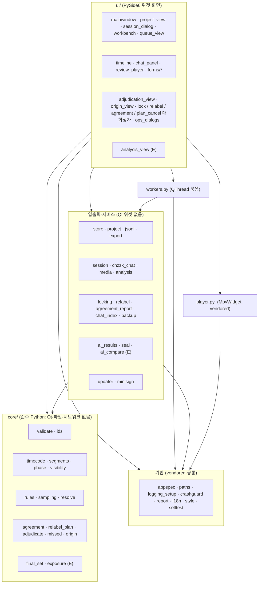
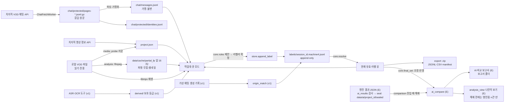
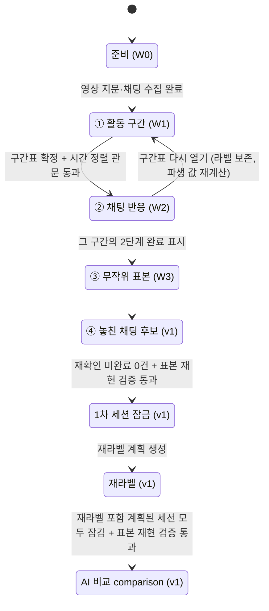
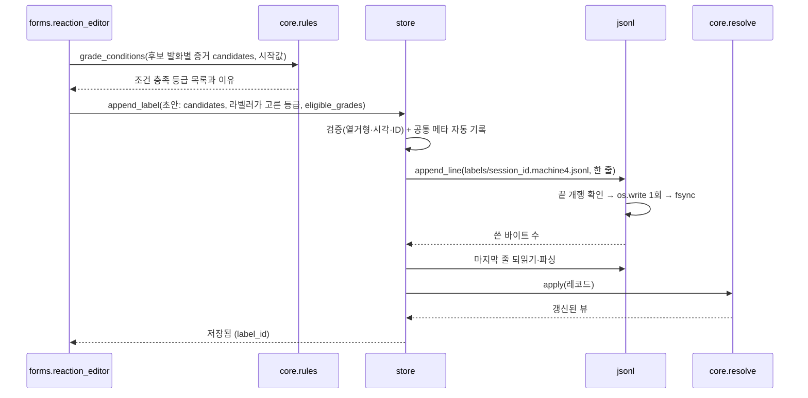

# ChatCoach 아키텍처 (02)

상태: 설계 초안 (2026-10-19). 2026-10-22 에 C단계 마감 코드와 맞추고 E 첫 묶음 자리를 더했다 (16 5-2 1·2번, D-15 7). '계획 (파일 없음)'·'E (만드는 중)' 표시가 없는 모듈은 구현돼 있다.

이 문서는 선정된 설계안(각도 A 「ClipSlicer 재사용 최우선」)을 확정 문서로 정리한 것이다. 스택, 모듈, 폴더, 데이터 흐름, 화면, 스레드, 성능 목표, 테스트, ClipSlicer 에서 가져오는 것을 다룬다.

다른 문서가 다루는 것은 여기서 다시 쓰지 않고 링크한다.

| 주제 | 문서 |
|---|---|
| 안내서 분석, 제품 아이디어, 우선순위 | [01-analysis-and-ideas.md](01-analysis-and-ideas.md) |
| 엔터티, 필드, 저장 형식, 버전, 병합 규칙 | [03-data-model.md](03-data-model.md), [../../schemas/](../../schemas/) |
| 릴리스 파이프라인, 업데이터 흐름, 서명 | [04-update-and-release.md](04-update-and-release.md) |
| 위협 모델, 보안 발견 항목(S-xx), 개인정보 | [05-security.md](05-security.md) |
| 일치도, AI 비교 지표, 표본 추출 | [06-evaluation-and-agreement.md](06-evaluation-and-agreement.md) |
| 단계별 일정, 열린 질문 전체 | [07-roadmap.md](07-roadmap.md) |
| 안내서 개정안 | [../labeling-guide/v0.2-draft.md](../labeling-guide/v0.2-draft.md) |

표기:

- `<앱>` = 포터블 폴더. `ChatCoach.exe` 가 있는 폴더다.
- `<프로젝트>` = 방송 한 편의 프로젝트 폴더.
- 'MVP' = 시범 라벨링을 돌릴 수 있는 첫 묶음(W0~W3 + 내보내기 + 업데이트). 'v1' = 그 뒤 현업 전체 흐름. 범위 정의는 [07-roadmap.md](07-roadmap.md).
- 숫자 목표는 모두 시작값이다. 첫 빌드와 시범 라벨링에서 재고 고친다.

---

## 0. 한 화면 요약

| 결정 | 내용 | 이유 (한 줄) |
|---|---|---|
| 언어·UI | Python 3.12 + PySide6 6.12.0 (Core·Gui·Widgets·Svg 만) | ClipSlicer 코드·테스트·사고 대응 지식을 그대로 쓴다 |
| 영상 | python-mpv 1.0.8 + libmpv-2.dll | 프레임 이동·A-B 반복·정확 탐색이 이미 검증됨 |
| 분석 | ffmpeg/ffprobe 번들 (파형·무음·썸네일·probe 전용) | 기존 함수 5개를 떼어 쓴다. 영상은 절대 바꾸지 않는다 |
| 진실 원본 | `project.json` + 세션별 append-only JSONL | OneDrive·병합·'라벨은 지우지 않는다'(안내서 0장)에 맞는다 |
| 재생성 가능한 것 | `<앱>\data\cache\` 에 둔다. 프로젝트 폴더에 두지 않는다 | 공유·동기화 대상을 원본만으로 줄인다 |
| 층 구조 | `core/`(순수 함수) ← 입출력 ← 워커 ← `ui/` | 규칙·표본·체인 해소를 Qt 없이 테스트한다 |
| 쓰기 통로 | 라벨 파일에 쓰는 코드는 `store` 하나, UI 스레드에서만 | '저장됐다' 표시가 거짓말이 되지 않게 |
| 보이는 것 | `core/visibility.py` 의 정책 함수 하나가 결정 | 블라인드가 화면 곳곳에 흩어지면 새는 곳이 생긴다 |
| 시각 | 라벨은 채팅 시계(ms) 하나로 저장, 영상과의 차는 보정 기록으로 분리 | 오프셋을 다시 재도 라벨을 고치지 않는다 |
| 업데이트 | ClipSlicer 업데이터를 복사해 고친다(robocopy 교체). '준비'와 '적용'을 나눈다 | 사고로 다져진 코드를 쓰고, 나중에 버전 폴더 방식으로 바꿀 길을 열어 둔다 |
| 설치 위치 권장 | `%LOCALAPPDATA%\Programs\ChatCoach` | OneDrive 밖, 사용자 전용 권한, 관리자 불필요 (S-08, S-09) |
| 범위 | MVP 밖 모듈은 파일도 만들지 않는다 | 범위 팽창이 가장 큰 위험이다 |

---

## 1. 스택 결정

### 1-1. 결정

| 영역 | 선택 (버전 고정) | 이유 |
|---|---|---|
| 언어 | Python 3.12 | ClipSlicer 와 같다. 1인 개발자가 두 스택을 유지하지 않는다 |
| GUI | PySide6 6.12.0. QtCore·QtGui·QtWidgets·QtSvg 만 | QtWebEngine 계열(설치 약 225MB)과 그 보조 프로세스를 뺀다 |
| 영상 재생 | python-mpv 1.0.8 + libmpv-2.dll (shinchiro 20261013) | `hr_seek`·`frame_back_step`·`ab-loop` 가 ClipSlicer 에서 검증됨 |
| 영상 분석 | ffmpeg/ffprobe n8.1.3 shared (BtbN autobuild-2026-10-12) | 파형·무음·썸네일·probe 만. 렌더링 코드는 가져오지 않는다 |
| 저장 | JSON + JSONL (UTF-8, BOM 없음, `\n`) | 텍스트·줄 단위라 병합·복구·diff 가 쉽다. SQLite 는 v1 에 '버릴 수 있는 색인'으로만 |
| 패키징 | PyInstaller 6.20.0 onedir, `upx=False` | 폴더가 곧 배포물. UPX 는 환경에 따라 결과가 달라지고 오탐 변수다 (S-17) |
| 업데이트 | GitHub Releases + 복사해 고친 updater | 상세는 [04-update-and-release.md](04-update-and-release.md) |
| 테스트 | pytest 9.1.1, `--selftest`, GitHub Actions windows-latest | ClipSlicer 와 같은 틀 |
| 넣지 않는 것 | yt-dlp, QtWebEngine, 로컬 HTTP 서버·브라우저 확장, 유튜브·디스코드, 전역 핫키, 영상 자르기·렌더링, pickle 캐시, 영상 옆 사이드카 파일 | 라벨링에 필요 없고, 크기·공격면·업데이트 사고 원인만 늘린다 |

### 1-2. 세 후보 비교

| 항목 | A: ClipSlicer 재사용 (선정) | B: .NET 10 + WPF | C: 이벤트 로그 원본 |
|---|---|---|---|
| 언어·UI | Python + PySide6 | C# + WPF + libmpv P/Invoke | Python + PySide6 |
| 진실 원본 | `project.json` + 세션별 JSONL | SQLite append-only (트리거로 수정 금지) | 해시 체인 이벤트 로그 + reducer, SQLite 는 파생 |
| 업데이트 | robocopy 교체 (수정 7건) | 버전 폴더 + 포인터 + NativeAOT 런처 | PyInstaller 런처 + 버전 폴더 (v1 에) |
| 서명 | v1 예정 → 이 문서 세트에서 M0(v0.0.1)로 앞당김 (13-3, [04](04-update-and-release.md) 0장) | MVP 부터 ECDSA 매니페스트 | v1, minisign |
| ClipSlicer 재사용 | 높음 (약 1,300줄 그대로) | 0 (지식만) | 약 30% |
| MVP 까지 | 11~14 작업일 (추정) | 4.5~6.5개월 (추정, 학습 포함) | 7~10주 (추정) |
| 설치 크기 | 약 420MB, 경량 zip 약 40MB (추정) | 280~300MB (ffmpeg 를 Media Foundation 으로 대체할 때) | 약 400MB (제안서의 220~280MB 는 자체 모순) |
| 가장 큰 약점 | robocopy 교체의 구조적 한계, 타임라인 재작성, 저장소 로드 로직 | 스택 전환 비용, 재사용 0, 두 스택 유지 | 이벤트 소싱 복잡도(코드 2~3배), 자동 업데이트가 v1 |

### 1-3. 심사 점수

심사는 관점이 다른 세 명이 0~100점으로 매겼다.

| 심사 관점 | A | B | C | 그 관점의 1위 |
|---|---|---|---|---|
| ① 가장 빠른 시범 시작 + 1년 뒤 혼자 유지보수 | 86 | 32 | 70 | A |
| ② 라벨러 피로·실수 (조작·화면) | 78 | 57 | 68 | A |
| ③ 업데이트·보안·개인정보 | 60 | 81 | 67 | B |
| 합계 | **224** | 170 | 205 | A |

A 는 ③ 에서 가장 낮았다. 그래서 이 문서는 B·C 의 보안·견고성 아이디어를 A 위에 얹었다. 무엇을 가져왔는지는 [13장](#13-접목한-아이디어와-우려에-대한-답)에 있다.

### 1-4. 이 결정을 다시 볼 조건

| 조건 | 다시 볼 것 |
|---|---|
| 외부 라벨러 PC 에서 PowerShell 실행 정책·AMSI 로 업데이트가 실제로 막힌 사례가 1건 이상 | 업데이트 적용 방식을 '버전 폴더 + 포인터'로 바꾼다 (5-6, [04](04-update-and-release.md)) |
| 라벨러가 10명 이상, 또는 외부 업체 | 위와 같음 + 코드 서명 |
| 첫 빌드 설치 크기가 600MB 를 넘음 | ffmpeg 를 빼고 파형·무음을 다른 수단으로 옮긴다 |
| 채팅 20만 건에서 9장 성능 목표를 못 맞춤 | 채팅 색인만 SQLite(FTS5)로 앞당긴다 (위치는 `<앱>\data\cache\`) |

---

## 2. 아키텍처 원칙

| # | 원칙 | 왜 |
|---|---|---|
| 1 | 진실 원본은 프로젝트 폴더의 텍스트 파일이다. 나머지는 다시 만들 수 있어야 한다 | 깨지면 다시 만들고, 사람이 열어 볼 수 있다 |
| 2 | `core/` 는 PySide6·파일·네트워크를 import 하지 않는다 | 안내서 규칙이 바뀌면 `core/` 와 시작값 파일만 바뀐다. 테스트가 빠르다 |
| 3 | 앱 고유 값(이름·저장소·exe·자산 접두사·보존 폴더·공개키)은 `app/appspec.py` 한 곳 | ClipSlicer 의 `USER_FILES`(Python) 와 `$keepFiles`(PowerShell) 처럼 두 곳의 진실이 생기지 않게 |
| 4 | 라벨 파일에 쓰는 코드는 `store` 하나뿐이다 | 쓰는 곳이 하나여야 메타 자동 기록·검증·되읽기를 빠짐없이 할 수 있다 |
| 5 | 무엇을 보여 줄지는 `core/visibility.py` 가 정한다. UI 는 묻기만 한다 | 블라인드(안내서 원칙 3)가 필터 누락 한 곳으로 깨지지 않게 |
| 6 | 저장하는 시각은 채팅 시계 하나다 | 시계가 둘이면 어느 쪽이 틀렸는지 나중에 알 수 없다 |
| 7 | 바깥에서 들어온 것(API 응답, 받은 패키지, 손으로 고친 JSON, 경로)은 검증한 뒤 쓴다 | 정답 데이터가 조용히 틀어지는 길을 막는다 ([05](05-security.md)) |
| 8 | 영상 파일은 읽기만 한다. 영상 옆에 파일을 만들지 않는다 | 정답의 원본이 바뀌면 안 된다. 영상이 읽기 전용 위치에 있을 수 있다 |
| 9 | MVP 밖 모듈은 저장소에 파일도 만들지 않는다 | 빈 파일이 범위를 끌어당긴다 |

---

## 3. 모듈 구성

### 3-1. 층과 의존 방향

화살표는 'import 한다' 방향이다. 거꾸로 가는 import 는 금지하고 테스트로 막는다(`tests/test_layers.py`).



| 층 | 들어가는 것 | 지켜야 할 것 |
|---|---|---|
| 기반 | 앱 고유 값, 경로, 로그, 충돌 기록, 문제 보고, 다크 테마, 자체 점검 | ClipSlicer 와 같은 파일 이름·자리에 둔다(역이식 diff 를 작게) |
| core | 열거형·표시명, 시작값, 검증, ID, 시각 변환, 구간 모델, 단계 규칙, 가시성, 등급 조건 충족 계산, 표본, 체인 해소 | 인자로 받은 값만 계산한다. 파일을 열지 않는다. 시각·난수도 인자로 받는다 |
| 입출력 | 프로젝트 폴더 읽기·쓰기, 채팅 수집, 영상 지문, ffmpeg 호출, 업데이트 | Qt 위젯을 import 하지 않는다. 오래 걸리는 함수는 취소 콜백을 받는다 |
| 워커 | 입출력 함수를 QThread 로 감싼다 | 라벨 파일에 쓰지 않는다 (8장) |
| ui | 화면, 단축키, 폼 | 코드 값(영어 식별자)과 선택지는 core 모듈의 상수에서 가져온다. 표시명은 지금 각 core 모듈(`phase.MODE_LABELS`, `adjudicate.DECISION_KO`·`CAUSE_KO`, `origin.ORIGIN_KO`·`METHOD_KO`, `missed.REASON_NAMES` 등)과 일부 ui 파일(분류 이름이 `forms/segment_form.py`·`timeline.py`·`adjudication_view.py`·`agreement_report.py` 에 따로 있음)에 있다. 한곳에 모으는 `core/schema.py` 는 두지 않기로 했다(D-12 2). 같은 값이 여러 파일에 있으면 그 기능의 시험이 맞춰 본다 (D-13 2, 14 4-2 12번) |

### 3-2. 모듈 표

'단계' 열: MVP = 첫 묶음에서 만든다. C단계 = C단계 묶음에서 만들었다(괄호는 근거 결정). **계획 (파일 없음)** = 설계에는 있으나 아직 파일이 없다 — 지금 그 책임을 맡은 곳을 '책임' 칸에 적었다. v1 = 그때 만든다(지금은 파일 없음).
이 표는 2026-10-21 의 실제 `app/` 파일 목록과 맞췄다(D-13 2, 14 4-2 12번). 2026-10-22 에 C 마무리(M4)의 `backup.py`·`ui/ops_dialogs.py` 를 '있음' 으로 고치고, **E 첫 묶음**의 새 파일 6개 자리를 더했다 — '단계' 칸이 **E (만드는 중)** 인 행은 책임·경계만 정한 것이고, 함수 이름은 그 묶음 보고에서 맞춘다 (D-15 7·8, 16 8-1). 파일이 생기거나 없어지면 이 표와 4장 트리를 같이 고친다.

| 모듈 | 책임 | 의존 | 기술 | 단계 |
|---|---|---|---|---|
| `app/appspec.py` | 앱 고유 값의 단일 출처: `name`, `repo`, `exe_name`, `asset_prefix`, `keep_dirs=("data","_backup","_update")`, `heavy_files`, `user_agent`, 업데이트 공개키 2개, 지원 `schema_version` 범위 | 없음 | frozen dataclass. `build.ps1`·`release.ps1` 은 `python -c` 로 읽는다 | MVP |
| `app/paths.py` | 설치 루트·코드 폴더·데이터 폴더 판정, 도구 찾기, libmpv 준비, 설정 파일 | appspec | stdlib, QSettings(IniFormat). 5-5 의 판정 규칙 | MVP |
| `app/logging_setup.py` | 회전 로그, 예외 훅, 백그라운드 예외를 대화상자로, 개인정보 가림 필터 | paths | logging, Signal | MVP |
| `app/crashguard.py` | `faulthandler` 를 `crash.log` 에, 실행 중 표식(`data\run\<pid>.running`), 이전 비정상 종료 감지 | paths | stdlib (S-31) | MVP |
| `app/report.py` | 문제 보고 문자열 (버전·OS·최근 로그, 비밀·닉네임·경로 가림) | logging_setup | stdlib (S-20) | MVP |
| `app/i18n.py` | `tr()` 껍데기. 사전 없음 | 없음 | — | MVP |
| `app/style.py` | Fusion + 다크 팔레트 + QSS | — | QSS | MVP |
| `app/selftest.py` | `--selftest <json> [--expect-version X] [--data-dir D]` 창 없이 점검 (11-3) | 거의 전부 | JSON + 종료 코드 | MVP |
| `app/player.py` | libmpv 임베드 위젯(재생·탐색·프레임 이동·A-B 반복·속도·음량) | paths | python-mpv. 옵션 한 곳만 수정 (12장) | MVP |
| `app/minisign.py` | 업데이트 매니페스트 minisign(Ed25519) 서명 검증. 서명·키 생성은 하지 않음(`tools/sign_manifest.py`) | 없음 | 표준 라이브러리만 (04 5장·9장) | MVP |
| ~~`app/core/schema.py`~~ | **두지 않는다**(D-12 2, 13 4-2 3번). 열거형은 값을 쓰는 core 모듈(`segments.CATEGORIES`, `rules.GRADES`, `agreement.GRADE_SCALE`, `origin`·`missed`·`adjudicate` 의 상수)에, 표시명은 그 모듈과 일부 ui 파일에 있다(3-1 표 ui 행). 스키마 enum 과의 일치는 각 기능 시험이 본다([03](03-data-model.md) 19장) | — | — | 두지 않음 (D-12 2, D-13 2) |
| `app/core/thresholds.py` | (계획) 시작값 로드·범위 검증·정규화 해시. 지금은 `app/project.py` 가 기준서 묶음을 읽고 `thresholds_sha256` 을 계산하며, 각 core 모듈이 자기 값을 읽는다(`segments.thresholds_from_guide`, `missed.thresholds_from_guide`, `rules.RuleConfig`) | validate | `assets/guide-config.v0.1.json` (스키마 `guide-config.schema.json`) | 계획 (파일 없음, D-13 2) |
| `app/core/validate.py` | 엄격 JSON 규칙(NaN·Infinity·중복 키 거부, 최상위 dict), `project.json` 손 검증(`PROJECT_SPEC`), 해시용 정규화 JSON(`canonical_json`) | 없음 | 손 검증기 (S-29). jsonschema 의존 없음 | MVP |
| `app/core/ids.py` | `chat_id` 값 기반 파생, `label_id`(uuid4), `session_id` 형식, 프로젝트 슬러그, 파일명용 ID 정규식 | 없음 | hashlib (S-14, S-46, S-49) | MVP |
| `app/core/timecode.py` | 채팅 시계 ↔ 영상 시각 변환, 시각 문자열 파싱·표시 (`parse_time` 등 ClipSlicer 차용) | schema | 정수 ms | MVP |
| `app/core/segments.py` | 활동 구간 모델: 마커 → 빈틈없는 구간, 경계 완충, 30초 미만 병합 제안, undo 200단계 | thresholds | ClipSlicer `segments.py` 개작 (Qt 없음) | MVP |
| `app/core/phase.py` | 단계 규칙: 어떤 구간에서 어떤 단계 라벨을 만들 수 있는가, 시간 정렬 관문. 작업대 모드 줄(`modes_for`): 1차·분석·보기 전용은 둘러보기·①~③, 재라벨(같은 사람·다른 사람)은 ①~④, 조정 세션은 둘러보기·조정, 출처 판정 세션은 둘러보기·출처 판정. ④ 단추는 재라벨 세션에만 있다(D-12 5). ③ 의 [표본 완료 표시] 는 1차에도 보인다(④ 를 여는 관문 `phase.mark(samples)`, 03 12-3) (D-13 1, 14 4-1 22번·4-2 12번) | — | 순수 함수 (6-2) | MVP (모드는 C단계, D-12 5) |
| `app/core/visibility.py` | `can_show(item, phase, session_kind)`, `files_to_open(session_kind, phase)` | schema | 순수 함수 표 | MVP (재라벨 분기는 v1) |
| `app/core/rules.py` | 등급 조건 충족 계산(등급을 미리 고르지 않음, [01](01-analysis-and-ideas.md) 3-1), 시간 창 판정, 이어짐 제안·절단, 완충 판정, 노출 추정 보조값 | thresholds | 순수 함수 | MVP |
| `app/core/sampling.py` | 표본 추출 (`sha256-tau-v2` 기본: 순서 키, 임계 키 τ 와 불감소, 전수 전환, `draw_no`·`sample_rev`, 분류가 바뀌는 경계에만 완충, 영상 밖 제외), 재현 검증 (옛 판 `sha256-tau-v1` 매니페스트도 v1 규칙으로 재현만 — D-11 5) | ids | 순수 함수. 규칙은 [06](06-evaluation-and-agreement.md) | MVP |
| `app/core/resolve.py` | 라벨 레코드 묶음 → '현재 유효 라벨' 뷰. supersedes 체인·철회·포크·순환·무효 참조 표시 | schema | 순수 함수, 골든 테스트 (S-10) | MVP |
| `app/core/agreement.py` | 세션 쌍 정렬과 일치도 계산 (구간 κ·핵심 일치율·경계 \|Δt\|, 반응 있음 이진 κ·등급 κ_w, 연결 F1·반응 시각 차, 이어짐 κ, 놓친 후보 κ·AC1·사유 코드 κ, 10분 블록 부트스트랩). 놓친 후보 짝 판정 `missed_pair_applicable`·거르기 `drop_missed_stale`(앞 판 `drop_missed_not_target` 은 하위 호환으로 둠, D-14 1, 15 5-1 16·17번). 출처는 계산하지 않고 `core.origin.compare_origins` 를 함수 안에서 늦게 import 해 보고서 모양으로만 바꾼다(순환 import 없음) | segments (origin·missed 는 함수 안에서 늦게) | 순수 Python (numpy 없음) | C단계 (D-12 1) |
| `app/core/relabel_plan.py` | 재라벨 계획 고르기 `sha256-relabel-v1`(블록 seed = `sample_seed\|relabel\|원 세션 ID`, τ_block), 재현 검증, 시작 관문(3일 간격). `plan_no` 는 기록용 순번이고 고르기에 쓰지 않는다. 1차 표본 목록(`sample_items`)은 계획에 넣지 않는다 | sampling, ids | 순수 함수 ([06](06-evaluation-and-agreement.md) 3장) | C단계 (D-12 1) |
| `app/core/adjudicate.py` | 조정: 잠긴 세션 짝마다 불일치 건(표본·구간) 모으기·합치기, 조정 기록 본문, 건 상태(`case_states` — 판 바뀜·`targets_changed`), 개정 후보(같은 `pattern_tag` 3건 이상), '조정자 = 라벨러' 머리 | agreement, segments | 순수 함수 ([03](03-data-model.md) 6-12) | C단계 (D-12 3·4) |
| `app/core/missed.py` | 놓친 채팅 후보(④): 대상 고르기(재라벨 블록 안 표본 중 미확인·관련성만·불명확), 조건 ① 다시 세기, ② 보조값, 사유 코드 제안·조건 맞춤 검사, `reason_code_source` | sampling, ids, timecode | 순수 함수 ([06](06-evaluation-and-agreement.md) 2-9·4-6) | C단계 (D-12 5) |
| `app/core/origin.py` | 출처 판정: 대상 파일 해석·만들기, 판정 본문 검사, 출처 일치도(3×3 혼동표·명목 κ, 사람끼리 κ). **출처 κ 는 이 모듈 하나**(`compare_origins`)가 계산한다 (D-13 2, 14 4-2 12번). 1차 표본으로 대상 만들기 `sample_target_chat_ids`·`build_sample_targets`, 같은 대상 찾기 `same_target_exists` (D-14 1, 15 5-1 4·5번) | agreement(`kappa_from_table`), ids | 순수 함수 ([06](06-evaluation-and-agreement.md) 4-7) | C단계 (D-12 6) |
| `app/locking.py` · `app/relabel.py` · `app/agreement_report.py` | 세션 잠금 파일 만들기·검사(풀기 없음). 계획 파일 입출력(재라벨 세션은 자기 계획만), 계획 색인 `relabel/index.json`(세션 화면은 색인으로 고른 라벨러 계획만 연다. 색인이 없거나 깨지면 그 자리에서 한 번 다시 만들고, 실패하면 재라벨 선택을 막는다), 계획 취소 `cancel_plan`. 일치도 보고서(잠금 확인 → 06 7-1 관문 → 계산 → 프로젝트 밖에 report.json·report.md). 여섯째 묶음에 더한 것(D-14 1, 15 1-2·1-4·5-1 25번): `locking.current_sample_doc`·`lock_current_sample`(재라벨 잠금의 `current_sample`), `relabel.create_second_plan`(조정 세션에서 `relabel_second` 계획 — 거부 범위는 [06](06-evaluation-and-agreement.md) 3-4), `relabel.done_ranges_of_view`(라벨을 마친 범위 — `store.done_ranges` 도 이것을 부름), `agreement_report.scan_chat_times`·`origin_target_summaries`, `make_report(chat_times=…, cancel_check=…)` | store, core | Qt 없음 | C단계 (D-12 1·2·7) |
| `app/ui/lock_dialog.py` · `relabel_dialog.py` · `agreement_dialog.py` | 잠그기 2단계 화면, 계획 만들기, 보고서 고르기·보기(출처 판정 세션끼리의 쌍도 고를 수 있고 종류가 섞인 쌍은 막음). `LockDialog` 는 `current_sample` 이 있을 때(재라벨)만 store 에 넘긴다 — 옛 서명의 가짜 store 를 깨지 않게 (D-14 1, 15 5-1 24번) | 위 입출력 | 메뉴 '세션'(`&N`)·'보고'(`&B`) | C단계 (D-12 1) |
| `app/ui/plan_cancel_dialog.py` | 재라벨 계획 취소(메뉴 '세션 → 재라벨 계획 취소…'). 조정 세션에서만 연다. 사유 필수, '되돌릴 수 없음' 체크. `relabel.cancel_plan` 을 부른다. **취소 길은 이 대화상자 하나다** — 조정 화면 아래 칸의 취소 칸은 1366x768 에서 잘려 지웠다 (D-14 1·2, 15 1-2 1번·5-2 17번) | relabel | — | C단계 (D-12 7) |
| `app/ui/adjudication_view.py` | 조정 화면: 잠긴 세션 고르기, 불일치 목록, 두 판정·확신도·근거 한 줄을 나란히, 결정·원인·태그 저장. 아래 칸: [출처 판정 대상 만들기](`core.origin.build_sample_targets` → `ProjectStore.write_origin_targets`), `relabel_second` 계획 만들기(1차 고르기·라벨러 ID·[계획 만들기], `ProjectStore.create_second_plan`). 배치는 7-3 '조정 화면 배치' | adjudicate, origin, store | 작업대 '조정' 모드 | C단계 (D-12 3·4, D-14 1) |
| `app/ui/origin_view.py` | 출처 판정 화면: 대상 채팅 한 건씩 실제·가상·판별 불가, '자동' 배지 받기 | origin, store | 작업대 '출처 판정' 모드 | C단계 (D-12 6) |
| `app/ui/session_dialog.py` | 세션 선택: 라벨러 명부, 세션 종류, 이어 하기, `reopen_note`, 재라벨 계획 고르기(색인으로 자기 계획만) | session, relabel | — | C단계 (D-09) |
| `app/chat_index.py` | 채팅 색인 캐시: messages.jsonl 을 한 번 읽어 chat_id → 시각·종류·type_code 병렬 배열을 만들고 `<앱>\data\cache\<project_id>\chat_index.bin` 에 둔다(`load_or_build`·`for_project`·`is_fresh`·`drop_cache`, 조회 `ChatIndex.get`·`chat_times`·`range_ids`). 형식·무효화는 [03](03-data-model.md) 7장. 작업대가 프로젝트를 열 때 워커로 만들고(`workbench.chat_index_for`), ④ 대상·보고서 `chat_times`·조정 `chat_info` 가 쓴다 | 없음(paths 는 늦게) | stdlib, Qt 없음, pickle 없음 | C단계 (14 6-1 의 2, D-14 1) |
| `app/jsonl.py` | JSONL 안전 읽기(BOM·잘린 마지막 줄·중간 깨짐)와 한 줄 append(끝 개행 확인 → `os.write` 1회 → `fsync`) | validate | stdlib (S-30) | MVP |
| `app/project.py` | 프로젝트 폴더 만들기·열기, `project.json` 저장(rev 비교 → 임시 파일 → `os.replace`), 기준서 묶음의 `thresholds_sha256` 계산. 프로젝트 쓰기 잠금(`open.lock`)은 잡지 않는다 | validate, ids, paths | stdlib (03 2-1·6-1·8-3) | MVP |
| `app/store.py` | 세션 기록 파일 쓰기의 유일한 통로. 열기(잠금은 `lock_factory` 로 주입·검증·로드), 라벨 append, 철회, `project.json` 저장 위임(`update_project`), 가시성에 따른 파일 선택, 세션 잠금(`lock_session`). 조정 세션만: 출처 판정 대상 파일 쓰기(`write_origin_targets`, 없을 때만·불변)·`relabel_second` 계획(`create_second_plan`) (D-14 1, 15 1-4) | project, core, jsonl, locking | 6-3 의 순서 | MVP |
| `app/export.py` | 내보내기 zip(JSONL·CSV·manifest), 허용 목록 방식, CSV 셀 보호 | store, resolve | csv(utf-8-sig) (S-27) | MVP (라벨러 패키지는 v1) |
| `app/backup.py` | 프로젝트 백업 zip(허용 목록, 안에 `manifest.json` — 파일마다 크기·SHA-256), 일 1회 백업(`daily_backup_if_due`, 프로젝트당 14개 순환)·수동 백업·업데이트/되돌리기 직전 백업(`pre_update_backup`, 5개)·세션 끝 기록 복사(`copy_session_file`), 되살리기(`restore_backup`, 새 폴더로만), 보존 기한(`retention_state`), 파기 계획·실행(`plan_disposal`·`execute_disposal`, 휴지통으로만 — 영구 삭제로 넘어가는 길 없음, `data\disposal_log.jsonl`). 순환은 일 1회 백업에만 한다(5-3) | paths, chat_index(파기 때 `drop_cache`) | zipfile, Qt 없음 (S-06, S-39, 05 10-3) | C 마무리 (M4, 16 1-3·5-2 1번) |
| `app/session.py` | 라벨러 선택, 세션 생성·종료, 프로젝트 잠금, 기계 ID, 열람 이벤트 기록. 잠긴 1차 다시 열기 막기 `reopen_refusal`(같은 사람 재라벨 대기 중, 또는 이 라벨러가 볼 계획 가운데 읽지 못한 것이 있을 때 — [03](03-data-model.md) 12-1, D-14 1) | store, phase | QLockFile 은 ui 쪽에서 주입 | MVP |
| `app/chzzk_chat.py` | 치지직 VOD 채팅 전량 수집, 원문 페이지 보존, 파싱·가명화 | ids, validate | urllib. ClipSlicer `chat.py` 의 재시도·커서 골격만 (S-28) | MVP |
| `app/media.py` | 영상 참조(경로·크기·부분 지문·파일 ID·ffprobe 메타), 재연결, 경로 문자열 검사 | analysis | stdlib (S-13, S-26) | MVP |
| `app/analysis.py` | ffprobe, 파형, 무음, 썸네일(파이프 출력), 프레임 1장 | paths | subprocess(bytes), timeout | MVP |
| `app/updater.py` | 확인(3상태) → 준비(다운로드·검증·해제·자체 점검) → 적용(Applier). 상세는 [04](04-update-and-release.md) | appspec, paths | urllib, zipfile, PowerShell 5.1 | MVP |
| `app/workers.py` | 업데이트 확인·준비 워커. 공통 작업 워커 `JobWorker`(여러 `Job` 을 차례로, 취소·진행·오류 시그널, `JobContext.check`·`progress`, `JobWorker.single`)와 재현 검증 워커 `SampleVerifyWorker`·`PlanVerifyWorker`. 잠그기 직전 표본 재현 검증(재라벨은 current_sample 계산)과 일치도 보고서를 UI 스레드 밖에서 돌린다 — 그동안 바쁨 표시와 [취소] (14 6-1 의 1, `MainWindow.run_job_modal`·`AgreementDialog.run`). 보고서는 계획 검증만이 아니라 **`make_report` 전체를 워커 하나로** 돌리고 `cancel_check` 로 멈춘다(나누면 `comparison_gate` 를 두 번 돈다, D-14 1, 15 5-1 15번). ChatFetch·ProjectLoad·Analyze·Backup 워커는 아직 없다(계획). 일 1회 백업은 워커가 아니라 `MainWindow.start_background_backups` 의 데몬 스레드 하나로 돈다(16 5-2 1번) | 입출력 | QThread (8장) | MVP |
| `app/ui/mainwindow.py` | 창 골격, 메뉴, 상태바, 화면 전환, 단축키 등록, 업데이트 연동. 워커 모달 실행 `run_job_modal`(8장), 프로젝트를 열 때 계획 색인 다시 만들기 `refresh_relabel_index`(내용이 같으면 쓰지 않음, D-14 1, 15 5-1 8번). 작업 중 세션 메뉴 끄기 `jobs_busy`·`update_session_actions`: `busy_jobs > 0` 이거나 작업대 워커가 돌면 [세션 잠그기]·[계획 만들기]·[일치도 보고서]·[계획 취소] 를 끈다. 라벨 기록을 쓰지 않는 배경 일 `BACKGROUND_JOBS`(파형·영상 확인·영상 참조·엔진·채팅 색인)는 셈에서 뺀다. 일 1회 백업·세션 끝 복사는 `main.py` 만 켠다(`start_background_backups`, `session_backup = True` — 시험·smoke 가 사용자 백업 폴더에 쓰지 않게). 업데이트·되돌리기 직전 백업은 늘 한다 (16 5-1 23·24번·5-2 2번) | ui 전부 | QMainWindow | MVP |
| `app/ui/project_view.py` | 최근 프로젝트, 열기(쓰기 잠금 확인) | store | 7-2 | MVP |
| `app/ui/new_project_wizard.py` | (계획) 새 프로젝트 5단계. 지금은 화면이 없고 `app/project.create` 와 도구로 만든다 | project, workers | 7-2 | 계획 (파일 없음, D-13 2) |
| `app/ui/calibration_dialog.py` | (계획) 시간 정렬(앵커 입력·오프셋 확정·건너뛰기 사유). 지금은 작업대가 `project.json` 의 `calibration` 을 읽어 쓰기만 한다 | timecode, store | 7-5 | 계획 (파일 없음, D-13 2) |
| `app/ui/workbench.py` | 작업대: 플레이어 + 타임라인 + 오른쪽 작업 칸 | ui 부품 | 7-3 | MVP |
| `app/ui/queue_view.py` | 큐 모드: 표본 한 건씩 판정 | sampling, forms | 7-4 | MVP |
| `app/ui/review_player.py` | 7-2 확인 범위 반복, 속도 프리셋, 프레임 번호(가변 프레임이면 끔), 들은 범위 기록, 화면 위 문구(OSD) | player, timecode | 7-3 | MVP |
| `app/ui/timeline.py` | 여러 트랙 타임라인. 마커 부분 갱신 `add_marker`·`remove_marker`·`update_marker`(7-3 '타임라인 그림') | core.segments | QPainter. 재작성 (12장) | MVP (부분 갱신은 C단계, D-14 1) |
| `app/ui/chat_panel.py` | 수십만 건 채팅 표 | store 뷰 | Model/View (9장) | MVP |
| `app/ui/shortcuts.py` | (계획) 단축키 표와 포커스 규칙. 지금은 작업대·큐 모드·출처 판정 화면이 각자 `QShortcut` 을 단다 | — | 7-6 | 계획 (파일 없음, D-13 2) |
| `app/ui/forms/segment_form.py` · `reaction_editor.py` · `continuation_editor.py` · `evidence_widget.py` | 단계별 입력 | rules, timecode, visibility | 7-3 | MVP |
| `app/ui/forms/missed_form.py` | ④ 놓친 채팅 후보 폼(조건 ① 은 보이기만, ②③④·점검 질문·사유 코드·확신도·근거) | missed | 작업대 ④ 모드 | C단계 (D-12 5) |
| `app/ui/update_dialog.py` | 새 버전 대화상자 | updater | ClipSlicer `UpdateDialog` 개작 (S-18) | MVP |
| `app/ui/ops_dialogs.py` | 운영 대화상자: 프로젝트 백업(보호 포함 고르기·위치 검사)·백업에서 되살리기·프로젝트 지우기(휴지통, 대상 목록·경고를 먼저 보이고 확인). 판정·실행은 `backup` 이 한다. 화면에는 경로를 보여도 로그에는 쓰지 않는다(S-20) | backup | 메뉴 '파일' | C 마무리 (M4, 16 1-3·5-2 1번) |
| `app/ui/settings_dialog.py` | (계획) 설정, 시작값 보기. 라벨러 명부는 지금 세션 선택 화면(`session_dialog`)의 [새 라벨러…] 로 관리한다 | project | — | 계획 (파일 없음, D-13 2) |
| `app/ai_results.py` | **엔진 결과 가져오기**: 엔진 출력 파일을 `ai-result` 형식으로 받고 [06](06-evaluation-and-agreement.md) 6-2 검사(거부·경고·표시만)를 돌린다. 결과는 '유효 / 거부 사유' 만 돌려주고 내용을 화면·로그에 내지 않는다. **4단계 등급만** 받는다 — `grade_scheme` 은 엔진 형식이 정해질 때 더한다(D-15 7). `engine/link.py` 의 `schema_version` 2 초안은 `to_v1()` 로 맞춘 v1 만 받는다(06 6-1) | core.validate, ids | Qt 없음 | E (만드는 중, D-15 7, 16 8-1 1번) |
| `app/seal.py` | **AI 결과 봉인·해제**: 받은 바이트를 `<앱>\data\ai\<project_id>\sealed\<sha256>.bin` 에 두고 `seal.jsonl` 에 `ai.sealed`(해시·크기·시각·검사 결과만)를 남긴다. 해제는 06 7-1 조건(계획된 재라벨까지 모두 잠김 + 재현 검증 통과)이면 `ai.unsealed`(그 시점 잠금 해시 목록)를 남기고 `runs\<run_id>.json` 으로 푼다. 사전 봉인 여부는 기록과 잠금 시각에서 계산한다([03](03-data-model.md) 6-14 'AI 봉인 기록'). **봉인·해제 기록은 `ai/` 쪽 파일이고 label-event 스키마를 바꾸지 않는다**(D-15 7). 해제 전에 내보내는 것은 '봉인됨 n건' 뿐이다 | ai_results, locking, relabel | Qt 없음 | E (만드는 중, D-15 7·8, 16 8-1 2·3번) |
| `app/ai_compare.py` | **AI 비교 보고서**: 해제된 run 만 읽는다. 06 6-3 매칭, 6-4 평가 집합(E1·E2·E3), 6-5 엄격·참고 점수, 6-6 제외 계단표. 보고서 폴더(06 6-7)에 `report.json`·`report.md`·`tables/*.csv`(UTF-8 BOM, 셀 보호)·`manifest.json`. 채팅 본문·닉네임·근거 한 줄은 넣지 않는다 | seal, core.final_set, core.exposure, agreement_report(관문) | Qt 없음 | E (만드는 중, 16 8-1 6번) |
| `app/core/final_set.py` | **최종 세트**: 잠긴 세션의 유효 라벨에 조정 기록을 덮는다 — `adjudicate.case_states` 를 열쇠로 원 라벨을 조정 값으로 바꾸고 `exclude_from_eval` 은 뺀다(06 6-6 의 `adjudicated_exclude`). 조정 값이 없는 재라벨 불일치는 `human_disagreement`. 내보내기·AI 비교·나란히 보기가 같은 함수를 쓴다 | resolve, adjudicate | 순수 함수 (파일·시계 없음) | E (만드는 중, D-13 2, 16 8-1 4번) |
| `app/core/exposure.py` | **AI 노출 판정**: 계획 취소 시각 `cancelled_at`·봉인 조기 해제 시각과 세션 생성 시각을 견줘, 그 뒤에 만든 세션에 `view.exposed(what = ai_results)` 가 필요한지와 `view_exposed` 로 뺄 세션을 정한다. 시각은 인자로 받는다. 기록을 쓰는 것은 store 다(기존 `view.exposed` 기록 종류 — 스키마는 그대로, D-15 7) | — | 순수 함수 | E (만드는 중, D-13 2, 16 8-1 7번) |
| `app/ui/analysis_view.py` | **나란히 보기 (방송 분석 모드)**: 해제된 엔진 판정과 최종 세트만 읽는다. 타임라인 위아래 두 트랙(엔진 / 최종 세트), 채팅마다 같음·다름·놓침 표시, 다른 곳으로 건너뛰기. **해제 전에는 열지 않고 '봉인됨(n건)' 만 보인다**(D-15 7). 분석 세션을 연 라벨러는 D-14 3 대로 노출 표시. 블라인드 시험: 라벨링·재라벨 세션은 이 화면과 `data\ai\`·`data\reports\` 를 열지 않는다(06 7-3) | seal, ai_compare, core.final_set, timeline | 작업대 부품 재사용 | E (만드는 중, D-14 8, D-15 7, 16 8-1 5·8번) |
| `compare_view` · `origin_match` | 사람끼리 비교 화면(06 4-9 첫 장), 가상 채팅 생성 기록 대조기. (옛 `missed_view` 는 `forms/missed_form.py`, `relabel_view` 는 `relabel_dialog.py`·`session_dialog.py`, `origin_view` 는 `ui/origin_view.py` 로 만들었고, `ai_compare` 는 E 의 `app/ai_compare.py` 로 옮겼다, D-15 7) | — | — | v1 (`origin_match` 는 H 와 같이) |

### 3-3. 모듈 사이의 계약

이름과 모양만 고정한다. 필드 정의는 [03-data-model.md](03-data-model.md).

```python
# app/core/rules.py
def grade_conditions(candidates: Sequence[CandidateEvidence], cfg: ThresholdConfig) -> GradeConditions: ...
#   candidates = 반응 라벨의 candidates[] (후보 발화마다 발화 시각·전사·증거 7항목. 07 ADR-21). 비면 '반응 미확인'
#   GradeConditions = (eligible_grades: list[grade], result: "graded" | "unconfirmed", reasons: list[str])  — 채팅 단위
#   등급을 고르지 않는다. 고른 등급과의 관계(grade_vs_conditions)는 store 가 저장 때 계산 (03 6-7)

# app/core/resolve.py
def resolve(records: Iterable[LabelRecord]) -> EffectiveView: ...
#   EffectiveView: effective(label_id) / history(label_id) / problems: invalid_ref, cycle, fork

# app/core/visibility.py
def can_show(item: ItemKind, phase: Phase, session_kind: SessionKind) -> bool: ...
def files_to_open(session_kind: SessionKind, phase: Phase) -> FileScope: ...

# app/core/timecode.py
def video_to_chat_ms(video_ms: int, cal: Calibration) -> int: ...
def chat_to_video_ms(chat_ms: int, cal: Calibration) -> int: ...

# app/core/sampling.py
def sort_key(seed_material: str, chat_id: str) -> str: ...   # sha256("{sample_seed}|{draw_no}|{chat_id}") 소문자 hex
def draw(eligible_chat_ids: Sequence[str], seed_material: str, n: int, census_max: int, prev_tau_key: str | None = None) -> SampleDraw: ...
#   eligible = 구간 안 일반 채팅에서 경계 완충·후원·시스템을 뺀 것. 호출하는 쪽이 현재 구간표로 만든다 (06 2-2)
#   SampleDraw = (tau_key, census, items: key ≤ τ 인 chat_id). τ = max(prev_tau_key, 적격 중 n번째 key) — 내려가지 않음 (06 2-3·2-6).
#   적격이 census_max(시작값 sample.census_max) 이하면 전수(census=True, items = 적격 전체) (03 15-1)

# app/store.py
class ProjectStore:
    @classmethod
    def open(cls, path: str, session: SessionContext) -> "ProjectStore": ...  # 잠금·검증·로드
    def append_label(self, draft: LabelDraft) -> LabelRecord: ...           # 메타 채움 → append → 되읽기 → 뷰 갱신
    def retract_last(self) -> LabelRecord: ...                              # 기록 층 되돌리기: 이 PC 의 마지막 라벨 줄 하나(새 대상 → retract(undo), 고친 판 → 앞 판 body 로 새 판). 화면의 ②·③ Ctrl+Z 는 이것이 아니라 작업대가 반응 저장 한 번을 통째로 되돌린다(7-6, D-10 9, D-12 2)
    def update_project(self, mutate: Callable[[dict], None]) -> None: ...   # rev 비교 후 저장

# app/updater.py
def check(spec: AppSpec) -> CheckResult: ...          # state: "newer" | "latest" | "failed"
def stage(release: Release, spec: AppSpec) -> StagedUpdate: ...   # 다운로드·검증·해제·--selftest 관문
class Applier(Protocol):
    def apply(self, staged: StagedUpdate) -> NoReturn: ...
    def rollback(self) -> NoReturn: ...
class RobocopyApplier: ...   # MVP. v1 에 PointerApplier 를 같은 자리에 꽂을 수 있게
```

---

## 4. 저장소 폴더 트리

`⟵` = ClipSlicer 에서 복사(vendored). `⟵*` = 복사 후 수정. 무엇을 바꾸는지는 [12장](#12-clipslicer-에서-가져오는-것). `(v1)` = 지금은 만들지 않는다.

```
chatcoach/                              공개 저장소 vtubeadmirer/chatcoach
├─ VERSION                                  유일한 버전 소스. tools/sync_version.py 가 아래 두 파일을 생성
├─ main.py                                  ⟵* 시작 순서 (6-5)
├─ app/
│  ├─ __init__.py                           __version__ (sync_version.py 가 VERSION 에서 생성. 손으로 고치지 않음)
│  ├─ appspec.py
│  ├─ paths.py                              ⟵*
│  ├─ logging_setup.py                      ⟵*
│  ├─ crashguard.py
│  ├─ report.py                             ⟵*
│  ├─ i18n.py                               ⟵* (tr 껍데기)
│  ├─ style.py                              ⟵
│  ├─ selftest.py                           ⟵* (골격 유지, 점검 항목 교체)
│  ├─ player.py                             ⟵* (생성 옵션 한 곳)
│  ├─ updater.py                            ⟵* (수정 7건 + 준비/적용 분리)
│  ├─ minisign.py                           업데이트 서명 검증 (표준 라이브러리 Ed25519)
│  ├─ jsonl.py
│  ├─ chat_index.py                         (C단계, D-14 1 — 채팅 색인 캐시, 03 7장)
│  ├─ project.py                            project.json 만들기·열기·저장
│  ├─ store.py
│  ├─ export.py
│  ├─ backup.py                             (C 마무리 M4 — 백업·되살리기·보존·파기, 16 5-2 1번)
│  ├─ session.py
│  ├─ locking.py                            (C단계, D-12 1)
│  ├─ relabel.py                            (C단계, D-12 1·2·7 — 계획·색인·취소)
│  ├─ agreement_report.py                   (C단계, D-12 1)
│  ├─ ai_results.py                         (E 만드는 중 — 엔진 결과 가져오기·06 6-2 검사, D-15 7)
│  ├─ seal.py                               (E 만드는 중 — 봉인·해제, data\ai\, D-15 7·8)
│  ├─ ai_compare.py                         (E 만드는 중 — AI 비교 보고서, 06 6장)
│  ├─ chzzk_chat.py
│  ├─ media.py
│  ├─ analysis.py                           ffmpeg_tools.py 의 5함수 개작
│  ├─ workers.py
│  ├─ core/
│  │  ├─ __init__.py
│  │  ├─ thresholds.py                      (계획 — 파일 없음, D-13 2)
│  │  ├─ validate.py
│  │  ├─ ids.py
│  │  ├─ timecode.py
│  │  ├─ segments.py                        segments.py 개작
│  │  ├─ phase.py
│  │  ├─ visibility.py
│  │  ├─ rules.py
│  │  ├─ sampling.py
│  │  ├─ resolve.py
│  │  ├─ relabel_plan.py                    (C단계, D-12 1)
│  │  ├─ agreement.py                       (C단계, D-12 1)
│  │  ├─ adjudicate.py                      (C단계, D-12 3·4)
│  │  ├─ missed.py                          (C단계, D-12 5)
│  │  ├─ origin.py                          (C단계, D-12 6 — 출처 κ 는 여기 하나)
│  │  ├─ final_set.py                       (E 만드는 중 — 조정 반영 최종 세트, D-13 2)
│  │  └─ exposure.py                        (E 만드는 중 — AI 노출 판정, D-13 2·D-15 7)
│  └─ ui/
│     ├─ __init__.py
│     ├─ mainwindow.py
│     ├─ project_view.py
│     ├─ session_dialog.py                  (C단계, D-09)
│     ├─ new_project_wizard.py              (계획 — 파일 없음, D-13 2)
│     ├─ calibration_dialog.py              (계획 — 파일 없음, D-13 2)
│     ├─ workbench.py
│     ├─ queue_view.py
│     ├─ review_player.py
│     ├─ timeline.py                        timeline.py 의 좌표·확대·눈금·자석만 유지하고 재작성
│     ├─ chat_panel.py
│     ├─ lock_dialog.py · relabel_dialog.py · agreement_dialog.py   (C단계, D-12 1)
│     ├─ plan_cancel_dialog.py              (C단계, D-12 7)
│     ├─ adjudication_view.py               (C단계, D-12 3·4)
│     ├─ origin_view.py                     (C단계, D-12 6)
│     ├─ analysis_view.py                   (E 만드는 중 — 나란히 보기, 해제 전에는 '봉인됨 n건' 만, D-15 7)
│     ├─ ops_dialogs.py                     (C 마무리 M4 — 백업·되살리기·지우기 대화상자, 16 5-2 1번)
│     ├─ shortcuts.py                       (계획 — 파일 없음, D-13 2)
│     ├─ update_dialog.py                   ⟵* dialogs.UpdateDialog
│     ├─ settings_dialog.py                 (계획 — 파일 없음, D-13 2)
│     └─ forms/
│        ├─ segment_form.py
│        ├─ reaction_editor.py
│        ├─ continuation_editor.py
│        ├─ evidence_widget.py
│        └─ missed_form.py                  (C단계, D-12 5)
├─ assets/
│  ├─ ChatCoach.manifest                ⟵* (version 은 sync_version.py 가 VERSION 에서 생성)
│  ├─ icon.ico · icon.png                   tools/make_icon.py 로 생성
│  └─ guide-config.v0.1.json                안내서 v0.1 시작값 전부 (기준서 버전마다 파일 하나, 릴리스 뒤 불변)
├─ schemas/                                 JSON 스키마. 목록과 정의는 03 19장
│  ├─ project · chat-message · label-event · guide-config · sample-manifest · ai-result · export-row (.schema.json)
│  ├─ relabel-plan · session-lock (.schema.json)   (C단계)
│  └─ update_manifest.schema.json           latest.json 형식 (04 5-2). 다른 스키마는 하이픈 이름 — 맞출지 확인 필요 (16 5-2 1번: 있음)
│     label-event 는 시범 고정판이다 — E 는 바꾸지 않는다. tests/test_label_format_frozen.py · tools/pilot_freeze.py --check (D-14 7, D-15 7)
├─ docs/
│  ├─ labeling-guide/v0.1.md · v0.1-review.md · v0.2-draft.md
│  ├─ design/01~07-*.md (설계) · 08 (결정) · 09~16 (진행 보고)
│  ├─ measurements/                         엔진·STT 측정 기록
│  ├─ release-notes/vX.Y.Z.md               릴리스마다 한 파일. Release 본문·latest.json notes_ko 의 단일 출처 (04 4-3)
│  └─ install.md                            설치 안내 (M4 에서 씀 — 공개키·수동 업데이트·메뉴 이름, 16 5-2 1번). 들어갈 항목은 5-1
├─ tests/
│  ├─ conftest.py                           ⟵
│  ├─ test_layers.py                        core 가 PySide6·io 를 import 하지 않는지
│  ├─ test_schema_validate.py
│  ├─ test_ids.py                           chat_id 가 페이지 경계와 무관한지
│  ├─ test_timecode.py
│  ├─ test_segments.py                      ⟵* (구간 모델 회귀)
│  ├─ test_phase.py
│  ├─ test_visibility.py
│  ├─ test_rules.py                         안내서 4-4 예시 4건 포함
│  ├─ test_sampling.py
│  ├─ test_resolve.py                       골든 테스트 (체인·철회·포크·순환)
│  ├─ test_jsonl.py                         BOM·잘린 마지막 줄·중간 깨짐
│  ├─ test_chat_index.py                    채팅 색인 + (뒷부분) 워커 시험 — 워커 시험은 다음 정리 때 test_workers.py 로 옮김 (D-14 1, 15 5-1 27번)
│  ├─ test_store.py
│  ├─ test_export.py                        허용 목록·CSV 셀 보호·식별자 0건
│  ├─ test_chzzk_parse.py
│  ├─ test_media.py                         UNC·URL 경로 거부
│  ├─ test_timeline.py                      ⟵* test_timeline_zoom.py (재작성 전에 먼저 이식)
│  ├─ test_chat_panel_bench.py              20만 행 벤치 (넘으면 경고만)
│  ├─ test_updater.py                       ⟵* (+ 서명·zip 검사)
│  ├─ test_updater_safety.py                ⟵* 실제 robocopy·PowerShell (release.ps1 에서만)
│  ├─ test_report_selftest.py               ⟵*
│  ├─ test_fixture_clean.py                 픽스처에 실제 식별자가 없는지
│  ├─ test_label_format_frozen.py           시범 고정판 라벨(골든 frozen_labels_v0_1.jsonl)을 늘 그대로 읽는지 (D-14 7. E 묶음도 이것이 통과해야 한다, D-15 7)
│  ├─ test_backup.py                        백업·되살리기·보존·파기 (M4)
│  └─ fixtures/
│     ├─ chzzk_page_synth.json              tools/make_fixture.py 로 합성 (실제 응답 복사 금지)
│     └─ labels_*.jsonl                     골든 입력 (.gitignore 예외 필요 — 11-2)
├─ tools/
│  ├─ get_libmpv.py                         ⟵* (+ SHA256 고정)
│  ├─ get_ffmpeg.py                         ⟵* (+ SHA256 고정)
│  ├─ make_icon.py                          ⟵
│  ├─ release.ps1                           ⟵* (VERSION 쓰기 → sync_version.py, 명시 경로 커밋, 역이식 점검)
│  ├─ sync_version.py                       VERSION → app/__init__.py · assets/ChatCoach.manifest 생성 (04 2-1)
│  ├─ lock_deps.ps1                         requirements.in → requirements.lock (pip-compile --generate-hashes)
│  ├─ check_tag.py                          태그 형식·VERSION 일치·main 포함 검사 (release.yml)
│  ├─ ci_selftest.py                        한글 폴더 사본에서 --selftest (release.yml)
│  ├─ package_release.py                    zip 두 개·SHA256SUMS·latest.json 묶기 (release.yml)
│  ├─ make_manifest.py                      latest.json 생성 (서명 없음)
│  ├─ check_release_zip.py                  앱과 같은 validate_zip 으로 zip 검사
│  ├─ publish_release.py                    초안 확인·zip 해시 재계산·게시 (개발 PC)
│  ├─ sign_manifest.py                      latest.json minisign 서명·검증 (개발 PC, M0 부터. 04 9장)
│  ├─ fake_release_server.py                127.0.0.1 전용 가짜 릴리스 서버 (04 12-3)
│  ├─ make_fixture.py                       합성 픽스처 생성
│  ├─ verify_project.py                     앱 없이 프로젝트 검증 (core.resolve·sampling 재사용)
│  └─ gui_smoke.py                          ⟵* 실제 창 스모크
├─ .github/workflows/
│  ├─ ci.yml                                ⟵*
│  └─ release.yml                           ⟵* (빌드·게시 잡 분리)
├─ build.ps1                                ⟵* (WebEngine·yt-dlp·확장 제거, -Channel release|test)
├─ ChatCoach.spec                       upx=False
├─ requirements.in                          최상위 의존성만. yt-dlp 없음
├─ requirements.lock                        M0 는 전이 의존성까지 버전 고정, M4(MVP) 부터 해시 잠금 + --require-hashes 로 설치 (04 4-4. PySide6 해시 생성은 확인 필요)
├─ .gitignore · .gitattributes              (이미 있음)
├─ LICENSE · THIRD_PARTY_NOTICES.md         ffmpeg(GPL)·libmpv(GPL/LGPL)·Qt(LGPL) 고지
└─ README.md
```

참고: ClipSlicer 저장소에는 LICENSE 파일과 별도 고지 파일이 없고 README 에 한 줄(MIT, 함께 배포되는 ffmpeg·libmpv·PySide6 는 각자의 라이선스)만 있다(확인함). ChatCoach 는 처음부터 두 파일을 둔다.

---

## 5. 실행 시 폴더 배치

### 5-1. 설치 위치

| 위치 | 판정 | 이유 |
|---|---|---|
| `%LOCALAPPDATA%\Programs\ChatCoach` | **권장** | 사용자 전용 권한이 상속된다. OneDrive 밖. 관리자 불필요. 경로가 짧다 |
| `C:\Tools\ChatCoach` | 비권장 | C:\ 바로 아래 새 폴더는 '인증된 사용자 수정' 권한을 상속한다. 같은 PC 의 다른 계정이 ffmpeg·DLL 을 심을 수 있다 (S-08) |
| OneDrive 아래 (예: `…\OneDrive\문서\…`) | 경고 후 허용 | 수백 파일 교체와 동기화가 잠금을 다투고, 라벨·채팅이 클라우드로 올라간다 (S-09) |
| Program Files, 읽기 전용 USB | 실행만 | 쓸 수 없어 데이터는 `%LOCALAPPDATA%` 로 폴백, 자동 업데이트는 안 된다 |

앞선 설계 초안의 `C:\Tools` 권장은 이 표로 바꾼다. 첫 실행 안내와 설치 안내 문서도 같은 문장(`%LOCALAPPDATA%\Programs\ChatCoach`)을 쓴다.

설치 안내 문서 `docs/install.md` 는 아직 없다. M4 산출물이다([07](07-roadmap.md) 3-1). 04·05·07 이 그 문서에 넣으라고 적은 항목을 여기 한곳에 모은다. 내용의 근거는 오른쪽 문서에 있고, 여기서는 목록만 고정한다.

| 항목 | 한 줄 | 근거 |
|---|---|---|
| 설치 위치 | `%LOCALAPPDATA%\Programs\ChatCoach` 에 푼다. OneDrive 아래·`C:\` 바로 아래는 피한다 | 위 표, S-08, S-09 |
| 관리자 권한 | 필요 없다 | 위 표, [05](05-security.md) 15장 |
| zip 차단 해제 | 풀기 **전에** 파일 속성 '차단 해제' 또는 `Unblock-File` | [04](04-update-and-release.md) 8장 |
| SmartScreen | 첫 실행 때 'Windows의 PC 보호' → [추가 정보] → [실행] | 04 8장·10장 |
| Defender 오탐 | Microsoft 에 오탐을 제출하는 경로 | 04 10장 |
| 회사 PC 실행 통제 | AppLocker·Smart App Control 이 실행이나 자동 교체를 막으면 IT 예외가 필요하다 | 04 8장, S-17 |
| 옛 폴더 지우기 전 | `data\` 를 먼저 확인한다(라벨이 그 안에 있을 수 있다). 새 버전은 앱 안 업데이트로 받는다 | S-39 |
| 수동 업데이트 | 새 폴더에 풀고 `data\` 만 옮기는 절차 | 04 8장 |
| 출처 확인 | 공개키 K1·K2(키 ID 포함)와 `minisign -Vm` 명령. `gh attestation verify` 는 v1 | 04 8장·9-2, S-44 |
| 외부 접속 목록 | 앱이 접속하는 주소. 업데이트 확인 주소는 04 6-2 를 따른다 | 05 4-3, 04 6-2 |
| 프로젝트 공유·파기 | 프로젝트 공유는 패키지 zip 으로(v1). 파기의 한계 | S-09 |
| 문제 보고 | 보고 문자열을 복사해 보내는 방법 | [07](07-roadmap.md) 3-2 |

### 5-2. 포터블 폴더 안 (MVP)

MVP 는 앱 코드가 루트에 바로 있다. `app\<버전>\` 하위 폴더는 v1 에 업데이트 방식을 바꿀 때만 생긴다(5-6). 로그는 `data\logs\` 에 둔다. 업데이트 때 보존할 폴더를 `data\` 하나로 줄이기 위해서다.

```
ChatCoach\                          = <앱>
├─ ChatCoach.exe
├─ _internal\                           python312.dll · PySide6(Core/Gui/Widgets/Svg) · libmpv-2.dll
│  ├─ ffmpeg\                           ffmpeg.exe · ffprobe.exe · av*.dll
│  ├─ VERSION · deps.txt · build_info.json   build_info = {version, commit, built_at, channel} (04 2-1)
│  ├─ assets\guide-config.v0.1.json
│  └─ docs\labeling-guide\v0.1.md
├─ data\                                ★ 업데이트가 건드리지 않는 유일한 사용자 폴더
│  ├─ settings.ini                      설정, 최근 프로젝트, 프로젝트 루트
│  ├─ labelers.json                     라벨러 표시 이름 (이 PC 에만. 패키지에 넣지 않음)
│  ├─ machine.json                      machine_id (uuid, 첫 실행 때 생성)
│  ├─ instance.lock                     단일 인스턴스 (QLockFile)
│  ├─ update\                           업데이터만 쓴다 (04 6-2·6-8·7장)
│  │  ├─ state.json                     마지막 성공·실패 시각과 사유, 마지막 본 버전, 건너뛴 버전
│  │  ├─ last_result.json               마지막 교체 결과 (from·to·robocopy 종료 코드)
│  │  ├─ backup_ok.json                 _backup 사본이 온전할 때만 생긴다. 되돌리기 조건
│  │  └─ updating.lock                  교체 중 표식. 앱이 먼저 쓰고 스크립트가 30초마다 갱신
│  ├─ run\<pid>.running                 정상 종료 때 지움. 남아 있으면 비정상 종료
│  ├─ logs\chatcoach.log · crash.log · update.log
│  ├─ cache\<partial_fp 앞 16자>\       버려도 되는 것: waveform.json · silence.json · thumbs\ (영상 지문 기준)
│  ├─ cache\<project_id>\               버려도 되는 것: chat_index.bin · index.sqlite(v1)
│  ├─ models\                           (v1) 선택 모델
│  ├─ ai\<project_id>\                  (v1) AI 결과. 받으면 봉인하고 comparison 진입 때만 연다 (06 7-2, S-11)
│  │  ├─ sealed\<sha256>.bin            봉인된 원본. 내용을 화면에 내지 않는다
│  │  ├─ seal.jsonl                     봉인·해제 기록 (해시·크기·시각)
│  │  └─ runs\<run_id>.json             봉인 해제 뒤 푼 결과
│  ├─ reports\<project_id>\<report_id>\ 비교 보고서: report.json · report.md (AI 비교 때 tables\*.csv · manifest.json, 06 6-7). 프로젝트가 '…\projects\<slug>' 면 data 대신 그 옆 '…\reports' 가 기본 (03 2-2, D-12 1)
│  ├─ disposal_log.jsonl                프로젝트 파기 기록
│  └─ projects\<slug>\                  기본 프로젝트 위치 (5-4)
├─ _update\<임의 이름>\                 업데이트 준비 폴더 (같은 볼륨). 끝나면 지운다
└─ _backup\                             교체 직후의 이전 버전 사본. 첫 정상 종료 뒤 지운다

%LOCALAPPDATA%\ChatCoach\           앱 폴더 밖 (5-3)
├─ backups\                             = paths.backup_root()
│  ├─ <project_id>\                     일 1회 백업 zip (프로젝트당 14개)
│  └─ pre-update\                       교체 직전 data 백업 zip (최근 5개, 04 6-7)
└─ data\                                앱 폴더에 쓸 수 없을 때의 폴백 (5-5)
```

### 5-3. 앱 폴더 밖에 두는 것

'폴더째 복사하면 작업이 따라간다' 가 원칙이다. 아래만 예외다.

| 무엇 | 어디 | 왜 밖에 두나 | 폴더째 복사에 따라가나 |
|---|---|---|---|
| 일 1회 백업 zip | `backup_root()\<project_id>\` (기본 `%LOCALAPPDATA%\ChatCoach\backups\<project_id>\`) | 옛 앱 폴더를 지우면 라벨과 백업이 함께 사라진다 (S-39). OneDrive 로 리디렉션되는 '문서' 를 피한다 | 아니오 |
| 교체 직전 data 백업 zip | `backup_root()\pre-update\` (이름 `pre-update-<이전>-to-<새>-<시각>.zip`, 최근 5개) | 같음. 새 버전이 첫 실행에서 라벨을 잘못 읽어도 사본이 남도록 옛 버전의 업데이터가 만든다 ([04](04-update-and-release.md) 6-7) | 아니오 |
| 데이터 폴백 | `%LOCALAPPDATA%\ChatCoach\data\` | 앱 폴더에 쓸 수 없을 때만. 첫 실행에 알리고 상태바에 '폴백 모드' 를 계속 표시 | 아니오 |

일 1회 백업 보존 개수는 프로젝트당 14개(시작값). 오래된 것부터 **휴지통으로** 보낸다(못 보내면 지우지 않고 경고). **순환은 일 1회 백업에만** 한다 — 수동 백업과 `sessions\`(세션 끝 기록 복사)는 순환 밖이고, '프로젝트 파기' 때 함께 휴지통으로 간다 (S-06, 16 5-1 15·16번·5-2 2번). 백업 대상은 열린 프로젝트만이 아니라 `data\projects\*` 전부(최근 목록의 프로젝트도)의 `project.json`·`guide\`·`labels\`·`samples\`·`locks\`(open.lock 제외)·`relabel\` 이다([03](03-data-model.md) 16-2). 채팅 원문은 수동 백업과 일 1회 중 주 1회. `<앱>\data\ai\` 는 넣지 않는다.

운영 기능을 켜는 곳 (16 5-1 24번·5-2 2번): 일 1회 백업과 세션 끝 복사는 **`main.py` 만** 켠다. 시험·smoke 가 만든 창은 사용자 백업 폴더에 쓰지 않는다. 업데이트·되돌리기 직전 백업은 늘 한다([04](04-update-and-release.md) 6-7).

### 5-4. 프로젝트 폴더

기본 위치는 `<앱>\data\projects\<slug>\`. 설정에서 다른 루트를 고를 수 있다.

- `slug` = 방송 제목 앞 30자(파일명 금지 문자·공백 치환) + `-` + `video_no`. 긴 한글 제목과 사용자 폴더 경로가 합쳐져 260자를 넘지 않게 한다. 관리자 권한 없는 PC 에서는 긴 경로 설정이 꺼져 있다 (S-49).
- 프로젝트 경로가 180자를 넘으면 경고한다.

```
<프로젝트>\
├─ project.json                  메타·영상 참조·기준서 버전과 doc_sha256·시작값 스냅샷과 해시·보정 판(calibration)·라벨러 id/역할·표본 시드(`sample_seed`, 만들 때 한 번)·`dataset_split`·rev. 단계는 적지 않는다(03 D12)
├─ guide\v0.1.md                 적용 기준서 사본. 해시는 project.json guides[].doc_sha256 에 둔다
├─ chat\
│  ├─ messages.jsonl             가명 본문과 파생 필드만. 수집 뒤 불변
│  ├─ fetch-<fetch_id>.json      수집 기록: 엔드포인트·시각·페이지 수·완료 여부 (보호 아님)
│  └─ protected\                 ★ 보호 구역: 내보내기·패키지·백업 기본 제외
│     ├─ salt.json                   가명화 솔트
│     ├─ identities.jsonl            viewer_id ↔ userIdHash·원 닉네임
│     └─ pages-<fetch_id>.jsonl.gz   API 응답 페이지 원문 (1페이지 1줄)
├─ labels\<session_id>.<machine4>.jsonl   세션 × PC 마다 하나, append-only. 모든 라벨 종류가 한 스트림
├─ samples\<sample_set_id>.json  표본 매니페스트 (불변. 경계가 바뀌면 sample_rev 를 올린 새 파일, 06 2-6·2-7)
├─ locks\
│  ├─ open.lock                  프로젝트 잠금 (QLockFile). 잡지 못하면 읽기 전용 (S-32, 03 13-5). 잠긴 세션을 다시 열 때는 읽기 전용이라 잡지 않는다 (03 12-1, D-12 1)
│  └─ <session_id>.json          세션 잠금 (기록 파일 해시·시각, 한 번만 만들고 풀지 않음)
├─ relabel\<plan_id>.json        재라벨 계획 (불변, 03 6-14)
├─ origin\                       (v1) ★ 보호 구역: 가상 채팅 생성 기록·대조 결과
└─ derived\                      (v1) 다시 만들기 비싼 보조 도구 결과: asr.json · vad.json · ocr.jsonl — asr·ocr 는 보호 구역
```

필드 정의, 보호 구역 목록 형식, `rev` 규칙은 [03-data-model.md](03-data-model.md) 에 있다.

열 때 검사하는 것:

| 검사 | 걸리면 |
|---|---|
| 경로 조상이 `%OneDrive%`·`%OneDriveCommercial%`·`%OneDriveConsumer%` 이거나 UNC | 막는 대화상자: '이동 권장' / '그래도 계속'. 계속하면 `project.json` 에 확인 기록 (S-09) |
| `locks\open.lock` 을 다른 창·PC 가 잡고 있음 | 잠금 파일의 호스트·라벨러를 보여 주고 읽기 전용으로 연다 (S-32) |
| `project.json` 의 `schema_version` 이 앱이 아는 것보다 큼 | 읽기 전용 |
| 영상 지문 불일치 | 읽기 전용. '미디어 교체' 절차를 거쳐야 쓸 수 있다 (S-13) |
| JSON 손상·검증 실패 | 읽기 전용 + 어느 필드가 왜 틀렸는지 표시. 조용히 기본값으로 바꾸지 않는다 (S-29) |

파일·폴더·ID 이름은 [03-data-model.md](03-data-model.md) 2장·13장이 정한다. 이 문서의 트리와 그림은 03 과 같은 이름만 쓴다. 어긋나면 03 이 맞고 이 문서를 고친다.

예전에 03 과 달랐던 세 가지(동시 열기 = `locks\open.lock` + 읽기 전용 폴백, 정책 모듈 = `app/core/visibility.py`, AI 결과 = `ai\<project_id>\sealed\`·`seal.jsonl`·`runs\`)는 03 2-1·2-2·12-1·13-5 와 같아졌다.

### 5-5. 경로 판정 규칙

경로를 정하는 함수는 `paths.py` 한 곳에 있다. 다른 모듈은 경로를 조립하지 않는다.

| 함수 | 돌려주는 것 | 판정 |
|---|---|---|
| `install_root()` | `<앱>` | frozen 이면 exe 폴더. 소스 실행이면 저장소 루트 |
| `code_dir()` | 코드·번들 폴더 | MVP 는 `install_root()\_internal`. v1 버전 폴더 방식이면 `install_root()\app\<ver>\_internal` |
| `data_root()` | `data\` | `install_root()\data` 에 시험 파일을 쓰고 지워 본다. 실패하면 `%LOCALAPPDATA%\ChatCoach\data` |
| `backup_root()` | 백업 폴더 | `%LOCALAPPDATA%\ChatCoach\backups`. 쓸 수 없으면 `data_root()\backups` |
| `find_tool(name)` | ffmpeg·ffprobe | frozen 이면 `code_dir()\ffmpeg` 와 `code_dir()` 만. PATH 를 보지 않는다 (S-08) |
| `prepare_libmpv()` | libmpv 폴더 | `code_dir()` 만. `import mpv` 동안 `PATH` 를 그 폴더 하나로 바꿨다가 되돌린다 (S-08) |

ClipSlicer 의 `settings_file()` 은 `open(path, "a")` 로 판정해 빈 `settings.ini` 를 만드는 부작용이 있다. 시험 파일 쓰고 지우기로 바꾼다.

### 5-6. v1 업데이트 방식을 바꿀 때의 배치 (참고)

1-4 의 조건이 생기면 아래로 옮긴다. 경로가 5-5 의 함수 뒤에 숨어 있으므로 바뀌는 곳은 `paths.code_dir()` 와 `updater` 의 Applier 뿐이다.

```
ChatCoach\
├─ ChatCoach.exe          작은 런처: current.txt 를 읽고 app\<ver>\ 의 exe 실행
├─ current.txt · previous.txt
├─ app\0.3.1\  app\0.3.2\     버전별 폴더 (이전 1개 보관)
├─ data\                      그대로
└─ _update\
```

런처와 앱은 같은 `paths.data_root()` 판정을 공유한다. 서로 다른 폴더를 보면 정상 실행을 실패로 오판한다(심사 우려). 상세는 [04-update-and-release.md](04-update-and-release.md).

---

## 6. 데이터 흐름

### 6-1. 전체 흐름



E 첫 묶음 (D-15 7·8): 엔진 결과는 처음부터 봉인 경로로만 들어온다. 시범 프로젝트(`pilot-*`)에 엔진을 돌린 결과도 같다 — 시범 세션이 잠기기 전에는 아무도 열지 않는다. 봉인·해제 기록은 `data\ai\` 쪽 파일이고, 라벨 기록(label-event)은 시범 고정판 그대로 읽는다.

한 방향 규칙:

- 채팅 원문 → `messages.jsonl` 은 수집 때 한 번. 이후 `messages.jsonl` 을 고치지 않는다. 다시 받으면 새 `fetch_id` 와 새 파일이고, 라벨이 있는 프로젝트에서는 막는다 (S-14).
- 라벨은 `store` 를 거쳐 `labels\` 에만 쌓인다. 화면·내보내기는 `core.resolve` 가 만든 뷰만 본다.
- 구간 경계에 따라 달라지는 값(완충 안인가, 저스트채팅 구간 안인가, 이어짐이 구간 끝에서 잘렸는가)은 읽을 때 현재 경계로 다시 계산한다. 이어짐은 저장 시점의 잘린 값·`truncated_at_segment_end` 와 함께 자르기 전 끝(`observed_end_ms`)을 남기고, 화면·내보내기는 그 값에서 새 구간 끝으로 다시 자른다([03](03-data-model.md) 6-8·10-3). 그래서 경계를 고쳐도 반응 라벨을 고칠 필요가 없다(심사 우려 '역방향 흐름'에 대한 답).
- 표본은 매니페스트로 고정한다. 경계를 고치면 적격 채팅을 다시 계산하되 τ 는 내리지 않는다(불감소). 구간 안에 남은 표본은 빠지지 않고, 밖·완충으로 나간 채팅은 판정을 지우지 않고 out_of_sample 로 계산하며, 새로 key ≤ τ 가 된 채팅만 판정 큐에 넣는다. 이 변화는 sample_rev 를 올린 새 매니페스트로 남긴다([06](06-evaluation-and-agreement.md) 2-6).

### 6-2. 단계 흐름

안내서 원칙 5(순서를 지킨다)를 `core/phase.py` 가 강제한다.



| 관문 | 조건 | 이유 |
|---|---|---|
| ① → ② | 구간표 확정 | 반응 라벨은 저스트채팅 구간 안에서만 만든다 |
| 시간 정렬 | 앵커 3개 이상으로 오프셋 확정, 또는 '건너뛰기 + 사유' | 오프셋이 틀리면 모든 라벨이 함께 틀린다. 유일하게 전부를 오염시키는 실수다 |
| ② → ③ | 구간 단위로 '2단계 완료' 표시 | 표본은 2단계와 독립이어야 하지만 순서는 지킨다 |
| 1차 세션 잠금 (v1) | 직접 반응·연결 가능성 높음 중 재확인 2회 미완료가 0건. 잠글 때 표본 재현 검증을 돌려 실패하면 잠그지 않는다 | 안내서 7-2 '최소 두 번 본다'. 바뀐 표본이 정답이 되지 않게 (S-35, [03](03-data-model.md) 6-14) |
| 재라벨 (v1) | 1차 잠금 뒤 계획 생성. 같은 사람은 잠금 3일 뒤부터(그 전이면 사유를 받고 기록) | 안내서 7-3, [06](06-evaluation-and-agreement.md) 3-3 |
| comparison 진입 (v1) | 재라벨을 포함해 계획된 세션이 **모두** 잠김 + 표본 재현 검증 통과. 이때 AI 결과 봉인을 해제한다 | 안내서 원칙 3. 1차 잠금 직후 AI 결과를 보면 같은 사람의 재라벨이 AI 쪽으로 쏠린다 ([06](06-evaluation-and-agreement.md) 7-1) |

구현 메모 (D-13 1·3·4, 14 4-1 22번): 위 그림의 ④ 는 **재라벨 세션에서만** 있다. 1차 세션은 ③ 다음에 바로 잠근다(1차는 ④ 를 하지 않는다, D-12 5·D-13 4). ③ 모드의 [표본 완료 표시] 는 1차에서도 보이고 ④ 를 여는 관문(`phase.mark(samples)`)이다. 조정·출처 판정 세션은 단계가 없고 자기 화면 하나다(3-2 `core/phase.py` 행). 놓친 후보 일치도는 같은 블록의 같은 사람 재라벨 ↔ 다른 사람 재라벨 사이에서 낸다([06](06-evaluation-and-agreement.md) 4-6).

AI 결과는 어느 단계에서든 받을 수 있다. 받으면 해시·크기·시각만 기록하고 봉인한다. 내용은 comparison 진입 전까지 보이지 않는다([06](06-evaluation-and-agreement.md) 7-2). 나란히 보기 화면(`ui/analysis_view.py`)도 해제 전에는 열지 않고 '봉인됨(n건)' 만 보인다 (D-15 7). 봉인을 앞당겨 열려면 사유를 받고, 그 뒤 만든 재라벨 세션은 `ai_exposed` 로 표시한다(판정은 `core/exposure.py`, D-13 2).

### 6-3. 라벨 한 건이 저장되는 길



- 공통 메타(라벨러·세션·기준서 버전과 해시·시작값 해시·앱 버전·보정 판 `calibration_rev`·영상 판 `media_rev`·파일 안 순번 `seq`·시각)는 `store` 가 채운다. UI 는 지울 수 없다. 필드 이름은 [03](03-data-model.md) 6-3.
- 쓰기에 실패하면 모달 오류와 상태바 빨간 표시를 띄우고, 초안을 메모리 큐에 두고 다시 시도하게 한다. 조용히 넘어가지 않는다 (S-49).
- 라벨 하나 = 저장 한 번. '저장 안 함' 상태가 없다.

### 6-4. 시각

| 시계 | 무엇 | 어디에 |
|---|---|---|
| 채팅 시계 (03 의 'VOD 시각') | API 의 `playerMessageTime` (ms) | 라벨의 모든 시각 |
| 영상 시각 | 로컬 파일의 재생 위치 (ms) | 화면 표시와 재생에만 |
| 보정 | `video_ms = chat_ms + offset_ms` | `project.json` 의 `calibration` (`active_rev`, 판 목록 `revs[]`: `offset_ms`·`anchors[]`·`status`·`broadcast_delay_ms`) |

라벨에는 그때의 보정 판 `calibration_rev` 와 영상 판 `media_rev` 를 남긴다. 오프셋을 다시 재면 어느 라벨이 옛 보정으로 매겨졌는지 알 수 있고 다시 계산할 수 있다. MVP 는 오프셋 하나다. 방송 중간에 오프셋이 바뀌는지(앵커 사이 보간이 필요한지)는 확인 필요 — 실제 10시간 VOD 로 잰 뒤 v1 에서 정한다. 상세는 [03-data-model.md](03-data-model.md).

### 6-5. 시작 순서 (`main.py`)

| 순서 | 하는 일 | ClipSlicer 와 다른 점 |
|---|---|---|
| 1 | `--selftest` 면 점검만 하고 끝 | `--expect-version`·`--data-dir` 추가 |
| 2 | `crashguard.enable()` | 새로 (S-31) |
| 3 | `QT_PLUGIN_PATH`·`QT_QPA_PLATFORM_PLUGIN_PATH` 를 지우고 번들 경로로 지정 | 새로. 다른 Qt 설치가 남긴 환경변수 때문에 창이 안 뜨는 것을 막는다 (S-48) |
| 4 | QApplication, 다크 테마, 로그 | `AA_ShareOpenGLContexts`·`--site` 삭제 (WebEngine 용이었다) |
| 5 | 업데이트 적용 중 잠금 확인, 단일 인스턴스 잠금 | 단일 인스턴스는 새로 |
| 6 | 설치 위치 검사 (OneDrive·쓰기 불가·경로 길이) | 새로 |
| 7 | 이전 비정상 종료 표식이 있으면 알림 + 호환 모드 제안 | 새로 |
| 8 | 메인 창 생성·표시 | — |
| 9 | `_backup` 삭제는 '창 표시 뒤 첫 정상 종료' 때. `--update-failed` 면 지우지 않는다 | ClipSlicer 는 창을 만들기 전에 지운다 (main.py 70~72행 확인함) |

---

## 7. 주요 화면

### 7-1. 화면 목록

| 화면 | 언제 | 단계 |
|---|---|---|
| 프로젝트 화면 | 시작 시. 최근 프로젝트, 새 프로젝트, 열기 | MVP |
| 새 프로젝트 마법사 | VOD 번호 → 영상 파일 → 채팅 수집 → 시간 정렬 → 라벨러·세션 | MVP (아직 파일 없음 — 3-2, D-13 2) |
| 시간 정렬 대화상자 | 마법사 안, 또는 작업대에서 언제든 | MVP (아직 파일 없음 — 3-2, D-13 2) |
| 작업대 | 1단계(구간)·2단계(반응). 재라벨 세션은 ④ 놓친 후보 모드도(D-12 5) | MVP |
| 큐 모드 | 3단계(표본). 4단계(후보)는 큐 모드가 아니라 작업대 ④ 모드의 폼이다(D-13 1) | MVP |
| 설정 | 라벨러, 프로젝트 루트, 업데이트, 호환 모드, 시작값 보기 | MVP (아직 파일 없음 — 3-2, D-13 2) |
| 세션 선택 | 프로젝트를 열 때. 라벨러·세션 종류·재라벨 계획 | C단계 (D-09) |
| 잠그기 · 계획 만들기 · 일치도 보고서 | 메뉴 '세션'·'보고' | C단계 (D-12 1) |
| 조정 | 조정 세션을 열면 바로. 불일치 건, 두 판정·근거 나란히 | C단계 (D-12 3·4) |
| 출처 판정 | 출처 판정 세션을 열면 바로. 대상 파일의 채팅만 | C단계 (D-12 6) |
| 재라벨 계획 취소 | 메뉴 '세션 → 재라벨 계획 취소…'(조정 세션에서만) 대화상자 하나. 조정 화면 아래 칸의 취소 칸은 지웠다 | C단계 (D-12 7, D-13 1, D-14 1·2) |
| `relabel_second` 계획 · 출처 판정 대상 만들기 | 조정 화면 아래 칸 | C단계 (D-14 1, 15 1-2 7·9번) |
| 프로젝트 백업 · 되살리기 · 지우기(휴지통) | 메뉴 '파일'. `ui/ops_dialogs.py` | C 마무리 (M4, 16 5-2 1번) |
| 방송 분석 (나란히 보기) | 해제된 엔진 판정 ↔ 최종 세트. 해제 전에는 열지 않고 '봉인됨(n건)' 만 | E (만드는 중, D-14 8, D-15 7) |
| AI 비교 보고서 | 해제된 run 만. 메뉴 자리는 E 묶음 보고에서 적는다 | E (만드는 중, D-15 7) |
| 사람끼리 비교 화면 | 비교 화면 첫 장([06](06-evaluation-and-agreement.md) 4-9) | v1 |

목표 해상도는 1920×1080. 최소 1366×768 을 지원한다(폼은 세로 스크롤). 1366×768 에서 반응 편집기가 쓸 만한지는 확인 필요.

1366×768 실제 창 측정 (D-14 1·2, 15 3-2·5-2 17번, gui_smoke 의 '오른쪽 밖' 은 고르기·숫자 칸도 센다). 아래 '남은 것' 은 정리 작업(16 1-2) 뒤 코드로 고쳤다 (16 5-2 1번):

| 화면 | 실제 창 | offscreen | 남은 것 |
|---|---|---|---|
| 조정 화면 | 785×732, 가로 스크롤 없음, 글자 잘림 0, 오른쪽 밖 0 (전에는 48) | 870×658, 오른쪽 밖 0 | 없음. 나란히 배치 문턱 `NARROW_PX` 는 **1200**(전 900)이라 1366 창의 오른쪽 칸(471·731·870px)은 늘 위아래 배치다 (16 1-2 2번) |
| 반응 편집기 (471 칸) | 471×613, 가로 스크롤 없음, 글자 잘림 0, **오른쪽 밖 0** (전에는 24, 그 전에는 가로 스크롤·63) | 0 | 없음. 원인은 숨은 칸에서 다시 만든 `EvidenceWidget` 부품이 기본 크기 640×480 을 들고 있던 것 — 칸을 부모로 만들고 레이아웃을 바로 돌린다 (16 1-2 1번) |
| 구간 폼 | 471, 오른쪽 밖 0 | 가로 스크롤·오른쪽 밖 21 | offscreen 글꼴 차이로 봄(15 5-2 3번) |
| 큐 · ④ 폼 · 출처 판정 화면 | 오른쪽 밖 0 (④ 471×680, 출처 471×732) | — | |

### 7-2. 프로젝트 화면과 마법사

```
┌──────────────────────────────────────────────────────────────────────────┐
│ ChatCoach 0.1.0                       라벨러: L01 ▾      [설정]      │
├──────────────────────────────────────────────────────────────────────────┤
│ 최근 프로젝트                                                            │
│  ▸ 여행 잡담 방송-15632692     ②반응 진행 · 마지막 2026-10-19 14:02     │
│  ▸ 노래 방송-15640011          ①구간 진행 · 읽기 전용(다른 PC 가 열람)   │
│                                                                          │
│ [새 프로젝트]   [폴더에서 열기]   [내보내기 파일 검증]                    │
├──────────────────────────────────────────────────────────────────────────┤
│ 상태: 최신 버전 (오늘 10:12 확인)  · 프로젝트 루트: data\projects        │
└──────────────────────────────────────────────────────────────────────────┘

새 프로젝트 (5단계, 뒤로 가기 가능)
 1 VOD 주소 또는 번호   → 영상 정보 조회 (제목·길이·19+ 여부)
 2 영상 파일 선택       → probe·부분 지문, 길이 차 2초 넘으면 경고
 3 채팅 수집            → 진행률·취소. 끝나면 건수·후원·시스템 건수 표시
 4 시간 정렬            → 7-5. 지금 하지 않으면 ②반응 단계가 잠긴다
 5 라벨러·세션 종류     → 1차 / 같은 사람 재라벨 / 두 번째 사람 (재라벨은 v1)
```

### 7-3. 작업대

평소(둘러보기) 상태. 오른쪽 칸은 채팅 표다.

```
┌──────────────────────────────────────────────────────────────────────────────────────────┐
│ 프로젝트  보기  도구  도움말                 [①구간 완료][②반응 진행][③표본 대기][④후보 v1] │
├──────────────────────────────────────────────────┬───────────────────────────────────────┤
│                                                  │ 채팅  [검색________]  [유형▾][라벨▾]   │
│                                                  │ 01:12:03 시청자 0012 여행 가면 꼭…  연결│
│              영상 (libmpv)                        │ 01:12:05 시청자 0844 ㅋㅋㅋ             │
│                                                  │>01:12:09 시청자 0031 저도요            │
│   (화면 위 문구: 판정 중인 채팅 시청자 0012 …)     │ 01:12:11 [후원] ……        판정 제외   │
│                                                  │ 01:12:13 시청자 0007 그거 어디예요?    │
├──────────────────────────────────────────────────┤  (완충 안 채팅은 흐리게)               │
│ 01:12:09.240  프레임 108,271  x1.0  음량 고르게 켬 │                                       │
│ [7-2 범위 반복 R] [반응 지점 찍기 M] [오프셋 +0.0s]│                                       │
├──────────────────────────────────────────────────┴───────────────────────────────────────┤
│ 썸네일·파형   ▁▂▅▇▅▂▁▁▂▃▅▃▂▁▁▂▃▅▇▅▃▂                                                     │
│ 활동 구간     [저스트채팅 ██████][게임 ███████████████][저스트채팅 ████]   완충 음영 ░░      │
│ 채팅 밀도     ▂▃▅▇▅▃▂▂▃▅▃▂▂▃▅▇                                                            │
│ 침묵(재검토)       ^           ^                                                           │
│ 반응 라벨       *  **    *                  재확인 필요는 속이 빈 표시                     │
│ 눈금  ──┬────┬────┬────┬────┬──  | 재생 위치                                              │
├──────────────────────────────────────────────────────────────────────────────────────────┤
│ L01 · 세션 L01-P-20261019-k9q2 · 기준서 v0.1 · 오프셋 +0.0s(앵커 3) · 최신 버전            │
└──────────────────────────────────────────────────────────────────────────────────────────┘
```

라벨 편집 상태. `M` 으로 반응 지점을 찍거나 채팅을 더블클릭하면 오른쪽 칸이 편집기로 바뀐다. 접히는 패널이 아니라 '편집 중' 이라는 분명한 상태다. 저장(`Ctrl+Enter`) 또는 취소(`Esc`) 전에는 다른 라벨로 넘어가지 않는다. 편집기 안에 후보 채팅 목록이 있으므로 전체 채팅 표가 필요 없다.

```
┌ 반응 라벨 편집 ───────────────────────────────────────────┐
│ 반응 지점 01:12:14.0 [지금 위치로]                          │
│ 발화 01:12:13.6 ~ 01:12:19.2  [시작=지금] [끝=지금]          │
│ 들은 내용 [여행 가면 무조건 맛집부터__________] (30자 권장)  │
│ 자동 인식 문장: 숨김 [보기]  (v1, 결과 있을 때만. 열람 기록) │
│ 후보 채팅 (반응 지점 −60초 ~ +5초)                          │
│  [x] 01:12:03 시청자 0012 여행 가면 꼭 하는 거 있어요?       │
│  [ ] 01:12:13 시청자 0007 그거 어디예요?                     │
│ 후보 발화 1/1 [+ 후보 추가]  증거는 이 발화와 [x] 채팅의 짝  │
│ 증거  강: [ ]닉네임 호명 [ ]문구 되풀이 [ ]직접 가리킴       │
│       중: [x]질문에 맞는 답 [x]채팅에만 있던 내용            │
│           시간 창: 11.0초 (20초 안 → 중간 증거 1개로만 셈)   │
│       약: [ ]같은 주제                                       │
│ 조건 충족: 직접 ✗ · 높음 ✓  (강 0 · 중 2 · 비슷한 채팅 없음)  │
│   등급 [Ctrl+1~4 로 고름]  조건과 다르게 고르면 사유 필수     │
│ 확신도: [확실함 Alt+1] [아마도 Alt+2] [판단 불가 Alt+3]       │
│ 근거 한 줄 [01:12:14 맛집 답변________] [현재 시각 Ctrl+T]   │
│ 재확인 1/2  [7-2 범위 다시 듣기 R]   들은 범위: 충족          │
│ [저장 Ctrl+Enter]  [반응 미확인 Ctrl+5]  [취소 Esc]           │
└────────────────────────────────────────────────────────────┘
```

증거 칸은 지금 보고 있는 (채팅, 후보 발화) 짝의 것이다. 한 채팅에 후보 발화가 여럿이면 `[+ 후보 추가]` 로 후보마다 발화 시각·들은 내용·증거를 따로 적는다(반응 라벨의 `candidates[]`). 등급·확신도·근거·이어짐은 채팅에 하나다. 불명확이면 후보를 전부 남긴다 ([03](03-data-model.md) 6-7, [07](07-roadmap.md) ADR-21).

1단계(구간)에서는 오른쪽 칸이 구간 폼이다: 분류 5개, 확신도 3개, 근거 한 줄, 경계 신호(화면·소리·말·행동) 선택, '채팅 대화 활발'(게임일 때), 쪼개기·합치기. 30초 미만 구간은 병합을 제안만 하고 자동으로 합치지 않는다. 2분 이상 침묵은 '재검토' 표시만 한다(검토 의견 2).

`review_player` 가 하는 일:

| 기능 | 내용 |
|---|---|
| 7-2 범위 반복 | [채팅 시각 − 10초, 발화 끝 + 30초] 를 A-B 반복으로 한 번에 설정 (시작값은 시작값 파일에서) |
| 속도 | 0.5 / 0.75 / 1 / 1.25 / 1.5 / 2. 음 높이 보정 켬 |
| 프레임 번호 | 고정 프레임률일 때만 표시. 가변 프레임률(`r_frame_rate` 와 `avg_frame_rate` 가 다름)이면 끄고 ms 만 표시 — '프레임 단위' 착시를 막는다 |
| 들은 범위 | 소리 켬·속도 2배 이하로 지나간 구간을 세션에 누적. 확인 범위를 듣지 않고 저장하면 경고 |
| 화면 위 문구 | mpv `show-text` 로 판정 중인 채팅의 가명·본문을 영상 위에 띄운다. Qt 위젯을 영상 위에 겹치면 깜빡인다 |
| 음량 고르게 | mpv 오디오 필터(dynaudnorm) 토글. 기본 켬. 켠 상태는 라벨 보조 정보로 기록. CPU 부담은 확인 필요 |

**구현 메모 — C단계 여섯째 묶음** (D-14 1, 15 5-1 1~3·13·14번):

- **타임라인 그림.** 라벨 저장·되돌리기 때는 바뀐 마커 칸만 다시 칠한다(`Timeline.add_marker`·`remove_marker`·`update_marker`, 작업대 `_push_labels(incremental=True)`). 바뀐 마커가 `PATCH_MAX_MARKERS`(64)를 넘거나, 정적 캐시가 지금 보기와 맞지 않거나, 촘촘함 판정이 바뀌거나, 새 트랙이면 전체로 그린다. 부분·전체 그림이 픽셀 단위로 같도록 겹친 마커의 쌓임 순서를 색·속 빔 순으로 고정하고, 촘촘한 트랙은 화면 열마다 한 줄만 긋는다.
- **마커 찾기.** 마커에 ID 가 없어 (시각, 종류) 로 찾는다. 종류를 주지 않으면 그 시각의 첫 마커다. 작업대는 늘 종류를 넘긴다.
- **조정 화면 배치.** 조정 모드에서는 작업대 오른쪽 칸을 넓힌다: 창 폭의 58%(`ADJ_RIGHT_SHARE`)와 `min(창 폭 − 320, ADJ_RIGHT_MIN_PX = 760)` 가운데 큰 값. 조정 화면 안에서는 폭이 `NARROW_PX`(**1200**) 미만이면 목록과 고른 건을 위아래로, 이상이면 나란히 둔다. 앞 판의 `ADJ_SIDE_MIN_PX`·'870px 이하로 묶기' 는 문턱을 1200 으로 올려 필요 없어져 지웠다 (16 1-2 2번·5-2 1번). 고른 건은 세로 스크롤 칸이다. '새 값' 은 두 줄(바탕·분류 / 시작·끝)이다.
- **반응 편집기 단축키 표시.** 단축키를 단추 글자('(Ctrl+n)')에 넣지 않고 풍선 도움말과 위 안내문에 둔다. 등급·확신도 단추는 2칸 격자다(470px 칸에서 넘치지 않게). 단축키 자체(7-6)는 그대로다.

### 7-4. 큐 모드 (3단계 표본)

```
┌────────────────────────────────────────────────────────────────────────────────┐
│ 표본: 저스트채팅 구간 #2 (01:02:10 ~ 01:48:33)   진행 37 / 100   적격 1,795     │
│ 시드 a91f…  draw 1  rev 1  τ 0e4b…  완충·후원·영상 밖은 적격 밖  [재현 검증]    │
├──────────────────────────────────────────────┬─────────────────────────────────┤
│                                              │ 표본 #38                        │
│              영상 (자동으로 7-2 범위 반복)     │ 01:20:41 시청자 0233            │
│                                              │ "오늘 점심 뭐 드셨어요?"          │
│                                              ├─────────────────────────────────┤
│                                              │ (반응 편집기 — 7-3 과 같은 부품) │
│                                              │                                 │
├──────────────────────────────────────────────┤ [반응 미확인 Ctrl+5 → 다음]      │
│ 01:20:31.0  x1.0                             │ [저장 Ctrl+Enter → 다음]         │
└──────────────────────────────────────────────┴─────────────────────────────────┘
```

| 규칙 | 이유 |
|---|---|
| 표본은 프로그램이 뽑는다. 다시 뽑기 버튼이 없다 | 안내서 2장 '라벨러가 고르지 않는다' |
| 진행의 분모는 표본 수다. 경계 완충·후원·시스템 채팅은 처음부터 적격이 아니라 분모에 없으므로 처음에는 정확히 100이다(적격이 100개 이하면 전수라 적격 수). 경계를 고쳐 표본이 늘면 '100 + 3' 처럼 보인다 | [06](06-evaluation-and-agreement.md) 2-2·2-3·2-6 (`sha256-tau-v2`, [07](07-roadmap.md) ADR-09) |
| 완충은 분류가 바뀌는 경계에만 있다. 같은 분류끼리 맞닿은 경계에는 없다. 새로 뽑는 표본은 `sha256-tau-v2` 다. 이미 있는 v1 매니페스트는 v1 규칙으로 재현 검증한다 | 안내서 3장 '활동이 바뀌는 시점' (D-10 1) |
| 영상이 덮지 않는 채팅은 표본에 나오지 않는다. 확인 범위(채팅 −10초 ~ +30초)가 영상 안에 다 들어와야 적격이다. 뺀 수는 매니페스트 `out_of_media` 로 보인다 | 소리를 들을 수 없는 자리는 판정할 수 없다 (D-10 3) |
| 고른 채팅에 이미 ② 반응 라벨이 있으면 새 라벨을 만들지 않는다. 그 라벨을 고치는 편집기로 연다(M). 진행률은 그 표본을 판정함으로 센다. 반응 미확인·판단 불가 단추는 막는다(그 라벨을 보지 않고 덮어쓰지 않게). ② 에서도 라벨이 있는 채팅을 열면 그 라벨을 고친다 | '채팅 1건 = 현재 유효 라벨 1건' (D-10 4). 집계 규칙은 [03](03-data-model.md) 6-13 |
| 들어가면 범위 반복·자동 재생, 저장하면 다음 표본으로 이동 | 맥락 전환 피로를 줄인다 |
| 2단계 연결 표시와 출처 배지를 숨긴다 | 2단계 결과에 끌려가지 않게 (`visibility` 가 결정) |
| 기본 속도 1.0 (시작값), 2.0 까지 '들은 것' 으로 인정 | 표본 100개 × 40초 이상이면 1배속에서 70분이 넘는다. 시범에서 소요 배율을 잰다 |
| 재현 검증 버튼을 화면 위에 항상 둔다 | 표본이 바뀌지 않았음을 누구나 즉시 확인 |

### 7-5. 시간 정렬 대화상자

```
┌ 시간 정렬 ─────────────────────────────────────────────────┐
│ 앵커 = 스트리머가 채팅을 읽은(닉네임 호명) 순간               │
│  # 채팅 시각     영상 시각     차이                           │
│  1 00:14:02.1   00:14:03.0   +0.9s  [이 채팅을 지금 화면에]   │
│  2 01:02:40.0   01:02:41.2   +1.2s                            │
│  3 02:31:15.5   02:31:16.3   +0.8s                            │
│ 중앙값 +0.9s · 흩어짐 0.4s     [오프셋 확정]                   │
│ [건너뛰기 — 사유 입력]  (사유가 기록되고 상태바에 표시된다)     │
└────────────────────────────────────────────────────────────┘
```

앵커 차이의 흩어짐이 크면(예: 3초 넘음, 시작값) 경고한다. 앞부분이 잘린 파일이거나 방송 중간에 끊긴 VOD 일 수 있다.

### 7-6. 단축키와 포커스 규칙

원칙: 수정자 없는 숫자 키는 라벨 값을 바꾸지 않는다. 포커스가 근거 칸에 있을 때 `1` 은 글자이고 밖에 있을 때 등급이 되면, 하루 수백 번 반복하는 입력에서 가장 흔한 실수가 된다(심사 우려). 그래서 등급·확신도는 수정자 키를 쓴다. 수정자 없는 글자 키는 재생·이동에만 쓴다. 텍스트 칸이 포커스를 가지면 그 칸이 글자를 먼저 가져간다(Qt 의 ShortcutOverride 동작).

| 키 | 동작 |
|---|---|
| `Space` / `K` | 재생·정지 |
| `←` / `→` | 1프레임 (가변 프레임률이면 0.1초) |
| `Shift+←/→` · `Ctrl+←/→` | 1초 · 10초 |
| `J` / `L` | −5초 / +5초 |
| `[` / `]` | 속도 한 단계 내리기·올리기 |
| `R` | 7-2 범위 반복 켜기·끄기 |
| `M` | 반응 지점 찍기 (편집기 열기만, 저장하지 않음) |
| `B` | 구간 경계 추가 (1단계. 실행 취소 200단계가 있어 예외로 둔다) |
| `Ctrl+1` ~ `Ctrl+4` | 등급: 직접 반응 / 연결 가능성 높음 / 관련성만 있음 / 불명확 |
| `Ctrl+5` | 반응 미확인 (후보 없음) |
| `Alt+1` ~ `Alt+3` | 확신도: 확실함 / 아마도 / 판단 불가 |
| `Ctrl+T` | 근거 칸에 현재 시각 넣기 |
| `Ctrl+Enter` | 저장 |
| `Esc` | 편집 취소, 포커스를 작업대로 |
| `Ctrl+Z` | 1단계: 구간 폼의 실행 취소. 2·3단계: 마지막 반응 저장 한 번을 통째로 되돌린다. 그 저장에서 쓴 줄(발화·반응·이어짐·영상 확인)을 모두 되돌린다. 고친 반응이면 앞 판으로 돌아간다. 이번 실행에서 저장한 것만 대상이다 (D-10 9) |
| `Ctrl+=` / `Ctrl+-` / `Ctrl+0` | 타임라인 확대·축소·전체 |

**구현 메모 (2026-10-21).** 위 표는 모두 들어갔고([11](11-progress-2026-10-21-c2.md)), 실제 구현은 다음이 다르거나 더 있다. 영상이 없을 때도 `←`/`→` 는 0.1초다. 지난 묶음의 `,`/`.`(1프레임)와 `Ctrl++`(확대), `Ctrl+F`(채팅 검색)를 남겼다. `Ctrl+Enter` 는 `Ctrl+Return` 과 같다. `B` 는 ① 구간, `M` 은 ② 반응·③ 표본에서만 동작한다. `Ctrl+Z` 는 ① 에서 구간 폼의 화면 상태 실행 취소(디스크에는 다음 `Ctrl+Enter` 때 새 판이나 철회 줄로 남음)이고, ②·③ 에서는 '철회 레코드 1건' 이 아니라 이번 실행에서 저장한 마지막 반응 저장 한 번(발화·반응·이어짐·영상 확인 여러 줄)을 통째로 되돌린다(앞 판이 있으면 그 판으로). ① 구간 폼에는 분류 `Alt+J/G/S/O/U`(저스트채팅·게임·노래·기타·판단 불가), 확신도 `Alt+1~3`, 경계 미세 이동 `Alt+,`/`Alt+.`(±1프레임)·`Alt+←/→`(±1초), 다시 실행 `Ctrl+Y`/`Ctrl+Shift+Z` 를 더했다(`Alt+Shift` 는 Windows 입력 언어 전환이라 피함). ③ 큐에는 이전·다음 표본 `PgUp`/`PgDown` 을 더했다. `Alt+U` 와 겹치지 않게 메뉴 '업데이트' 의 니모닉을 `&U` 에서 `&D` 로 바꿨다. 한국어 입력기 조합 중 동작은 아직 손으로 확인하지 않았다.

한국어 입력기가 글자를 조합하는 중에 `Ctrl+숫자`·`Alt+숫자` 가 제대로 들어오는지는 확인 필요 — 첫 빌드에서 실제로 시험한다.

### 7-7. 상태바에 항상 보이는 것

라벨러 · 세션 ID · 기준서 버전 · 현재 오프셋과 앵커 수(건너뛰었으면 '정렬 건너뜀') · 블라인드 배지(재라벨 세션, v1) · 폴백 모드·읽기 전용 배지 · 업데이트 상태(새 버전 / 최신 / 확인 실패 — 셋을 구분, S-41).

---

## 8. 스레딩 모델

| 스레드 | 하는 일 | 지켜야 할 것 |
|---|---|---|
| UI (메인) | 위젯, 타임라인 그리기, 정책 판단, **라벨 저장**(append + fsync, 수 ms), `project.json` 저장 | 네트워크·ffmpeg·큰 파일 파싱 금지. 한 번에 16ms 를 넘기는 작업 금지 |
| libmpv 내부 | 디코드·렌더(창 핸들 임베드)·이벤트 | 속성 관찰 콜백은 mpv 이벤트 스레드에서 불린다. 콜백 안에서는 Signal 만 보내고 위젯·store 를 건드리지 않는다 (ClipSlicer 방식) |
| `ChatFetchWorker` | API 페이지 수집, 원문 gz 쓰기, 파싱·가명화 | 임시 이름으로 다 쓴 뒤 교체. 취소 지원. 종료 조건 3중 (S-28) |
| `ProjectLoadWorker` | `messages.jsonl` → 병렬 배열, 채팅 색인 캐시 | 다 만든 객체를 Signal 로 넘기고 다시 건드리지 않는다(소유권 이전) |
| `AnalyzeWorker` | ffprobe·파형·무음·썸네일 | 자식 프로세스 출력은 bytes 로 받는다. timeout |
| `UpdateCheckWorker` · `UpdateStageWorker` | 확인 / 다운로드·검증·해제·자체 점검 | '적용'은 UI 스레드에서, 모든 워커가 끝난 것을 확인한 뒤 |
| `BackupWorker` | 백업 zip | 대상 파일을 먼저 복사(스냅샷)한 뒤 압축 |
| (v1) `ToolWorker` | ASR·OCR 외부 프로세스 | 결과는 `derived\` 파일로만 받는다 |

규칙:

- 라벨 파일에 쓰는 것은 UI 스레드의 `store` 뿐이다. 쓰는 곳이 하나라 잠금이 필요 없다.
- 워커 결과는 Signal 로만 받는다. 대화상자가 닫힐 때 아직 도는 워커는 `setParent(None)` + `finished → deleteLater` 로 떼어 둔다(ClipSlicer 함정).
- `QTimer.start` 에 `valueChanged(int)` 를 바로 잇지 않는다. 람다로 감싼다(ClipSlicer 함정).
- Qt 객체에 `__del__` 을 쓰지 않는다(ClipSlicer 0.9.14 FlowLayout 사고).
- 업데이트 적용 전, 진행 중인 수집·분석·백업이 있으면 적용을 막고 이유를 보여 준다.

**구현 메모 — 워커 (C단계 여섯째 묶음, D-14 1·4, 15 1-4·4-2 1번·5-1 15·23번):**

- 지금 있는 워커는 업데이트 둘과 공통 작업 워커 `JobWorker` 계열이다(3-2 `app/workers.py`). 위 표의 `ChatFetch`·`ProjectLoad`·`Analyze`·`Backup` 워커는 아직 없다. 채팅 색인은 작업대가 프로젝트를 열 때 `JobWorker` 로 만든다(`ProjectLoadWorker` 자리).
- `MainWindow.run_job_modal`: 진행 대화상자를 **처음부터 모달로** 띄우고 [취소] 를 둔다. 도는 동안 `busy_jobs > 0` 이거나 작업대 워커가 돌면 세션 메뉴([세션 잠그기]·[계획 만들기]·[일치도 보고서]·[계획 취소])를 끈다(`MainWindow.jobs_busy`, 작업대 신호 `Workbench.jobsBusyChanged`). 라벨 기록을 쓰지 않는 배경 일 `BACKGROUND_JOBS`(`waveform`·`media_check`·`media_ref`·`engine`·`chat_index`)는 몇 분 걸려도 막지 않는다 (16 1-2 15번·4-1 3번·5-2 1번. 앞 문구 '다시 들어오기 막기는 `lock_session_dialog` 에만' 을 고침). 끝난 뒤 작업대·store 가 바뀌었으면 잠그기 화면을 만들지 않는다.
- 도는 중 창을 닫으면 닫기를 미루고 워커를 취소한 뒤, 끝나면 닫는다. 취소 지점이 없는 하나짜리 긴 일은 끝날 때까지 기다린다.
- 워커가 도는 동안에도 UI 틈이 최대 약 0.3초(재현 검증 표본 100건: 최대 321.7ms, 95분위 53.1ms) 생긴다(파이썬 GIL). 위 '16ms 를 넘기는 작업 금지' 를 넘지만 **받아들인다**(UI 에서 바로 돌리면 4.55초 멈춤). 실제 사용에서 끊김이 보이면 `verify_manifest` 고리에서 `ctx.check()` 를 부르거나 별도 프로세스로 옮긴다 (D-14 4).

---

## 9. 성능 목표

기준 규모: 채팅 20만 건, VOD 8시간. 대형 채널은 36만 건까지 나올 수 있다(실현성 조사의 추정). 숫자는 모두 시작값이고, 근거가 추정이면 확인 필요로 적었다.

| 항목 | 목표 | 근거 | 측정 |
|---|---|---|---|
| 시작 → 창 표시 | SSD 2초, HDD 4초 이하 | WebEngine·yt-dlp import 가 없다. 확인 필요 | 로그의 '시작'·'창 표시' 시각 차. **M0 첫 측정(2026-10-20, 빈 창 v0.0.1, test 빌드, SSD, 한글 임시 폴더)**: main.py 진입 → 창 표시 0.93초(로그), exe 실행 → 창 표시 로그까지 외부 측정은 아래 M0 측정 표 |
| 프로젝트 열기 | 3초 이하 (색인 캐시가 있으면 1초) | JSON 줄 파싱 추정. 확인 필요 | 벤치 |
| 채팅 메모리 | 20만 건 100MB 이하 | 병렬 배열. 확인 필요 | tracemalloc |
| 재생 위치 → 채팅 하이라이트 | 평균 16ms, 최악 100ms 이하 | 정렬된 시각 배열 + bisect | 벤치 |
| 채팅 검색 (입력 멈춘 뒤 250ms 디바운스 후) | 100ms 이하 | Qt 실측: 50만 행에서 리스트 걸러내기 + 모델 리셋 53ms, `QSortFilterProxyModel` 은 13.8초 | `test_chat_panel_bench.py` |
| 필터 해제 | 100ms 이하, 직전 선택 채팅·스크롤 위치 복원 | 같음 | 같음 |
| 타임라인: 재생 위치 갱신 | 8ms 이하 | 정적 트랙을 그림으로 캐시, 재생 위치·호버만 다시 그림 | 벤치 |
| 타임라인: 확대·스크롤 | 50ms 이하 | 보이는 범위 트랙만 다시 그림 | 벤치 |
| 라벨 저장 | 30ms 이하 (되읽기 포함) | HDD 의 fsync 는 확인 필요 | 벤치 |
| 파형 (8시간) | 60초 이하, 백그라운드 | 실측 1시간 3.7초 | 로그 |
| 무음 탐지 (8시간) | 60초 이하, 백그라운드 | 실측 1시간 3.8초 | 로그 |
| 채팅 수집 (20만 건) | 5~7분 | 요청당 200건, 응답 70~210ms + 요청 간 지연 100~200ms. 확인 필요 | 로그 |
| 설치 크기 | 약 420MB | ClipSlicer 실측(678MB)에서 WebEngine 225MB 등을 뺀 추정 | **M0 첫 측정: 391MB, 파일 74개** (빈 창. libmpv 121MB + ffmpeg 약 100MB + Qt Core/Gui/Widgets) |
| 전체 zip / 경량 zip | 165~185MB / 35~45MB | 압축률 0.42 가정 | **M0 첫 측정: 161.1MB / 34.7MB** (압축 해제 410MB / 87MB. 둘 다 추정 범위 안) |

M0 첫 측정 표 (2026-10-20, 빈 창 v0.0.1 → v0.0.2, `-Channel test`, `tools/update_roundtrip.py`, SSD, `%TEMP%\테스트 문서\`):

| 항목 | 값 | 비고 |
|---|---|---|
| 설치 폴더 | 391MB, 74개 파일 | PySide6-Essentials 중 Core·Gui·Widgets 만. QtSvg 는 import 하지 않아 번들되지 않음 |
| 전체 zip / 경량 zip | 161.1MB / 34.7MB | zipfile DEFLATE 6 |
| exe 실행 → 창 표시 | 0.78~1.03초 (디스크 캐시 있음) | 외부 타이머. 창이 뜬 뒤 로그 줄이 보일 때까지라 약간 과대. 목표(SSD 2초) 안 |
| main.py 진입 → 창 표시 | 0.77~0.93초 | 로그 '창 표시: 시작 후 N ms'. PyInstaller 부트로더·Python 초기화는 빠진 값 |
| `--selftest` 전체(창 없음) | 2.8초 | 10개 항목, ffmpeg·ffprobe 실행과 libmpv 로드 포함 |
| 경량 업데이트: 확인 → 다운로드·해시·zip 검사·해제·자체 점검 → 교체 스크립트 시작 확인 → 앱 종료 | 약 4초 (전체 zip 161MB 는 약 6초) | 127.0.0.1 가짜 서버라 네트워크 시간은 빠짐 |
| 앱 종료 → robocopy 백업·교체 → `--updated` 재실행 창 표시 | 약 7초 | `_backup` 복사 포함(경량은 ffmpeg·libmpv 제외해 87MB). 전체 왕복 경량 약 13초, 전체 약 16초 |

A·B단계 첫 측정 (2026-10-21, 개발 PC, RTX 4060 Ti, VOD 1편 `<VOD-A>`(길이 약 10시간 11분). 자세한 것은 [09-progress-2026-10-21.md](09-progress-2026-10-21.md) 2장):

| 항목 | 값 | 비고 |
|---|---|---|
| 채팅 수집 (방송 전체) | 29,645건, 149페이지, 41.1초 | 페이지당 약 0.28초(요청 간 지연 포함). 20만 건이면 약 4.6분 (**추정**, 선형 외삽). 목표 5~7분 안 |
| 영상 probe / 부분 지문 | 0.14초 / 0.005초 | 5분 1080p60 파일 308MB |
| 16kHz 모노 WAV 추출 (5분) | 0.55초 | 1시간 약 7초 (**추정**) |
| 파형 4000점 / 무음 감지 (5분) | 1.02초 / 0.73초 | 무음 81구간(-35dB, 0.6초) |
| STT large-v3-turbo (5분, VAD 켬) | 2.8~3.1초 (97~106배속) | 모델 읽기 4초 별도. 말 비율 13% 표본 |
| STT large-v3 (5분, VAD 켬) | 7.0~8.5초 (35~43배속) | 모델 읽기 8초 별도 |
| STT 1시간 (turbo) | 말 13%: 34~37초 / 말 50~70%: 2~3.5분 / 전부 말: 4.3~4.6분 | **추정** (5분 외삽). 실측 필요 |
| 채팅↔발화 연결 link-v0 | 5분 0.28~0.31초, 방송 전체 text 29,378건 2.46초 | 읽기 0.4~0.5초 별도 |

C단계 여섯째 묶음 측정 (2026-10-21, `tools/bench_c6.py`, 합성 채팅 20만 건·마커 20만 개, offscreen, 이 PC 에서 한 번. 자세한 것은 [15](15-progress-2026-10-21-c6.md) 2장, D-14 1):

| 항목 | 값 | 목표 대비 |
|---|---|---|
| 채팅 색인 처음 만들기 (20만) | 2.16초 (지금 길 `jsonl.read` 전체 2.36초) | 프로젝트 열기 3초 안 |
| 채팅 색인 다시 읽기 (캐시 있음) | 0.074초, 전체 sha256 확인 포함 0.123초 | 1초 안 |
| 채팅 색인 처음 만들기 (36만) | 약 3.6초 (**추정**, 선형 외삽) | 3초 넘음. 워커라 화면은 멈추지 않음 |
| 색인 첫 조회 1000건 | 0.044초 | — |
| 캐시 파일 크기 | 10.0MB (앞 시안 60.5MB) | — |
| 재현 검증 (표본 100건) | UI 에서 바로 4.55초 멈춤 → 워커 UI 틈 최대 321.7ms, 95분위 53.1ms | 16ms 넘음(GIL), 받아들임 (8장, D-14 4) |
| 라벨 저장 뒤 타임라인 (전체 보기, 촘촘함) | add 1.76~2.00ms, update 3.77ms, remove 1.79ms (전체 다시 그리기 179ms) | 8ms 안 |
| 라벨 저장 뒤 타임라인 (10분 보기) | add 0.47ms, update 0.78ms, remove 0.34ms (전체 120ms) | 8ms 안 |
| 타임라인 확대·스크롤 · 채팅 메모리 | 이 묶음에서는 재지 않음 (전체 다시 그리기 20만 마커 1029ms → 179ms). 아래 C 마무리 표에서 잼 | — |

C 마무리 측정 (2026-10-22, `tools/bench_c6.py`, 합성 마커 20만 개, offscreen, 이 PC 에서 한 번. 자세한 것은 [16](16-progress-2026-10-21-c7.md) 3-2, 16 1-2 14번·5-2 2번):

| 항목 | 값 | 목표 대비 |
|---|---|---|
| 타임라인 확대 | 평균 24.8ms, 최대 71.2ms | **넘음** (1.5·2.2배 확대에서 50ms 초과) |
| 타임라인 축소 | 평균 30.3ms, 최대 104.3ms | **넘음** |
| 타임라인 스크롤 | 1시간 보기 최대 39.5ms, 10분 19.7ms, 8시간 2.3ms | 50ms 안 |
| 채팅 메모리 · 36만 건 색인 처음 만들기 | 재지 않음 (36만은 추정 3.6초 그대로) | 확인 필요 (16 5-2 13번) |

넘은 두 줄의 대책은 촘촘한 트랙을 배율별 열 최댓값 캐시로 그리고 `bench_c6 --only zoom` 으로 다시 재는 것이다(16 5-2 12번, E 첫 묶음 0번). 다시 잰 값은 그 묶음 보고에 적고 이 표를 고친다.

구현 규칙 (어기면 목표를 못 맞춘다):

| 규칙 | 이유 |
|---|---|
| 채팅 표는 `QAbstractTableModel` + `QTableView`. `QListWidget`·`QTableWidget`·`QSortFilterProxyModel` 금지 | 실측: 프록시 필터 13.8초, 해제 46초 |
| 행 높이 고정(`setSectionResizeMode(Fixed)` + 기본 높이), 줄바꿈 끔 | 가변 높이는 스크롤마다 크기 계산을 부른다 |
| 행 데이터는 병렬 배열: 시각 `array('q')`, 본문 `list[str]`, 미리 casefold 한 본문, 작은 정수 코드 | 튜플 객체 수십만 개를 만들지 않는다 |
| 필터는 인덱스 배열을 새로 만들고 `beginResetModel`/`endResetModel`. 그 뒤 선택한 `chat_id` 와 스크롤 복원 | 보던 채팅을 잃지 않는다 |
| 채팅 색인 캐시는 단순 바이너리 한 파일(`chat_index.bin`: 머리 JSON + little-endian 배열 + id 바이트, [03](03-data-model.md) 7장). pickle 금지 (D-14 1: 앞 문구 'array.tofile + UTF-8 줄 파일' 을 구현대로 고침) | 바뀐 pickle 을 읽으면 코드가 실행된다 |
| 타임라인 정적 트랙(썸네일·파형·구간·밀도·침묵·라벨)은 `QPixmap` 캐시, 데이터나 보이는 범위가 바뀔 때만 다시 만든다 | 트랙이 8개라 초당 수십 번 전체를 그리면 프레임 이동 때 끊긴다 |
| 긴 작업은 전부 워커, 진행률·취소 | — |

벤치는 MVP-0([07-roadmap.md](07-roadmap.md)) 전에 합성 20만·36만 행으로 먼저 잰다. 채팅 표를 만든 뒤에 재면 되돌아가는 비용이 크다.

---

## 10. 구조에 박아 두는 견고성·보안 규칙

위협과 근거는 [05-security.md](05-security.md) 에 있다. 여기에는 '어느 모듈이 지키는가' 만 적는다.

| 규칙 | 지키는 곳 | 관련 |
|---|---|---|
| frozen 이면 도구·DLL 은 번들 폴더에서만 찾는다. `import mpv` 동안 PATH 를 번들 하나로 | `paths` | S-08 |
| mpv 옵션 `ytdl=no`·`sub_auto=no`·`audio_file_auto=no`·`load_scripts=no`·`config=no` | `player` | S-26 |
| ffmpeg 에 `-nostdin`, 입력 쪽 `-protocol_whitelist file`, timeout | `analysis` | S-26 |
| 받은 경로는 파일 시스템에 닿기 전에 문자열로 검사 (UNC·URL 거부) | `media` | S-26 |
| Qt 플러그인 환경변수 정리 | `main.py` | S-48 |
| 네이티브 충돌 기록과 비정상 종료 표식 | `crashguard` | S-31 |
| 로그는 INFO 기본. 채팅 본문·닉네임·userIdHash 금지. 가림 필터를 파일 로그와 문제 보고가 함께 쓴다 | `logging_setup`, `report` | S-20 |
| 엄격 JSON 로더(NaN 거부, BOM 은 바이트로 벗김, 크기 상한) | `core.validate`, `jsonl` | S-29, S-30, S-47 |
| JSONL 한 줄 쓰기 규칙, 잘린 마지막 줄 격리, 중간 깨짐이면 읽기 전용 | `jsonl` | S-30 |
| 파일명이 되는 ID 는 정규식 검사 | `core.ids` | S-46 |
| `os.replace` 재시도 후 실패를 화면에 | `store` | S-09 |
| 프로젝트 잠금 + `project.json` rev 비교 | `store`, `session` | S-32 |
| 시각은 `astimezone().isoformat()`. 순서 판단은 (session_id, 순번) | `store` | S-34 |
| supersedes 는 같은 세션 안에서만. 포크·순환은 자동으로 고르지 않고 표시 | `core.resolve` | S-10 |
| 무엇을 열고 보여 줄지는 `visibility` 가 결정 | `store`, `ui` | S-11 |
| 내보내기·패키지는 허용 목록. 보호 구역 기본 제외 | `export` | S-05, S-11, S-47 |
| CSV 셀 보호(`=`·`+`·`-`·`@` 로 시작하면 `'` 접두) | `export` | S-27 |
| URL 은 `open_trusted_url` 하나로만 연다 | `ui.update_dialog` 등 | S-18 |
| 수집 루프 종료 조건 3중, 익명 채팅 분리 | `chzzk_chat` | S-28 |

---

## 11. 테스트 전략

### 11-1. 층별

| 층 | 무엇을 | 어떻게 | 언제 돈다 |
|---|---|---|---|
| core | 규칙, 표본, 체인 해소, ID, 시각, 구간 모델, 가시성, 검증 | 순수 함수 단위 테스트. 안내서 4-4 예시 4건을 그대로 테스트로 | 매 push (CI) |
| 입출력 | JSONL 읽기·쓰기, store, 내보내기, 채팅 파서, 영상 경로 | 임시 폴더 + 합성 픽스처. 한글 폴더 이름 포함 | 매 push |
| 층 경계 | `core` 가 PySide6·입출력 모듈을 import 하지 않는가 | `test_layers.py` (import 그래프 검사) | 매 push |
| UI | 타임라인 좌표·확대·자석, 채팅 표 | `QT_QPA_PLATFORM=offscreen`. 타임라인은 ClipSlicer 테스트를 먼저 옮기고 그 테스트를 통과하는 상태에서 트랙을 더한다 | 매 push |
| 벤치 | 채팅 표 20만 행, 프로젝트 열기, 라벨 저장 | 목표를 넘으면 경고만 출력 (실패 아님) | 매 push |
| 업데이터 | 자산 선택·zip 검사·서명 | `test_updater.py` | 매 push |
| 실제 프로세스 | 실제 robocopy·PowerShell 교체, 한글 폴더, 다른 창, 중간 종료 | `test_updater_safety.py` | `tools/release.ps1` 에서만 (CI 제외) |
| 빌드 산출물 | exe 가 실제로 뜨는가 | `--selftest` 를 한글 폴더('테스트 문서')에서 | release.yml |
| 실제 창 | 영상 열기 → 마커 → 라벨 저장 → 내보내기 | `tools/gui_smoke.py` | 릴리스 전 수동 |

### 11-2. 골든 테스트와 픽스처

- `core/resolve.py` 를 순수 함수로 뺀 이유는 골든 테스트를 위해서다. `tests/fixtures/labels_*.jsonl` → 기대하는 '현재 유효 라벨' JSON. 경우: 단순 수정, 철회, 다른 세션 참조(무효), 순환, 포크, 잘린 마지막 줄.
- 픽스처는 실제 API 응답을 복사하지 않는다. `tools/make_fixture.py` 가 합성한다(`userIdHash = sha1("fixture-N")`, 닉네임 '시청자N', `video_no` 0). `test_fixture_clean.py` 가 32자 이상 16진수·0 아닌 `video_no`·형식 밖 닉네임을 찾으면 실패한다 (S-21).
- 저장소 `.gitignore` 가 `*.jsonl` 을 전부 제외한다(확인함). 골든 입력을 올리려면 `!tests/fixtures/**/*.jsonl` 예외 한 줄이 필요하다. 이 문서는 `.gitignore` 를 고치지 않는다 — 구현 첫 커밋에서 넣는다.

### 11-3. `--selftest` 항목

`ChatCoach.exe --selftest <결과.json> [--expect-version X.Y.Z] [--data-dir <폴더>]`. 창 없이 돌고 결과 JSON 과 종료 코드(0 = 모두 통과)로 끝난다. ClipSlicer 골격을 그대로 쓰고 항목만 바꾼다. `--data-dir` 을 주면 `paths.data_root()` 대신 그 폴더를 쓴다. 업데이터가 사용자의 `data\` 를 건드리지 않고 점검하기 위해서다 ([04](04-update-and-release.md) 6-6).

| 항목 | 확인하는 것 |
|---|---|
| `version` | `--expect-version` 과 `__version__`·번들 `VERSION` 이 같은가 |
| `channel` | `_internal\build_info.json` 의 `channel` 이 `"release"` 인가. `-Channel test` 빌드는 여기서 실패한다 |
| `pubkeys` | 내장 공개키가 `appspec` 의 K1·K2 뿐이고 시험용 키가 없는가. 환경 변수 `CHATCOACH_TEST_PUBKEY` 를 읽지 않는가 |
| `ffmpeg` · `ffprobe` | 번들 경로에서 `-version` 이 도는가 (PATH 를 비운 상태) |
| `libmpv` | 로드된 DLL 이 번들 경로의 것인가 (`mpv` 백엔드 이름이 절대경로로 일치) |
| `qt_plugins` | Qt 라이브러리 경로 첫 항목이 번들 아래인가 |
| `settings` | 데이터 폴더 판정과 설정 쓰기 (`--data-dir` 이 있으면 그 폴더에) |
| `thresholds` | `assets/guide-config.v0.1.json` 로드·검증, 해시가 코드 상수와 같은가 |
| `guide_hash` | 번들 `v0.1.md` 의 해시가 코드 상수와 같은가 |
| `store_roundtrip` | 한글 임시 폴더에 프로젝트 생성 → 라벨 append → 다시 열기 → 뷰 일치 |
| `single_instance` | 잠금 획득·해제 |
| `updater` | 업데이트 잠금, 준비 폴더 생성·삭제 |

이 점검은 두 곳에서 쓴다. ① release.yml 이 빌드 직후 한글 폴더에서(`tools/ci_selftest.py`). ② 업데이터가 교체 직전, 준비 폴더의 새 exe 로 `--expect-version` 과 `--data-dir _update\<id>\selftest-data` 를 붙여서(제한 90초). 통과해야만 교체 스크립트를 띄운다. 깨진 빌드가 폴더를 덮어쓰는 사고를 교체 전에 막는다. 실패한 준비 폴더는 원인 분석용으로 1개만 남긴다(크기 상한). 상세는 [04-update-and-release.md](04-update-and-release.md).

`-Channel test` 빌드끼리 앱 안 업데이트를 시험할 때(04 12-5)의 `channel` 항목은 M0 구현에서 이렇게 정했다: 점검에 `--expect-channel` 인자를 두고, 업데이터 관문은 **지금 실행 중인 설치본의 채널**을 넘긴다(test → test, release → release). CI 의 `tools/ci_selftest.py` 는 `--expect-channel release` 를 준다. 인자가 없으면 frozen 빌드는 `release` 여야 한다. 그래서 test 빌드가 release 사본을 덮는 일은 관문이 막고, test 끼리의 시험 업데이트는 통과한다.

경량 zip 에는 ffmpeg·libmpv 가 없어 준비 폴더의 새 exe 로 점검하면 `ffmpeg`·`libmpv` 항목이 실패한다. 그래서 `stage` 가 설치본 `_internal\` 의 두 항목을 준비 폴더에 하드링크(같은 볼륨, 안 되면 복사)한 뒤 점검한다. 교체 스크립트는 어차피 이 두 경로를 `/XD`·`/XF` 로 뺀다 (M0 구현에서 발견해 추가).

### 11-4. 앱 밖 검증 도구

`tools/verify_project.py <프로젝트 폴더>`: label_id 중복, 체인·순환·포크, 표본 재현, 세션 봉인 해시를 검사한다. `core.resolve`·`core.sampling` 을 그대로 쓰므로 MVP 에 넣어도 비용이 작다. 외부 검토자가 앱 없이 쓸 수 있다.

---

## 12. ClipSlicer 에서 가져오는 것

기준: `vtubeadmirer/clipslicer@07d13cc` (0.9.16). 줄 수는 2026-10-19 에 직접 셌다.

### 12-1. 복사해 쓰는 것 (앱 고유 값·작은 수정만)

| ClipSlicer (줄 수) | ChatCoach | 바꾸는 것 |
|---|---|---|
| `app/style.py` (76) | `app/style.py` | 없음 |
| `app/i18n.py` (60) | `app/i18n.py` | 영어 사전 import 분기 삭제 |
| `app/report.py` (43) | `app/report.py` | 가림 패턴 추가(네이버 쿠키·userIdHash·닉네임·사용자 홈 경로), 폴더명 대신 '포터블/폴백' 만 |
| `app/logging_setup.py` (122) | `app/logging_setup.py` | 로거 이름, `data\logs`, 파일 로그 INFO 기본, 가림 필터 |
| `app/paths.py` (81) | `app/paths.py` | 5-5 의 함수들, 도구 탐색을 번들로 한정, 시험 파일 판정 |
| `app/selftest.py` (112) | `app/selftest.py` | 틀 유지, 항목 교체 (11-3) |
| `app/player.py` (157) | `app/player.py` | MPV 생성 옵션에 S-26 의 5개 추가. 그 밖은 그대로 |
| `main.py` (111) | `main.py` | 6-5 의 표 |
| `app/updater.py` (471) | `app/updater.py` | 아래 12-3 |
| `app/dialogs.py` 의 `UpdateDialog` | `app/ui/update_dialog.py` | 릴리스 노트 외부 링크 자동 열기 끔, URL 은 `open_trusted_url` 로만 (S-18) |
| `tools/get_libmpv.py` (122) · `get_ffmpeg.py` (75) | 같은 이름 | 받은 파일의 SHA-256 고정값 비교 (S-04) |
| `tools/make_icon.py` (57) | 같은 이름 | 글자·색 |
| `tools/release.ps1` (46) | 같은 이름 | `VERSION` 에서 두 파일 생성, `git add -A` 대신 명시 경로와 추적 안 된 파일 검사(S-21), 역이식 점검 (12-4) |
| `build.ps1` (84) | 같은 이름 | WebEngine·yt-dlp·확장 제거, Qt DLL 화이트리스트 축소(Core/Gui/Widgets/Svg), `--noupx`. `-DistPath dist_test` 유지 |
| `ClipSlicer.spec` | `ChatCoach.spec` | `upx=False` (S-17) |
| `.github/workflows/ci.yml` (51) · `release.yml` (138) | 같은 이름 | 액션 커밋 SHA 고정, 빌드·게시 잡 분리 (S-03). 상세는 [04](04-update-and-release.md) |
| `assets/ClipSlicer.manifest` | `assets/ChatCoach.manifest` | 이름, 버전 생성. `activeCodePage=UTF-8` 이 cp949 불일치의 한 축이라는 주석 |
| `tests/conftest.py` (16) | 같은 이름 | 없음 |
| `tests/test_updater.py` (400) | 같은 이름 | 이름·보존 폴더, 서명·zip 검사 추가 |
| `tests/test_updater_safety.py` (223) | 같은 이름 | '보조 프로세스 강제 종료' 테스트를 '기다리기' 테스트로 |
| `tests/test_report_selftest.py` (42) | 같은 이름 | 항목 교체 |
| `tools/gui_smoke.py` (285) | 같은 이름 | 단계를 라벨링 흐름으로 |

### 12-2. 참고해서 새로 쓰는 것

| ClipSlicer (줄 수) | ChatCoach | 가져오는 것 | 새로 쓰는 것 |
|---|---|---|---|
| `app/segments.py` (486) | `core/segments.py`, `jsonl.py`, `store.py` | 마커 → 빈틈없는 구간, undo 200단계, `parse_time`·`parse_timestamps`·`fmt_time`, 임시 파일 + `os.replace` 패턴 | 구간 필드(분류·확신도·근거·경계 신호), 완충·병합 제안, 구간 ID(uuid4). 시작 시각 키로 속성을 붙이는 방식(409행)과 길이 밖 마커를 조용히 버리는 방식(407행)은 쓰지 않는다 (S-13) |
| `app/timeline.py` (711) | `ui/timeline.py` | `x_to_t`·`t_to_x`·`px_tol_sec`·`_set_view`·`zoom`·`_draw_ruler`(프레임 단위 눈금)·`snapped`(자석)·`PreviewPopup`·휠 처리, 약 250줄 | 그리기 전체: 트랙 스택, 분류 색, 완충 음영, 정적 트랙 캐시. 고정 높이 `THUMB_H=64` 와 순번 색 `seg_color(i)` 는 버린다 |
| `app/chat.py` (731) | `chzzk_chat.py` | `_http_json` 재시도, 커서 루프 골격, `build_buckets` | 파서·저장 전부. 현재 파서는 세 값(초·본문·닉네임)만 남기고 `(t, text, user)` 로 중복을 지우며 20만 건에서 솎아낸다 — 정답 데이터에 쓸 수 없다 |
| `app/ffmpeg_tools.py` (836) | `analysis.py` | `probe`·`compute_waveform`·`detect_silence`·`extract_thumbnails`·`grab_frame`·`_run`, 약 180줄 | 썸네일은 임시 파일 대신 파이프 출력 (S-19). 입력 옵션 보강 (S-26) |
| `app/workers.py` (684) | `workers.py` | `AnalyzeWorker`·`SilenceWorker` 패턴 | 나머지 |
| `app/mainwindow.py` (2512) | `ui/mainwindow.py` | 업데이트 연동(1716~1803행) 흐름, `_build_shortcuts` 패턴 | 창 구성 전부. 확인 시각을 결과 전에 저장하는 패턴은 쓰지 않는다 (S-41) |
| `tests/test_segments.py` (115) · `test_timeline_zoom.py` (126) · `test_chat.py` (343) | 같은 역할 | 테스트 기법·경우 | 대상 |

### 12-3. `updater.py` 수정 목록

| # | 수정 | 이유 |
|---|---|---|
| 1 | 교체 스크립트를 `appspec` 값으로 생성. 보존 폴더 `data`·`_backup`·`_update` 만 | 제외 목록 이중 관리 제거 |
| 2 | 백업 robocopy 의 종료 코드가 8 이상이면 교체하지 않고 중단, 복구 결과도 기록 | 반쪽 백업으로 복구하는 사고 |
| 3 | `_backup` 은 첫 정상 종료 뒤 삭제, `--update-failed` 면 보존 | 새 버전이 깨져도 되돌릴 사본이 남게 |
| 4 | 준비 폴더는 `<앱>\_update\<임의 이름>` | 고정 임시 폴더 레이스 제거, 같은 볼륨 |
| 5 | 체크섬·서명이 없으면 거부, '유일한 .sha256' 폴백 삭제 | fail-open 제거 |
| 6 | 보조 프로세스 강제 종료 삭제(기다리기만), 경로 비교에 끝 구분자 | 무관한 프로세스를 죽이지 않게 |
| 7 | 받은 크기·압축 해제 총량·zip 구조 검사 | 디스크 채우기·잘못 묶인 릴리스 |
| + | 확인·준비·적용을 함수로 나누고 적용은 `Applier` 로 | v1 에 버전 폴더 방식으로 바꿀 때 이 자리만 바꾼다 |
| + | 준비 폴더의 새 exe 로 `--selftest --expect-version` 통과 후에만 교체 | 깨진 빌드가 폴더를 덮지 않게 |
| + | 교체 스크립트가 시작 표식을 쓸 때까지 앱이 최대 10초 기다린 뒤 종료. 표식이 없으면 앱을 닫지 않고 수동 안내 | 실행 정책에 막혀 스크립트가 시작도 못 한 경우 (S-17) |

흐름·서명·확인 경로·릴리스 절차는 [04-update-and-release.md](04-update-and-release.md).

### 12-4. 복사 규칙과 역이식

- 복사한 파일 첫 줄에 출처를 적는다: `# vendored from vtubeadmirer/clipslicer@07d13cc (app/updater.py) — 변경: …`
- 공유 패키지는 만들지 않는다. 세 번째 사용처가 없고, 가장 큰 공유 후보(updater)가 가장 앱 종속적이다. 서명 검증처럼 두 앱이 똑같이 필요한 변경이 생기면 그때 다시 본다.
- `tools/release.ps1` 이 릴리스마다 '이전 태그 이후 바뀐 복사 파일 목록'을 출력하고, 각각 ClipSlicer 에 반영할지 묻고 답을 기록한다. 업데이터 수정(위 1~7)은 ChatCoach 에서 검증된 뒤 같은 릴리스 주기 안에 ClipSlicer 에 별도 커밋으로 옮긴다. 업데이터 버그는 다음 버전을 못 받게 만드는 가장 비싼 버그다.

### 12-5. 가져오지 않는 것

| ClipSlicer | 이유 |
|---|---|
| `sitebrowser.py`, `web_profile`, QtWebEngine 계열 | 로그인 브라우저가 필요 없다. 설치 약 225MB, 보조 프로세스가 업데이트를 막은 전력 |
| `bridge.py`, `browser_extension/` | 외부에서 들어오는 요청이 필요 없다. 포트를 열지 않는다 |
| `downloads.py`, `live_record.py`, `hls_section.py`, `ytdlp_patches.py`, yt-dlp | 영상 받기는 ClipSlicer 에 맡긴다. 라벨링 도구는 파일을 열기만 한다 |
| `youtube.py`, `youtube_ui.py`, `upload_history.py`, `discord.py` | 라벨·채팅이 외부 서비스로 나가면 안 된다 |
| `bookmarks.py`, `notify.py` | 전역 핫키는 다른 프로그램과 충돌하고 오입력을 만든다 |
| `ffmpeg_tools.py` 의 `Cutter`·`RenderOptions`·필터·GPU 인코더 (약 600줄) | 영상을 바꾸지 않는다 |
| `cache.py` (pickle) | 바뀐 캐시 파일을 읽으면 코드가 실행된다 |
| `firstrun.py`, `startpanel.py` | 샘플 영상 생성 등 ClipSlicer 고유 흐름 |
| `i18n_en.py`, `help*.py`, `tools/i18n_extract.py`, `test_i18n.py` | 한국어 전용 도구 |
| 영상 옆 사이드카 (`<영상>.clipslicer*.json`) | 여러 라벨러가 같은 영상을 독립적으로 라벨링한다 |

---

## 13. 접목한 아이디어와 우려에 대한 답

### 13-1. 접목한 아이디어

| 아이디어 | 출처 | 판정 | 반영 위치 |
|---|---|---|---|
| MVP-0: 수집 + 시간 정렬 + 구간표 + 내보내기만으로 안내서 3장을 먼저 시험 (약 D4) | C | 채택 | [07](07-roadmap.md) |
| 교체 전 새 exe `--selftest` 관문 | B·C | 채택 | 11-3, 12-3 |
| 업데이터의 준비/적용 분리, `Applier` 추상 | B·C | 채택 | 3-3, 5-6 |
| 시각을 채팅 시계 하나로, 보정은 별도 기록, 앵커 3개 관문 | C | 채택 | 6-2, 6-4, 7-5 |
| API 응답 페이지 원문 gz 보존 | C | 채택 (보호 구역 안) | 5-4 |
| `VERSION` 단일 소스 | B·C | 채택 | 4장 |
| 확인 1차 경로를 raw.githubusercontent 채널 파일로 | B | 변형 채택 | 채널 파일 대신 서명된 `latest.json` 을 릴리스 자산으로 올린다. 확인은 1차 `releases/latest/download/latest.json`, 2차 REST API. 앱이 서명된 `latest.json` 하나만 믿으므로 채널 파일을 따로 운영하지 않는다 ([04](04-update-and-release.md) 0장·6-2) |
| sha256 기반 언어 독립 표본 순서 키 + 임계 키 τ (`sha256-tau-v2`, 완충은 적격 밖·분류가 바뀌는 경계에만, 영상 밖 제외, τ 불감소. 옛 판 `sha256-tau-v1` 은 재현 검증만 — D-11 5) | C | 채택 (사용자 확정 전, [07](07-roadmap.md) ADR-09) | `core/sampling.py`, [06](06-evaluation-and-agreement.md) 2장 |
| 앱 밖 검증 CLI | C | 채택 (MVP 최소판) | 11-4 |
| SQLite 색인은 프로젝트 폴더가 아니라 `data\cache` 에 | C | 채택 (v1) | 1-4, 5-2 |
| 저장소 로드 골든 테스트를 첫날부터 | C | 채택. 로드 로직을 `core/resolve.py` 로 분리 | 11-2 |
| 가시성 정책 한 곳 + 숨김 해제 기록 | C | 채택 | 2장, `core/visibility.py` |
| 블라인드를 '필터'가 아니라 '열지 않음'으로 | B | 채택 (재라벨은 v1) | `visibility.files_to_open` |
| 큐 모드 | C | 채택 | 7-4 |
| 재라벨 계획을 10분 블록 단위로 | C | 채택 (v1) | [06](06-evaluation-and-agreement.md) |
| 채팅 표 벤치 테스트, 고정 행 높이, 선택 복원 | B | 채택 | 9장 |
| 가변 프레임률이면 프레임 번호 끄기 | B | 채택 | 7-3 |
| mpv 화면 위 문구 | B | 채택 | 7-3 |
| 비교 화면 지표 목록 | C | 채택 (v1) | [06](06-evaluation-and-agreement.md) |
| 표본 `draw_no`·`sample_rev`·알고리즘 이름·재현 검증 버튼 상시 노출 | C | 채택 | 7-4 |
| 후보 발화마다 증거 기록 (반응 라벨의 `candidates[]`, 등급·확신도는 채팅 단위) | [01](01-analysis-and-ideas.md) G4, 안내서 v0.2 초안 4-1 | 채택 (사용자 확정 전, [07](07-roadmap.md) ADR-21) | 3-3, 6-3, 7-3, [03](03-data-model.md) 6-7 |
| 보호 구역 분리 (가명 본문 / 원문·신원) | C | 채택 | 5-4 |
| 열람(닉네임·ASR) 기록 | C | 채택 | 7-3, [03](03-data-model.md) |
| 재생성 가능한 캐시를 앱 데이터 폴더로 | C | 채택 | 5-2 |
| ClipSlicer 사고 목록을 실제 프로세스 테스트로 | A | 채택 | 11-1 |
| 업데이트 직전 사용자 데이터 백업 | A | 채택 | 5-3 |
| 앱 고유 값 단일 출처 | A | 채택 | `appspec` |
| 실패한 준비 폴더 1개 보존 | C | 채택 | 11-3 |
| 업데이트 확인 3상태 | A | 채택 | 7-7 |
| 공유 폴더 활동 표시를 heartbeat JSON 으로 | C | 기각 | 프로젝트 폴더 안 `QLockFile` + 읽기 전용 폴백이 더 단순하다 (S-32) |
| 설치 안내와 첫 실행 감지 | A | 채택 | 5-1, 6-5 |

### 13-2. 우려에 대한 답

| 우려 | 답 | 남는 위험 |
|---|---|---|
| 범위 팽창이 가장 큰 위험 | v1 모듈은 파일도 만들지 않는다. MVP-0 를 약 D4 에 넣어 안내서 3장을 먼저 시험 | 시범 결과가 늦게 나오면 v1 요구가 다시 커진다 |
| `timeline.py` 개작은 재작성이다 | 재작성으로 계획한다. 유지할 약 250줄을 12-2 에 못 박았다. 기존 테스트를 먼저 옮긴다 | 재작성 일정 자체는 추정이다 |
| robocopy 교체의 구조적 한계 | 준비/적용 분리, 자체 점검 관문, 시작 표식 대기. 1-4 의 조건이 생기면 버전 폴더로 | 전원 차단 중 반쯤 교체는 MVP 에서 완화만 된다 |
| 복사한 코드의 분기 | 출처 주석 + `release.ps1` 역이식 점검 + 같은 주기 안 역이식 | 사람이 '아니오' 를 고르면 갈라진다 |
| 저장소 로드 로직이 단일 복잡점 | `core/resolve.py` 순수 함수 + 골든 테스트 + 저장 직후 되읽기 | 골든 경우를 빠뜨리면 못 잡는다 |
| OneDrive 아래 설치 습관 | 권장 위치를 `%LOCALAPPDATA%\Programs` 로, 첫 실행·프로젝트 열기에서 막는 대화상자 | 사용자가 '그래도 계속' 을 고를 수 있다 |
| 채팅 20만~36만 건 성능 미측정 | MVP-0 전에 합성 데이터로 벤치. 못 맞추면 색인 SQLite 를 앞당김 | 실제 기기 편차 |
| 버전 파일 2개 동기화 | `VERSION` 단일 소스 | — |
| ASR·OCR 도구 exe 가 빌드 파이프라인을 늘린다 | MVP 에 없음. v1 ASR 은 개발 PC 의 CLI 스크립트로 시작, 배포 exe 는 라벨러가 필요할 때. OCR 은 가상 채팅 주입 경로가 정해진 뒤 | — |
| 미인증 GitHub API 한도 | 1차 경로는 `api.github.com` 이 아닌 `releases/latest/download/latest.json`, 2차가 REST API. 3상태 표시, 성공했을 때만 확인 시각 기록, 실패면 1시간 뒤 재시도 ([04](04-update-and-release.md) 6-2) | 1차 경로가 미인증 한도 밖인지는 확인 필요 (04 16장) |
| 숫자 단축키와 한국어 입력 충돌 | 수정자 없는 숫자는 라벨 값을 바꾸지 않는다. 등급 `Ctrl+숫자`, 확신도 `Alt+숫자` | 입력기 조합 중 동작은 확인 필요 |
| 4분할 화면의 세로 공간 부족 | 편집 상태에서 오른쪽 칸을 편집기로 바꾼다. 표본은 큐 모드 | 1366×768 은 확인 필요 |
| 여러 트랙 타임라인 다시 그리기 비용 | 정적 트랙 그림 캐시, 재생 위치만 다시 그림 | — |
| '들은 범위' 경고를 습관적으로 닫음 | 경고 무시 횟수를 세션에 기록. 직접·높음은 재확인 2회 없으면 '재확인 필요' 상태로 남고 잠금(v1)을 막는다 | 경고 자체는 차단이 아니다 |
| 표본 100개의 시간 비용 | 기본 1.0배속, 2.0배까지 인정, '반응 미확인 → 다음' 한 키. 시범에서 배율을 잰다 | 층화 추출 여부는 [06](06-evaluation-and-agreement.md) |
| 라벨 단위 실행 취소가 없음 | `Ctrl+Z` = ① 구간은 폼의 실행 취소, ②·③ 은 마지막 반응 저장 한 번(발화·반응·이어짐·영상 확인)을 통째로 되돌린다. 새로 만든 것은 철회, 고친 것은 앞 판으로 되돌린 새 판을 덧붙인다(7-6, D-10 9, D-12 2) | 철회·되돌린 판도 기록에 남는다(의도) |
| 필터 뒤 선택·스크롤을 잃음 | `chat_panel` 책임으로 명시 (9장) | — |
| 가변 프레임률 파일의 프레임 번호 과신 | 가변이면 프레임 번호를 끈다 | 실제 치지직 VOD 가 가변인지는 확인 필요 |
| 블라인드가 소프트하다 | 재라벨 세션은 다른 세션 파일을 디스크에서 열지 않는다 | 메모장으로 여는 것은 못 막는다. 앱은 '앱 안에서 보지 않았음' 과 열람 기록까지 보장 |
| 구간 경계 수정의 역방향 흐름 | 구간에 따라 달라지는 값은 읽을 때 현재 경계로 다시 계산 (6-1). 표본은 τ 불감소로 유지하고 sample_rev 를 올린 새 매니페스트를 쓴다 | — |
| 장시간 청취 피로 | 음량 고르게 기본 켬, 볼륨 기억, 50분 휴식 알림, 시간당 라벨 수를 세션에 기록 | 음량 필터가 판단에 주는 영향은 확인 필요 |
| 업데이트 실패를 정상 시작으로 오판해 `_backup` 삭제 | 첫 정상 종료 뒤 삭제, 비정상 종료 표식 | — |
| OneDrive 위 SQLite (B·C 안 지적) | MVP 에 SQLite 없음. v1 색인은 `data\cache` | — |
| 런처·앱의 데이터 경로 불일치 (B 안 지적) | v1 전환 때 둘이 같은 `paths.data_root()` 를 쓴다 (5-6) | — |
| 서명 키 운영 (B 안 지적) | [04](04-update-and-release.md), [05](05-security.md) | — |

### 13-3. 서명 시점에 대한 이 문서 세트의 결정

선정안은 서명을 v1 로 미뤘다. 그러나 공개키는 처음 설치되는 바이너리에 들어 있어야 효력이 있다. 서명 없이 배포된 사본은 나중에도 서명 없이 다음 버전을 받는다 (S-01). 그래서 [04](04-update-and-release.md) 0장의 결정대로 **M0(v0.0.1)부터 모든 릴리스에 서명하고, 업데이터는 처음부터 서명을 필수로 검사한다(fail-closed)**. `appspec` 에는 v0.0.1 부터 공개키 2개(현재·예비)가 들어간다. 절차는 [04-update-and-release.md](04-update-and-release.md).

---

## 14. 이 문서 범위의 열린 질문

전체 목록은 [07-roadmap.md](07-roadmap.md). 아래는 구조에 영향을 주는 것만.

| 질문 | 왜 중요한가 | 정할 때까지의 기본값 |
|---|---|---|
| 라벨러 PC 의 최소 해상도는? | 작업대 배치와 큐 모드 필요성 | 1920×1080 목표, 1366×768 최소 |
| 프로젝트 폴더를 공유 드라이브에 두고 여러 PC 가 동시에 열 일이 있는가? | 잠금·충돌 처리 범위 | 동시에 쓰는 것은 한 PC, 나머지는 읽기 전용. 교환은 패키지(v1) |
| ffmpeg 번들을 유지할까? (설치 약 420MB vs 약 225MB) | 크기와 파형·무음·썸네일 기능 | 유지 |
| 설치 권장 위치를 `C:\Tools` 에서 `%LOCALAPPDATA%\Programs\ChatCoach` 로 바꾸는 데 동의하는가? | 권한 상속·OneDrive | 바꾼다 |
| 등급 `Ctrl+숫자`, 확신도 `Alt+숫자` 방식이 괜찮은가? | 하루 수백 번 하는 입력 | 이 방식 |
| '음량 고르게' 를 기본으로 켤까? | 피로 vs 판단 영향 | 켬, 라벨에 기록 |
| 방송 중간에 채팅↔영상 오프셋이 바뀌는 VOD 가 실제로 있는가? | 보정 모델(오프셋 하나 vs 앵커 보간) | 오프셋 하나 |
| 가상 채팅은 어떤 경로로 방송에 들어가는가? (봇 계정 채팅 / 화면 오버레이) | OCR 도구가 필요한지 | v1 까지 OCR 없음 |
