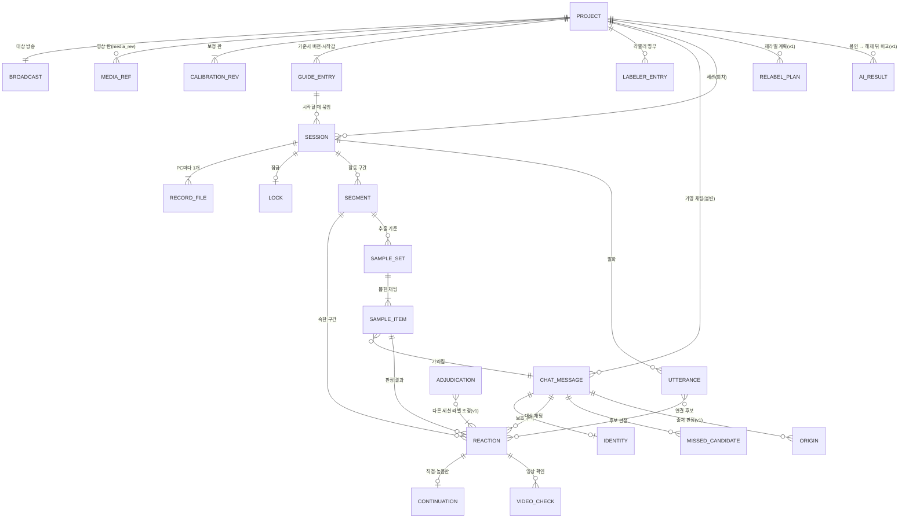
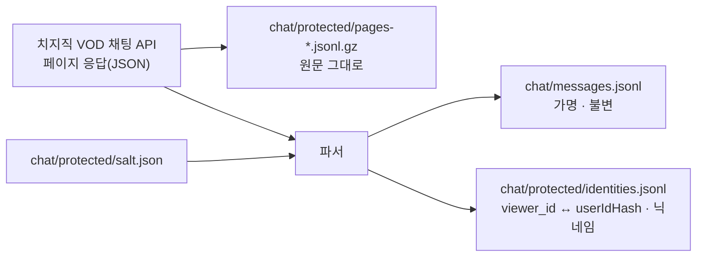
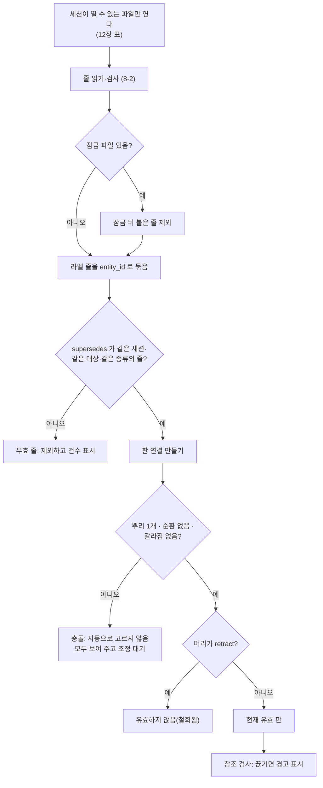

상태: 설계 초안 (2026-10-19) · 아직 구현되지 않음

# 03. 데이터 모델 — 엔터티 · 저장 형식 · 버전 · 병합

이 문서는 ChatCoach 가 무엇을, 어디에, 어떤 모양으로 저장하는지 정한다. 라벨 한 건이 안내서 7-1 의 항목을 빠짐없이 담고, 기준서가 바뀌어도 이전 라벨이 남고, 라벨러 여러 명의 파일을 합쳐도 깨지지 않게 하는 것이 목표다.

- 실제 JSON Schema(draft 2020-12)는 [`schemas/`](../../schemas/) 에 있다. 이 문서는 그 이유와 규칙을 설명하고, 필드의 정확한 제약은 스키마가 기준이다.
- 숫자는 모두 시작값이다. 시작값 자체는 [안내서 v0.1](../labeling-guide/v0.1.md) 과 `guide-config` 파일이 정한다.
- 관련 문서: [01 분석·아이디어](01-analysis-and-ideas.md) · [02 아키텍처](02-architecture.md) · [04 업데이트·릴리스](04-update-and-release.md) · [05 보안](05-security.md) · [06 평가·일치도](06-evaluation-and-agreement.md) · [07 로드맵](07-roadmap.md) · [안내서 v0.2 초안](../labeling-guide/v0.2-draft.md)

---

## 0. 결정 요약

| # | 결정 | 이유 |
|---|---|---|
| D1 | 라벨 원본은 세션별 추가 전용 JSONL(`labels/<session_id>.<machine4>.jsonl`). SQLite 는 버릴 수 있는 색인으로만 쓴다(v1). | PC 마다 다른 파일에 쓰므로 OneDrive·공유 폴더에서 충돌이 구조적으로 없다. '라벨은 지우지 않는다'(안내서 0장)가 파일 형식으로 지켜진다. |
| D2 | 라벨의 모든 시각은 **VOD 시각**(치지직 playerMessageTime 축) ms 정수. 영상 파일 위치는 project.json 의 보정값(offset)으로 바꾼다. 라벨마다 `calibration_rev`·`media_rev` 를 남긴다. | 보정을 고쳐도 라벨 파일을 건드리지 않고 다시 계산할 수 있다. 치지직 다시보기에서 누구나 같은 시각을 찾을 수 있다. |
| D3 | 수정은 새 판(`supersedes`), 삭제는 `retract` 줄. 판 연결은 같은 세션 안에서만 허용한다. | 이력이 남고, 다른 라벨러·다른 세션 파일이 내 라벨을 바꿀 수 없다. |
| D4 | 대상의 고정 ID(`entity_id`)와 판 ID(`id`)를 나눈다. | 라벨을 고쳐도 반응→구간, 이어짐→반응 같은 참조가 끊기지 않는다. |
| D5 | 원시 관찰값(후보 발화마다 증거 7항목, 찍은 시각, 후보, 실제 끝 시각)과 결정(등급, 확신도), 저장 시점의 조건 충족 상태(`eligible_grades`)와 고른 등급이 그와 어긋나는지(`grade_vs_conditions`)를 함께 저장한다. 등급은 제안하지 않는다([01](01-analysis-and-ideas.md) 3-1, [07](07-roadmap.md) 질문 37 기본안). | 시작값이 바뀌면 다시 분류할 수 있다. 조건과 다르게 고른 판정도 구분된다. |
| D6 | 라벨마다 `guide_version` + 기준서 본문 해시 12자 + 시작값 해시 12자를 남긴다. | 같은 '0.1' 아래에서 본문이나 숫자가 달라진 라벨이 섞이는 것을 잡는다. |
| D7 | 채팅 가명화는 수집할 때 끝낸다. `messages.jsonl` 에는 원 닉네임·userIdHash·profile·extras 원문이 없다. 원본은 `chat/protected/` 에만 둔다. | 가명 파일만 넘겨도 재식별이 안 된다(원문을 같은 줄에 두면 가명화가 무효가 된다는 보안 검토 반영). |
| D8 | `viewer_id` = HMAC-SHA256(프로젝트 솔트, userIdHash). 이것이 저장·참조에 쓰는 확정 가명이다. 화면의 '시청자 0012' 는 따로 계산하는 표시용 번호다(14-2). | 다시 받아도 같은 값이 나오고, 다른 방송과는 연결되지 않는다. |
| D9 | `chat_id` = 공개 규칙 `sl-chat-id-v1`(내용 해시, 수집 순서 무관). | 다시 받아도 같은 ID 가 나오고, AI 엔진도 같은 ID 를 계산할 수 있다. |
| D10 | 표본은 `sha256-tau-v1`([06](06-evaluation-and-agreement.md) 2장). 순서 키 = `sha256(sample_seed\|draw_no\|chat_id)` 이고, 경계 완충·후원·시스템을 뺀 적격 채팅 중 키가 임계 키 τ(처음에는 100번째 키) 이하인 것을 뽑는다. 경계가 바뀌어도 τ 는 내려가지 않고 `sample_rev` 를 올린 새 매니페스트를 쓴다. 매니페스트는 고치지 않는다(15장). | 누가 언제 뽑아도 같은 표본이 나오고, 처음 판정 수가 정확히 100이며, 다른 언어로도 재현할 수 있다. 구간을 쪼개거나 기준서를 올려도 같은 채팅은 같은 순서에 선다. |
| D11 | 블라인드는 '필터' 가 아니라 '열지 않음' 이다. 재라벨 세션은 다른 세션 파일을 디스크에서 아예 읽지 않는다. | 필터 버그로 1차 라벨이 새는 길을 없앤다. |
| D12 | 프로젝트 단계·잠금 여부는 project.json 에 적지 않고 라벨 기록과 잠금 파일에서 계산한다. | 두 곳에 적으면 언젠가 어긋난다. |
| D13 | 내보내기는 항상 zip + `manifest.json`(파일별 해시). CSV 는 검토용 사본이며 수식 주입을 막는다. | 받는 쪽이 손상·편집·버전 불일치를 알 수 있다. |
| D14 | 스키마는 `additionalProperties: false` 로 엄격하게. 시범용 실험 값은 `x` 객체에만 둔다. | 오타나 임의 필드가 정답 데이터에 섞이지 않는다. |
| D15 | 다시 만들기 쉬운 파생(파형·무음·썸네일·검색 색인)은 앱 `data\cache\` 에, 비싸고 민감한 파생(ASR·OCR)은 프로젝트 `derived/`(보호 구역)에 둔다. | 동기화되는 파일을 줄이면서, 몇 시간 걸린 결과는 프로젝트와 함께 다닌다. |

---

## 1. 용어

| 용어 | 뜻 |
|---|---|
| VOD 시각 | 치지직 다시보기 타임라인 위의 시각. 채팅 API 의 `playerMessageTime` 과 같은 축이다. 라벨의 모든 시각이 이 축의 ms 정수다. |
| 영상 파일 시각 | 로컬 영상 파일의 재생 위치(mpv `time-pos`). 저장하지 않고, 보정 앵커에만 적는다. |
| 세션 (= 회차) | 한 라벨러가 한 프로젝트에서 한 종류(1차·재라벨·조정·출처 판정)로 하는 작업 단위. 안내서 7-3 일치도 비교·잠금·블라인드의 단위다. 여러 날, 여러 번 실행에 걸칠 수 있다. |
| 기록 파일 | 세션 하나 × PC 하나에 파일 하나. `labels/<session_id>.<machine4>.jsonl`. |
| 실행 (run) | 앱을 한 번 켜서 세션을 연 것. `run.start` 줄로 남는다. |
| 기록 (줄) | 기록 파일의 한 줄. 세션 운영 기록(`session.open` 등)과 라벨이 있다. |
| 라벨 | 판정 내용을 담은 기록. `segment` · `utterance` · `reaction` · `continuation` · `video_check` · `missed_candidate` · `origin` · `adjudication` · `retract`. |
| 대상 (entity) | 라벨이 가리키는 것(구간 하나, 발화 하나, 반응 하나…). 고정 ID 는 `entity_id`. |
| 판 (version) | 같은 대상의 한 번의 기록. 판 ID 는 줄의 `id`(= label_id). 고치면 새 판이 생긴다. |
| 현재 유효 라벨 | 대상마다 가장 마지막 판(철회되지 않은 것). 11장에서 계산한다. |
| 보호 구역 | 원 닉네임·원문·생성 기록처럼 내보내기·패키지·일반 백업에서 기본으로 빼는 경로. project.json `protected_zone` 에 적는다. |
| 파생 자료 | 원본에서 다시 만들 수 있는 것. 지워도 된다. |

---

## 2. 파일 배치

### 2-1. 프로젝트 폴더

기본 위치는 `<앱>\data\projects\<slug>\` 다(다른 폴더 지정 가능, 02 문서). `slug` 는 방송 제목 앞 30자(파일명 금지 문자 치환) + `-` + video_no 로 길이를 묶는다. Windows 경로 260자 제한 때문이다.

```text
<slug>\
├─ project.json                      메타·영상 참조·보정·기준서 스냅샷·명부        [원본 · 비교 후 교체로 고쳐 씀]
├─ guide\v0.1.md                     이 프로젝트에 적용한 기준서 사본               [원본 · 불변]
├─ chat\
│  ├─ messages.jsonl                 가명 채팅, 한 줄 = 메시지                      [원본 · 불변]
│  ├─ fetch-<fetch_id>.json          수집 기록(엔드포인트·페이지 수·완료 여부)       [원본 · 불변]
│  └─ protected\                     ★보호 구역
│     ├─ salt.json                   가명화 솔트(32바이트)
│     ├─ identities.jsonl            viewer_id ↔ userIdHash · 원 닉네임
│     └─ pages-<fetch_id>.jsonl.gz   API 응답 원문, 한 줄 = 한 페이지
├─ labels\<session_id>.<machine4>.jsonl   세션 기록                              [원본 · 추가만]
├─ locks\
│  ├─ open.lock                      프로젝트 쓰기 잠금(QLockFile). 못 잡으면 읽기 전용(13-5)   [실행 중 표식 · 백업·패키지 제외]
│  └─ <session_id>.json              세션 잠금(기록 파일 해시, v1)                  [원본 · 불변]
├─ samples\<sample_set_id>.json      무작위 표본 매니페스트                         [원본 · 불변]
├─ relabel\<plan_id>.json            재라벨 계획 (v1)                               [원본 · 불변]
├─ origin\                           ★보호 구역: 가상 채팅 생성 기록·대조 결과 (v1)
└─ derived\                          비싼 파생: asr.json · vad.json · ocr.jsonl     [파생 · ★asr·ocr 는 보호]
```

### 2-2. 앱 data 폴더 (프로젝트 밖)

```text
<앱>\data\
├─ machine.json                      이 PC 의 machine_id (UUID, 처음 실행 때 한 번 만듦)
├─ labelers.json                     라벨러 표시 이름 — 실명은 프로젝트에 넣지 않는다
├─ cache\<partial_fp 앞 16자>\       waveform.json · silence.json · thumbs\       [파생 · 버려도 됨]
├─ cache\<project_id>\               chat_index.bin(채팅 병렬 배열) · index.sqlite(v1)   [파생 · 버려도 됨]
├─ ai\<project_id>\                  AI 결과(v1): sealed\<sha256>.bin(봉인 원본) · seal.jsonl(봉인·해제 기록) · runs\<run_id>.json(해제 뒤)   [6-14]
├─ reports\<project_id>\<report_id>\ 일치도·AI 비교 보고서(v1): report.json · tables\*.csv · manifest.json   [6-14]
└─ disposal_log.jsonl                프로젝트 파기 기록
```

- 백업 zip 의 위치·보존 개수는 [04](04-update-and-release.md)·[05](05-security.md) 가 정한다. 무엇을 묶는지는 16장.
- 프로그램 폴더에 쓸 수 없으면 `data\` 전체가 `%LOCALAPPDATA%\ChatCoach\` 로 폴백한다(02 문서). 이때 `run.start` 의 `data_dir_mode` 가 `fallback` 으로 남는다.

### 2-3. 보호 구역 기본값

`project.json` 의 `protected_zone` 기본값: `chat/protected/`, `derived/asr*`, `derived/ocr*`, `origin/`.

보호 구역은 라벨러 패키지·정답 세트·일반 백업에서 빠진다. 넣으려면 '보호 포함' 을 켜야 하고, 켜면 경고 후 매니페스트에 기록된다(16장, [05](05-security.md)).

---

## 3. 엔터티 관계

아래는 논리 관계다. `SEGMENT` 부터 `ADJUDICATION` 까지는 실제로는 모두 세션 기록 파일의 줄(kind 로 구분)이다.



---

## 4. 시각 표현 규약

### 4-1. 다섯 가지 시계

| 시계 | 무엇 | 저장 형식 | 어디에 |
|---|---|---|---|
| VOD 시각 | 치지직 다시보기 타임라인 = `playerMessageTime` 축. 실측에서 0 은 라이브 시작 + 약 4초였다(확인 필요). | ms 정수 | 모든 라벨 시각, `messages.t_ms`, 표본, AI 결과(권장) |
| 영상 파일 시각 | 로컬 파일 재생 위치 | 저장하지 않음 | 보정 앵커의 `file_ms` 에만 |
| 채팅 서버 시각 | API `messageTime`(epoch ms) | ms 정수 | `messages.server_time_ms` 에만. 두 시각의 차(실측 상수)는 `project.chat.server_minus_player_ms` |
| 벽시계 | 기록한 시각 | ISO 8601 + OS 시간대 오프셋 | 줄마다 `created_at`. 순서 판단에는 쓰지 않는다 |
| 방송 지연 D | 시청자 화면이 스트리머보다 늦은 정도 | ms 정수 | `calibration.revs[].broadcast_delay_ms`. 표시·경고에만 쓴다 |

### 4-2. 변환과 보정 기록

```text
영상 파일 시각 = VOD 시각 + offset_ms        (offset_ms 는 활성 보정 판의 값)
```

- 파일 앞 12초가 잘린 영상이면 `offset_ms = -12000` 이다.
- 프로젝트를 만들면 보정 판 0(`offset_ms = 0`, `status = unverified`)이 자동으로 생긴다.
- 라벨러가 닉네임 호명처럼 채팅과 소리가 같은 순간인 앵커를 3개 이상 찍으면, 중앙값으로 새 판(`status = verified`)을 만든다. 앵커가 부족하면 사유를 적고 `skipped` 로 넘어갈 수 있다.
- **반응 라벨링은 활성 보정이 `verified` 또는 `skipped` 일 때만 열린다.** 오프셋이 틀리면 모든 라벨이 한꺼번에 틀리기 때문이다.

**보정이 바뀌었을 때.** 라벨 파일은 고치지 않는다. 시각 필드는 출처에 따라 두 가지로 나뉜다.

| 출처 | 필드 | 보정이 바뀌면 |
|---|---|---|
| 채팅 시계에서 온 값 | `messages.t_ms`, `reaction.first_visible_ms`(source=`chat_clock`), 표본 항목 `t_ms` | 그대로 |
| 플레이어에서 찍은 값 | 구간 `start_ms`/`end_ms`, 발화 `start_ms`/`end_ms`/`raw_click_ms`, 반응 `reaction_time_ms`/`raw_click_ms`, 증거 `at_ms`, 이어짐 span, 영상 확인 `watched_ranges`, OCR `frame_ms` | 화면·내보내기에서 `저장값 + offset[라벨의 calibration_rev] − offset[활성 rev]` 로 다시 계산 |

방법이 `piecewise_linear`(v1, 방송 중간에 오프셋이 바뀌는 경우)여도 원리는 같다. 다만 틀린 오프셋으로 화면을 보고 내린 판단 자체는 되돌릴 수 없다. 그래서 보정이 크게 바뀐 라벨은 '보정 변경 후 미확인' 으로 표시한다.

### 4-3. 규칙

1. 시각은 정수 ms 로 저장한다. 실수·문자열·NaN 은 스키마와 로더가 모두 거부한다.
2. 범위는 `[시작, 끝)` 반열림이고, 시작 < 끝 이다.
3. 구간 경계는 '전환이 시작된 시각'(안내서 3장)이다.
4. 경계 완충은 **분류가 다른** 두 구간 사이 경계의 앞뒤 각각 `boundary_buffer_sec`(시작값 10초)다. 같은 분류끼리 맞닿은 경계는 전환이 아니므로 완충이 없다(06 문서에서 확인).
5. 반응 시각은 한 점이다. 발화의 어느 지점(첫 음절 등)인지는 v0.2 초안 후보로 두고, 지금은 라벨러가 찍은 점과 자석 적용 전 위치(`raw_click_ms`)를 함께 남긴다.
6. 화면에는 `h:mm:ss.s` 로 보이고, 저장은 ms 로 한다.
7. 영상 길이 밖의 시각은 버리지 않고 `out_of_media` 로 표시한다(ClipSlicer `segments.py` 는 길이 밖 마커를 조용히 버렸다 — 그대로 가져오지 않는다).
8. 벽시계는 순서 판단에 쓰지 않는다. 순서는 `(기록 파일, seq)` 와 `supersedes` 연결로 정한다. `run.start` 에 PC 시계 오차(`clock_skew_ms`)를 남긴다.
9. 방송 지연 D 는 저장된 시각을 바꾸지 않는다. 대신 '문구 되풀이' 증거를 체크했는데 발화가 채팅보다 앞서면 경고(`repeat_before_chat`)한다. 시청자가 스트리머 말을 따라 친 경우일 수 있기 때문이다.

---

## 5. 열거값

코드 값은 영어 식별자, 화면 표시명은 `app/core/schema.py` 상수가 단일 출처다(`tr()` 번역 대상이 아니다. 모듈 위치는 [02](02-architecture.md) 3-2). 스키마 파일의 enum 과 `app/core/schema.py` 가 같은지 테스트로 묶는다(19장).

### 5-1. 활동 분류 (`category`, 안내서 3장)

| 값 | 표시 |
|---|---|
| `just_chatting` | 저스트채팅 |
| `game` | 게임 (`active_chat` = '채팅 대화 활발' 표시 가능) |
| `singing` | 노래 |
| `other` | 기타 |
| `undeterminable` | 판단 불가 |

### 5-2. 반응 결과와 등급 (안내서 4-2)

| 필드 | 값 | 표시 |
|---|---|---|
| `result` | `graded` | 연결 후보가 있어 등급을 줌 |
| | `unconfirmed` | 반응 미확인 (후보가 아예 없음, 등급 없음) |
| `grade` | `direct` | 직접 반응 |
| | `likely` | 연결 가능성 높음 |
| | `related_only` | 관련성만 있음 |
| | `unclear` | 불명확 (후보는 있으나 가릴 수 없음, `unclear_cause` 필수) |

등급을 순서로 볼 때 '한 단계 어긋남' 을 어떻게 셀지는 [06](06-evaluation-and-agreement.md) 이 정한다. 저장은 순서 없는 값으로 한다.

### 5-3. 확신도 (`confidence`, 안내서 5장 — 모든 라벨 종류에 필수)

| 값 | 표시 |
|---|---|
| `certain` | 확실함 |
| `probably` | 아마도 |
| `undeterminable` | 판단 불가 |

등급과 확신도는 따로 저장한다. '불명확 / 확실함' 같은 조합도 허용한다(검토 의견 3).

### 5-4. 이어짐 (`continuation.type`, 안내서 4-3)

| 값 | 표시 |
|---|---|
| `none` | 이어지지 않음 |
| `short` | 짧게 이어짐 |
| `extended` | 확장됨 |
| `new_topic` | 새 주제로 전환 |

### 5-5. 놓친 채팅 후보가 아닌 사유 (`reason_code`, 안내서 6장)

| 값 | 뜻 | 자동 처리 |
|---|---|---|
| `A` | 구간 밖(경계 완충 포함) | 조건 ① 실패 시 자동 제안 |
| `B` | 기회 부족 | `max_chat_rate_per_10s` 가 정해지면 제안 |
| `C` | 대화 가치 낮음 | — |
| `D` | 이미 다룸 | — |
| `E` | 반복·도배 | — |
| `F` | 후원·시스템 메시지 | 채팅 종류가 `text` 가 아니면 자동 |
| `G` | 판단 불가 | — |

### 5-6. 채팅 출처 (`origin.origin`, 검토 의견 1, v1)

| 값 | 표시 |
|---|---|
| `real` | 실제 |
| `virtual` | 가상 |
| `undeterminable` | 판별 불가 (실제 시청자 소통 통계에서 기본 제외, 건수 따로 표시) |

판정 근거(`method`): `generation_log_match`(생성 기록 대조) · `viewer_id_match`(봇 계정 가명 일치) · `ocr_match` · `manual` · `none`.

### 5-7. 증거 종류 (`candidates[].evidence` 의 키, 안내서 4-1)

| 키 | 뜻 | v0.1 강도 |
|---|---|---|
| `nickname_called` | 닉네임을 부름 | strong |
| `text_repeated` | 채팅 문구를 읽거나 거의 그대로 되풀이 | strong |
| `direct_reference` | 채팅을 직접 가리키는 말 | strong |
| `answer_form` | 질문에 맞는 답의 형태 | medium |
| `unique_content` | 채팅에만 있던 구체적 내용이 발화에 등장 | medium |
| `within_time_window` | 채팅이 뜬 뒤 시간 창(시작값 20초) 안 반응 | medium |
| `same_topic` | 같은 주제 | weak |

강도는 라벨에 저장하지 않고 기준서 시작값(`evidence_strength`)에서 정한다. v0.2 에서 '시간 창' 이 증거가 아니라 조건(`gate`)으로 바뀌어도 라벨을 고치지 않고 다시 분류할 수 있게 하려는 것이다.

### 5-8. 채팅 종류 (`kind`)

| `type_code` | `kind` | 판정 |
|---|---|---|
| 1 | `text` | 대상 |
| 2 · 3 · 4 · 5 | `image` · `sticker` · `video` · `rich` | 제외 (확인 필요: 실제로 오는지) |
| 10 | `donation` | 제외(사유 F), 따로 표시 |
| 11 | `subscription` | 제외(사유 F) |
| 30 | `system` | 제외(사유 F) — 관측된 적 없음, 확인 필요 |
| 그 외 | `other` | 제외 |

### 5-9. 세션 종류 (`session_kind`)

| 값 | 코드 | 뜻 |
|---|---|---|
| `primary` | `P` | 1차 라벨링 |
| `relabel_same` | `RS` | 같은 사람 재라벨(7-3) |
| `relabel_second` | `R2` | 두 번째 사람 독립 라벨(7-3) |
| `adjudication` | `AD` | 조정(검토자, v1) |
| `origin_review` | `OR` | 채팅 출처 판정(검토자, v1) |

### 5-10. 그 밖의 값

| 필드 | 값 | 비고 |
|---|---|---|
| `utterance.speaker` | `streamer` · `tts` · `other_audio` · `unknown` | 강한 증거는 `streamer` 일 때만 성립한다. 후원 TTS 를 스트리머 말로 오인하는 것을 막는다(방법론 검토). |
| `utterance.modality` | `verbal` · `nonverbal` · `both` | 비언어 반응(웃음·끄덕임). v0.2 초안 후보라 판정 규칙은 아직 없다. |
| `utterance.outcome` | `linked` · `no_candidate_in_vod` · `candidate_ambiguous` | 반응한 것은 분명한데 VOD 채팅에 대응 채팅이 없는 경우(삭제·블라인드 등)를 반응 미확인과 구별한다. |
| `segment.start_signal` | `screen` · `audio` · `speech` · `action` · `unknown` | 경계를 정한 신호. 선택 입력(v0.2 후보). |
| `reaction.grade_vs_conditions` | `consistent` · `deviates` · `not_applicable` | 고른 등급이 조건 충족 상태와 어긋나지 않음 / 다르게 고름(사유 필수) / 등급 없음(반응 미확인). 앱이 계산한다 |
| `reaction.unclear_cause` | `multiple_similar_chats` · `multiple_utterances` · `audio_unclear` · `other` | 안내서 4-2 '비슷한 채팅 여러 개, 소리가 안 들림 등' |
| `reaction.first_visible_source` | `chat_clock` · `ocr` · `manual` | 기본 `chat_clock` |
| `utterance.heard_text_source` | `typed` · `asr_edited` · `asr_unedited` | 자동 인식 문장 원문은 라벨에 넣지 않는다 |
| `reaction.aids_used` | `asr_text` · `vad_snap` · `grade_conditions` · `ocr` | 앱이 자동으로 채운다 |

---

## 6. 엔터티와 필드

필드의 정확한 타입·범위는 스키마를 본다. 아래 표는 '무엇을 왜 담는가' 를 정리한다.

### 6-1. 프로젝트 — `project.json` ([스키마](../../schemas/project.schema.json))

| 블록 | 주요 필드 | 뜻 |
|---|---|---|
| 식별 | `project_id`(UUID v4), `slug`, `rev` | `rev` 는 저장할 때마다 +1. 읽었던 값과 디스크 값이 다르면 저장하지 않는다(8-3). |
| 작성 | `created_at/by`, `modified_at/by`(`L01@m3fa`), `created_app_version` | |
| 목적·보존 | `purpose`, `retention_until`(기본 +12개월, 확인 필요), `consent_note` | 보존 기한이 지나면 '파기 대상' 으로 표시([05](05-security.md)). |
| `broadcast` | `platform`(`chzzk`), `video_no`(문자열), `title`, `duration_ms`, `live_open_at`, `adult` | 영상 정보 API 값. |
| `media` | `media_rev`, `current`(경로·크기·부분 지문·NTFS 파일 ID·ffprobe 요약), `history[]` | 영상은 프로젝트에 넣지 않고 참조만 한다. 지문이 다른 파일로 바꾸려면 '미디어 교체'(사유 + `media_rev` 증가 + 오프셋 재측정)를 거친다. |
| `chat` | `chat_rev`, `fetch_id`, `messages_sha256`, `complete`, `server_minus_player_ms`, `anonymous_count`, `kind_counts` | 아직 받지 않았으면 `null`. 라벨이 하나라도 있으면 다시 받기를 막는다(MVP). |
| `pseudonymization` | `method`(`hmac-sha256-v1`), `salt_id`, `nickname_mask` | 솔트 원본은 보호 구역에만 둔다(14장). |
| `guides[]` | `guide_version`, `doc_path`, `doc_sha256`, `thresholds`(시작값 스냅샷), `thresholds_sha256`, `added_at/by`, `reason` | 추가만 한다. 세션은 시작할 때 이 중 하나에 묶인다. |
| `active_guide_version` | | 새 세션의 기본 버전. |
| `calibration` | `active_rev`, `revs[]`(`offset_ms`, `anchors[]`, `status`, `broadcast_delay_ms`, `delay_anchors[]`) | 4-2. 판은 추가만 한다. |
| 표본·평가 | `sample_seed`, `dataset_split` | `sample_seed` 는 프로젝트를 만들 때 한 번 만드는 임의 16바이트(hex 32자)다. 화면에서 바꿀 수 없고 비밀이 아니다. 표본 순서 키(`sha256-tau-v1`, 15장·[06](06-evaluation-and-agreement.md) 2-1)와 06 3-2 의 재라벨 블록 순서가 쓴다. `dataset_split` 은 `dev`·`test`, 기본 `dev` 다. 시범처럼 기준을 고치는 데 쓴 라벨은 `dev` 로 두고 최종 엔진 평가에 기본으로 넣지 않는다([06](06-evaluation-and-agreement.md) 9-4). 기본을 `dev` 로 두는 이유: 시범 라벨이 실수로 평가 정답에 섞이는 쪽이 더 나쁘다. 세션은 열 때 이 값을 복사하므로(6-4), 나중에 `test` 로 바꿔도 앞 세션은 `dev` 로 남는다. 추출 번호 `draw_no` 는 여기 두지 않고 표본 매니페스트(6-13)에 둔다. 구간마다 따로 오르기 때문이다. |
| `labelers[]` | `labeler_id`, `role`(`primary`·`second`·`reviewer`), `assigned_session_kinds`, `engine_author` | 표시 이름(실명)은 넣지 않는다. 실명은 수집 PC 의 `data\labelers.json` 에만 둔다. `engine_author` 는 AI 엔진의 규칙·코드를 만든 사람인지(`true`/`false`, 명부에 넣을 때 묻는다)다. 엔진 규칙을 아는 사람의 라벨에는 블라인드로도 막을 수 없는 쏠림이 있어, 숨기지 않고 보고서 머리에 표시한다([06](06-evaluation-and-agreement.md) 5장). |
| `protected_zone` | 경로 목록 | 2-3. |
| `storage_warning_acknowledged` | `at`, `by`, `path_kind` | 프로젝트가 OneDrive·네트워크·이동식 드라이브 아래일 때 경고를 확인한 기록([05](05-security.md)). |

프로젝트 단계(구간 → 반응 → 표본 → 후보 → 잠금 → 비교)는 저장하지 않는다. `phase.mark` 줄과 `locks/` 에서 계산한다(D12).

### 6-2. 채팅 — `chat/messages.jsonl` 과 보호 구역 ([스키마](../../schemas/chat-message.schema.json))



**`messages.jsonl` 한 줄**

| 필드 | 뜻 |
|---|---|
| `chat_id` | 공개 규칙 `sl-chat-id-v1` 로 만든 메시지 ID(13-1). |
| `t_ms` | VOD 시각 = `playerMessageTime`. 비정상이면 `null` + `flags.invalid_time`. |
| `server_time_ms` | 채팅 서버 시각 = `messageTime`(epoch ms). |
| `type_code`, `kind` | 원래 코드와 줄인 종류(5-8). |
| `status` | `messageStatusType` 원값(`NORMAL`, `CBOTBLIND` …). |
| `viewer_id`, `is_anonymous` | 작성자 가명(14-2). 익명이면 `anon`. |
| `nickname_masked` | 가림 닉네임(14-3). |
| `role` | `streamer`·`manager`·`viewer`·`unknown`(profile 의 userRoleCode 를 줄인 값). |
| `text` | 본문(이모티콘 토큰 `{:이름:}` 유지). 4,000자에서 자르면 `flags.text_truncated`. |
| `flags` | 수집 때 발견한 이상. |
| `raw_ref` | 원문 페이지 안 위치(`fetch_id`, `page`, `index`). API 필드가 바뀌어도 다시 받지 않고 원문에서 다시 파싱할 수 있다. |

넣지 않는 것: 원 닉네임, userIdHash, profile 원문(배지·구독 개월·닉네임 색), extras 원문(후원 금액·osType·이모티콘 URL). 후원 여부는 `kind` 로만 남긴다.

**수집 규칙** — ClipSlicer `chat.py` 와 다른 점:

- 중복을 지우지 않는다. 같은 사람이 같은 말을 여러 번 친 것도 그대로 둔다(사유 E 판정에 필요).
- 개수 상한·솎아내기를 하지 않는다.
- 커서 진행은 응답의 `videoChats` 만 쓴다. 페이지 경계에서 같은 원문(9필드 모두 동일)이 다음 페이지에 다시 오는지는 확인 필요다. 오면 경계의 같은 원문만 한 번 받는다.
- 종료 조건: 다음 커서가 정수가 아니거나, 지금 커서 이하이거나, VOD 길이 + 10분을 넘으면 멈춘다. 페이지 수 상한에 걸리면 `complete = false` 와 사유를 남긴다.

**보호 구역 파일**

| 파일 | 한 줄(또는 내용) |
|---|---|
| `salt.json` | `{"salt_hex": "<64자>", "created_at": "…"}` |
| `identities.jsonl` | `{"viewer_id", "user_id_hash", "nicknames": [{"nickname", "first_seen_ms"}]}` — 방송 중 닉네임이 바뀔 수 있어 목록으로 둔다. |
| `pages-<fetch_id>.jsonl.gz` | `{"page", "request_url"(쿠키 없음), "requested_at", "status", "body"(응답 원문 문자열)}` |
| `fetch-<fetch_id>.json` (보호 아님) | 엔드포인트, 시작·끝 시각, 페이지 수, 메시지 수, 완료 여부, User-Agent, 앱 버전, `messages_sha256` |

### 6-3. 기록 줄 공통 봉투 ([스키마](../../schemas/label-event.schema.json))

모든 줄에 있는 것:

| 필드 | 뜻 |
|---|---|
| `v` | 기록 형식 버전(정수, 지금 1). |
| `id` | 이 줄(판)의 UUID v4. 라벨이면 이것이 label_id 다. |
| `seq` | 파일 안 순번(1부터). |
| `kind` | 기록 종류. |
| `session_id`, `labeler_id` | 줄만 떼어 내도 누가 어느 세션에서 썼는지 알 수 있게 줄마다 둔다. |
| `created_at` | 벽시계(OS 오프셋 포함). 표시용. |
| `app_version` | |
| `body` | 종류별 내용. |
| `x` | 시범용 실험 값(점수 계산에 쓰지 않음). |

라벨 종류에 추가로 필수인 것(공통 라벨 메타):

| 필드 | 뜻 |
|---|---|
| `entity_id` | 대상 고정 ID. 고쳐도 그대로다. |
| `supersedes` | 대체하는 이전 판 id. 첫 판이면 `null`. |
| `guide_version`, `guide_sha12`, `thresholds_sha12` | 기준서 태그(9장). |
| `media_rev`, `calibration_rev` | 영상 판·보정 판(4-2). |

이 값들은 store 가 자동으로 채우고 UI 에서 지울 수 없다(안내서 7-1 '라벨러·일시·기준서 버전').

### 6-4. 세션 운영 기록

| kind | 언제 쓰나 | 주요 body 필드 |
|---|---|---|
| `session.open` | 기록 파일의 첫 줄(seq 1). 같은 세션의 다른 PC 파일에도 같은 메타가 반복된다. | `project_id`, `session_kind`, `session_created_at`, `machine_id`, `machine4`, `guide_version`, `guide_doc_sha256`, `thresholds_sha256`, `scope`(`whole`/`blocks`+`ranges`), `relabel_plan_id`, `blind`, `tool`(`heard_max_speed` 등), `tool_models`(VAD·ASR 모델), `dataset_split`(세션을 만들 때의 `project.dataset_split` 사본) |
| `run.start` | 앱을 켜고 세션을 열 때마다 | `utc_offset_min`, `tz_name`, `clock_skew_ms`, `clock_source`, `data_dir_mode`, `media_vfr`, `compat_mode`, `update_check_state`, `checked_at`, `latest_seen_version` |
| `phase.mark` | 단계 완료(또는 다시 열기) 표시 | `phase`(`segments`·`reactions`·`samples`·`missed`·`origin`), `scope`(`all` 또는 구간 entity_id 목록), `done` |
| `view.exposed` | 숨겨 둔 자료를 열어 봤을 때 | `what`(`nickname_raw`·`asr_text`·`other_session_labels`·`ai_results`·`origin_info`·`raw_chat_page`), `chat_id`, `entity_id`, `during_entity_id` |
| `warning` | 앱 경고와 처리 | `code`(`audio_not_heard`·`recheck_missing`·`grade_rule_override`·`rationale_without_time`·`repeat_before_chat`·`calibration_unverified`·`relabel_too_early`·`segment_too_short`·`long_silence_signal`·`clock_skew`·`other`), `action`(`shown`·`dismissed`·`resolved`), `entity_id` |

`warning` 은 '들은 범위 경고를 습관적으로 닫는' 패턴을 안내서 8장 점검에 쓰기 위한 기록이다.

**앱 버전과 업데이트 확인 상태** ([04](04-update-and-release.md) 6-2 '라벨링 세션 메타'). `app_version` 은 모든 줄의 봉투에 이미 있다(6-3). 확인 상태는 `session.open` 이 아니라 `run.start` 에 둔다. 한 세션이 여러 실행에 걸치고, 그 사이에 앱이 바뀔 수 있기 때문이다. 세션의 첫 실행에서도 `session.open` 바로 뒤에 `run.start` 가 붙으므로 빠지는 실행이 없다.

| 필드 | 값 | 뜻 |
|---|---|---|
| `update_check_state` | `latest` · `newer` · `failed` · `never` | 이 줄을 쓸 때 `data\update\state.json` 에서 계산한 마지막 확인 결과. 확인은 앱 시작 30초 뒤에 돌므로 이번 실행이 아니라 직전 확인의 결과다. |
| `checked_at` | ISO 8601 또는 `null` | 그 결과가 나온 시각. 확인한 적이 없으면 `null`. |
| `latest_seen_version` | `X.Y.Z` 또는 `null` | 마지막으로 본 최신 버전. 봉투의 `app_version` 보다 크면 '구버전으로 매긴 실행' 으로 걸러 낼 수 있다. |

설치본이 `min_supported` 보다 낮으면 새 라벨 저장 자체가 막힌다([04](04-update-and-release.md) 5-5). 위 값은 그보다 약한 경우(새 버전이 있는데 받지 않음, 확인 실패가 이어짐)를 나중에 가려내기 위한 것이다.

### 6-5. 활동 구간 — `segment` (안내서 3장)

| 필드 | 뜻 |
|---|---|
| `start_ms`, `end_ms` | 시작('전환이 시작된 시각')·끝. |
| `category`, `confidence`, `rationale` | 분류, 확신도, 근거 한 줄. |
| `active_chat` | 게임 구간의 '채팅 대화 활발'. 게임이 아니면 `null`(스키마가 강제). |
| `start_signal` | 경계 신호 종류(선택). |
| `long_silence_reviewed` | 긴 침묵 재검토 신호를 보고 검토했는지. 신호는 `data\cache\…\silence.json` 에서 오고, 분류를 자동으로 바꾸지 않는다(검토 의견 2). |
| `split_from`, `merged_from[]` | 쪼개기·합치기 이력. |
| `out_of_media` | 영상 길이 밖(영상이 바뀐 경우). |

한 세션의 현재 유효 구간들은 범위(`scope`) 안을 겹치지 않게 나눈다. 빈틈은 '아직 안 매긴 시간' 으로 표시한다. 30초 미만 구간은 저장을 막지 않고 합치기를 제안한다(`segment_too_short` 경고).

### 6-6. 발화 — `utterance` (안내서 7-1 '연결 발화')

| 필드 | 뜻 |
|---|---|
| `segment_id` | 속한 구간. |
| `start_ms`, `end_ms` | 발화 시작·끝. |
| `heard_text`, `heard_text_source` | 직접 듣고 적은 핵심 구절(30자 안팎 권장, 최대 300자)과 입력 출처. |
| `speaker`, `modality` | 소리 출처, 말·비언어. |
| `raw_click_ms`, `snapped` | 처음 찍은 위치와 자석 적용 결과(자석 기본값은 꺼짐). |
| `outcome` | 반응 라벨이 하나도 가리키지 않는 발화는 이 값이 필요하다. |

발화를 별도 대상으로 둔 이유: 한 발화가 여러 채팅에 한꺼번에 답하는 경우("여행 질문 많이 하셨는데…")가 흔하고, 재라벨 비교 때 '같은 발화' 를 시작 시각으로 맞춰야 한다.

### 6-7. 채팅 반응 — `reaction` (안내서 4장)

채팅 1건 = 라벨 1건. 2단계(발화에서 출발)와 3단계(표본에서 출발)가 같은 모양이다. 연결 후보 발화는 `candidates[]` 배열에 두고, 후보마다 발화(`utterance_id` — 발화 시각과 들은 내용은 그 발화 라벨의 `start_ms`·`end_ms`·`heard_text`)와 강·중·약 증거 체크(`evidence` 7항목)를 적는다. 등급·확신도·이어짐은 채팅 단위다(이 라벨 최상위, 이어짐은 이 반응을 가리키는 `continuation`). '불명확' 이면 후보를 전부 적는다(안내서 4-2, 7-1 '후보가 여럿이면 전부'). [01](01-analysis-and-ideas.md) G4 와 [안내서 v0.2 초안](../labeling-guide/v0.2-draft.md) 4-1 [제안](증거를 채팅–발화 짝마다 적음)을 받아들인 모양이다. 예전의 단일 증거 묶음(`evidence`)은 `candidates[0].evidence` 로 흡수했다. [07](07-roadmap.md) ADR-21·질문 7 에서 결정됨(사용자 확정 전 — 반대하면 되돌림).

| 필드 | 뜻 | 안내서 |
|---|---|---|
| `chat_id`, `segment_id` | 대상 채팅, 속한 저스트채팅 구간 | 7-1 대상 채팅 |
| `entry`, `sample_ref` | `from_utterance`/`from_sample`, 표본 묶음과 순서(표본이면 필수) | 2장 |
| `result`, `grade` | 결과와 확정 등급 | 4-2 |
| `eligible_grades`, `grade_vs_conditions`, `override_reason` | 저장 시점의 조건 충족 상태(앱 계산, 제안 아님 — 후보별로 센 결과의 합집합), 고른 등급과의 관계, 다르게 고른 이유 | — |
| `unclear_cause` | 불명확 사유(불명확이면 필수) | 4-2 |
| `candidates[]` | 연결 발화 후보 전부(`graded` 면 1개 이상, `unconfirmed` 면 0개, 불명확이면 전부). 후보마다 `utterance_id`(발화 라벨 entity_id)와 `evidence`(7항목 모두: `present`, `at_ms`, `note`) | 4-1, 4-2, 7-1 연결 발화·증거 체크 |
| `linked_utterance_id` | 직접·높음일 때 연결한 발화(필수). `candidates[].utterance_id` 중 하나 | 4-3 |
| `competing_chat_ids[]` | 같은 발화의 계기일 수 있는 다른 채팅 | 4-4 예시 4 |
| `first_visible_ms`, `first_visible_source` | 채팅이 화면에 처음 뜬 시각(기본: 채팅 시각) | 7-1 |
| `reaction_time_ms`, `raw_click_ms`, `snapped` | 읽은 순간(한 점), 찍은 위치, 자석 | 4-3 |
| `no_similar_chat_nearby`, `similar_chat_ids[]` | '같은 시간대 비슷한 채팅 없음' 판단 | 4-2 |
| `streamer_already_on_topic` | 이미 그 주제를 말하던 중 | 4-2 관련성만 |
| `confidence`, `rationale` | 확신도, 근거 한 줄 | 5장, 7-1 |
| `first_judgment`, `changed_on_recheck` | 재확인에서 바뀌기 전 판단 | 7-2 |
| `aids_used[]` | 참고한 보조 자료 | 원칙 4 |

**저장 규칙** (스키마가 강제하는 것 / 앱·검사 도구가 강제하는 것):

| 규칙 | 강제하는 곳 |
|---|---|
| `unconfirmed` 이면 등급·후보·연결 발화·반응 시각이 모두 비어 있어야 함 | 스키마 |
| `graded` 이면 후보 발화 1개 이상 | 스키마 |
| 직접·높음이면 연결 발화와 반응 시각 필수 | 스키마 |
| 연결 발화는 `candidates[].utterance_id` 중 하나이고, 한 반응 안에서 후보 발화가 겹치지 않음 | 검사 도구(18장) |
| 불명확이면 `unclear_cause` 필수 | 스키마 |
| 조건 충족 상태와 다르게 고르면(`grade_vs_conditions = deviates`) 사유 필수 | 스키마 |
| **연결한 후보(`linked_utterance_id`)의 강한 증거가 0개인데 직접 반응** → 저장 거부 | 앱(강도는 기준서 시작값에서 오므로 스키마로 쓸 수 없음). 안내서가 "강한 증거 없이는 직접 반응을 주지 않는다" 고 못 박았으므로 사유를 받고 허용하지 않는다. |
| 그 밖의 등급 규칙과 다른 확정 | 앱: 경고 + `override_reason` |
| 확인 범위를 소리로 듣지 않고 저장 | 앱: 경고(`audio_not_heard`) |
| 근거에 시각이 없음 | 앱: 경고(`rationale_without_time`) |
| 대상 채팅이 저스트채팅 구간 밖이거나 `kind ≠ text` | 앱: 저장 거부 |

### 6-8. 이어짐 — `continuation` (안내서 4-3)

| 필드 | 뜻 |
|---|---|
| `reaction_entity_id` | 이어짐이 붙은 반응(현재 등급이 직접·높음이어야 함 — 검사 도구). |
| `type` | 4종. `none` 이 아니면 span 필수(스키마). |
| `span_start_ms`, `span_end_ms` | 대화가 이어진 구간(구간 끝에서 잘린 값). |
| `observed_end_ms` | 자르기 전 실제로 같은 주제가 끝난 시각. 구간 경계가 바뀌면 다시 자를 수 있다. |
| `truncated_at_segment_end` | 잘렸음(앱이 자동 표시). |
| `related_chat_ids[]` | 같은 주제로 이어진 다른 시청자 채팅. 개수는 저장하지 않고 이 목록에서 센다. |
| `confidence`, `rationale` | |

`short`/`extended` 의 1분 기준과 '채팅 3개' 기준은 저장값(span, 목록)에서 계산하므로, 시작값이 바뀌면 다시 분류할 수 있다.

### 6-9. 영상 확인 — `video_check` (안내서 7-1, 7-2)

| 필드 | 뜻 |
|---|---|
| `target_kind`, `target_entity_id`, `target_version_id` | 무엇을 확인했는지. |
| `check` | `first`(처음) / `recheck`(다시 듣기). 확인한 벽시계 시각은 줄의 `created_at`. |
| `window_start_ms`, `window_end_ms` | 확인 범위(채팅 뜨기 10초 전 ~ 후보 발화 끝 30초 뒤, 시작값). |
| `watched_ranges[]` | 그 범위 안에서 소리를 켜고 `heard_max_speed`(기본 2배) 이하로 실제 재생한 구간. |
| `coverage_ratio`, `audio_heard` | 덮은 비율, 소리로 들었다고 인정되는지(앱 계산). |
| `judgment` | 그 시점의 판단 스냅샷. |

직접·높음 반응은 `first` + `recheck` 가 모두 있어야 '완료' 로 본다. 없으면 정답 세트에서 `recheck_incomplete` 로 빠진다(16장).

### 6-10. 놓친 채팅 후보 — `missed_candidate` (안내서 6장)

| 필드 | 뜻 |
|---|---|
| `chat_id`, `segment_id`, `sample_ref` | |
| `scope` | `sample`(표본 안 4단계 대상 — 결과가 반응 미확인·관련성만 있음·불명확인 채팅 — 을 체계적으로 본 것, [06](06-evaluation-and-agreement.md) 2-9) / `extra`(표본 밖에서 따로 발견, 통계 분리). |
| `cond1` | ① 구간·완충. `value`, `in_segment`, `in_buffer` — 앱이 계산하고 라벨러가 바꿀 수 없다. |
| `cond2` | ② 읽힐 기회. `value` + 보조값 `exposure_est_ms`, `chat_rate_10s`, `visible_lines`. |
| `cond3`, `cond4` | ③ 대화 가치, ④ 앞뒤 2분 안에 이미 다루지 않음. |
| `is_candidate` | 네 조건이 모두 참일 때만 `true`(스키마). |
| `reason_code`, `reason_code_source` | 후보가 아니면 필수(스키마). |
| `check_question` | 점검 질문의 답. |
| `confidence`, `rationale` | 확신도는 필수(안내서 6장). |

### 6-11. 채팅 출처 — `origin` (검토 의견 1, v1)

`origin_review` 세션에서만 만든다. 필드: `chat_id`, `origin`, `method`, `generation_ref`(생성 기록 파일·항목), `ocr_ref`(프레임 시각·줄), `score`, `second_score`, `confidence`, `rationale`. 반응 라벨링 중에는 보이지 않는다(출처를 알면 반응을 다르게 보는 편향 방지).

### 6-12. 조정 — `adjudication` (v1), 철회 — `retract`

| kind | 필드 | 뜻 |
|---|---|---|
| `adjudication` | `target_kind`, `targets[]`(세션·대상·판), `decision`(`final`·`exclude_from_eval`·`keep_as_ambiguous`), `final`, `cause`(`guide_unclear`·`simple_mistake`·`truly_ambiguous`·`other`), `pattern_tag`, `note` | 갈린 라벨의 최종값. 원 라벨은 그대로 남고, '최종 세트' 에서만 조정값이 우선한다. 잠긴 세션을 바로잡는 유일한 길이다. |
| `retract` | `reason`(`undo`·`merged`·`split_cleanup`·`wrong_target`·`other`), `merged_into`, `note` | 삭제 대신 쓴다. `entity_id` = 대상, `supersedes` = 대상의 현재 판(필수). |

### 6-13. 무작위 표본 — `samples/<sample_set_id>.json` ([스키마](../../schemas/sample-manifest.schema.json))

| 필드 | 뜻 |
|---|---|
| `sample_set_id` | `S-<원 구간 entity_id 앞 8자>-d<draw_no>-r<sample_rev>` |
| `draw_no` | 추출 번호. 1 이 기본이고, 검토자(`role = reviewer`)가 사유를 적고 '다시 뽑기' 할 때만 올린다. seed 의 일부라 올리면 순서 전체가 바뀐다. 구간 경계 변경에는 쓰지 않는다. |
| `sample_rev`, `previous_sample_rev`, `reason`, `changes` | 같은 계열(원 구간 entity_id·`draw_no`)의 몇 번째 매니페스트인지. 경계가 바뀌면 올린 새 파일을 쓰고, 바로 앞 번호·사유·들어오고 나간 chat_id(`added`, `removed[]` 의 `reason = boundary_changed`)를 적는다. 1 이면 `previous_sample_rev`·`changes` 가 `null` 이고 `reason` 은 `initial` 이다. 유효한 것은 가장 큰 `sample_rev` 다(15-4). |
| `source_segment` | 기준이 된 1차 세션 구간 판(세션·대상·판·시작·끝). |
| `guide_version`, `thresholds_sha256` | 뽑을 때의 기준서 버전과 시작값 해시. `sample.per_segment`·`sample.census_max`·`segment.boundary_buffer_sec` 가 이 시작값에서 온다. |
| `algorithm`, `seed_material` | `sha256-tau-v1`, `"{sample_seed}\|{draw_no}"`(15-1). 매니페스트 하나만 받아도 재현할 수 있다. |
| `population` | 범위 안에서 `kind ∈ kinds` 이고 시각이 정상인 채팅: `kinds`, `statuses`, 범위, 크기, `chat_ids_sha256`, `messages_sha256`. |
| `excluded` | 뺀 건수: `non_text`, `invalid_time`, `buffer`([06](06-evaluation-and-agreement.md) 2-2 의 1~3번). |
| `eligible` | 적격 채팅(모집단 − 경계 완충)의 `size`, `chat_ids_sha256`. |
| `requested_size`, `census` | 요청 크기(`sample.per_segment`), 전수 여부(적격 수 ≤ `sample.census_max`). |
| `tau_key`, `tau_real_key` | 임계 키 τ(적격이 0개면 `null`), 실제 시청자 보충용 τ_real(v1, [06](06-evaluation-and-agreement.md) 2-4, 없으면 `null`). |
| `items[]` | `order`(제시 순서), `chat_id`, `t_ms`, `rank`(적격 중 key 순위), `sort_key`(선택), `role`(`base` = key ≤ τ / `origin_extend` = τ_real 보충분). |
| `presentation_order` | 제시 순서 규칙. 기본 `time`(구간 안 시각 순, [06](06-evaluation-and-agreement.md) 2-8). |
| `drawn_at/by`, `app_version` | |

표본 항목의 판정 상태(`pending`/`judged`/`out_of_sample`)는 저장하지 않는다. 그 chat_id 에 같은 계열 매니페스트를 가리키는 유효한 `reaction`(entry=`from_sample`)이 있는지와, 그 chat_id 가 가장 큰 `sample_rev` 의 `items` 에 남아 있는지로 계산한다. 빠진 채팅의 판정은 지우지 않고 `out_of_sample` 로 표본 통계에서만 뺀다.

### 6-14. 잠금 · 재라벨 계획 · 가상 채팅 생성 기록 · AI 봉인 · 보고서

이 절의 파일은 모두 v1 이고, 스키마 파일도 v1 에서 만든다(19장). 아래 표가 그때의 필드 목록이다.

**잠금 `locks/<session_id>.json`** (v1)

| 필드 | 뜻 |
|---|---|
| `session_id`, `project_id`, `locked_at`, `locked_by`, `app_version` | |
| `files[]` | 기록 파일별 `name`, `size`, `sha256`, `last_seq` |
| `label_counts` | 종류별 유효 라벨 수 |
| `sample_verify[]` | 잠글 때 실행한 표본 재현 검증 결과 |

잠금 뒤에는 그 세션에 줄을 추가할 수 없다. 잠금 뒤 붙은 줄(`seq > last_seq`)은 검사 도구가 '잠금 후 추가' 로 표시하고 뷰에서 뺀다. AI 결과는 언제든 봉인해 받을 수 있지만, 봉인 해제는 계획된 재라벨 세션까지 모두 잠긴 뒤에만 된다(아래 'AI 봉인 기록', [06](06-evaluation-and-agreement.md) 7-1).

프로젝트 쓰기 잠금 `locks/open.lock` 은 이 파일과 다르다. QLockFile 이 쓰는 실행 중 표식이라 형식을 정하지 않는다(13-5).

**재라벨 계획 `relabel/<plan_id>.json`** (v1)

| 필드 | 뜻 |
|---|---|
| `plan_id`(`RP-yyyymmdd-xxxx`), `source_session_id` | |
| `unit`(`segment`/`block`), `block_ms` | 기준서 `relabel.unit` 을 따른다. |
| `selected[]` | 범위 `[start, end)`와 층(`random`/`hard`). |
| `plan_no` | 프로젝트 안 계획 순번. 무작위 층의 순서 키는 별도 시드를 두지 않고 `project.sample_seed` 와 `plan_no` 로 만든다([06](06-evaluation-and-agreement.md) 3-2). |
| `earliest_start_at` | 원 세션 잠금 + `min_interval_days`. 이보다 이르게 시작하면 경고하고 세션에 기록한다(하드 차단 여부는 설정). [06](06-evaluation-and-agreement.md) 3-3 은 앞당긴 시작(`early_start`·사유·시각)을 계획에 남기라고 했지만, 계획 파일은 불변이므로 재라벨 세션의 `warning(relabel_too_early)` 줄과 그 `detail`(사유)로 남긴다. 보고서는 그 줄에서 '앞당긴 세션' 을 계산한다. |
| `sample_items[]` | 범위 안 표본 항목(`chat_id`, `order`, 원 `sample_set_id`). 원 구간 경계는 넣지 않는다. 재라벨 세션은 `samples/` 를 열지 않는다(12장). |

**가상 채팅 생성 기록** (v1) — 형식이 아직 없다(열린 질문). 지금 가정하는 최소 필드: `gen_id`, `wall_time`(ms 포함 ISO 8601), `text`, `nickname`, `account_user_id_hash`(봇 계정으로 실제 전송한 경우). 가져올 때 `account_user_id_hash` 는 같은 HMAC 로 `viewer_id` 로 바꿔 대조하고, 원본은 `origin/` 에 보호 구역으로 둔다.

**AI 봉인 기록 `<앱>\data\ai\<project_id>\seal.jsonl`** (v1)

봉인 절차와 조건은 [06](06-evaluation-and-agreement.md) 7-1·7-2 가 정한다. 여기서는 기록 모양만 정한다. 추가 전용 JSONL 이고 쓰기 규칙은 8-1 과 같다. 프로젝트 폴더 밖이라 라벨러 패키지와 재라벨 세션에 닿지 않는다.

| kind | 필드 | 뜻 |
|---|---|---|
| (공통) | `v`, `seq`, `kind`, `at`, `by`(검토자 `role = reviewer` 의 labeler_id), `app_version`, `sha256` | `sha256` = 받은 파일 바이트의 SHA-256. 원본은 `sealed\<sha256>.bin` 으로 둔다. |
| `ai.sealed` | `size`, `check`(`valid`·`rejected`), `reject_reasons[]` | 받을 때 06 6-2 검사 결과만 남긴다. `run_id`·엔진 이름처럼 내용을 해석한 값은 적지 않는다(06 7-2 '해석 결과도 저장하지 않는다'). |
| `ai.unsealed` | `run_id`, `locks[]`(`session_id`, 잠금 파일 `sha256`, `locked_at`), `conditions_met`, `reason` | 풀면서 `runs\<run_id>.json` 으로 옮긴다. 06 7-1 조건(계획된 세션 모두 잠김 + 표본 재현 검증 통과) 전에 열면 `conditions_met = false` 와 사유(필수)를 남긴다. 그 뒤 만든 재라벨 세션은 `ai_exposed` 로 표시된다. |

'사전 봉인'(봉인 시각 < 1차 세션 잠금 시각) 여부는 저장하지 않는다. 이 기록과 잠금 파일의 시각에서 계산한다(D12 와 같은 이유).

**보고서 `<앱>\data\reports\<project_id>\<report_id>\report.json`** (v1)

파일 구성(report.json · tables · manifest)과 지표는 [06](06-evaluation-and-agreement.md) 6-7·4장이 정한다. 03 은 '입력이 같으면 보고서도 같다'(06 1장)를 확인할 수 있게 하는 입력 기록만 정한다.

| 블록 | 필드 | 뜻 |
|---|---|---|
| 식별 | `report_id`(`R-<yyyymmdd>-<4자>`, 가칭), `report_type`(`agreement`·`ai_compare`·`pilot_check`), `created_at/by`, `app_version` | `pilot_check` 는 06 8장 시범 점검 보고서. |
| `inputs.sessions[]` | `session_id`, `labeler_id`, `machine4`, 기록 파일별 `sha256`, 잠금 파일 `sha256` | 비교에는 잠긴 세션만 쓴다(06 1장). |
| `inputs.guide` | `guide_version`, `thresholds_sha256` | 섞여 있으면 계산을 거부한다(06 9-4). |
| `inputs.eval_settings` | 분석 설정 전체 + 정규화 해시(8-4 와 같은 방법) | 기준서 시작값과 따로 기록한다(06 10장). |
| `inputs.data` | `messages_sha256`, 표본 매니페스트 `sample_set_id`·해시 목록, `dataset_split` | |
| `inputs.ai` | 봉인 `sha256`, `run_id`, 봉인·해제 시각 | `ai_compare` 일 때만. |
| `inputs.bootstrap_seed` | 위 입력의 해시에서 만든 값 | 06 1장. |
| `header` | `intra_only`, `engine_author_included`(명부 `engine_author`), `pre_sealed`, `origin_judged`, `reinterpreted`, `view_exposed_sessions[]` | 06 6-7 '보고서 머리에 적는 것'. |

### 6-15. 안내서 7-1 항목 → 저장 위치

| 7-1 항목 | 저장 위치 |
|---|---|
| 라벨 ID와 종류 | 줄의 `id`(판), `entity_id`(대상), `kind` |
| 영상 시각 — 시작·종료 | `segment.start_ms/end_ms`, `continuation.span_start_ms/span_end_ms` |
| 영상 시각 — 채팅이 처음 뜬 시각 | `reaction.first_visible_ms` (+ `first_visible_source`) |
| 영상 시각 — 스트리머가 반응한 시각 | `reaction.reaction_time_ms` |
| 대상 채팅 — 닉네임(가림)·본문 | `reaction.chat_id` → `messages.jsonl` 의 `nickname_masked`, `text`(내보낼 때 합침) |
| 연결 발화 — 시각과 말한 내용(후보 전부) | `reaction.candidates[].utterance_id` → `utterance.start_ms/end_ms/heard_text` |
| 증거 체크 | `reaction.candidates[].evidence` 7항목(후보 발화마다) |
| 등급과 확신도 | `reaction.grade`·`confidence` / `segment.category`·`confidence` / `continuation.type`·`confidence` / `missed_candidate.is_candidate`·`reason_code`·`confidence` |
| 근거 한 줄 | `rationale` (모든 라벨 종류) |
| 영상 확인 기록 — 처음·다시 확인한 시각 | `video_check`(`check` = `first`/`recheck`, 시각 = `created_at`) |
| 라벨러·일시·기준서 버전 | `labeler_id`, `created_at`, `guide_version` + `guide_sha12` + `thresholds_sha12` |
| (7-2) 처음 판단 | `reaction.first_judgment` + 대체된 이전 판 자체 |

---

## 7. 저장 형식 결정 — 왜 JSONL 이 원본이고 SQLite 는 파생인가

| 기준 | 추가 전용 JSONL (원본) | SQLite 를 원본으로 쓸 때 |
|---|---|---|
| OneDrive·공유 드라이브 | PC 마다 다른 파일에 쓰므로 충돌이 없다. 충돌 사본이 생겨도 줄 단위로 비교할 수 있다. | `-wal`/`-shm`·잠금이 동기화와 다툰다(확인 필요). 충돌 사본은 사실상 병합할 수 없다. |
| 라벨러 여러 명 병합 | 파일 합집합 + `id` 중복 검사 | 행 단위 병합 도구가 필요하다 |
| '지우지 않는다' | 형식 자체가 추가만 한다 | UPDATE/DELETE 를 막는 트리거가 필요하다 |
| 전원 차단·USB 분리 | 마지막 한 줄만 잃는다 | 파일 전체가 손상될 수 있다 |
| 사람이 열어 보기 | 메모장으로 볼 수 있다 | 도구가 필요하다 |
| 조회 속도 | 열 때 전부 메모리로 읽는다(라벨 수천 줄이면 충분히 빠름) | 빠르다 |
| 36만 채팅 검색 | 병렬 배열 + 직접 필터(MVP), FTS5 색인(v1) | FTS5 |

결론: 원본은 JSONL, 검색·조인이 필요해지면 그때 색인을 만든다.

**파생 자료 규칙**

| 파생 | 위치 | 규칙 |
|---|---|---|
| 파형·무음·썸네일 | `<앱>\data\cache\<partial_fp 앞 16자>\` | 생성 파라미터·도구 버전·원본 지문을 같이 적고, 다르면 버리고 다시 만든다. pickle 금지(JSON 또는 단순 바이너리). |
| 채팅 병렬 배열 | `<앱>\data\cache\<project_id>\chat_index.bin` | `messages_sha256` 가 같을 때만 쓴다. 36만 줄 JSONL 로드가 느릴 때 쓰는 대비책이다(로드 시간은 확인 필요). |
| 검색 색인 (v1) | `<앱>\data\cache\<project_id>\index.sqlite` | 원본이 아니다. 만든 원본 파일들의 해시를 `derived_from` 표에 적고, 어긋나면 다시 만든다. '색인 다시 만들기' 버튼을 항상 보인다. 프로젝트 폴더에 두지 않는다(OneDrive 함정). 내보내기·백업에 넣지 않는다. |
| ASR·VAD·OCR 결과 | 프로젝트 `derived\` | 다시 만드는 데 몇 시간이 걸리고, 라벨이 참고한 자료라 프로젝트와 함께 둔다. ASR·OCR 은 보호 구역이다(OCR 은 화면의 원 닉네임을 담는다). 모델 이름·해시를 같이 적는다. |

---

## 8. 파일 읽기·쓰기 규칙

### 8-1. JSONL 쓰기 (`store.append`)

1. UTF-8, BOM 없음, 줄바꿈은 LF. 한 줄 = `json.dumps(obj, ensure_ascii=False, separators=(",", ":"), allow_nan=False)`.
2. 쓰기 전에 파일 끝 바이트가 LF 가 아니면 LF 부터 쓴다(앞 줄이 잘린 채 남아 있을 때 두 줄이 붙지 않게).
3. 한 번의 write 로 한 줄을 쓰고, 쓴 바이트 수를 확인한 뒤 flush + `os.fsync`.
4. `seq` 는 그 파일의 마지막 seq + 1. 한 기록 파일은 한 PC 의 한 창만 쓴다(앱 단일 인스턴스 + 프로젝트 `locks\open.lock`, 13-5).
5. 한 줄 최대 1MB.
6. 쓰기에 성공한 뒤에만 화면의 뷰를 갱신한다. 실패하면 모달 오류를 띄우고, 그 라벨을 메모리 대기열에 두고 다시 시도한다. 조용히 버리지 않는다.
7. 라벨 1건 = 자동 저장 1회다. '저장 안 함' 상태가 없다.

### 8-2. JSONL 읽기와 손상 대응

1. 바이트로 읽고, 앞이 `EF BB BF` 면 직접 벗긴다(`utf-8-sig` 코덱은 쓰지 않는다 — 업데이트 도중 코덱 로드가 실패한 ClipSlicer 전례).
2. 줄 단위로 디코딩·파싱한다. `parse_constant` 로 NaN·Infinity 를 거부한다.
3. **마지막 줄만** 깨졌거나 LF 없이 끝나면, 그 줄을 `<파일>.partial-<시각>` 으로 옮기고 경고를 한 번 띄운 뒤 계속한다.
4. **중간 줄**이 깨졌거나 스키마 검사에 실패하면, 그 세션을 읽기 전용으로 열고 몇 번째 줄인지 보여 준다. 조용히 건너뛰지 않는다(ClipSlicer `bookmarks.py` 의 '깨진 줄은 건너뜀' 패턴을 가져오지 않는다).
5. `v` 가 앱이 아는 값보다 크면 그 세션은 읽기 전용이다.
6. 파일 이름이 규칙(13-2)에 맞지 않으면 읽지 않고 목록으로 알린다(13-4).

### 8-3. `project.json` 저장

- 임시 파일에 다 쓴 뒤 `os.replace`. 실패하면 0.1 / 0.3 / 1 / 3초 간격으로 다시 시도하고, 끝내 실패하면 오류를 띄운다(ClipSlicer `segments.save` 처럼 `False` 만 돌려주고 끝내지 않는다).
- 저장 직전에 디스크의 `rev` 를 읽어, 처음 읽었던 값과 같을 때만 `rev + 1` 로 쓴다. 다르면 다시 읽고 "다른 창이나 PC 가 먼저 저장했습니다" 를 보여 준다.
- 직전 사본은 백업으로 남긴다. 파일이 깨졌으면 자동으로 덮지 않고, 깨진 원본을 `.corrupt-<시각>` 으로 보존한 뒤 백업에서 복구할지 묻는다.
- 라벨은 이 파일에 쓰지 않는다. 쓰는 것은 영상 교체·보정·기준서 추가·명부·채팅 수집 요약·`dataset_split` 변경(검토자)뿐이다. `dataset_split` 의 이력은 세션마다 복사된 값(6-4)으로 남는다.

### 8-4. 해시와 정규화

| 해시 | 대상 | 방법 |
|---|---|---|
| `guide doc_sha256` | 기준서 md 파일 바이트 | SHA-256. 저장소 `.gitattributes` 가 LF 로 고정한다. |
| `thresholds_sha256` | 시작값 `values` 객체 | 정규화 JSON 의 SHA-256: 키 정렬, 구분자 `,` `:`, `ensure_ascii=False`, UTF-8, NaN 금지, 정수값인 실수는 정수로(`3.0` → `3`). |
| `messages_sha256` | `messages.jsonl` 바이트 | SHA-256 |
| 잠금 파일의 `sha256` | 기록 파일 바이트 | SHA-256 |
| `partial_fp` | 영상 파일 | 크기 + 앞 1MB + 10% 간격 64KB×8 + 끝 1MB 의 SHA-256 |
| `chat_ids_sha256` | 표본 모집단·적격 채팅(`population`·`eligible`) | 정렬한 chat_id 를 `\n` 으로 이은 UTF-8 문자열의 SHA-256 |
| `*_sha12` | 위 값 | 앞 12자리 |

---

## 9. 버전과 이전 버전 라벨 보존

### 9-1. 번호 일곱 가지

| 번호 | 무엇이 바뀌면 올리나 | 어디에 | 올라가면 |
|---|---|---|---|
| `schema_version` (`v`) | 기록·파일 형식(필드 추가 포함 — 스키마가 엄격하므로) | 줄마다 `v`, 파일마다 `schema_version` | 앱이 아는 값보다 크면 읽기 전용. 옛 줄은 읽을 때 변환(`migrate_record`)하고 고치지 않는다. |
| `guide_version` | 기준서 본문 또는 시작값 | `project.guides[]`, `session.open`, 라벨마다 | 새 세션부터 적용. 이전 라벨은 그대로 남는다. |
| `guide_sha12` · `thresholds_sha12` | (같은 버전 안의 실제 내용) | 라벨마다 | 세션의 값이 프로젝트 기록과 다르면 경고 + 세션 기록. 내보내기에서 해시별로 나눈다. |
| `app_version` | 프로그램 | 줄마다 | 참고용. 릴리스 노트에 '라벨 형식 영향 있음/없음' 을 적는다. |
| `media_rev` | 영상 파일 교체 | `project.media`, 라벨마다 | 지문이 다른 파일은 '미디어 교체' 없이는 읽기 전용. |
| `calibration_rev` | 시각 보정 | `project.calibration`, 라벨마다 | 플레이어에서 찍은 시각을 다시 계산(4-2). |
| `chat_rev` | 채팅 집합 | `project.chat` | 라벨이 있으면 다시 받기 금지(MVP). |

**업데이트 매니페스트의 세 필드와의 관계** ([04](04-update-and-release.md) 2-2·5-2). 앱 버전·기준서 버전·형식 버전은 따로 움직인다. 업데이트 매니페스트는 그 관계를 아래 세 필드로 앱에 알린다.

| 매니페스트 필드 | 이 문서의 무엇인가 | 앱이 하는 일 |
|---|---|---|
| `label_schema_version` | 새 앱이 쓰는 기록 줄의 `v`(위 표 첫 줄). 앱이 읽을 수 있는 `v` 범위는 `appspec` 이 갖는다([02](02-architecture.md) 3-2). | 설치본과 다르면 '라벨 형식이 바뀝니다' 경고. 새 `v` 줄이 하나라도 든 세션은 옛 앱에서 읽기 전용이 된다(8-2 의 5). |
| `guide_versions` | 새 앱이 시작값 파일(`assets/guide-config.v*.json`)과 규칙 함수를 갖고 있는 `guide_version` 목록. | 열린 프로젝트의 세션이 묶인 `guide_version`(6-4) 이 목록에 없으면 경고. 이미 붙은 `project.guides[]` 는 바꾸지 않는다(9-2). |
| `min_supported` | 그보다 낮은 앱으로 쓴 줄이 정답 데이터에 섞이면 안 되는 하한. `v` 나 기준서 호환이 깨질 때만 올린다. | 설치본이 낮으면 새 라벨 저장을 막는다(04 5-5). 줄마다 `app_version` 이 있어 그 전에 쓴 줄도 나중에 가려낼 수 있다. |

- 같은 세션을 PC 여러 대가 나눠 쓰는데 일부만 새 `v` 앱을 받으면, 옛 앱은 그 세션을 읽기 전용으로 연다. 덮어쓰지 않는 쪽으로 실패한다.
- `project.json`·표본 매니페스트 같은 다른 파일의 `schema_version` 은 `label_schema_version` 에 들어가지 않는다. 그런 변경을 매니페스트로 알릴 필드는 아직 없다(확인 필요). 그때까지는 릴리스 노트에 '형식 영향' 을 적는다.

### 9-2. 기준서 버전 태깅 규칙

1. 라벨 줄은 어떤 버전 변경에도 고치지 않는다(안내서 0장).
2. 새 기준서 버전은 `project.guides[]` 에 항목을 **추가**하는 것이다. 기존 항목은 바꾸지 않는다.
3. 세션은 열 때 기준서 하나에 묶이고, 세션 안에서는 버전을 바꿀 수 없다.
4. 새 버전으로 같은 방송을 다시 매기려면 새 세션을 만든다. 표본 seed 에는 `guide_version` 이 들어가지 않으므로(15-1) 같은 채팅은 같은 순서에 선다. 새 기준서 버전의 매니페스트는 새 계열이라 τ 불감소를 이어받지 않고, 그 버전의 n 으로 τ 를 다시 계산한다([06](06-evaluation-and-agreement.md) 9-2).
5. 기준서 사본(`guide/v0.x.md`)과 해시를 프로젝트에 두어, '어떤 기준으로 매겼는지' 가 라벨과 떨어지지 않게 한다.
6. 내보내기는 버전 필터를 제공하고, 기본값은 활성 버전이다.
7. 시작값을 바꿨을 때 결과가 어떻게 달라지는지 보는 '재분류' 는 파일을 고치지 않고 화면·내보내기 뷰에서만 계산한다(원시값을 저장한 이유, D5).
8. 버전 문자열은 `X.Y`, 시범용 초안은 접미사를 붙인 `X.Y-draft`(예: `0.2-draft`, [07](07-roadmap.md) ADR-19)다. 모든 스키마가 `^[0-9]+\.[0-9]+(-[a-z0-9]+)?$` 를 쓴다. 초안을 확정할 때('0.2-draft' → '0.2')는 `guides[]` 에 새 항목을 추가한다. 두 항목의 해시가 같아도 버전 문자열이 다르면 다른 기준서로 집계한다(한 점수 = 같은 `guide_version`·`thresholds_sha256`, [06](06-evaluation-and-agreement.md) 9-4). 시범 라벨은 어차피 `dev` 다.

### 9-3. 시작값을 바꿀 때

- 기본값 파일은 `assets/guide-config.v0.1.json`([스키마](../../schemas/guide-config.schema.json))이다. 값 하나라도 바꾸면 `guide_version` 을 올리고 `change_log` 에 이유를 적는다.
- 앱 설정 화면에서 시작값을 고치면 '새 기준서 버전 만들기' 흐름으로만 저장된다. 이미 붙은 `guides[]` 항목은 바뀌지 않는다.
- 안내서에 숫자가 없는 항목(같은 시간대 창, 채팅 속도 상한, 출처 대조 기준)은 `null` 이다. `null` 이면 그 값에 기대는 자동 제안을 하지 않는다.
- 일치도 허용 오차(경계 짝짓기 창 등)는 기준서 시작값이 아니라 분석 설정(eval_settings)이라 guide-config 에 두지 않는다. 바꿔도 기준서 버전이 오르지 않고, 보고서마다 값과 해시를 기록한다([06](06-evaluation-and-agreement.md) 10장 D13, 6-14 보고서 `inputs.eval_settings`).
- 이미 릴리스한 `docs/labeling-guide/v0.N.md` 는 고치지 않는다(v0.1 머리말도 그렇게 적혀 있다). CI 가 해시 상수와 파일 해시를 비교한다([04](04-update-and-release.md)).

---

## 10. 수정 이력 — 고치기 · 지우기 · 되돌리기

### 10-1. 규칙

| 하고 싶은 일 | 기록 방법 |
|---|---|
| 라벨 고치기 | 같은 `entity_id`, `supersedes` = 현재 판 id 인 새 줄 |
| 라벨 지우기 | `retract` 줄(`entity_id` = 대상, `supersedes` = 현재 판) |
| 지운 것 되살리기 | `retract` 줄을 `supersedes` 로 가리키는 새 판 |
| 직전 실수 되돌리기(Ctrl+Z) | 방금 고친 것이면 그 전 판의 내용으로 새 판, 방금 만든 것이면 `retract(undo)` — 키 한 번으로 한 줄 |
| 재확인에서 판단이 바뀜 | `video_check(recheck)` + 새 판(`changed_on_recheck = true`, `first_judgment` 자동 복사) |
| 잠긴 세션의 라벨이 틀림 | 조정 세션의 `adjudication` |
| 다른 라벨러의 라벨에 동의하지 않음 | `adjudication` (남의 세션 판을 `supersedes` 할 수 없다) |

- `supersedes` 는 같은 세션, 같은 `entity_id`, 같은 종류(retract 제외)의 **현재 판(머리)** 만 가리킬 수 있다.
- 머리가 아닌 판을 가리키는 줄이 생기면 판 연결이 갈라진 것(포크)이고, 그 대상은 '충돌' 이 된다(11장).

### 10-2. 처음 판단 보존 (안내서 7-2)

처음 판단은 두 곳에 남는다. 대체된 이전 판 자체와, 새 판의 `first_judgment` 사본이다. 사본을 따로 두는 이유는 내보내기 행 하나만 보고도 '어떤 경우에 헷갈렸는지' 를 알 수 있게 하려는 것이다.

### 10-3. 구간 편집

| 조작 | 기록 |
|---|---|
| A·B 사이 경계 이동 | A 새 판(끝 변경) + B 새 판(시작 변경), 연속된 seq |
| 쪼개기 A → A, C | A 새 판(끝 줄임) + C 새 대상(`split_from` = A) |
| 합치기 A ← B | A 새 판(`merged_from` = [B], 끝 늘림) + B `retract(merged, merged_into = A)` |
| 분류·확신도만 변경 | A 새 판 |

여러 줄이 함께 바뀌는 조작은 연속된 seq 로 쓴다. 그 사이에 앱이 꺼지면 구간이 겹치거나 빈틈이 생기는데, 다음에 열 때 검사가 이를 찾아 '겹침/빈틈 고치기' 를 띄운다.

경계가 바뀌었을 때 이미 있는 라벨은 이렇게 다룬다.

- 반응·발화는 구간을 `segment_id` 로 가리키므로 참조가 끊기지 않는다.
- 채팅이 새 경계 밖으로 나가거나 완충 안으로 들어가면 화면에 표시하고, 정답 세트에서 사유와 함께 뺀다. 라벨은 그대로 둔다.
- 이어짐 span 은 `observed_end_ms` 에서 새 구간 끝으로 다시 잘라 보여 준다.
- 표본은 15-4.

이렇게 해 두면 라벨러가 반응 라벨링 중에도 경계 오류를 부담 없이 고칠 수 있다.

### 10-4. 잠금 이후

세션을 잠그면 `locks/<session_id>.json` 이 생기고, 그 세션에는 더 쓸 수 없다. 고칠 것이 있으면 조정 세션에서 `adjudication` 으로만 고친다.

---

## 11. 현재 유효 라벨 계산

store 의 로드 로직은 가장 복잡하고, 버그가 나면 사용자에게 '라벨이 사라졌다' 로 보인다(파일에는 남아 있어도). 그래서 규칙을 고정하고 골든 테스트를 첫날부터 둔다.



- 순환 검사는 방문 집합과 깊이 상한(10,000)으로 한다. 무한 루프가 나지 않는다.
- 같은 세션의 다른 PC 파일들은 합쳐서 하나의 세션으로 읽는다. 판 연결은 `supersedes` 로 이어지므로 파일 사이 순서가 필요 없다.
- 참조 검사: 반응의 `segment_id`·후보 발화, 이어짐의 `reaction_entity_id`, 영상 확인의 대상, 모든 `chat_id` 가 실제로 있어야 한다. 끊긴 참조는 라벨을 지우지 않고 경고로 표시한다.

**골든 테스트** (`tests/fixtures/labels_*` → 기대하는 현재 유효 라벨 JSON)

| # | 상황 | 기대 |
|---|---|---|
| 1 | 3판 연결 | 머리 1개가 유효 |
| 2 | 머리가 retract | 유효하지 않음 |
| 3 | retract 뒤 되살림 | 되살린 판이 유효 |
| 4 | 한 판을 두 줄이 supersedes (포크) | 충돌, 유효 판 없음 |
| 5 | 순환 | 충돌, 멈추지 않음 |
| 6 | 다른 세션의 id 를 supersedes | 그 줄 무효 |
| 7 | 다른 대상의 id 를 supersedes | 그 줄 무효 |
| 8 | 같은 id, 다른 내용이 두 파일에 | 가져오기 거부 |
| 9 | 같은 세션, PC 두 대의 파일 | 합쳐서 정상 |
| 10 | 마지막 줄 잘림 | 그 줄만 격리, 나머지 정상 |
| 11 | BOM 이 붙은 파일 | 정상 |
| 12 | 잠금 뒤 붙은 줄 | 뷰에서 제외 |
| 13 | 재라벨 세션 로드 | 다른 세션 파일을 여는 호출이 0회 |

주의: 저장소 `.gitignore` 가 `*.jsonl` 을 통째로 제외한다. 픽스처는 확장자를 `.jsonl.txt` 로 하거나 `!tests/fixtures/**/*.jsonl` 예외를 넣는다([02](02-architecture.md)).

---

## 12. 세션 격리와 블라인드

### 12-1. 세션 종류별로 여는 파일

'열지 않음' 은 화면에서 숨기는 것이 아니라 store 가 그 파일을 디스크에서 읽지 않는다는 뜻이다. 정책은 `app/core/visibility.py` 한 곳의 표(`files_to_open`·`can_show`)로 두고, UI 와 store 는 그 표만 묻는다([02](02-architecture.md) 3-2·3-3, [05](05-security.md)).

| 자료 | primary | relabel_same | relabel_second | adjudication | origin_review |
|---|---|---|---|---|---|
| `locks/open.lock` | 잡기 | 잡기 | 잡기 | 잡기 | 잡기 |
| 자기 세션 `labels/` | 읽기·쓰기 | 읽기·쓰기 | 읽기·쓰기 | 읽기·쓰기 | 읽기·쓰기 |
| 다른 세션 `labels/` | 열지 않음 | 열지 않음 | 열지 않음 | 잠긴 세션만 읽기 | 열지 않음 |
| `project.json` | 읽기(보정·영상만 쓰기) | 읽기 | 읽기 | 읽기 | 읽기 |
| `chat/messages.jsonl` | 읽기 | 읽기 | 읽기 | 읽기 | 읽기 |
| `samples/` | 읽기·추출 | 열지 않음(계획이 채팅 목록 제공) | 열지 않음 | 읽기 | 열지 않음 |
| `relabel/<plan>` | — | 자기 계획만 | 자기 계획만 | 읽기 | — |
| `chat/protected/identities` | 토글(수집 PC, 기록) | 토글 | 토글 | 토글 | 열지 않음(viewer_id 로 대조) |
| `derived/asr*` | 토글(기록) | 토글 | 토글 | 읽기 | 열지 않음 |
| `origin/`, 출처 라벨 | 열지 않음 | 열지 않음 | 열지 않음 | 읽기 | 읽기·쓰기 |
| `<앱>\data\ai\` | 열지 않음 | 열지 않음 | 열지 않음 | 봉인·봉인 해제 뒤 읽기(6-14) | 열지 않음 |
| `<앱>\data\reports\` | 열지 않음 | 열지 않음 | 열지 않음 | 읽기·쓰기 | 열지 않음 |

'잡기' 는 프로젝트를 열 때 `locks/open.lock` 을 잡고, 못 잡으면 프로젝트 전체를 읽기 전용으로 연다는 뜻이다(13-5). '토글' 은 기본 숨김이고, 켜면 `view.exposed` 줄이 남는다. 블라인드 해제를 막지는 않지만, 일치도 계산에서 노출된 세션을 따로 볼 수 있다.

### 12-2. 재라벨 세션

- `session.open.scope` = `blocks` + 계획의 범위들. 범위 밖 라벨은 저장을 거부한다.
- 구간 표가 빈 상태로 시작한다(1차 세션의 마커를 불러오지 않음). 그래야 구간 일치도를 잴 수 있다.
- 3단계 표본 항목은 계획 파일의 `sample_items` 로 받는다. 1차 구간 경계가 들어 있는 `samples/` 는 열지 않는다.
- 원 세션 잠금 후 `min_interval_days`(시작값 3일)가 지나지 않았으면 경고(`relabel_too_early`)하고 기록한다.

### 12-3. 단계 순서 강제 (안내서 원칙 5)

| 만들려는 라벨 | 조건 |
|---|---|
| `reaction`, `utterance` | 대상 채팅이 속한 구간의 분류가 `just_chatting` 이고, 그 구간이 `phase.mark(segments)` 로 완료됨 |
| `reaction`(entry=`from_sample`) | 위 조건 + 표본 매니페스트 있음 |
| `missed_candidate`(scope=`sample`) | 그 구간이 `phase.mark(samples)` 로 완료됨 |
| `continuation` | 대상 반응의 현재 등급이 `direct` 또는 `likely` |
| `origin` | 세션 종류가 `origin_review` |

뒤 단계 진행 중에 앞 단계(구간 경계)를 고치는 것은 막지 않는다. 영향은 10-3 처럼 표시한다.

---

## 13. 다중 라벨러 — ID · 파일 이름 · 병합

### 13-1. ID 규칙

| ID | 형식 | 예 | 비고 |
|---|---|---|---|
| `project_id` | UUID v4 | | |
| `session_id` | `<labeler_id>-<P·RS·R2·AD·OR>-<yyyymmdd>-<무작위 4자>` | `L01-P-20261019-k9q2` | 날짜는 사람이 보기 위한 것이다(순서 판단에 쓰지 않음). |
| `machine4` | base32(SHA-256(machine_id)) 앞 4자, 소문자 | `m3fa` | |
| 줄 `id` (판) | UUID v4 | | |
| `entity_id` | UUID v4 | | 대상을 처음 만들 때 정한다. |
| `chat_id` | `sl-chat-id-v1` | `c126056b5d9f74056f3c0` | 아래 규칙 |
| `viewer_id` | `hmac-sha256-v1` | `vw_zhm34oc3r6u4` | 14-2 |
| `sample_set_id` | `S-<구간 entity_id 앞 8자>-d<draw_no>-r<sample_rev>` | `S-3f2a9c01-d1-r1` | |
| `fetch_id` | `F<yyyymmdd>-<4자>` | `F20261019-a1b2` | |
| 재라벨 계획 | `RP-<yyyymmdd>-<4자>` | | v1 |
| AI `run_id` | `[A-Za-z0-9][A-Za-z0-9_.-]{0,63}` | | 엔진이 정한다 |

- ULID·UUID v7 이 아니라 UUID v4 를 쓰는 이유: 순서를 PC 벽시계에 기대지 않기 위해서다(시계가 틀린 PC 에서도 결과가 같아야 한다). 순서는 `seq` 와 `supersedes` 로 정한다. 충돌 확률은 무시할 수 있고, 세션 ID 가 이름 공간을 한 번 더 나눈다.
- 파일 이름이 되는 ID 는 모두 정규식 검사를 통과한 뒤에만 경로로 쓴다(`..\`, `CON`, `:` 같은 경로 조작 방지).

**`sl-chat-id-v1`** — 수집 순서·페이지 경계와 상관없이 같은 값이 나오고, 다른 언어로도 계산할 수 있다.

```text
key     = f"{video_no}|{messageTime}|{userIdHash}|{messageTypeCode}|{content}"   # 값이 없으면 빈 문자열
chat_id = "c" + sha256(key.encode("utf-8")).hexdigest()[:20]
# 다섯 값이 완전히 같은 메시지가 여럿이면 두 번째부터 "_2", "_3" …
# (구별할 수 없는 메시지라 어느 쪽이 _2 인지는 의미가 없다)
```

검산용 예: `video_no=15632692, messageTime=1791689602000, userIdHash=abc123, messageTypeCode=1, content=여행 가면 꼭 하는 거 있어요?` → `c126056b5d9f74056f3c0`.

`extras` 는 키에 넣지 않는다. `extraToken` 처럼 요청마다 바뀔 수 있는 값이 있을지 모르기 때문이다(확인 필요). `content` 는 유니코드 정규화 없이 API 가 준 그대로 쓴다.

### 13-2. 기록 파일 이름

```text
labels/<session_id>.<machine4>.jsonl        예: labels/L01-P-20261019-k9q2.m3fa.jsonl  (34자)
```

- 같은 세션을 다른 PC 에서 이어 하면 파일이 따로 생긴다(`….b7kq.jsonl`). 그래서 OneDrive 충돌 사본이 생기지 않고, 두 파일은 같은 세션으로 합쳐 읽힌다.
- 프로젝트 잠금(13-5)이 통하지 않아 두 PC 에서 **동시에** 같은 대상을 고치면 판 연결이 갈라지고 '충돌' 로 보인다. 드문 경우라 사람이 조정한다.
- 기록 파일 첫 줄은 반드시 `session.open` 이고, 그 안의 `session_id`·`machine4` 가 파일 이름과 같아야 한다.

### 13-3. 가져오기(병합) 규칙

v1 라벨러 패키지를 돌려받을 때와 공유 드라이브에서 수동으로 복사할 때 모두 같은 검사를 거친다. 가져오기는 파일을 `labels/` 에 복사만 하고, 내용을 고치지 않는다.

1. 파일 이름이 13-2 형식이고, 첫 줄 `session.open` 의 값과 같다.
2. `project_id` 가 같다.
3. 세션의 `guide_doc_sha256`·`thresholds_sha256` 이 `project.guides[]` 의 한 항목과 같다.
4. 모든 줄이 스키마를 통과하고, `seq` 가 1부터 빈틈없이 늘어난다.
5. 같은 `id` 가 이미 있으면 내용이 바이트까지 같아야 한다. 다르면 그 파일 전체를 거부한다.
6. 같은 이름의 파일이 이미 있으면, 둘이 같거나 기존 파일이 새 파일의 바이트 접두사(이어 쓴 것)일 때만 바꾼다. 아니면 거부하고 사람이 고른다.
7. 잠금 파일이 있으면 기록 파일 해시가 잠금의 해시와 같아야 한다.
8. 판 연결·참조 검사(11장)를 통과한다.
9. `labeler_id` 가 명부에 없거나, 같은 `labeler_id` 가 다른 PC 에서 처음 나타나면 거부하지 않고 경고한다.
10. 패키지에 `messages_sha256` 이 있으면 프로젝트 값과 같아야 한다(다른 채팅 집합으로 매긴 라벨을 막는다).

### 13-4. 충돌 사본

OneDrive 가 `…-DESKTOP-ABC.jsonl` 이나 `… (1).jsonl` 을 만들면, 파일 이름 규칙에 맞지 않으므로 읽지 않고 '충돌 파일 N개' 를 알린다.

- 한쪽이 다른 쪽의 바이트 접두사면 '긴 쪽 채택' 을 한 번에 할 수 있다.
- 아니면 두 파일을 나란히 보여 주고 사람이 고른다. 자동으로 합치지 않는다. 갈라진 판단을 숨기지 않기 위해서다.
- `project.json` 충돌 사본이면 `rev` 가 큰 쪽을 제안하고 차이를 보여 준다.

### 13-5. 같은 프로젝트를 동시에 열 때

방어선은 세 겹이다. 앞의 것이 실패해도 뒤의 것이 데이터를 지킨다.

| 순서 | 장치 | 하는 일 |
|---|---|---|
| 1 | `locks\open.lock` (QLockFile, `staleLockTime` 지정) | 프로젝트를 쓰기로 여는 창은 하나다. 못 잡으면 잠금 파일의 호스트명·라벨러를 보여 주고 읽기 전용으로 연다([05](05-security.md) S-32, [02](02-architecture.md) 5-4). |
| 2 | 기록 파일 분리 (13-2) | 잠금이 새도 PC 마다 다른 파일에 쓰므로 라벨 줄은 덮이지 않는다. |
| 3 | `project.json` 의 `rev` 비교 (8-3) | 잠금이 새도 뒤에 저장한 쪽이 앞의 보정·명부를 지우지 못한다. |

- OneDrive·네트워크 드라이브 위에서 QLockFile 의 오래된 잠금 판정이 제대로 되는지는 확인 필요다. 동기화가 늦으면 두 PC 가 각자 잠금을 잡을 수 있다고 보고, 2·3 을 빼지 않는다.
- `open.lock` 은 실행 중 표식이라 백업·라벨러 패키지·내보내기에 넣지 않는다.
- `presence` 하트비트 파일(60초 갱신 알림)은 쓰지 않는다. QLockFile + 읽기 전용 폴백이 더 단순하다는 이유로 [02](02-architecture.md) 13-1 에서 기각됐다.

---

## 14. 닉네임 가림과 원본 분리

### 14-1. 무엇을 어디에 두나

| 정보 | 가명 채팅(`messages.jsonl`) | 보호 구역 | 내보내기 기본 |
|---|---|---|---|
| userIdHash | 없음 | `identities.jsonl` | 없음 |
| 원 닉네임 | 없음 | `identities.jsonl` | 없음 |
| `viewer_id` | 있음 | `identities.jsonl` | 있음(방송 안에서 일관 — '다른 시청자 채팅 3개' 계산에 필요) |
| 표시용 번호(`시청자 0012`) | 없음(열 때 계산, 14-2) | — | 사람이 보는 CSV 에만(16-4). JSONL·정답 세트에는 없음 |
| 가림 닉네임 | 있음 | — | 끔(옵션) |
| profile 원문(배지·구독·닉네임 색) | 없음 | `pages-*.jsonl.gz` | 없음 |
| extras 원문(후원 금액·OS·이모티콘 URL) | 없음(`kind` 만) | `pages-*.jsonl.gz` | 없음 |
| 역할(매니저 등) | `role`(줄인 값) | — | 있음 |
| 본문 | 있음 | 원문 페이지에도 | 정답 세트는 끔, 전체 라벨 내보내기는 옵션 |

### 14-2. `viewer_id`

```text
salt       = os.urandom(32)                        # chat/protected/salt.json, 프로젝트마다 새로
viewer_id  = "vw_" + base32(HMAC-SHA256(salt, userIdHash.encode("utf-8"))).lower()[:12]
익명       = userIdHash 가 없거나 "anonymous" 면 "anon" (시청자 수 계산에서 뺀다)
salt_id    = sha256(salt).hexdigest()[:12]         # project.json 에 기록(솔트 자체가 아님)
```

검산용 예: 솔트 바이트 `00 01 … 1f`, userIdHash `abc123` → `vw_zhm34oc3r6u4`.

- 저장·참조 키를 순번(`viewer_0001`)이 아니라 HMAC 으로 하는 이유: 다시 받아도 같은 값이 나와야 하기 때문이다. 수집 순서로 매긴 순번은 수집 순서가 바뀌면 달라지고, 채팅 집합이 한 줄만 달라도 뒤 번호가 모두 밀린다. HMAC 은 사람마다 따로 정해진다.
- 솔트를 프로젝트마다 두는 이유: 방송 사이에서 같은 시청자를 잇지 못하게 하기 위해서다(최소 연결). 같은 채널의 방송끼리 연결이 필요한지는 열린 질문이다.
- 솔트를 잃어도 이미 만든 `viewer_id` 는 그대로다. 생성 기록의 봇 계정 대조(v1)만 못 하게 된다.

**표시용 번호** — 사람이 읽고 부르기 쉬운 번호가 화면에는 필요하다. 그래서 참조 키와 따로 계산한다.

```text
viewer_no = messages.jsonl 의 모든 줄을 (t_ms, chat_id) 오름차순으로 보고 (t_ms 가 null 인 줄은 맨 뒤),
            viewer_id 가 처음 나온 순서대로 1, 2, 3 …   (anon 은 번호 없음)
표시       = "시청자 " + 4자리 0 채움 (9999 를 넘으면 자릿수를 늘린다). 익명은 "익명".
```

- 수집 순서와 무관하다(`t_ms` 와 `chat_id` 만 쓴다). 채팅 집합이 같으면 누가 열어도 같은 번호다. 라벨이 있으면 다시 받기를 막으므로(6-1 `chat`) 한 프로젝트 안에서는 바뀌지 않는다.
- 저장하지 않고 열 때 계산한다(`chat_index.bin` 에 캐시해도 된다). 라벨·`view.exposed`·JSONL 내보내기·정답 세트에는 `viewer_id` 만 남는다. 사람이 보는 CSV 에는 `viewer_id` 옆에 `viewer_no` 를 함께 넣는다(16-4).
- [02](02-architecture.md) 7-3·7-4 화면 모형의 '시청자 0012' 는 이 표시용 번호다. [05](05-security.md) 10-1·10-2 와 [안내서 v0.2 초안](../labeling-guide/v0.2-draft.md) 7-1 은 저장 가명 `vw_…` 를 쓴다.

### 14-3. 가림 닉네임

`project.pseudonymization.nickname_mask` 로 정한다.

| 값 | 결과 | 쓰는 때 |
|---|---|---|
| `first_char` (기본) | 첫 글자 + `*` (최대 7개). 예: `김**` | 라벨러가 소리로 들은 '○○님' 호명과 대상 채팅을 맞춰 보는 데 도움이 된다. |
| `hidden` | `***` | 외부로 넘길 때 첫 글자도 숨기고 싶을 때 |

첫 글자를 보이는 것이 적절한지는 열린 질문이다.

### 14-4. 원 닉네임 열람

- '원 닉네임 보기' 는 `identities.jsonl` 이 있는 PC(보통 수집 PC)에서만 켤 수 있다.
- 켤 때마다 `view.exposed(what = nickname_raw, chat_id, during_entity_id)` 가 남는다.
- 일치도 보고서는 노출이 있었던 세션을 표시한다([06](06-evaluation-and-agreement.md)).

로그·문제 보고에 본문·닉네임이 섞이지 않게 하는 규칙은 [05](05-security.md) 가 정한다.

---

## 15. 무작위 표본

계산 규칙의 기준은 [06](06-evaluation-and-agreement.md) 2장이다. 이 장은 저장·재현에 필요한 것만 적는다. 옛 규칙 `sha256-sort-v1`(seed 에 구간·기준서 버전을 넣고, 완충을 모집단에 넣은 채 표시만 하고, 경계가 바뀌면 `draw_no + 1` 로 부족분을 더 뽑음)은 폐기했다([07](07-roadmap.md) ADR-09·질문 42 에서 결정됨 — 사용자 확정 전, 반대하면 되돌림).

### 15-1. 알고리즘 `sha256-tau-v1`

```text
seed_material = f"{project.sample_seed}|{draw_no}"          # 구간·기준서 버전은 넣지 않는다
key(c)        = sha256(f"{seed_material}|{c.chat_id}".encode("utf-8")).hexdigest()   # 소문자 hex
모집단        = 범위 [start_ms, end_ms) 안, kind ∈ kinds 이고 t_ms 가 정상인 채팅
적격          = 모집단 − 경계 완충 안 채팅 (15-2)
E, n          = 적격 수, requested_size (= sample.per_segment)
τ             = E = 0                  → null (표본 없음)
                E ≤ sample.census_max  → 적격 중 가장 큰 key (census = true, 전수)
                그 밖                  → 적격을 key 오름차순으로 세운 n번째 key
                같은 계열의 이전 판이 있으면 τ = max(이전 tau_key, 위 값)   # 불감소 (15-4)
표본          = 적격이면서 key ≤ τ 인 채팅 (role = base)
```

- 처음 뽑을 때 판정 수는 정확히 n(시작값 100)개이고, 전수면 적격 전부다. key 는 소문자 hex 라 문자열 비교와 숫자 비교가 같다.
- `random.Random(seed).sample` 대신 해시를 쓰는 이유: CPython 버전에 묶이지 않고, AI 엔진 쪽(다른 언어)에서도 같은 표본을 재현할 수 있다.
- seed 에 구간 entity_id 와 `guide_version` 을 넣지 않는 이유: 구간을 쪼개거나 합쳐도, 같은 방송을 새 기준서로 다시 매겨도 같은 채팅이 같은 순서에 선다. 그래서 버전 사이에서 같은 채팅끼리 비교할 수 있다.
- `draw_no` 는 seed 의 일부라 올리면 순서 전체가 바뀐다. 검토자가 사유를 적고 '다시 뽑기' 할 때만 올리고, 구간 경계 변경에는 쓰지 않는다(15-4).
- `sample_seed` 는 비밀이 아니다. 무작위의 목적은 숨기는 것이 아니라 라벨러가 고르지 않게 하는 것이다. 라벨러가 고르거나 다시 뽑는 기능은 없다.
- n·`census_max`·완충 길이는 기준서 시작값(`sample.per_segment`·`sample.census_max`·`segment.boundary_buffer_sec`)이고 매니페스트의 `thresholds_sha256` 으로 묶인다. 알고리즘 이름은 시작값이 아니다.

### 15-2. 모집단과 적격

| 순서 | 조건 | 처리 | 매니페스트 |
|---|---|---|---|
| 1 | 후원·구독·시스템(`kind ∉ kinds`, v0.1 은 `kinds = ["text"]`) | 줄 세우기 전에 뺀다 | `excluded.non_text` |
| 2 | 채팅 시각이 없거나 범위 밖 | 줄 세우기 전에 뺀다 | `excluded.invalid_time` |
| — | 여기까지 남은 것이 모집단 | | `population` |
| 3 | 경계 완충 안(분류가 다른 경계의 양쪽 각 `boundary_buffer_sec`, 4-3 규칙 4) | 적격에서 뺀다. 순서 키는 매기지만 τ 계산·표본 수·판정 큐에 넣지 않는다 | `excluded.buffer` |
| — | 여기까지 남은 것이 적격 채팅 | | `eligible` |

- 한 채팅은 처음 걸린 사유 하나로만 센다. 집계 이름과 적격 뒤의 표시(클린봇 가림·출처)는 [06](06-evaluation-and-agreement.md) 2-2 표를 따른다.
- 완충을 적격에서 빼므로 처음 판정 수가 정확히 100이고, [안내서 v0.2 초안](../labeling-guide/v0.2-draft.md) 2장 '경계 완충 제외' 와 같다. 완충은 구간표가 끝난 뒤(안내서 1장 5) 정해지고, 경계를 고쳐도 τ 불감소(15-4)가 이미 뽑힌 표본을 지키므로 '언제 뽑느냐' 에 따라 표본이 흔들리지 않는다.
- 채팅 출처(가상·판별 불가)는 뽑기 조건이 아니다. 판정한 뒤 집계에서 가른다. 실제 시청자 표본 보충(v1, `tau_real_key`, `role = origin_extend`, 상한 `sample.max_extend_ratio`)은 06 2-4.
- 클린봇 블라인드(`CBOTBLIND`) 채팅은 지금 `statuses = null`(전부 포함)로 두고, 판정하되 표시해 따로 센다. 넣을지 뺄지는 확인 필요다(20장 질문 3).

### 15-3. 매니페스트는 불변

한 번 쓴 `samples/*.json` 은 고치지 않는다. 바뀌면 `sample_rev` 를 올린 새 파일을 쓴다. 계열은 같은 원 구간 entity_id 와 `draw_no` 로 묶이고, 계열 안에서 유효한 것은 가장 큰 `sample_rev` 다. 판정 상태는 계산값이다(6-13).

### 15-4. 구간 경계가 바뀌었을 때

1. 기존 매니페스트는 그대로 둔다.
2. 새 경계로 적격 채팅을 다시 계산하고 `τ ← max(이전 tau_key, 새 적격 채팅 중 n번째 key)`. τ 는 내려가지 않는다.
3. 그래서 구간 안·완충 밖에 남은 표본 채팅은 표본에서 빠지지 않는다.
4. 구간 밖이나 완충 안으로 나간 채팅의 판정은 지우지 않고 `out_of_sample` 로 계산한다(`changes.removed`, `reason = boundary_changed`). 표본 통계에서만 빠진다.
5. 새로 key ≤ τ 가 된 채팅을 판정 큐에 넣는다(`changes.added`). 표본이 100개를 조금 넘을 수 있고, 보고서에 '기준 100 + 경계 변경 3' 처럼 적는다.
6. `sample_rev + 1`, `previous_sample_rev`, `reason`, `changes` 를 적은 새 매니페스트를 쓴다.

- 쪼개기·합치기로 새 구간(새 entity_id)이 생기면 새 계열을 시작한다. 이때 τ = max(원 구간들의 τ, 새 구간 적격 채팅 중 n번째 key)이고, 원 구간에서 뽑힌 채팅이 새 구간 안에 남으면 표본에 남는다. 물려받은 τ 의 출처(원 구간 매니페스트의 `sample_set_id`)는 지금 `reason` 에 적는다. 재현 검증이 읽을 전용 필드는 06 2-7 표에 없어 두지 않았다(확인 필요).
- 기준서 버전이 바뀌어 새 세션으로 다시 매기면 새 계열이라 τ 불감소를 이어받지 않는다. seed 가 같아 순서는 같다(9-2 4번).
- 옛 규칙의 'draw_no + 1 로 부족분만 더 뽑기' 는 쓰지 않는다. 합친 표본이 단순 무작위 표본이 아니게 되기 때문이다. τ 방식은 모든 적격 채팅에 'key ≤ τ' 라는 같은 규칙을 적용하므로 경계가 바뀐 뒤에도 단순 무작위 표본이다.

### 15-5. 재현 검증

`verify_sample(manifest, messages.jsonl, 구간 라벨, 같은 계열 이전 판의 tau_key)` 가 같은 입력으로 다시 계산해 `eligible`·`tau_key`·`items` 가 같은지 본다.

- 표본 화면 위쪽에 '재현 검증' 버튼을 항상 둔다.
- 라벨러 패키지를 가져올 때와 세션을 잠글 때 자동으로 실행하고, 실패하면 잠금을 막고 무엇이 다른지 보인다.
- 매니페스트의 `messages_sha256` 로 채팅 파일이, `thresholds_sha256` 로 시작값이 바뀌었는지도 함께 확인된다.

---

## 16. 내보내기

### 16-1. 종류

| 종류(`export_type`) | 내용 | 대상 |
|---|---|---|
| `full_labels` | 열 수 있는 세션들의 현재 유효 라벨(이력 포함 옵션) — `labels.jsonl` | 분석·보관 |
| `ground_truth_strict` / `ground_truth_lenient` | 정답 조건을 통과한 행만. 본문·닉네임·발화 내용 없음. 제외 건수 동봉 | AI 엔진 평가 |
| `review_csv` | `segments.csv`, `reactions.csv`, `samples.csv`, `missed.csv`, `missed_pilot.csv`(MVP — 4단계 화면이 생기기 전 6장 시범용, 16-4) | 사람 검토(엑셀) |
| `labeler_package` (v1) | 다른 라벨러가 작업할 최소 자료(허용 목록) | 외부·두 번째 라벨러 |
| `backup` | 라벨과 메타 | 복구 |

모든 내보내기는 zip 하나에 `manifest.json` 을 넣는다([스키마 `$defs/exportManifest`](../../schemas/export-row.schema.json)). 매니페스트에는 파일별 크기·SHA-256, 필터, 기준서 해시, 활성 보정값, `messages_sha256`, 종류별 행 수, 제외 사유별 건수가 들어간다.

### 16-2. 무엇이 들어가나 (허용 목록 방식)

정한 파일·필드만 담는다. 목록에 없는 것은 새로 생겨도 나가지 않는다.

| 자료 | full_labels | ground_truth | review_csv | labeler_package | backup |
|---|---|---|---|---|---|
| `project.json` | 요약만(매니페스트) | 요약만 | — | 있음 | 있음 |
| `guide/` | 해시만 | 해시만 | — | 있음 | 있음 |
| 라벨(현재 유효) | 있음 | 조건 통과분 | 있음 | 자기 세션 없음(새로 시작) | 원본 파일 그대로 |
| `samples/` | — | — | `samples.csv` | 1차용: 있음 / 재라벨: 계획만 | 있음 |
| `locks/`, `relabel/` | — | — | — | 계획만 | 있음(`open.lock` 제외) |
| `chat/messages.jsonl` | — | — | — | 있음 | 주 1회 |
| 채팅 본문 | 옵션 | 없음 | 옵션 | (messages 안) | — |
| 가림 닉네임 | 옵션 | 없음 | 옵션 | (messages 안) | — |
| 발화 `heard_text` | 옵션 | 없음 | 옵션 | — | — |
| `viewer_id` | 있음 | 있음 | 있음 | (messages 안) | — |
| 보호 구역 | 없음 | 없음 | 없음 | 없음 | 없음(별도 '보호 포함' 옵션) |
| `derived/`·캐시 | 없음 | 없음 | 없음 | 없음(받는 쪽에서 다시 만듦) | 없음 |
| `<앱>\data\ai\` | 없음 | 없음 | 없음 | 없음 | 없음 |
| 출처 판정·생성 기록 | 검토자만 | 사유 건수만 | 검토자만 | 없음 | 보호 포함 시 |

### 16-3. JSONL 행 ([스키마](../../schemas/export-row.schema.json))

한 줄 = 라벨 1건. 기록을 펼쳐 붙인 모양이라 분석 도구에서 바로 읽힌다.

- 반응 행에는 후보 발화(`utterances[]`), 영상 확인 기록(`video_checks[]`), 대상 채팅 정보가 합쳐진다.
- 증거는 후보 발화마다 기록되므로(6-7), 행의 `evidence_strong` · `evidence_medium` · `evidence_weak` 에는 연결한 발화(`linked_utterance_id`) 후보의 증거를, 연결 발화가 없으면(관련성만·불명확) 후보 전체의 합집합을 그 세션 기준서의 강도표로 나눠 넣는다. 후보별 증거를 행에 어떻게 펼칠지는 export-row 스키마를 6-7 에 맞춰 고칠 때 정한다(확인 필요).
- `delay_ms`(= 반응 시각 − 처음 뜬 시각)는 저장하지 않고 내보낼 때 계산한다.
- 시각은 VOD 시각 ms 다. 영상 파일 시각이 필요하면 매니페스트의 `calibration.offset_ms` 를 더한다.
- `eval` 은 정답으로 쓸 수 있는지(`strict`, `lenient`)와 빠진 사유(`excluded_reasons`)다. 판정 규칙은 [06](06-evaluation-and-agreement.md) 이 정한다. 사유 값: `confidence_undeterminable`, `in_boundary_buffer`, `non_text_message`, `origin_virtual`, `origin_undeterminable`, `human_disagreement`, `conflict_unresolved`, `calibration_unverified`, `out_of_media`, `audio_not_heard`, `recheck_incomplete`, `adjudicated_exclude`, `view_exposed`, `grade_unclear`, `confidence_probably`(엄격에서만 제외), `agreement_below_gate`(엄격은 보류). 뜻과 세는 순서는 [06](06-evaluation-and-agreement.md) 6-6 표다.

### 16-4. CSV — 검토용, 수식 주입 방지

- UTF-8 **BOM 있음**(엑셀이 한글을 바로 읽게), 첫 행은 열 이름(주석 줄을 넣지 않는다 — 넣으면 엑셀·pandas 가 열 이름을 잘못 읽는다).
- 시각 열은 `*_ms`(정수)와 `*_hms`(`h:mm:ss.s`)를 함께 둔다.
- CSV 는 참고용이며 다시 가져올 수 없다. 이 사실은 내보내기 대화상자와 매니페스트 `notes` 에 적는다. 정답 원본은 JSONL 이다.
- 모든 문자열 칸은 내보내기 함수 하나(`safe_cell`)를 거친다. store·agreement·ai_compare 가 같은 함수를 쓴다.

```python
def safe_cell(v):
    if not isinstance(v, str):
        return v                                   # 숫자 열은 숫자 그대로
    v = "".join(ch for ch in v if ch in "\t\n" or ord(ch) >= 0x20)   # 제어문자 제거
    if v.lstrip(" ")[:1] in ("=", "+", "-", "@", "\t"):
        return "'" + v                             # 엑셀이 수식으로 읽지 않게
    return v
```

치지직 시청자는 누구나 `=HYPERLINK(…)` 같은 채팅을 칠 수 있다. 앞에 `'` 를 붙이면 값이 조금 바뀌지만, CSV 는 보기용이므로 감수한다.

| 파일 | 주요 열 |
|---|---|
| `segments.csv` | session_id, labeler_id, entity_id, start_ms, start_hms, end_ms, end_hms, category, confidence, active_chat, rationale, guide_version |
| `reactions.csv` | session_id, labeler_id, chat_id, chat_t_hms, viewer_id, viewer_no, (text), entry, result, grade, eligible_grades, grade_vs_conditions, confidence, reaction_time_hms, delay_ms, evidence_strong, evidence_medium, evidence_weak, utterance_hms, (heard_text), recheck_count, changed_on_recheck, rationale |
| `samples.csv` | sample_set_id, order, rank, role, chat_id, chat_t_hms, 판정 상태(`out_of_sample` 포함), result, grade, confidence |
| `missed.csv` | chat_id, scope, cond1~cond4, exposure_est_ms, chat_rate_10s, is_candidate, reason_code, check_question, confidence, rationale |
| `missed_pilot.csv` | 아래 표 |

괄호 열은 옵션을 켰을 때만 들어간다.

**`missed_pilot.csv` — 6장 시범용** ([07](07-roadmap.md) 3-2 '6장 시범용 CSV')

MVP 에는 4단계(`missed_candidate`) 입력 화면이 없다(v1). 그래서 시범에서는 앱이 대상 채팅과 보조값을 채운 CSV 를 내고, 라벨러가 엑셀에서 빈 열을 채운다.

- 행: 표본 안 4단계 대상 채팅. 3단계 결과가 반응 미확인·관련성만 있음·불명확인 것이다([06](06-evaluation-and-agreement.md) 2-9). 07 3-2 는 '반응 미확인' 만 적었지만 06 의 모집단을 따른다. `reaction_result`·`grade` 열로 반응 미확인만 골라 볼 수 있다.
- 순서: 채팅 시각 순(06 2-8 의 제시 순서와 같다).
- 형식: 위 CSV 공통 규칙(BOM, 열 이름 한 줄, `safe_cell`, `*_ms` + `*_hms`)을 따른다.
- 입력 값: 조건·점검 질문은 `Y`·`N`, 사유 코드는 `A`~`G`, 확신도는 5-3 의 영어 값(`certain`·`probably`·`undeterminable`). 허용 값은 내보내기 대화상자와 매니페스트 `notes` 에 적는다(CSV 안에 주석 줄을 넣지 않는다).
- 다시 가져오지 않는다. 채운 파일은 시범 분석([06](06-evaluation-and-agreement.md) 8장)에 쓴다. 이 결과를 나중에 `missed_candidate` 라벨로 옮길지는 확인 필요다.

| 묶음 | 열 | 누가 채우나 |
|---|---|---|
| 식별 | session_id, labeler_id, sample_set_id, order, chat_id, segment_id | 앱 |
| 대상 채팅 | chat_t_ms, chat_t_hms, viewer_id, viewer_no, (nickname_masked), (text) | 앱. `text` 는 ③ 대화 가치 판정에 필요하므로 이 파일에서는 기본으로 켠다 |
| 3단계 결과 | reaction_result, grade | 앱 |
| ① 구간 | cond1, cond1_in_segment, cond1_in_buffer | 앱(6-10 처럼 라벨러가 바꾸지 않는다). 07 3-2 는 ①~④ 를 빈 열로 적었지만 ① 은 계산값이다 |
| 보조값 | exposure_est_ms, chat_rate_10s, visible_lines | 앱(6-10 `cond2` 의 보조값) |
| 자동 제안 | reason_code_suggested | 앱. 5-5 의 자동 처리(① 실패 → `A`, `max_chat_rate_per_10s` 가 정해지면 `B`). 없으면 빈칸 |
| 판정 | cond2, cond3, cond4, reason_code, check_question, confidence, rationale | 라벨러(빈 열). 후보 여부는 열로 두지 않고 분석 때 '네 조건 모두 `Y`' 로 계산한다 |

---

## 17. AI 결과 가져오기 형식

[스키마](../../schemas/ai-result.schema.json). 비교 지표는 [06](06-evaluation-and-agreement.md).

| 규칙 | 내용 |
|---|---|
| 언제 | 받기(봉인)는 언제든 검토자가 한다. 내용은 보이지 않는다. 열기(봉인 해제)는 [06](06-evaluation-and-agreement.md) 7-1 조건이 된 뒤 조정(검토자) 세션에서만 한다. 라벨링 세션에서는 메뉴 자체가 없다(안내서 원칙 3). |
| 어디에 | `<앱>\data\ai\<project_id>\sealed\<sha256>.bin` 에 봉인하고, 해제하면 `runs\<run_id>.json` 으로 푼다. 기록은 `seal.jsonl`(6-14). 프로젝트 폴더에 두지 않아 패키지·동기화에 섞이지 않는다. |
| 채팅 맞추기 | `chat_id`(`sl-chat-id-v1`). 엔진은 같은 공개 규칙으로 직접 계산할 수 있다. 프로젝트에 없는 chat_id 는 건수로 보고한다. |
| 채팅 집합 | `target.messages_sha256` 이 있고 프로젝트 값과 다르면 경고한다. |
| 시각 | `time_axis = vod_ms` 권장. `media_ms` 면 `media.partial_fp` 가 프로젝트 영상과 같아야 하고, 가져올 때 활성 보정으로 바꾼다. |
| 전처리 비교 | `engine.components`(VAD·ASR)가 세션 `tool_models` 와 같으면 보고서 머리에 '공유 전처리 — 오류가 서로 상관될 수 있음' 을 적는다. |
| 부분 결과 | 엔진이 내지 않는 종류(예: 이어짐)는 배열을 빼면 된다. |

엔진이 실제로 어떤 결과를 내는지는 아직 모른다(열린 질문). 이 스키마는 그 답을 받으면 고친다.

---

## 18. 검사 도구 — `tools/verify_project.py`

앱 밖에서 프로젝트 폴더나 라벨러 패키지를 검사하는 CLI 다. 앱도 가져오기·잠금 때 같은 함수를 쓴다. 외부 검토자가 앱 없이 무결성을 확인할 수 있다.

| 검사 | MVP | v1 |
|---|---|---|
| 모든 JSON/JSONL 이 UTF-8(BOM 없음)·파싱 가능·NaN 없음 | ● | |
| 파일 이름 ↔ `session.open` 일치, 세션 메타가 파일 사이에서 같음 | ● | |
| `seq` 빈틈 없음, `id` 형식·중복(같은 id 는 같은 내용) | ● | |
| 판 연결: 같은 세션·대상·종류, 뿌리 1개, 순환·갈라짐 없음 | ● | |
| 참조: 구간·발화·반응·chat_id 가 실제로 있음 | ● | |
| 구간 겹침·빈틈 | ● | |
| 규칙 일관성: 후보 = 네 조건 모두 참, 연결한 후보에 강한 증거 없는 직접 반응 없음, 연결 발화는 반응의 `candidates[]` 안(후보 발화 중복 없음), 이어짐은 직접·높음에만 | ● | |
| 라벨의 기준서 해시 ↔ `project.guides[]` | ● | |
| `messages_sha256` 일치 | ● | |
| 표본 재현 | ● | |
| 잠금 해시 일치, 잠금 뒤 추가 줄 | | ● |
| 패키지에 보호 구역 파일이 없음 | | ● |
| 재라벨 세션 라벨이 계획 범위 안 | | ● |

---

## 19. 스키마 파일 목록

| 파일 | 대상 |
|---|---|
| [`schemas/project.schema.json`](../../schemas/project.schema.json) | `project.json` |
| [`schemas/chat-message.schema.json`](../../schemas/chat-message.schema.json) | `chat/messages.jsonl` 한 줄 |
| [`schemas/label-event.schema.json`](../../schemas/label-event.schema.json) | 세션 기록 파일 한 줄(모든 kind 를 `oneOf` 로) |
| [`schemas/guide-config.schema.json`](../../schemas/guide-config.schema.json) | 시작값 설정(`assets/guide-config.v0.1.json`) |
| [`schemas/sample-manifest.schema.json`](../../schemas/sample-manifest.schema.json) | `samples/*.json` |
| [`schemas/ai-result.schema.json`](../../schemas/ai-result.schema.json) | AI 결과 가져오기 |
| [`schemas/export-row.schema.json`](../../schemas/export-row.schema.json) | 내보내기 행 + `$defs/exportManifest` |

**아직 없는 스키마** — 만들 때 이 묶음에 넣는다. 파일 이름은 가칭이다.

| 파일 | 대상 | 단계 | 필드 출처 |
|---|---|---|---|
| `schemas/update_manifest.schema.json` | 업데이트 매니페스트 `latest.json` | M0 (`latest.json` 을 처음 만드는 릴리스 전, [04](04-update-and-release.md) 15장) | [04](04-update-and-release.md) 5-2 표를 그대로 옮긴다. 이름은 04 표기를 따랐다. 다른 스키마처럼 `-` 로 쓸지는 만들 때 04 와 함께 정한다 |
| `schemas/session-lock.schema.json` | `locks/<session_id>.json` | v1 | 6-14 '잠금' |
| `schemas/relabel-plan.schema.json` | `relabel/<plan_id>.json` | v1 | 6-14 '재라벨 계획', [06](06-evaluation-and-agreement.md) 3장 |
| `schemas/ai-seal.schema.json` | `<앱>\data\ai\<project_id>\seal.jsonl` 한 줄 | v1 | 6-14 'AI 봉인 기록' |
| `schemas/report.schema.json` | `<앱>\data\reports\…\report.json` | v1 | 6-14 '보고서', [06](06-evaluation-and-agreement.md) 6-7 |
| `schemas/eval-settings.schema.json` | 분석 설정(eval_settings: 일치도 허용 오차·판단 기준·보고서 경고값) | v1 (일치도·AI 비교를 앱 안에서 계산할 때) | [06](06-evaluation-and-agreement.md) 10장 분석 묶음. 기준서 시작값이 아니라 guide-config 에 넣지 않는다(9-3). 파일 위치는 그때 정한다(확인 필요) |

`label-event.schema.json` 에 `session.open.dataset_split`·`run.start.update_check_state`·`checked_at`·`latest_seen_version` 을 넣었다(6-4). 반응 라벨의 후보별 증거(`candidates[]`, 6-7)와 표본 매니페스트의 `sha256-tau-v1` 필드(6-13), guide-config 의 `sample.census_max`·`sample.max_extend_ratio`·`relabel.random_share`·`relabel.hard_share`·`relabel.enforce_interval` 도 스키마에 반영했다. (`project.schema.json` 의 `sample_seed`·`dataset_split`·`labelers[].engine_author` 는 이미 넣었다.)

- 각 스키마는 다른 파일을 참조하지 않는 독립 파일이다. AI 엔진(다른 언어)이 필요한 파일 하나만 받아 쓸 수 있게 하려는 것이다. 대신 열거값이 여러 파일에 반복되므로, `tests/test_schemas_sync.py` 가 모든 스키마의 열거값과 `app/core/schema.py` 상수가 같은지 검사한다.
- 줄 사이 관계(판 연결, 참조, 잠금, 강도표에 따른 등급 규칙)는 스키마로 쓸 수 없다. 18장 검사 도구가 맡는다.
- 이 문서 작성 때 스키마는 JSON 문법·내부 참조·정규식과 예시 50여 건(통과·거부)으로 확인했다. 표준 검증기(jsonschema)로는 아직 돌리지 않았다(확인 필요 — 구현 때 CI 에 넣는다).

---

## 20. 열린 질문

| # | 질문 | 영향 |
|---|---|---|
| 1 | 가림 닉네임에 첫 글자를 보일지(`first_char`), 전부 숨길지(`hidden`) | 외부 라벨러의 '닉네임 호명'(강한 증거) 판정 정확도 vs 노출 |
| 2 | 솔트를 프로젝트마다 둘지, 채널마다 둘지 | 같은 채널 방송끼리 같은 시청자를 이어 분석할 필요가 있는지 |
| 3 | 클린봇 블라인드(`CBOTBLIND`)·삭제 채팅을 표본 모집단과 반응 판정에 넣을지 | 스트리머 화면에 보였는지 확인 필요 |
| 4 | (결정됨 — 사용자 확정 전, 반대하면 되돌림) 표본에서 경계 완충에 걸린 항목을 빼기만 하고 다시 뽑지 않는 것(실제 판정 수 < 100)이 괜찮은지 | 빼기만 하지 않는다. 완충은 적격에서 빼고 임계 키 τ 로 처음에 정확히 100개를 뽑는다(15-2, [07](07-roadmap.md) ADR-09·질문 42) |
| 5 | '강한 증거 없는 직접 반응' 을 사유를 받고도 막는 것(하드 차단)이 맞는지 | 안내서 문구대로 했다. 증거 체크 실수 때 라벨러가 막힐 수 있다 |
| 6 | 재라벨 단위 기본값: `segment`(v0.1 문구) vs `block`(구간 일치도 측정 가능) | `guide-config` 의 `relabel.unit` |
| 7 | 가상 채팅 생성 기록의 형식과 시각 기준(벽시계 vs 영상 시각), 주입 경로(봇 계정 전송 vs 화면 오버레이) | `origin/` 스키마와 대조 방법 |
| 8 | 보존 기한 기본값(지금 가정: 생성일 + 12개월) | 파기 일정 |
| 9 | AI 엔진이 실제로 내는 결과 종류(구간·등급·반응 시각·후보·출처 중 무엇) | `ai-result` 스키마 확정 |
| 10 | 후원 금액을 파생 필드에 남기지 않는 것(보호 원문에만)이 괜찮은지 | 후원 반응을 따로 분석하려면 바꿔야 함 |
| 11 | 치지직 API 페이지 경계에서 같은 메시지가 다시 오는지, `extras` 에 요청마다 바뀌는 값이 있는지 | 수집기 중복 처리와 `chat_id` 규칙(확인 필요) |
| 12 | (결정됨 — 사용자 확정 전, 반대하면 되돌림) 표본 규칙을 옛 `sha256-sort-v1`(시드 = 프로젝트·구간·기준서·draw_no)과 [06](06-evaluation-and-agreement.md) 2장 `sha256-tau-v1`(시드 = `project.sample_seed`, 임계 키 τ, 완충은 적격에서 제외) 중 무엇으로 하나 | `sha256-tau-v1` 로 정했다. 15장·6-13·9-2·`sample-manifest.schema.json` 을 06 2장에 맞췄고 `sha256-sort-v1` 은 폐기했다([07](07-roadmap.md) ADR-09·질문 42) |
