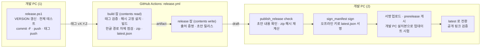
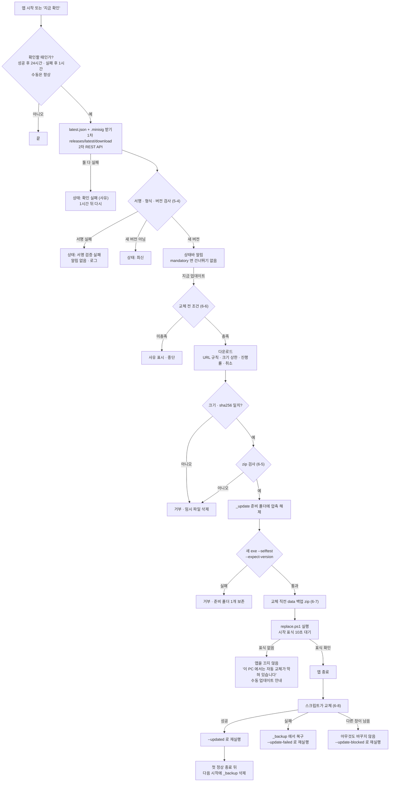

# 업데이트·릴리스 설계

상태: 설계 초안 (2026-10-19) · 아직 구현되지 않음

> 이 문서는 StreamLabeler 를 빌드해 GitHub 에 올리는 절차와, 프로그램 안에서 새 버전을 받아 바꾸는 방법을 정한다.
> 스택·폴더 구조·`paths` 함수는 [02-architecture.md](./02-architecture.md), 라벨 파일 형식과 버전 축은 [03-data-model.md](./03-data-model.md), 위협 모델과 `S-` 번호 항목은 [05-security.md](./05-security.md), 마일스톤(M0~M4)과 일정은 [07-roadmap.md](./07-roadmap.md) 를 본다.
> 이 문서의 숫자(초, 개수, MB)는 모두 시작값이다. 첫 빌드와 시범 운영에서 재고 조정한다.

## 0. 결정 요약

| 주제 | 결정 | 이유 |
|---|---|---|
| 버전 출처 | 저장소 루트의 `VERSION` 한 파일. 나머지는 여기서 생성한다 | ClipSlicer 의 '버전 파일 2개' 동기화 사고를 구조로 없앤다 |
| 태그 | `vX.Y.Z` 만 쓴다. 접미사를 붙이지 않고, 한 번 쓴 번호는 다시 쓰지 않는다 | 파싱이 단순하다. 잘못 걸린 태그는 버리고 다음 번호를 쓴다 |
| 빌드 | GitHub Actions `windows-latest`. 빌드 잡(읽기 권한)과 게시 잡(쓰기 권한)을 나눈다 | 빌드 중에 실행되는 남의 코드가 Release 를 바꾸지 못하게 한다 (S-03) |
| 빌드 입력 | ffmpeg·libmpv 바이너리는 SHA-256 으로 고정하고, pip 는 해시 잠금 파일을 쓴다 | 상류 파일이 바뀐 것을 모른 채 번들하지 않는다 (S-04) |
| 배포물 | 전체 zip, 경량 zip, `SHA256SUMS`, `latest.json`, `latest.json.minisig` | 앱은 서명된 `latest.json` 하나만 믿는다 |
| 신뢰 근거 | 개발 PC 의 오프라인 minisign(Ed25519) 키로 `latest.json` 에 서명한다 | GitHub 계정·토큰이 털려도 가짜 업데이트가 설치되지 않는다 (S-01) |
| 서명 시점 | **M0(v0.0.1)부터 모든 릴리스에 서명하고, 업데이터는 처음부터 서명을 필수로 검사한다** | 공개키는 처음 설치된 사본에 있어야 효력이 있다. '서명이 있으면 검증' 분기는 서명 파일을 지우기만 하면 우회된다. 선정안의 'v1 에 서명' 보다 앞당긴다([07-roadmap.md](./07-roadmap.md) ADR-13·질문 11, [05-security.md](./05-security.md) S-01 도 같다) |
| 서명 위치 | CI 가 아니라 개발 PC. CI 는 서명 없는 초안(draft)까지만 만든다 | 키가 GitHub Secrets 에 있으면 '저장소에 쓸 수 있는 사람 = 서명할 수 있는 사람' 이 된다 |
| 확인 경로 | 1차 `github.com/<저장소>/releases/latest/download/latest.json`, 2차 REST API | 1차는 GitHub 가 문서화한 '최신 릴리스 자산' 고정 링크로, REST API 의 미인증 한도(시간당 60회) 밖이라고 본다 (한도 동작은 확인 필요) |
| 확인 주기 | 성공하면 24시간, 실패하면 1시간 뒤 다시. '지금 확인' 은 언제나 | 실패 한 번이 하루를 막지 않게 한다 (S-41) |
| 교체 방식 | MVP 는 in-place(robocopy) 교체 + ClipSlicer 약점 수정. 확인·준비·적용을 나누고 적용은 `Applier` 뒤에 숨긴다 | 사고로 다져진 코드와 재현 테스트를 그대로 쓰되, 외부 PC 에서 PowerShell 이 막히면 적용 방식만 바꿀 수 있게 한다 |
| 보존 | 프로그램 폴더 안의 사용자 데이터는 `data\` 하나. 교체에서 빼는 것은 전체 경로 `data\`·`_backup\`·`_update\` 세 개뿐 | 0.9.5 /MIR 사고의 근본 원인(제외 목록을 두 곳에서 관리)을 없앤다 |
| 롤백 | 이전 프로그램 사본 `_backup\` 을 첫 정상 종료 뒤까지 보관. 중단된 업데이트·연속 충돌 때 되돌리기 제안, 메뉴 '이전 버전으로 되돌리기' | 새 버전이 켜지기는 하는데 라벨링이 망가진 경우를 라벨러가 스스로 푼다 |
| 코드 서명 | 지금은 하지 않는다. 외부로 넓힐 때 회사 명의 Azure Artifact Signing 또는 SignPath Foundation 을 검토한다. EV 는 사지 않는다 | 한국 개인은 Artifact Signing 자격이 없고, OV·EV 는 SmartScreen 경고를 바로 없애 주지 않는다 |
| 저장소 설정 | 첫날 immutable releases, 태그 룰셋 `v*`, 2FA | 켜기 전에 게시한 릴리스에는 소급되지 않는다 (S-44) |

## 1. 원칙

1. 앱은 서명이 맞는 `latest.json` 에 적힌 파일만 설치한다. 서명·해시·크기 중 하나라도 없거나 다르면 거부한다(fail-closed).
2. 업데이트 코드는 사용자 데이터를 고치지 않는다. 쓰는 곳은 `data\update\` 와 `data\logs\update.log`, 그리고 교체 직전 백업 zip(6-7)뿐이다.
3. 앱을 끄기 전에 교체가 실제로 시작될 수 있는지 확인한다. 앱이 꺼진 뒤에야 실패를 알게 하지 않는다.
4. 실패하면 아무것도 바꾸지 않은 상태로 돌아가는 것이 기본이다. 바꾸는 도중에 실패하면 `_backup\` 으로 되돌린다.
5. 프로세스를 강제로 죽이지 않는다. 기다리다 안 되면 보류한다.
6. 사람에게 보이는 상태는 셋으로 나눈다: 새 버전 있음 / 최신 / 확인 실패(사유).
7. 교체를 실행하는 것은 이미 설치된 옛 버전의 업데이터다. 업데이터 수정은 한 버전 늦게 효과가 난다(12-6). 그래서 첫 라벨러용 버전(v0.1.0)의 업데이터가 이 문서의 MVP 항목을 모두 갖춰야 한다.

## 2. 버전 규칙

### 2-1. 단일 소스

| 파일 | 역할 | 누가 고치나 |
|---|---|---|
| `VERSION` (저장소 루트, `0.1.3` 한 줄, BOM 없음, LF) | 유일한 버전 출처 | 사람 또는 `tools/release.ps1` |
| `app/__init__.py` 의 `__version__` | `tools/sync_version.py` 가 `VERSION` 에서 생성 | 손으로 고치지 않음 |
| `assets/StreamLabeler.manifest` 의 `version="X.Y.Z.0"` | 같은 스크립트가 생성 | 손으로 고치지 않음 |
| `_internal\VERSION`, `_internal\build_info.json` | 빌드가 복사·생성. `build_info.json` = `{version, commit, built_at, channel}` | 빌드 |
| `_internal\deps.txt` | 번들 ffmpeg·libmpv 의 태그와 해시 (6-4 경량 판정) | 빌드 |

- 사람이 고치는 곳은 `VERSION` 하나다. 생성 파일 두 개는 커밋하되 직접 편집하지 않는다(파일 머리에 '자동 생성' 주석).
- CI 는 네 값이 같아야 통과시킨다: 태그, `VERSION`, 생성 파일 두 개, 빌드된 exe 가 `--selftest` 에서 보고하는 버전. `VERSION` 만 고치고 `sync_version.py` 를 잊어도 CI 가 잡는다.
- `channel` 은 `release` 또는 `test` 다(12-2). 게시되는 빌드는 반드시 `release` 다.

### 2-2. 번호를 올리는 규칙

| 바뀐 것 | 올리는 자리 |
|---|---|
| 버그 수정, UI 문구. 라벨 형식은 그대로 | 패치 `0.1.3 → 0.1.4` |
| 기능 추가, 라벨 파일 `schema_version` 변경, 지원 기준서 버전 추가 | 마이너 `0.1.x → 0.2.0` |
| 현업 투입 확정 | `1.0.0` |

- 태그는 `^v\d+\.\d+\.\d+$` 만 허용한다. `-rc1` 같은 접미사는 쓰지 않는다. 시험판은 GitHub 의 prerelease 표시로 구분한다.
- 번호는 다시 쓰지 않는다. CI 가 실패해도 그 번호는 버리고 다음 패치 번호로 간다. immutable releases·태그 룰셋(11장)도 같은 규칙을 강제한다.
- 앱 버전, 기준서 버전(`guide_version`), 라벨 형식 버전(`schema_version`)은 따로 움직인다. 세 축의 관계는 [03-data-model.md](./03-data-model.md) 에 있다. 업데이트가 다루는 것은 매니페스트의 `label_schema_version`·`guide_versions`·`min_supported` 세 필드다(5장).

## 3. 배포물

| 파일 | 내용 | 크기 (추정, 첫 빌드에서 측정) | 누가 쓰나 |
|---|---|---|---|
| `StreamLabeler-vX.Y.Z-win64.zip` | 전체. 최상위 폴더 `StreamLabeler\` 하나 | 165~185MB | 첫 설치, 의존성(ffmpeg·libmpv)이 바뀐 업데이트 |
| `StreamLabeler-vX.Y.Z-win64-update.zip` | 경량. 전체에서 `_internal\ffmpeg\` 와 `_internal\libmpv-2.dll` 만 뺀 것 | 35~45MB | 의존성이 같은 업데이트 |
| `SHA256SUMS` | 두 zip 의 `<hash> *<name>` 줄 (ASCII, LF) | 1KB 미만 | 사람 (수동 확인) |
| `latest.json` | 업데이트 매니페스트 (5장) | 수 KB | 앱 |
| `latest.json.minisig` | `latest.json` 의 minisign 분리 서명 | 1KB 미만 | 앱 |

- 앱은 `SHA256SUMS` 를 읽지 않는다. 해시는 서명된 `latest.json` 안의 값만 쓴다. ClipSlicer release.yml 의 '자산 업로드 순서 의존'(옛 업데이터가 마지막 `.sha256` 을 전체 zip 의 것으로 보는 문제) 이 생길 자리가 없다.
- `deps.txt` 를 릴리스 자산으로 따로 올리지 않는다. 번들 의존성의 태그와 해시는 `latest.json` 의 `deps` 에 들어간다.
- ClipSlicer(전체 287MB, 경량 157MB) 보다 작은 이유는 QtWebEngine 을 넣지 않기 때문이다. 근거는 [02-architecture.md](./02-architecture.md).

## 4. 릴리스 파이프라인

### 4-1. 흐름



서명이 CI 밖에 있는 이유: 키를 GitHub Secrets 에 넣으면 저장소 쓰기 권한을 얻은 쪽(계정 탈취, 토큰 유출, 악성 워크플로)이 서명도 할 수 있다. 그러면 서명은 출처 증명(attestation) 이상의 의미가 없다. 키를 개발 PC 밖으로 내보내지 않아야 서명이 그 공격들을 막는다.

### 4-2. 단계와 이유

| # | 어디서 | 단계 | 하는 일 | 이유 | 도입 |
|---|---|---|---|---|---|
| 1 | 개발 PC | 릴리스 준비 | `tools/release.ps1 -Version X.Y.Z -MessageFile msg.txt`: 형식·태그 중복 검사 → `VERSION` 쓰기와 `sync_version.py` → `pytest`(로컬 전용 robocopy 안전 테스트 포함) → `git add -u` + 명시 경로, 추적 안 된 파일이 남으면 중단 → `git commit -F` → push → 성공했을 때만 태그 → 태그 push | 2026-10-16 '잘못된 커밋에 태그' 사고를 막은 ClipSlicer 절차를 그대로 쓴다. `git add -A` 를 쓰지 않아 실제 채팅이 든 파일이 딸려 올라가지 않게 한다 (S-21) | M0 |
| 2 | build 잡 | 태그 검증 | 태그 형식, `VERSION`·생성 파일과 같은지, 태그 커밋이 `main` 에 포함되는지(`git merge-base --is-ancestor`) | 엉뚱한 커밋·브랜치의 빌드가 나가지 않게 한다 | M0 |
| 3 | build 잡 | 의존성 설치 | `pip` 버전 고정, `pip install --require-hashes -r requirements.lock`, `tools/get_ffmpeg.py`·`get_libmpv.py` 가 받은 파일을 내장 SHA-256 과 비교 | 상류 계정이 털려 같은 이름의 파일이 바뀌어도 빌드가 멈춘다 (S-04) | M0 |
| 4 | build 잡 | 단위 테스트 | `pytest -m "not local_only"` | 태그를 release.ps1 밖에서 push 했을 때의 안전망 | M0 |
| 5 | build 잡 | 빌드 | `build.ps1 -Channel release`: PyInstaller onedir, `--noupx`, `build_info.json`·`deps.txt` 생성, PATH 를 비운 상태에서 번들 ffmpeg 검증 | UPX 는 빌드 환경에 따라 결과가 달라지고 백신 오탐을 늘린다 (S-17) | M0 |
| 6 | build 잡 | 한글 경로 자체 점검 | `$RUNNER_TEMP\테스트 문서\StreamLabeler` 사본에서 `--selftest out.json --expect-version X.Y.Z` | 0.9.5~0.9.7 의 한글 경로 오류를 릴리스 전에 잡던 장치를 그대로 쓴다. 버전을 한 번 더 확인한다 | M0 |
| 7 | build 잡 | zip 과 해시 | 전체·경량 zip 을 만들고 `SHA256SUMS` 를 Python 으로 쓴다(BOM·CRLF 없음). 앱과 같은 zip 검사(6-5)를 `tools/check_release_zip.py` 로 돌린다 | 잘못 묶인 zip 을 게시 전에 걸러낸다 (S-43) | M0 |
| 8 | build 잡 | 매니페스트 생성 | `tools/make_manifest.py`: `VERSION`, 릴리스 노트, zip 의 크기·해시·압축 해제 크기·파일 수, `deps` → `latest.json` (서명 없음) | 해시를 사람이 옮겨 적지 않는다 | M0 |
| 9 | build 잡 | artifact 업로드 | `actions/upload-artifact` (커밋 SHA 고정) | 잡 사이 전달 | M0 |
| 10 | release 잡 | 출처 증명 | `actions/attest-build-provenance` 로 zip 두 개에 SLSA provenance 를 남긴다 | '이 zip 이 이 저장소·이 커밋·이 워크플로에서 나왔다' 를 나중에 증명한다 (S-44). 공개 저장소는 무료. 작업은 30분 안팎이라 앞당겨도 된다 | v1 (07 로드맵과 같음) |
| 11 | release 잡 | 초안 릴리스 | checkout 없이 artifact 만 받아 `gh release create vX.Y.Z --draft --verify-tag` 로 zip·`SHA256SUMS`·`latest.json` 을 올린다 | 쓰기 권한 잡에서 서드파티 코드가 돌지 않는다(`gh` 는 러너에 기본 설치). immutable releases 는 게시 후 자산 추가를 막으므로 초안으로 둔다 | M0 |
| 12 | 개발 PC | 초안 확인 | `tools/publish_release.py check vX.Y.Z`: 초안의 `latest.json` 을 받아 버전·노트·크기를 보여 주고, zip 두 개를 받아 해시가 `latest.json` 과 같은지 다시 계산한다 | 서명은 '내가 확인한 것' 에만 한다. CI 변조를 한 번 더 걸러낸다 | M0 |
| 13 | 개발 PC | 서명 | `tools/sign_manifest.py sign latest.json`(오프라인 키, 암호 입력) → `latest.json.minisig`. 내장 공개키로 즉시 검증한다 | 신뢰의 뿌리를 GitHub 밖에 둔다 (9장) | M0 |
| 14 | 개발 PC | 서명 업로드·게시 | `.minisig` 를 초안에 올리고 **prerelease 로** 게시한다 | latest 가 아니므로 라벨러에게는 아직 보이지 않는다 | M0 |
| 15 | 개발 PC | 내부 확인 | 개발 PC 의 설치본(숨은 설정 `update_channel=beta`)에서 앱 내 업데이트를 끝까지 한 번 돌린다 | '게시 = 전원 배포' 가 되지 않게 하는 가장 싼 단계적 배포다 | M4 (MVP) |
| 16 | 개발 PC | latest 전환 | prerelease 를 풀고 latest 로 지정한다(`make_latest`). `releases/latest/download/latest.json` 이 새 버전을 주는지와 서명이 맞는지 확인한다 | 라벨러에게 실제로 보이는 순간 | M0 |

- M0 기간(개발자 혼자)에는 15단계를 건너뛰고 14에서 16으로 바로 가도 된다.
- 12·14·16단계는 초안을 읽고 쓰므로 인증이 필요하다. 개발 PC 에 `gh` CLI 를 설치해 쓰는 것을 추천한다(지금은 없음, 16장 질문). 설치하지 않으면 `publish_release.py` 가 REST API 를 직접 부르고 토큰은 환경 변수에서만 읽는다.
- 워크플로 안의 로직은 되도록 `tools/*.py` 로 뺀다. 같은 스크립트를 로컬에서 돌려 볼 수 있고, PowerShell 인라인의 인코딩 함정(BOM·cp949)이 줄어든다.
- `workflow_dispatch` 로 수동 실행하면 build 잡만 돌아 artifact 를 만든다. Release 는 만들지 않고, zip 이름은 `dev-<커밋 7자리>` 로 한다.

### 4-3. release.yml 골격

전체 파일이 아니라 구조만 보인다. `<commit-sha>` 는 실제 작성 때 전체 커밋 SHA 로 채운다.

```yaml
name: Release
on:
  push:
    tags: ["v*"]
  workflow_dispatch:
permissions: {}                      # 기본은 아무 권한 없음. 잡마다 필요한 것만 연다
env:
  PYTHONUTF8: "1"
  PYTHONIOENCODING: utf-8
jobs:
  build:
    runs-on: windows-latest
    permissions:
      contents: read
    steps:
      - uses: actions/checkout@<commit-sha>          # v4.x
        with:
          persist-credentials: false                 # 토큰을 .git/config 에 남기지 않는다
          fetch-depth: 0                             # 태그 커밋의 main 포함 여부 검사용
      - uses: actions/setup-python@<commit-sha>      # v5.x
        with:
          python-version: "3.12"
      - name: 태그 검증
        if: startsWith(github.ref, 'refs/tags/v')
        run: python tools/check_tag.py "${{ github.ref_name }}"
      - name: 의존성 (해시 고정)
        run: |
          python -m pip install pip==<고정 버전>
          pip install --require-hashes -r requirements.lock
          python tools/get_ffmpeg.py
          python tools/get_libmpv.py
      - name: 단위 테스트
        run: python -m pytest -q -m "not local_only"
      - name: 빌드
        shell: pwsh
        run: .\build.ps1 -Channel release
      - name: 한글 경로 자체 점검
        run: python tools/ci_selftest.py --korean-dir "${{ runner.temp }}\테스트 문서"
      - name: zip · SHA256SUMS · latest.json
        run: python tools/package_release.py --out out
      - uses: actions/upload-artifact@<commit-sha>   # v4.x
        with:
          name: release
          path: out/
  release:
    if: startsWith(github.ref, 'refs/tags/v')
    needs: build
    runs-on: ubuntu-latest
    permissions:
      contents: write
      id-token: write                                # attestation 용 (v1)
      attestations: write                            # attestation 용 (v1)
    steps:
      - uses: actions/download-artifact@<commit-sha>
        with:
          name: release
          path: out
      - uses: actions/attest-build-provenance@<commit-sha>   # v1
        with:
          subject-path: "out/*.zip"
      - name: 초안 릴리스
        env:
          GH_TOKEN: ${{ github.token }}
          GH_REPO: ${{ github.repository }}
        run: >
          gh release create "${{ github.ref_name }}" --draft --verify-tag
          --title "StreamLabeler ${{ github.ref_name }}" --notes-file out/notes.md
          out/*.zip out/SHA256SUMS out/latest.json
```

- `ci.yml`(push·PR 마다)은 build 잡의 2~4단계만 돌린다. 같은 SHA 고정 규칙과 `persist-credentials: false` 를 쓴다.
- 릴리스 노트는 GitHub 자동 생성(`generate_release_notes`)을 쓰지 않는다. 앱에 보이는 한국어 노트는 `docs/release-notes/vX.Y.Z.md` 한 곳에서 나오고, 같은 문장이 Release 본문과 `latest.json` 의 `notes_ko` 에 들어간다.

### 4-4. 빌드 입력 고정

| 대상 | 방법 | 갱신할 때 |
|---|---|---|
| ffmpeg (BtbN shared 빌드) | `tools/get_ffmpeg.py` 에 `TAG`·`ASSET`·`SHA256` 상수. 받은 직후 비교하고 다르면 예외로 빌드를 끊는다 | TAG 를 올릴 때 개발 PC 에서 새 해시를 적는다. 상류에 공개 체크섬이 있으면 대조한다 (있는지 확인 필요) |
| libmpv (shinchiro 빌드) | `tools/get_libmpv.py` 에 같은 방식 | 같음 |
| Python 패키지 | 최상위만 적은 `requirements.in` → `pip-compile --generate-hashes` → `requirements.lock`. CI·로컬 모두 `--require-hashes` 로 설치 | `tools/lock_deps.ps1` 한 번. pip-compile 이 PySide6 휠 해시를 문제없이 만드는지는 확인 필요. 안 되면 M0 는 전이 의존성까지 버전만 고정하고 해시는 M4 에 넣는다 |
| GitHub Actions | 전체 커밋 SHA 와 `# v4.2.2` 같은 주석. Dependabot 이 주간 PR 을 만든다 | PR 을 보고 병합 |
| 번들 의존성 기록 | 빌드가 `_internal\deps.txt` 와 `latest.json` 의 `deps` 에 같은 값을 쓴다 | 자동 |

- CI 에서는 py7zr 을 쓰지 않고 러너의 `7z.exe` 만 쓴다(의존성 트리 축소). ClipSlicer release.yml 의 고정 안 된 `pip install pillow` 같은 줄은 두지 않는다.
- 이 고정이 잡는 것은 '같은 이름, 다른 내용' 이다. 상류가 처음부터 악성 파일을 낸 경우는 막지 못한다.

## 5. 업데이트 매니페스트

### 5-1. 파일 두 개 — 서명을 JSON 안에 넣지 않는 이유

- 본문 `latest.json` 과 분리 서명 `latest.json.minisig` 를 함께 올린다. 매니페스트 항목의 `signature` 는 이 분리 파일이다.
- 서명을 JSON 안에 넣으면 '서명 대상 바이트' 를 정하려고 정규화(canonical JSON)를 구현해야 한다. 거기서 버그가 나면 검증이 왜 통과하거나 실패하는지 알기 어렵다. 분리 서명은 받은 바이트를 그대로 검증한다.
- 형식은 minisign(Ed25519). 이유: 서명 파일에 키 ID 가 들어 있어 두 공개키 중 어느 것으로 서명했는지 알 수 있고, 순수 Python 검증 라이브러리(py-minisign)와 공식 CLI 가 모두 있으며, 서명에 포함되는 trusted comment 를 쓸 수 있다.

### 5-2. 필드

| 키 | 타입 | 뜻 | 앱의 검사 |
|---|---|---|---|
| `manifest_version` | int | 이 형식의 버전. 지금은 1 | 앱이 아는 값보다 크면 자동 업데이트 대신 '수동 업데이트 필요' 안내 |
| `app` | string | `"StreamLabeler"` | 다르면 거부 |
| `version` | string `X.Y.Z` | 새 버전 | 설치본보다 커야 한다. 같거나 작으면 무시 (다운그레이드 방지) |
| `published_at` | string, ISO 8601 UTC | 매니페스트를 만든 시각 | 설치본 `build_info.built_at` 보다 이르면 거부. 표시에도 쓴다 |
| `min_supported` | string `X.Y.Z` | 이보다 낮은 앱은 지원 종료 | 설치본이 이보다 낮으면 '업데이트 필요' 모드 (5-5) |
| `mandatory` | bool | 건너뛸 수 없는 업데이트 | true 면 '이 버전 건너뛰기' 를 숨기고 시작할 때마다 알린다 (5-5) |
| `label_schema_version` | int | 이 버전이 쓰는 라벨 형식 | 설치본과 다르면 대화상자에 '라벨 형식이 바뀝니다' 경고 |
| `guide_versions` | string[] | 이 버전이 지원하는 기준서 버전 | 열린 프로젝트의 `guide_version` 이 목록에 없으면 경고 |
| `notes_ko` | string | 한국어 릴리스 노트 (일반 텍스트, 8KB 이하) | 8KB 를 넘으면 자른다. 일반 텍스트로만 표시하고 링크를 열지 않는다 (S-18) |
| `deps` | object | `{"ffmpeg": {"tag", "sha256"}, "libmpv": {"tag", "sha256"}}` (상류 아카이브의 태그와 해시) | 경량 zip 선택 조건 (6-4) |
| `assets[]` | object[] | 내려받을 파일 | 아래 하위 키 |
| `assets[].kind` | `"full"` 또는 `"lite"` | 전체·경량 | 각각 정확히 하나 |
| `assets[].name` | string | 파일 이름 | `StreamLabeler-v{version}-win64.zip` 또는 `...-win64-update.zip` 과 같아야 한다 |
| `assets[].size` | int | 바이트 수 | 받은 크기와 정확히 같아야 한다. 2GiB 미만 |
| `assets[].sha256` | string (소문자 hex 64자) | 해시 | 받은 파일과 같아야 한다 |
| `assets[].url` | string | 다운로드 주소 | `https://github.com/vtubeadmirer/streamlabeler/releases/download/v{version}/{name}` 과 글자 그대로 같아야 한다 (호스트 화이트리스트) |
| `assets[].unpacked_size` | int | 압축을 풀었을 때 크기 합 | zip 항목 크기 합과 같아야 한다 (zip 폭탄 방지) |
| `assets[].file_count` | int | 파일 수 | zip 항목 수와 같아야 한다. 3,000 이하 |

- 같은 `manifest_version` 안에서는 필드 추가만 한다. 앱은 모르는 키를 무시한다.
- JSON 스키마는 `schemas/update_manifest.schema.json` 으로 둔다(아직 없음). [03-data-model.md](./03-data-model.md) 의 스키마 묶음과 함께 관리한다.
- `url` 은 `make_manifest.py` 가 태그와 이름으로 만든다. 초안 단계의 API 주소를 쓰지 않는다(초안 자산 주소는 게시 후와 다르다).

### 5-3. 예시

```json
{
  "manifest_version": 1,
  "app": "StreamLabeler",
  "version": "0.1.3",
  "published_at": "2026-11-02T05:05:00Z",
  "min_supported": "0.1.0",
  "mandatory": false,
  "label_schema_version": 1,
  "guide_versions": ["0.1"],
  "notes_ko": "반응 편집기에서 재확인 버튼이 비활성으로 남던 문제를 고쳤습니다.\n채팅 표 검색이 빨라졌습니다.",
  "deps": {
    "ffmpeg": {"tag": "autobuild-2026-10-12-13-12", "sha256": "<64자>"},
    "libmpv": {"tag": "20261013", "sha256": "<64자>"}
  },
  "assets": [
    {
      "kind": "full",
      "name": "StreamLabeler-v0.1.3-win64.zip",
      "size": 178123456,
      "sha256": "<64자>",
      "url": "https://github.com/vtubeadmirer/streamlabeler/releases/download/v0.1.3/StreamLabeler-v0.1.3-win64.zip",
      "unpacked_size": 421000000,
      "file_count": 338
    },
    {
      "kind": "lite",
      "name": "StreamLabeler-v0.1.3-win64-update.zip",
      "size": 41234567,
      "sha256": "<64자>",
      "url": "https://github.com/vtubeadmirer/streamlabeler/releases/download/v0.1.3/StreamLabeler-v0.1.3-win64-update.zip",
      "unpacked_size": 112000000,
      "file_count": 301
    }
  ]
}
```

`latest.json.minisig` 의 trusted comment: `StreamLabeler latest.json v0.1.3`

### 5-4. 검증 순서

1. 크기 상한: `latest.json` 64KB 이하, `.minisig` 2KB 이하. 넘으면 읽지 않는다.
2. 서명: `.minisig` 의 키 ID 가 내장 공개키 두 개(9장) 중 하나와 같고 Ed25519 검증이 통과해야 한다. 파일이 없으면 실패다. trusted comment 의 버전이 본문의 `version` 과 같아야 한다.
3. JSON 파싱: `NaN`·`Infinity` 거부, 최상위가 object.
4. `manifest_version`, `app`, 필드 타입·형식.
5. `version` 이 설치본보다 크고, `published_at` 이 설치본 빌드 시각보다 늦다.
6. `assets` 의 `name`·`url` 이 규칙과 같다.
7. 여기까지 통과해야 '새 버전 있음' 으로 표시한다.

- 다운그레이드·재생 방지는 '설치본 버전보다 커야 한다' 하나로 충분하다고 본다. 하한이 설치본 자체에 들어 있어 `data\` 를 지워도 사라지지 않는다. 마지막으로 받은 매니페스트를 따로 기억하는 규칙은 두지 않는다(긴급 철회 13장과 충돌하고, 막는 위협이 작다).
- 서명 검증 실패는 '확인 실패' 와 따로 '서명 검증 실패 — 개발자에게 알려 주세요' 로 보인다. 공격이거나 릴리스 실수다.

### 5-5. `mandatory` 와 `min_supported` 의 동작

| 상황 | 앱의 동작 | 라벨링 |
|---|---|---|
| 새 버전, `mandatory=false` | 상태바 알림, [이 버전 건너뛰기] 가능 | 계속 가능 |
| 새 버전, `mandatory=true` | 건너뛰기 없음, 시작할 때마다 알림 | 계속 가능 |
| 설치본 < `min_supported` | '업데이트 필요' 모드: 상단 고정 안내 + [업데이트] [수동 업데이트 안내] | **새 라벨 저장 막음**. 열람·내보내기는 가능 |
| 확인 실패 (오프라인 등) | 아무것도 강제하지 않음 | 계속 가능 |

- `min_supported` 는 라벨 형식이나 기준서 호환이 깨질 때만 올린다. 앱 버전이 섞이면 정답 데이터 형식이 섞이기 때문이다(안내서 7-1 '기준서 버전' 기록).
- 자동 교체가 막힌 PC 의 라벨러도 빠져나갈 수 있게, '업데이트 필요' 모드에서는 수동 업데이트 안내(8장)를 반드시 함께 보인다.
- 매니페스트를 못 받은 상태에서 막지 않는 이유: 오프라인 작업을 막으면 네트워크 장애가 라벨링 중단이 된다.

## 6. 프로그램 쪽 흐름

### 6-1. 전체 그림



### 6-2. 확인 주기와 경로

- 시점: 앱 시작 30초 뒤(창이 뜨고 프로젝트를 연 뒤) 백그라운드 스레드에서. 마지막 성공 뒤 24시간이 지났거나 마지막 실패 뒤 1시간이 지났을 때만 확인한다. '지금 확인' 은 주기와 상관없이 바로 한다.
- 경로:
  1. `GET https://github.com/vtubeadmirer/streamlabeler/releases/latest/download/latest.json` 과 같은 경로의 `.minisig`. GitHub 문서에 있는 '최신 릴리스 자산 직접 링크' 형식이다. `api.github.com` 이 아니어서 미인증 시간당 60회 한도와 무관하다고 본다(실제 한도 동작은 확인 필요). 사무실 하나에 라벨러 여럿이 같은 공인 IP 를 써도 문제가 덜하다.
  2. 1이 실패(404·네트워크 오류)하면 `GET https://api.github.com/repos/vtubeadmirer/streamlabeler/releases/latest` 에서 `latest.json`·`.minisig` 자산을 찾아 받는다.
  3. 둘 다 실패하면 '확인 실패'.
  - 숨은 설정 `update_channel=beta`(개발자·내부 확인용)는 `GET /repos/vtubeadmirer/streamlabeler/releases?per_page=10` 에서 초안을 뺀 가장 높은 버전(prerelease 포함)의 `latest.json` 을 쓴다.
- 요청 공통: `User-Agent: StreamLabeler-updater/<버전>`, 연결·읽기 제한 10초, 리다이렉트는 https 로만 최대 5번. 앱에 토큰(PAT)을 넣지 않는다 — 공개 바이너리 속 토큰은 저장소 쓰기 권한을 공개하는 것과 같다.
- 상태 표시: 상태바에 '새 버전 vX.Y.Z' / '최신 (마지막 확인 hh:mm)' / '업데이트 확인 실패 — 사유'. ClipSlicer 처럼 '최신입니다 (또는 확인에 실패했습니다)' 로 섞지 않는다.
- 기록: `data\update\state.json` = `{last_ok_at, last_fail_at, last_fail_reason, last_seen_version, skip_version}`. 확인 시각은 결과가 나온 뒤에 쓴다. ClipSlicer 는 결과 전에 써서 실패 한 번이 주기 전체를 막았다(S-41).
- 라벨링 세션 메타에 `app_version`, `update_check_state`, `checked_at` 를 남긴다. 구버전으로 매긴 세션을 나중에 걸러내기 위해서다 ([03-data-model.md](./03-data-model.md)).

### 6-3. 알림과 대화상자

- 알림은 상태바 버튼 '새 버전 vX.Y.Z' 로만 한다. 모달 창으로 작업을 끊지 않는다.
- 대화상자: 버전, 내려받을 크기(전체·경량 중 선택된 것), 노트(일반 텍스트), 라벨 형식·기준서 변화 경고, 버튼 [지금 업데이트] [나중에] [이 버전 건너뛰기](mandatory 면 없음) [릴리스 페이지 열기].
- 릴리스 페이지 주소는 매니페스트 문자열이 아니라 앱이 만든다: `https://github.com/vtubeadmirer/streamlabeler/releases/tag/v{version}` (`version` 은 정규식 검사 뒤). 외부 문자열을 `os.startfile` 에 넘기지 않는다 (S-18).
- 진행 중인 작업(채팅 수집, 분석, 외부 도구 실행)이 있으면 [지금 업데이트] 를 비활성으로 두고 사유를 보인다.

### 6-4. 다운로드

- 고르기: 매니페스트 `deps` 가 로컬 `_internal\deps.txt` 와 같고 `_internal\ffmpeg\ffmpeg.exe`·`_internal\libmpv-2.dll` 이 있으면 경량, 아니면 전체.
- 저장 위치: `<앱>\_update\<임의 이름>\pkg.zip.part` (`<임의 이름>` 은 `tempfile.mkdtemp`). 다 받고 해시가 맞으면 `pkg.zip` 으로 이름을 바꾼다.
  - `%TEMP%` 가 아니라 `_update\` 인 이유: 앱과 같은 볼륨이라 교체 robocopy 가 볼륨을 넘지 않고, 고정 이름 폴더의 두 창 레이스(ClipSlicer `%TEMP%\ClipSlicer-update`)가 없고, Storage Sense 정리 대상이 아니다 (S-42). 저장소 `.gitignore` 에 이미 `_update/` 가 있다.
- 주소: `assets[].url` 이 5-2 규칙과 같아야 시작한다. 리다이렉트 대상 호스트는 고정하지 않는다. GitHub 가 다운로드 호스트를 `objects.githubusercontent.com` 에서 `release-assets.githubusercontent.com` 으로 바꾼 전례가 있고, 무결성은 서명된 해시가 보장한다. 다만 https 가 아니면 중단한다.
- 크기: `Content-Length` 가 있으면 `size` 와 같아야 한다. 받으면서 센 바이트가 `size` 를 넘는 순간 중단한다.
- 시간: 소켓 읽기가 30초 동안 멈추면 중단한다. 전체 시간 제한은 두지 않고 진행률(받은 MB / 전체 MB, 속도)과 [취소] 를 보인다.
- 취소·실패: `.part` 와 준비 폴더를 지운다. 아무것도 바뀌지 않는다.

### 6-5. 검증과 압축 해제

1. `sha256(pkg.zip)` 이 `assets[].sha256` 과 같아야 한다.
2. zip 검사 (`validate_zip`). 릴리스 쪽 `tools/check_release_zip.py` 도 같은 함수를 쓴다.

| 검사 | 기준 | 막는 것 |
|---|---|---|
| 항목 수 | `file_count` 와 같고 3,000 이하 | 비정상 패키지 |
| 압축 해제 크기 합 | `unpacked_size` 와 같고 2GiB 이하 | zip 폭탄, 디스크 채우기 |
| 경로 | 모두 `StreamLabeler/` 로 시작. `..`, 절대경로, 드라이브 문자, `:` 없음 | zip-slip. Python 3.12 `extractall` 도 정리하지만 명시적으로 거부한다 |
| 필수 파일 | `StreamLabeler/StreamLabeler.exe`, `StreamLabeler/_internal/VERSION` (내용 = `version`) | 엉뚱한 레이아웃·버전 |
| 금지 항목 | `StreamLabeler/data/`, `StreamLabeler/_backup/`, `StreamLabeler/_update/` | 보존 폴더를 zip 이 덮는 사고 |
| 이름 중복 | 대소문자를 무시하고(casefold) 같은 이름이 없음 | Windows 에서 서로 덮어씀 |
| 경량 zip | `_internal/ffmpeg/`, `_internal/libmpv-2.dll` 이 없어야 함 | 경량·전체가 뒤바뀐 릴리스 |

3. `_update\<임의 이름>\new\` 에 압축을 풀고 `pkg.zip` 을 지운다.

ClipSlicer `find_app_dir` 의 'os.walk 로 처음 찾은 exe' 방식은 쓰지 않는다. 경로는 고정이다.

### 6-6. 교체 전 조건 — 앱을 끄기 전에 모두 확인

| 조건 | 확인 방법 | 안 맞으면 |
|---|---|---|
| 프로그램 폴더에 쓸 수 있음 | 시험 파일을 쓰고 지운다 | 자동 업데이트 대신 수동 안내 (8장) |
| 네트워크 드라이브가 아님 | 경로가 `\\` 로 시작하지 않음 | 수동 안내. 네트워크 드라이브 설치는 지원하지 않는다 |
| 진행 중 작업 없음 | 워커 목록(수집·분석·도구) | 사유 표시 |
| 같은 폴더의 다른 창 없음 | 단일 인스턴스(`QLockFile`, `data\instance.lock`)라 원래 없다. 스크립트가 한 번 더 기다린다 | — |
| 디스크 여유 | 앱 볼륨: 압축 해제 크기 + 현재 설치 크기(`_backup` 몫) × 1.2. 백업 폴더 볼륨: 예상 백업 크기 × 1.2 | 어느 드라이브가 얼마나 모자란지 표시 |
| OneDrive 아래인가 | 앱 경로가 `%OneDrive%`·`%OneDriveCommercial%`·`%OneDriveConsumer%` 로 시작(대소문자 무시) | 경고: '동기화를 잠시 멈추거나 `%LOCALAPPDATA%\Programs\StreamLabeler` 로 옮기세요'. 진행은 허용하고 선택을 로그에 남긴다 |
| 이동식 드라이브 | `GetDriveTypeW` 가 `DRIVE_REMOVABLE` 이거나 파일 시스템이 FAT 계열 | 경고: '1~3분 동안 뽑지 마세요' (v1) |
| 새 exe 자체 점검 통과 | `_update\<id>\new\StreamLabeler\StreamLabeler.exe --selftest <json> --expect-version X.Y.Z --data-dir _update\<id>\selftest-data`, 창 없음, 90초 제한 | 거부. 준비 폴더는 원인 분석용으로 1개만 남긴다 (더 오래된 것은 지움) |
| 교체 직전 data 백업 성공 | 6-7 | 거부 |

- 자체 점검의 `--data-dir` 은 사용자의 `data\` 를 건드리지 않게 하려는 것이다. 점검 항목은 [02-architecture.md](./02-architecture.md) 의 selftest 표(버전, libmpv 로드, ffmpeg 실행, thresholds·기준서 해시, 한글 임시 폴더에서 프로젝트 쓰기·읽기)에 두 가지를 더한다: `channel == "release"`, 내장 공개키에 시험용 키가 없음.
- Python `zipfile` 로 푼 파일에는 인터넷 다운로드 표시(MOTW)가 붙지 않아 SmartScreen 창이 뜨지 않을 것으로 본다 (확인 필요). 백신 실시간 검사로 첫 실행이 느릴 수 있어 제한을 90초로 넉넉히 둔다.

### 6-7. 교체 직전 data 백업

- 대상: `data\settings.ini`, `data\labelers.json`, 그리고 최근 목록에 있는 모든 프로젝트(앱 폴더 밖 프로젝트 포함)의 `labels\`·`project.json`·`samples\`·`locks\`·`relabel\`.
- 제외: `chat\`(수집 뒤 바뀌지 않아 앱이 고치지 않는다), `derived\`(다시 만들 수 있다), `identities.jsonl`(보호 파일. 사본을 늘리지 않는다, S-06).
- 위치: `paths.backup_root()\pre-update\` (기본 `%LOCALAPPDATA%\StreamLabeler\backups\pre-update\`). 이름 `pre-update-<이전>-to-<새>-<yyyymmddHHMMSS>.zip`. 최근 5개만 남긴다(시작값).
- 앱 폴더 밖에 두는 이유: 라벨러가 옛 앱 폴더를 지워도 백업은 남아야 한다 (S-39).
- 업데이터가 하는 이유: 업데이트 코드는 `data\` 를 고치지 않지만, **새 버전**이 첫 실행에서 라벨 파일을 잘못 읽거나 마이그레이션 버그를 낼 수 있다. 새 버전 안에서 백업하면 그 코드가 죽었을 때 사본이 없다.
- 실패하면 업데이트를 멈춘다. 일 1회 백업·보존·파기 규칙은 [03-data-model.md](./03-data-model.md)·[05-security.md](./05-security.md) 와 같아야 한다.

### 6-8. 교체 — MVP 의 in-place 방식

앱이 하는 일:

1. `data\update\updating.lock` 에 `{pid, from, to, started_at}` 를 쓴다. ClipSlicer 는 스크립트가 시작하면서 잠금을 써서, 그 사이에 exe 를 다시 켜면 검사를 통과하고 파일을 잠갔다.
2. `replace.ps1` 을 `_update\<id>\` 에 쓴다. 내용은 `app/appspec.py` 의 값(보존 경로, exe 이름)으로 생성한다. PowerShell 5.1 이 한글 주석을 읽도록 UTF-8 BOM 을 **바이트로 직접** 붙인다. `utf-8-sig` 코덱은 업데이트 도중 로드에 실패한 전례가 있다(ClipSlicer 0.9.5).
3. `powershell -NoProfile -ExecutionPolicy Bypass -WindowStyle Hidden -File <replace.ps1> -AppPid <pid> -App <앱 폴더> -New <새 폴더> -Id <id> [-Lite]` 를 실행한다. 출력은 bytes 로 받아 UTF-8, 안 되면 cp949 순서로 디코딩한다(0.9.8 사고).
4. `_update\<id>\started` 가 10초 안에 생기는지 본다. 없으면 앱을 끄지 않고 '이 PC 에서는 자동 교체가 막혀 있습니다' 와 수동 업데이트 안내를 보인다. `Get-ExecutionPolicy -List` 결과를 로그에 남긴다 (S-17). 정책(GPO·AppLocker·Constrained Language Mode·백신)이 스크립트를 막은 경우를 앱이 살아 있을 때 잡는다.
5. 표식이 있으면 앱을 종료한다.

스크립트가 하는 일:

| 단계 | 하는 일 | 실패하면 |
|---|---|---|
| 1 | 매개변수를 확인하고 `started` 표식을 쓴다 | 앱이 10초 뒤 실패로 처리 |
| 2 | 앱 프로세스 종료를 기다린다 (최대 60초) | 3단계에서 판단 |
| 3 | 같은 폴더(`$App` 끝에 `\` 를 붙인 접두사로 비교)에서 실행 중인 프로세스가 없어질 때까지 최대 120초 기다린다. 죽이지 않는다. 기다리는 동안 30초마다 잠금 파일의 시각을 갱신한다 | 아무것도 바꾸지 않고 `--update-blocked` 로 재실행 |
| 4 | 새 폴더에 필수 파일이 있는지 본다: `StreamLabeler.exe`, `_internal\python312.dll`, `_internal\VERSION`, 전체 zip 이면 `_internal\libmpv-2.dll` | 백신이 그 사이 격리했을 수 있다. 아무것도 바꾸지 않고 `--update-failed` |
| 5 | 백업: `robocopy $App $App\_backup /MIR /XD $App\data $App\_backup $App\_update /R:2 /W:1` | rc ≥ 8 이면 아무것도 바꾸지 않고 `--update-failed`. ClipSlicer 는 이 rc 를 보지 않았다 |
| 6 | `data\update\backup_ok.json` = `{version: 이전 버전, at}` | — |
| 7 | 교체: `robocopy $New $App /MIR /XD $App\data $App\_backup $App\_update [경량이면 $App\_internal\ffmpeg] [경량이면 /XF libmpv-2.dll] /R:2 /W:1` | rc ≥ 8 이면 8단계 |
| 8 | 복구: `robocopy $App\_backup $App /MIR /XD (5단계와 같음)`. 복구 rc 도 기록 | 복구도 rc ≥ 8 이면 `restore_failed` 를 기록하고 재실행을 시도. 사용자 안내는 6-10 |
| 9 | `data\update\last_result.json` = `{result, from, to, backup_rc, copy_rc, restore_rc, at}`, `data\logs\update.log` 에 줄을 더한다 | — |
| 10 | 잠금 파일을 지우고 `--updated` 또는 `--update-failed` 로 재실행 | — |

- `/XD` 에 이름(`data`)이 아니라 전체 경로(`$App\data`)를 준다. 이름만 주면 `_internal` 안의 같은 이름 폴더까지 교체에서 빠진다. 전체 경로 `/XD` 가 `/MIR` 의 삭제에서도 대상을 지키는지는 사고 재현 테스트로 확인한다 (확인 필요).
- 원본 `$New` 가 대상 안(`$App\_update\...`)에 있지만 `/XD $App\_update` 로 빠지므로 재귀하지 않는다고 본다. 이것도 테스트로 확인한다 (확인 필요).
- `/XF libmpv-2.dll` 은 이름으로 맞춘다. 같은 이름의 파일이 다른 곳에 없다는 전제다 (확인 필요).
- ClipSlicer 의 '같은 폴더 보조 프로세스 `Stop-Process -Force`' 는 넣지 않는다. 라벨링 도구에는 보조 프로세스가 없고, 접두사 오매칭(`C:\Tools\ClipSlicer` 가 `C:\Tools\ClipSlicer-old\x.exe` 도 매칭)으로 무관한 프로그램을 죽일 위험이 있었다.
- 스크립트 안에서는 되도록 .NET 정적 호출 대신 내장 cmdlet 을 쓴다(Constrained Language Mode 호환). 실제 차단 사례가 나오기 전까지는 그 이상 하지 않는다.
- 스크립트는 `_update\<id>\` 를 지우지 않는다(자기 자신이 그 안에 있다). 다음 정상 시작 때 앱이 `_update\` 아래 남은 폴더를 이름 형식을 확인한 뒤 지운다. 자체 점검 실패로 보존 중인 1개는 남긴다.

실행 중인 인스턴스: 앱은 폴더당 하나만 뜬다. 다른 폴더의 사본은 이 폴더의 파일을 잠그지 않는다. 120초 대기는 창을 닫는 중인 짧은 겹침을 위한 것이다.

OneDrive: 6-6 에서 경고한다. 동기화 엔진이 파일을 잠그면 robocopy 가 재시도한 뒤 rc ≥ 8 로 끝나고 복구로 간다. 설치 권장 위치는 `%LOCALAPPDATA%\Programs\StreamLabeler` 다. 사용자 전용 권한이 상속되고, OneDrive 밖이며, 관리자 권한이 필요 없다 (S-08, [02-architecture.md](./02-architecture.md)). `C:\Tools` 처럼 드라이브 바로 아래 새 폴더는 '인증된 사용자 수정' 권한을 물려받아 권하지 않는다.

USB: 교체 중에 뽑으면 반쯤 바뀐 폴더가 남을 수 있다. in-place 방식의 구조적 한계다(6-11).

### 6-9. 재실행·성공 확인·정리

| 실행 인자·상황 | 새 앱이 하는 일 |
|---|---|
| `--updated` | 'vX.Y.Z 로 업데이트했습니다' 와 노트를 보인다. `data\run\<pid>.running` 표식을 만들고 정상 종료 때 지운다. `_backup\` 은 **아직 지우지 않는다** |
| 다음 정상 시작 | 남은 `.running` 표식이 없고 `last_result.to` 가 현재 버전이면 `_backup\` 을 백그라운드에서 지우고 `backup_ok.json` 을 지운다. `_update\` 를 정리한다 |
| `--update-failed` | `last_result.json` 의 사유와 `update.log` 위치를 보이고 [다시 시도] [수동 업데이트] 를 준다. `_backup\` 은 남긴다 |
| `--update-blocked` | '다른 StreamLabeler 창이 열려 있어 업데이트를 보류했습니다' |
| `.running` 표식이 남아 있음 | '이전 실행이 비정상 종료되었습니다'. 업데이트 직후 연속 2회면 [이전 버전으로 되돌리기] 를 제안한다 |
| `updating.lock` 이 2분 넘게 갱신되지 않았고 `last_result` 가 없음 | '지난 업데이트가 중간에 멈췄습니다'. `backup_ok.json` 이 있으면 [되돌리기] 를 제안한다 |
| `updating.lock` 이 2분 안에 갱신됨 | '업데이트가 진행 중입니다' 를 보이고 종료한다 |

- ClipSlicer 0.9.14 는 창을 만들기 전에 `_backup` 삭제를 시작해서, 새 버전이 창을 못 만들거나 재생에서 죽어도 되돌릴 사본이 이미 사라지고 있었다. 여기서는 '첫 정상 종료' 를 성공 기준으로 둔다 (S-31).
- libmpv·Qt 의 네이티브 충돌은 Python 예외 훅에 잡히지 않는다. `faulthandler` 를 `data\logs\crash.log` 에 켠다. 문제 보고에 이 파일 끝부분을 넣는다.

### 6-10. 실패와 롤백

| 실패 지점 | 라벨러가 보는 것 | 프로그램 폴더 | 복구 |
|---|---|---|---|
| 확인 실패 | 상태바 '확인 실패' | 그대로 | 1시간 뒤 자동 재시도 |
| 서명 검증 실패 | '서명 검증 실패 — 개발자에게 알려 주세요' | 그대로 | 개발자가 릴리스를 확인 |
| 다운로드 실패·취소 | 대화상자 메시지 | 그대로 | 다시 시도 |
| 해시·zip 검사 실패 | '받은 파일이 올바르지 않습니다' | 그대로 | 다시 시도. 반복되면 보고 |
| 자체 점검 실패 | '새 버전이 이 PC 에서 실행되지 않습니다' + 보고서 복사 버튼 | 그대로 (준비 폴더 1개 보존) | 보고. 수동 업데이트도 같은 문제일 가능성이 크다 |
| data 백업 실패 | 사유(디스크·권한) | 그대로 | 공간 확보 |
| 스크립트가 시작하지 않음 | '이 PC 에서는 자동 교체가 막혀 있습니다' | 그대로, 앱은 켜져 있음 | 수동 업데이트(8장), IT 예외 요청 |
| 다른 창이 남음 | `--update-blocked` 알림 | 그대로 | 창을 닫고 다시 |
| 백업 robocopy 실패 | `--update-failed` | 그대로. 불완전한 `_backup` 은 `backup_ok` 가 없어 되돌리기에 쓰지 않는다 | 디스크·잠금 확인 |
| 교체 실패 → 복구 성공 | `--update-failed` | 이전 버전 | 다시 시도 |
| 교체 실패 → 복구 실패 | 앱이 켜지면 강한 경고. 안 켜질 수도 있다 | 섞임 | 수동 복구: 전체 zip 을 새 폴더에 풀고 `data\` 를 옮긴다 (8장) |
| 교체 중 전원 차단·USB 분리 | 다음 실행에서 앱이 켜지면 '지난 업데이트가 중간에 멈췄습니다' | 섞였을 수 있음 | `backup_ok` 가 있으면 [되돌리기]. 없거나 앱이 안 켜지면 수동 복구 |
| 새 버전이 켜지지만 라벨링에 이상 | 라벨러가 판단 | 새 버전 | 메뉴 [이전 버전으로 되돌리기] |

되돌리기 ('이전 버전으로 되돌리기' 메뉴와 위 표의 제안이 같은 함수를 쓴다):

- 조건: `_backup\` 이 있고, `data\update\backup_ok.json` 이 그 버전을 가리키며, `_backup\_internal\VERSION` 이 현재 버전과 다르다.
- 동작: 같은 `replace.ps1` 을 `-New $App\_backup -NoBackup` 으로 실행한다. 교체 전 조건과 시작 표식 대기도 같다.
- 되돌린 뒤 그 새 버전을 `skip_version` 에 자동으로 넣는다. 그러지 않으면 다음 시작에 다시 권한다. 더 높은 수정 버전이 나오면 다시 알린다.
- 라벨 파일은 추가만 하므로 버전을 내려도 읽힌다. 단 이전 버전이 모르는 `schema_version` 의 줄은 읽기 전용으로 보인다 ([03-data-model.md](./03-data-model.md)).
- 되돌리기는 로컬 행동이라 다운그레이드 방지(5-4)와 부딪히지 않는다.

### 6-11. 함수 경계와 v1 전환안

in-place 방식의 한계(반쯤 바뀐 폴더, 순간 디스크 2배, PowerShell 의존)는 위 수정으로 줄어들 뿐 사라지지 않는다. 그래서 [02-architecture.md](./02-architecture.md) 의 인터페이스대로 확인·준비·적용을 나누고, 적용만 갈아끼울 수 있게 둔다.

```python
# app/updater.py (요지 — 02-architecture.md 3장과 같은 이름)
def check(spec: AppSpec) -> CheckResult: ...                       # "newer" | "latest" | "failed"(사유)
def stage(release: Release, spec: AppSpec) -> StagedUpdate: ...    # 다운로드 · 해시 · zip 검사 · 해제 · --selftest 관문
class Applier(Protocol):
    def apply(self, staged: StagedUpdate) -> NoReturn: ...         # 6-7 백업 · 6-8 교체 시작
    def rollback(self) -> NoReturn: ...                            # 6-10 되돌리기
class RobocopyApplier: ...    # MVP
class PointerApplier: ...     # v1 후보: current.txt 한 파일을 os.replace 로 바꾸는 방식
```

전환 조건 ([07-roadmap.md](./07-roadmap.md) 5-3 과 같다. 하나라도 해당하면 v1 진입 전에 바꾼다):

- 외부 라벨러 PC 에서 6-8 의 '스크립트가 시작하지 않음' 이 실제로 보고되었다.
- 반쯤 바뀐 폴더로 인한 수동 복구가 생겼다.
- 라벨러 10명 이상이거나 외부 업체가 들어온다.

v1 배치는 [02-architecture.md](./02-architecture.md) 5-6 에 있다(런처 `StreamLabeler.exe` + `current.txt`·`previous.txt` + `app\<버전>\` + `data\`). 그때 지킬 것:

- 런처와 앱은 같은 `paths.data_root()` 판정을 쓴다. 건강 신호 자체는 파일 경로에 기대지 않고 종료 코드나 이름 있는 파이프로 받는다. 앱이 `data\` 를 `%LOCALAPPDATA%` 로 폴백하면 런처가 엉뚱한 곳을 보고 정상 실행을 실패로 오판해 되돌리기를 반복할 수 있기 때문이다.
- 건강 기준은 시간이 아니라 두 지점이다: 창 생성 성공, 데이터 계층 열기 성공. 제한은 60초로 넉넉히 두고 '응답 없음' 과 '비정상 종료' 를 나눈다.
- `current.txt`·`previous.txt` 가 비었거나 깨지면 `app\*\_internal\VERSION` 을 검사해 가장 높은 정상 버전으로 간다.
- 런처를 바꿀 때는 새 런처를 `--version` 으로 한 번 실행해 보고, 옛 런처를 `.old` 로 한 주기 더 보관한다.
- 런처를 PyInstaller 로 만들면 부트로더가 둘(백신 오탐 대상이 둘)이 되고, 작은 네이티브 런처는 도구 체인이 는다. 그때 고른다.
- 새 업데이터는 사고 이력이 없다. 외부 투입 전에 '전원 차단 모사·디스크 가득·읽기 전용 USB·한글 폴더·동시 실행' 을 실제 프로세스로 시험하고, 내부 업데이트를 3회 이상 사고 없이 돌린다.

## 7. 사용자 데이터 보존 규칙

| 경로 | 내용 | 업데이트 때 | 되돌리기 때 |
|---|---|---|---|
| `data\settings.ini` | 설정 | 보존 | 보존 |
| `data\labelers.json` | 라벨러 명부 | 보존 | 보존 |
| `data\projects\` | 기본 프로젝트 위치 | 보존 | 보존 |
| 앱 밖 프로젝트 폴더 | 사용자가 지정한 위치 | 건드리지 않음 (교체 직전 백업만) | 건드리지 않음 |
| `data\logs\` | `streamlabeler.log`, `update.log`, `crash.log` | 보존 (`update.log` 에 줄 추가) | 보존 |
| `data\update\` | `state.json`, `last_result.json`, `backup_ok.json`, `updating.lock` | 업데이터만 쓴다 | 업데이터만 쓴다 |
| `data\run\` | `<pid>.running` 표식 | 보존 | 보존 |
| `data\instance.lock` | 단일 인스턴스 잠금 | 보존 | 보존 |
| `data\models\`, `data\cache\` (v1) | 선택 모델, 버릴 수 있는 색인 | 보존 | 보존 |
| `paths.backup_root()` (기본 `%LOCALAPPDATA%\StreamLabeler\backups\`) | 교체 직전·일 1회 백업 zip | 새로 추가 | 그대로 |
| `_backup\` | 이전 버전 프로그램 사본 (사용자 데이터 아님) | 만들어짐 | 원본으로 쓰임 |
| `_update\` | 준비 폴더 | 만들어짐 | 만들어짐 |
| `StreamLabeler.exe`, `_internal\` | 프로그램 | 교체 | 교체 |

규칙:

1. 프로그램 루트에 새 사용자 파일을 두지 않는다. 새 데이터는 반드시 `data\` 아래에 둔다. 테스트로 강제한다: 앱을 한 번 돌린 뒤 루트에 `appspec.keep_dirs`(`data`·`_backup`·`_update`)와 배포물 말고 다른 항목이 생기면 실패. 이것이 ClipSlicer 의 '제외 목록 두 곳(Python `USER_FILES`, 스크립트 `$keepFiles`) 관리' 를 끝내는 방법이다.
2. 보존 목록은 `app/appspec.py` 한 곳에 있고, `replace.ps1` 은 그 값으로 생성된다.
3. 프로그램 폴더에 쓸 수 없으면(Program Files, 읽기 전용 USB) `data` 는 `%LOCALAPPDATA%\StreamLabeler\data` 로 폴백하고 자동 업데이트는 끈다. 첫 실행에 '이 위치에서는 폴더째 복사가 되지 않습니다' 를 알린다 ([02-architecture.md](./02-architecture.md)).

## 8. 수동 업데이트

언제 쓰나: 자동 교체가 막힌 PC, 네트워크 드라이브나 쓸 수 없는 폴더, 복구 실패, 매니페스트의 `manifest_version` 이 앱보다 새로울 때.

권장 방법 — 새 폴더에 풀고 `data\` 만 옮긴다:

1. 앱을 끈다.
2. 릴리스 페이지(앱의 [릴리스 페이지 열기], 또는 `https://github.com/vtubeadmirer/streamlabeler/releases/latest`)에서 `StreamLabeler-vX.Y.Z-win64.zip` 과 `SHA256SUMS` 를 받는다.
3. 해시를 확인한다.
   ```powershell
   (Get-FileHash .\StreamLabeler-vX.Y.Z-win64.zip -Algorithm SHA256).Hash.ToLower()
   ```
   `SHA256SUMS` 의 같은 이름 줄과 같아야 한다. 이 파일은 같은 릴리스에서 오므로 전송 오류 확인용이다. 출처까지 확인하려면 아래 '고급' 을 본다.
4. zip 파일 속성에서 '차단 해제' 를 체크하거나 `Unblock-File .\StreamLabeler-vX.Y.Z-win64.zip` 을 실행한다. 풀기 **전에** 해야 안의 exe 에 인터넷 다운로드 표시가 옮겨 붙지 않는다.
5. 새 폴더에 푼다. 예: `%LOCALAPPDATA%\Programs\StreamLabeler-new\`.
6. 옛 폴더의 `data\` 를 새 폴더의 `StreamLabeler\` 안으로 복사한다.
7. 새 `StreamLabeler.exe` 를 실행해 버전과 프로젝트 목록을 확인한다. 문제가 없으면 옛 폴더를 지우고 새 폴더 이름을 원래대로 바꾼다.

덮어쓰기도 되지만 권하지 않는다. 옛 폴더 위에 그대로 풀면 `data\` 는 남지만, 새 버전에서 없어진 파일이 `_internal\` 에 남아 섞일 수 있다(오래된 모듈이 로드되는 문제 가능 — 확인 필요). 덮어써야 한다면 옛 폴더의 `StreamLabeler.exe` 와 `_internal\` 을 먼저 지우고 푼다. `data\` 는 지우지 않는다.

고급 — 출처 확인: `latest.json` 과 `latest.json.minisig` 를 받아 `minisign -Vm latest.json -P <공개키>` 로 서명을 확인한 뒤, `latest.json` 의 `sha256` 과 zip 해시를 비교한다. 공개키는 README 와 `docs/install.md` 에 적는다. 이 과정을 앱의 '파일에서 업데이트' 메뉴(v1 후보: 브라우저로 받은 zip 을 서명된 매니페스트와 대조해 같은 교체 경로로 적용)로 대신할 수 있다.

SmartScreen: 코드 서명이 없어 첫 실행 때 'Windows의 PC 보호' 가 뜬다. [추가 정보] → [실행]. 앱 안 업데이트에서는 이 창이 뜨지 않을 것으로 본다(확인 필요). 회사 PC 의 Smart App Control·AppLocker 는 실행 자체를 막을 수 있고 IT 예외가 필요하다. 같은 안내를 `docs/install.md` 에 둔다.

## 9. 서명 키 관리

### 9-1. 도구

- minisign 형식 Ed25519 키쌍. 생성·서명은 `tools/sign_manifest.py`(py-minisign) 또는 공식 `minisign` CLI 로 한다. 두 도구의 형식이 호환된다고 보지만, py-minisign 의 암호 보호 키 생성 API 는 확인 필요다.
- 앱의 검증은 py-minisign(순수 Python)으로 한다. 번들에 C 확장이 늘지 않는다.

### 9-2. 생성 — 첫 빌드 전에 한 번

| 단계 | 내용 |
|---|---|
| 1 | 키쌍 두 개를 같은 날 만든다: K1(현재), K2(예비). 둘 다 암호로 보호한다 |
| 2 | 위치는 저장소 밖, OneDrive 밖. K1 비밀키는 개발 PC 의 `%LOCALAPPDATA%\StreamLabeler-signing\` 또는 USB 1 에 둔다. K2 비밀키는 개발 PC 에 두지 않고 오프라인 백업에만 둔다 (두 키가 함께 털리지 않게) |
| 3 | 오프라인 백업 두 곳: USB 1, USB 2 (다른 장소에 보관). 각각 K1·K2 비밀키. 암호는 비밀번호 관리자에 둔다. 평문 파일로 OneDrive 에 두지 않는다 |
| 4 | 공개키 K1·K2 를 키 ID 와 함께 `app/appspec.py` 의 공개키 자리에 넣는다. README 와 `docs/install.md` 에도 적는다 |
| 5 | 백업이 실제로 읽히는지 시험한다: 각 USB 의 키로 시험 파일에 서명하고 검증한다 |

- 예비키는 첫 공개 빌드 **전에** 넣어야 한다. 이미 설치된 사본에는 나중에 공개키를 더할 수 없다.
- `sign_manifest.py` 는 키 경로에 `OneDrive` 가 들어 있거나 저장소 안이면 거부한다. 저장소가 `OneDrive\문서\streamlabeler` 아래에 있어 `.gitignore` 로 git 에서 빠져도 클라우드에는 올라가기 때문이다 (S-16).
- 저장소 `.gitignore` 에 `*.key`·`minisign.key` 가 이미 있다. 비밀키 파일 이름을 이 규칙에 맞춘다(예: `streamlabeler-k1.key`).

### 9-3. 서명 — 릴리스마다

- 4-2 의 12~13단계. 암호는 그때 입력하고 저장하지 않는다.
- trusted comment 는 `StreamLabeler latest.json v{version}` 으로 한다.
- 같은 버전 번호로 내용이 다른 매니페스트에 다시 서명하지 않는다. `sign_manifest.py` 가 `%LOCALAPPDATA%\StreamLabeler-signing\signed.log` 에 `(version, sha256)` 을 남기고 겹치면 거부한다. 고칠 것이 있으면 다음 번호로 낸다.

### 9-4. 사고 대응

| 상황 | 할 일 | 남는 위험 |
|---|---|---|
| K1 분실 (유출은 아님) | 다음 릴리스를 K2 로 서명한다. 그 버전의 공개키 = (K2, K3). K3 를 새로 만들어 9-2 처럼 백업한다 | 없음 |
| K1 유출 의심 | 즉시 K2 로 서명한 새 버전을 낸다. 공개키 = (K2, K3). 라벨러에게 바로 업데이트하라고 알린다. 개발 PC 를 점검한다 | 업데이트 전의 사본은 K1 서명을 계속 믿는다. 공격자가 더 높은 번호로 서명하면 막지 못한다. 폐기 목록은 1인 규모에서 넣지 않고 '즉시 업데이트' 공지로 대신한다 |
| K1·K2 모두 분실 또는 유출 | 자동 업데이트를 믿을 수 없다. README 와 라벨러 연락 채널로 '수동 재설치' 를 공지하고 새 키쌍으로 다시 시작한다 | 재설치 전의 사본은 업데이트를 받지 못한다 |
| GitHub 계정 탈취 | 서명 키가 GitHub 밖에 있어 가짜 업데이트는 설치되지 않는다. 계정 복구, 토큰 폐기, 릴리스 점검 | 서명 안 된 자산이 Releases 에 올라올 수 있다. 수동 다운로드 사용자에게 주의 공지 |

- 정기 교체는 하지 않는다(1인 운영 부담). 사고 때만 바꾸고, 1년에 한 번 백업 읽기 시험을 한다.
- 개발 PC 자체가 침해되면 이 구조로 막을 수 없다. 한계로 적어 둔다.

### 9-5. 계정과 토큰

- GitHub 계정: 패스키 또는 하드웨어 키 2FA.
- 개발 PC 의 토큰: fine-grained, 이 저장소의 contents 쓰기만, 90일 만료. 4-2 의 12·14·16단계에 쓴다.
- 앱에는 어떤 토큰도 넣지 않는다.

## 10. 코드 서명 (SmartScreen)

매니페스트 서명(9장)은 '가짜 업데이트를 설치하지 않는다' 를, 코드 서명(Authenticode)은 'Windows 가 게시자를 알아본다' 를 해결한다. 서로 대신하지 못한다.

| 선택지 | 비용 (조사 시점, 확인 필요) | 조건 | 효과 | 판단 |
|---|---|---|---|---|
| 서명 없음 | 0 | 없음 | 첫 실행마다 경고. 서명 없는 파일은 해시별 평판이라 매 버전 0 부터 다시 쌓는다. Smart App Control 이 켜진 Windows 11 은 막을 수 있다 | **지금** |
| SignPath Foundation | 무료 | OSI 라이선스, CI 빌드만 서명, 릴리스마다 수동 승인, 역할 3개 정의(1인이 충족하는 방법은 확인 필요), 서명 정책 게시 | OV 급 서명. 인증서 주체는 'SignPath Foundation' | 외부 확대 때 후보 |
| Azure Artifact Signing (구 Trusted Signing) Basic | 월 $9.99 | 유료 Azure 구독, 조직 신원 검증. 한국은 **조직**만 가능, 개인은 미국·캐나다 거주자만 | 진짜 Authenticode, CI 자동 서명. 평판은 다운로드가 쌓여야 생긴다 | 회사 명의로 배포할 수 있으면 첫 후보 |
| OV(IV) 인증서 | 연 $200~450 + 하드웨어 토큰 또는 클라우드 HSM(월 $20 안팎) | 신분 검증 1~2주. 2026-03 이후 최대 유효기간 460일 | 게시자 이름 표시, 같은 인증서로 평판 이전. 첫 다운로드 경고는 남는다 | 위 둘이 안 될 때 |
| EV 인증서 | 연 $290~500 이상 + 토큰 | 사업자 | Microsoft 문서 기준 2024 이후 SmartScreen 즉시 통과 혜택이 없다 | 사지 않는다 |

단계:

1. 지금(라벨러 1~5명, 내부): 서명하지 않는다. `docs/install.md` 에 '차단 해제 → 추가 정보 → 실행' 1회 절차와 Defender 오탐 시 Microsoft 제출 경로를 적는다. 릴리스마다 전체 zip 의 exe 를 VirusTotal 에 올려 Defender 탐지가 0 인지 본다(5분).
2. 외부 라벨러·수십 명: 회사 명의가 가능하면 Artifact Signing, 아니면 SignPath Foundation 신청, 둘 다 안 되면 OV.
3. 코드 서명을 넣으면 build 잡에서 zip 을 묶기 **전에** exe(그리고 v1 런처)에 서명한다. 이때 서명 권한(Azure OIDC 등)이 CI 에 들어가지만, 매니페스트 키는 계속 CI 밖에 둔다.

PyInstaller spec 은 `upx=False` 로 둔다. ClipSlicer.spec 은 `upx=True` 인데 러너에 UPX 가 없어 효과가 없었을 뿐이다. 언젠가 로컬 PC 에 UPX 가 있으면 패킹된 exe 가 나와 오탐이 늘어난다.

## 11. 저장소·계정 설정 (첫날)

| 설정 | 값 | 이유 |
|---|---|---|
| Immutable releases | 켬 | 게시된 자산·태그 바꿔치기를 막는다. 켜기 전 릴리스에는 소급되지 않는다. 대가: 번호 재사용 불가, 잘못 낸 릴리스는 새 번호로만 대체 |
| 태그 룰셋 `v*` | 삭제·이동 금지 | 토큰 유출·실수 대응 |
| 기본 브랜치 룰셋 | force-push 금지 | 같음 |
| Actions 허용 범위 | 'GitHub 및 확인된 제작자' 또는 허용 목록 | 아무 액션이나 돌지 않게 |
| Workflow 기본 권한 | read | 잡마다 명시 |
| Secret scanning, push protection | 켬 | 공개 저장소는 무료 |
| Dependabot | `github-actions` 주간 | SHA 고정 액션 갱신 |

## 12. 개발 중 테스트

### 12-1. 빌드 위치

- 시험 빌드는 `.\build.ps1 -DistPath dist_test`. 실제 설치본(`%LOCALAPPDATA%\Programs\StreamLabeler`)에 빌드하지 않는다. ClipSlicer 에서 저장소 안 `dist\` 가 실제 설치본이라 빌드가 덮어쓰거나 잠금에 막히던 일을 반복하지 않는다.

### 12-2. 시험 빌드 채널

- `build.ps1 -Channel test` 로 만든 빌드만 다음을 한다:
  - 공개키를 환경 변수 `STREAMLABELER_TEST_PUBKEY` 에서 읽는다(내장 K1·K2 대신).
  - `--update-base-url http://127.0.0.1:<port>/` 를 받아들인다. http 는 `127.0.0.1` 일 때만 허용한다.
- `release` 채널은 둘 다 무시한다. CI 의 자체 점검이 `channel == "release"` 를 확인한다.
- 시험 키는 저장소에 두지 않는다. 가짜 서버가 실행할 때마다 임시 키쌍을 만들고 공개키를 환경 변수로 넘긴다.

### 12-3. 가짜 릴리스 서버

`tools/fake_release_server.py` — `127.0.0.1` 에만 묶이는 작은 HTTP 서버. 폴더 하나(`latest.json`, `.minisig`, zip)를 GitHub 경로 모양(`/vtubeadmirer/streamlabeler/releases/latest/download/...`)으로 내준다. 모드로 실패를 흉내 낸다.

| 모드 | 흉내 내는 것 | 기대 결과 |
|---|---|---|
| `normal` | 정상 | 업데이트 성공 |
| `no_sig` | `.minisig` 없음 | 거부 |
| `bad_sig`, `wrong_key` | 서명 불일치, 모르는 키 | '서명 검증 실패' |
| `old_version` | 같거나 낮은 버전 | '최신' |
| `size_mismatch`, `oversize` | 크기가 다름, 계속 보냄 | 중단 |
| `bad_redirect` | 다른 호스트의 http 로 리다이렉트 | 중단 |
| `slow`, `stall` | 느림, 30초 무응답 | 진행률·취소 동작, 중단 |
| `primary_404`, `rate_limit_403` | 1차 경로 실패 | 2차 경로로. 둘 다 실패면 '확인 실패' 와 1시간 뒤 재시도 |
| `zip_bomb`, `dup_names`, `data_entry`, `two_exe`, `wrong_version_inside`, `lite_with_ffmpeg` | 조작된 zip | 거부 |
| `selftest_fail` | 새 exe 가 exit 1 | 거부, 준비 폴더 보존 |

### 12-4. 자동 테스트

| 묶음 | 내용 | 어디서 |
|---|---|---|
| `tests/test_update_manifest.py` | 서명·형식·버전·필드 규칙, trusted comment 대조 | CI + 로컬 |
| `tests/test_update_zip.py` | `validate_zip` 의 7가지 검사 | CI + 로컬 |
| `tests/test_update_download.py` | 가짜 서버로 크기·리다이렉트·취소·두 경로 | CI + 로컬 |
| `tests/test_update_check_state.py` | 3상태, 성공 24시간·실패 1시간, 확인 시각을 쓰는 시점 | CI + 로컬 |
| `tests/test_updater_safety.py` (ClipSlicer 에서 옮겨 고침, `local_only` 표시) | PING.EXE 를 복사한 가짜 앱 + 실제 robocopy·PowerShell: 한글 폴더, 다른 창 대기(죽이지 않음), 전체 경로 `/XD` 로 `data\` 보존(`_internal` 안 같은 이름 폴더는 교체됨), 백업 rc ≥ 8 중단, 교체 rc ≥ 8 복구, 시작 표식, BOM 스크립트, cp949 출력 디코딩, `_update` 안의 원본, 경량 교체의 ffmpeg·libmpv 유지, 되돌리기, 잠금 갱신, 중간 종료 뒤 '멈춘 업데이트' 감지 | `tools/release.ps1` 로컬 게이트 (CI 제외) |

### 12-5. 손으로 하는 끝까지 시험 — 업데이터를 바꾼 릴리스마다

1. 같은 코드에서 버전만 다른 A(예: 0.0.90)와 B(0.0.91)를 `-Channel test` 로 `dist_test` 에 빌드한다.
2. A 를 `%TEMP%\테스트 문서\StreamLabeler\` 에 복사하고 시험 프로젝트와 라벨 몇 건을 만든다.
3. 가짜 서버에 B 를 올리고 A 에서 업데이트한다 → 버전, `data\` 그대로, `_backup` 유지를 확인 → 정상 종료 후 다시 시작 → `_backup` 삭제를 확인한다.
4. 다시 A 로 시작해 [이전 버전으로 되돌리기] 를 확인한다.
5. 실패 모드 몇 개(`selftest_fail`, `size_mismatch`, 다른 창 열어 두기)를 돌린다.
6. OneDrive 아래 폴더에서 한 번 돌려 경고가 뜨는지 본다.

### 12-6. 업데이터는 한 버전 늦게 고쳐진다

교체를 실행하는 것은 설치되어 있는 옛 버전의 업데이터다. 업데이터 버그를 고친 버전은 그다음 업데이트부터 효과가 난다. 그래서:

- `manifest_version` 을 올리는 변경은 신중히 한다. 올려야 하면 옛 앱이 '수동 업데이트 필요' 로 안내받는지 먼저 확인한다.
- 옛 업데이터로는 적용되지 않는 급한 수정이면 수동 업데이트 공지를 함께 낸다.
- 첫 라벨러용 버전(v0.1.0)이 나가기 전에 MVP 업데이터 항목(15장)을 모두 넣는다.

## 13. 릴리스 절차 체크리스트

### 준비

- [ ] 바뀐 것에 맞게 번호를 정했다(2-2). 라벨 `schema_version` 이나 지원 기준서 버전이 바뀌면 마이너.
- [ ] `docs/release-notes/vX.Y.Z.md` 를 썼다. 첫 두 줄은 `min_supported: X.Y.Z` 와 `mandatory: false`, 그다음 `---`, 그 아래 한국어 본문(일반 텍스트 문장, 8KB 이하). 링크를 넣어도 앱에서는 열리지 않는다.
- [ ] `min_supported`·`mandatory` 를 바꿀지 정했다. 기본은 바꾸지 않는다.
- [ ] 업데이터·`replace.ps1`·`paths.py` 를 바꿨다면 `test_updater_safety.py` 통과 + 12-5 손 시험. ClipSlicer 에도 같은 수정이 필요한지 메모한다(`release.ps1` 이 `app/updater.py` 변경을 감지하면 '역이식 검토' 를 출력한다).
- [ ] README 의 버전 문구는 `release.ps1` 이 `VERSION` 으로 갱신한다(ClipSlicer README 의 '0.8' 불일치 재발 방지).

### 실행

- [ ] `.\tools\release.ps1 -Version X.Y.Z -MessageFile msg.txt` (커밋 메시지는 파일로)
- [ ] Actions 의 Release 워크플로가 끝까지 초록이다. 실패하면 원인을 고치고 **다음 번호**로 다시 낸다.

### 서명·게시 (개발 PC)

- [ ] `python tools/publish_release.py check vX.Y.Z` — 초안의 `latest.json` 내용을 확인했고 zip 해시 재계산이 맞는다.
- [ ] `python tools/sign_manifest.py sign latest.json` — 암호 입력, 내장 공개키로 검증 통과.
- [ ] `.minisig` 를 올리고 prerelease 로 게시했다.
- [ ] 개발 PC 설치본(`update_channel=beta`)에서 앱 내 업데이트, 재시작, 프로젝트 열기가 된다. (M4 부터)
- [ ] latest 로 전환했다.

### 게시 후

- [ ] `https://github.com/vtubeadmirer/streamlabeler/releases/latest/download/latest.json` 이 새 버전을 주고 `.minisig` 검증이 통과한다(`python tools/sign_manifest.py verify --url ...`).
- [ ] `gh attestation verify StreamLabeler-vX.Y.Z-win64.zip -R vtubeadmirer/streamlabeler` 가 통과한다. (v1 부터)
- [ ] 전체 zip 의 exe 를 VirusTotal 에서 확인했다(Defender 0).
- [ ] 라벨러에게 알렸다. `mandatory`·`min_supported` 를 올렸다면 사유도.

### 긴급 철회 — 잘못된 버전을 latest 로 냈을 때

1. 그 릴리스를 prerelease 로 되돌린다. `releases/latest` 가 직전 버전을 가리키게 되어, 아직 안 받은 사람에게는 더 이상 보이지 않는다(새 버전이 아니게 되므로). CDN 캐시로 몇 분 걸릴 수 있다(확인 필요). immutable releases 에서도 prerelease·latest 표시는 바꿀 수 있다.
2. 이미 받은 사람에게는 [이전 버전으로 되돌리기] 를 안내한다.
3. 수정 버전을 다음 번호로 낸다. 같은 번호로 다시 서명하지 않는다.

## 14. ClipSlicer 업데이터와 다른 점

| ClipSlicer 0.9.16 의 약점 | 이 설계 | 관련 |
|---|---|---|
| `.sha256` 이 zip 과 같은 릴리스에서 온다 (출처 보증 없음) | 오프라인 키로 서명한 `latest.json` 의 해시만 쓴다 | S-01 |
| 체크섬이 없으면 경고만 하고 설치 (fail-open), '유일한 .sha256' 폴백 | 서명·해시가 없으면 거부 | S-01 |
| 크기 상한 없음, 압축 해제 크기 미검사 | 크기 정확 일치, `unpacked_size`·`file_count` 일치 | S-43 |
| `%TEMP%\ClipSlicer-update` 고정 폴더 (두 창 레이스, 검증 뒤 복사 전까지의 시간 창) | `<앱>\_update\<임의 이름>`, 단일 인스턴스, 교체 직전 필수 파일 확인 | S-42 |
| 백업 robocopy 결과를 보지 않음 | rc ≥ 8 이면 교체하지 않음, `backup_ok` 표식 | — |
| 창을 만들기 전에 `_backup` 삭제 시작, `--update-failed` 때도 삭제 | 첫 정상 종료 뒤 다음 시작에 삭제, 실패 때는 보존 | S-31 |
| 잠금 파일을 스크립트가 늦게 쓰고 10분이면 무시 | 앱이 먼저 쓰고 스크립트가 30초마다 갱신 | — |
| 같은 폴더 보조 프로세스 `Stop-Process -Force`, 접두사 오매칭 | 죽이지 않고 기다림, 끝 구분자 포함 비교 | — |
| 제외 목록을 Python·스크립트 두 곳에서 따로 관리 | `data\`·`_backup\`·`_update\` 세 경로, `appspec` 한 곳에서 생성 | — |
| 다른 인스턴스 감지에 최대 15초 PowerShell 조회 | `QLockFile` 단일 인스턴스 | — |
| 확인 실패와 '최신' 을 섞어 표시, 확인 시각을 결과 전에 기록 | 3상태, 성공 24시간·실패 1시간 | S-41 |
| 미인증 REST API 만 사용 | 1차 `releases/latest/download` 고정 링크 | S-41 |
| 디스크 여유 미확인 | 앱 볼륨·백업 볼륨 두 곳 확인 | S-42 |
| 버전 파일 2개를 손으로 동기화 | `VERSION` 하나 + 생성 + CI 대조 | — |
| 릴리스 노트 링크를 바로 열고 `html_url` 을 `os.startfile` 에 넘김 | 일반 텍스트, 주소는 앱이 만든다 | S-18 |
| 스크립트가 시작조차 못 해도 앱은 이미 종료 | 시작 표식을 10초 기다린 뒤에만 종료 | S-17 |
| 빌드 입력(ffmpeg·libmpv·pip) 해시 미검사, 액션 태그 참조, 워크플로 전역 쓰기 권한 | 해시 고정, SHA 고정, 잡 분리 | S-03, S-04 |
| spec 의 `upx=True` | `upx=False` | S-17 |

복사해 온 코드의 관리:

- `app/updater.py` 처럼 ClipSlicer 에서 가져온 파일의 첫 줄에 `# vendored from vtubeadmirer/clipslicer@07d13cc (app/updater.py) — 변경: …` 를 적는다.
- 여기서 고친 업데이터 약점(fail-closed, 백업 rc, `_backup` 삭제 시점, 강제 종료 제거)은 ClipSlicer 에도 해당한다. 역이식은 ClipSlicer 쪽에서 판단하며 이 문서 범위 밖이다. 잊지 않도록 `release.ps1` 이 알림만 출력한다.

## 15. 단계별 도입

마일스톤 이름은 [07-roadmap.md](./07-roadmap.md) 와 같다. M0 = 빈 껍데기와 배포 경로(v0.0.x, 개발자만), M4 = MVP 의 업데이트·운영 마감(v0.1.0, 시범 라벨링), v1 = 외부 라벨러 투입 전.

| 항목 | M0 | M4 (MVP) | v1 |
|---|---|---|---|
| `VERSION` 단일 소스, 태그 검증, `release.ps1` 명시 경로 커밋 | ● | | |
| 빌드/게시 잡 분리, 액션 SHA 고정, 저장소 설정(11장) | ● | | |
| ffmpeg·libmpv 해시 고정 | ● | | |
| pip 해시 잠금 | 버전 고정 (해시가 되면 해시) | ● 해시 | |
| 한글 경로 자체 점검, `channel` 확인, `upx=False` | ● | | |
| zip 검사, `latest.json` 생성, `SHA256SUMS` | ● | | |
| 키 생성(K1·K2), 공개키 2개 내장, 서명 필수 검증 | ● | | |
| 초안 → 서명 → 게시 흐름 | ● | | |
| 확인 3상태와 재시도 규칙, 두 경로 | ● | | |
| 교체 전 자체 점검 관문, 시작 표식, 백업 rc 검사, 전체 경로 `/XD`, 잠금 선기록·갱신 | | ● | |
| `_backup` 삭제 시점, `crash.log`, 멈춘 업데이트 감지 | | ● | |
| 디스크 두 볼륨 확인, OneDrive 경고 | | ● | |
| 교체 직전 data 백업 zip | | ● | |
| 되돌리기 (제안과 메뉴) | | ● | |
| `min_supported`·`mandatory` 동작 | | ● | |
| prerelease 내부 확인 단계 | | ● | |
| artifact attestation | | | ● |
| 이동식 드라이브 경고, '파일에서 업데이트' | | | ● (후보) |
| 런처 + 버전 폴더 (`PointerApplier`) | | | 조건부 (6-11) |
| 코드 서명 | | | 결정 (10장) |

- M0 에 서명 경로를 넣으면 M0 의 '업데이트 왕복' 완료 기준([07-roadmap.md](./07-roadmap.md))이 서명까지 함께 시험한다. 추가 작업은 키 의식 반나절과 `sign_manifest.py`·`publish_release.py` 약 1일로 추정한다.
- 되돌리기 메뉴는 선정안의 v1 에서 M4 로 앞당겼다([07-roadmap.md](./07-roadmap.md) 3-1 M4 도 같다). 같은 `replace.ps1` 을 다시 쓰는 작은 작업(약 0.5일)이고, 중단된 업데이트·연속 충돌 때의 복구 수단이기도 해서다.

## 16. 열린 질문과 확인 필요

### 사용자에게 묻는 것

| # | 질문 | 왜 필요한가 | 제안 |
|---|---|---|---|
| 1 | StreamLabeler 를 회사(법인·사업자) 명의로 배포할 수 있나? | Azure Artifact Signing 은 한국에서 조직만 가능하다. 가장 싼 진짜 코드 서명 | 지금은 보류, 외부 확대 때 결정 |
| 2 | 개발 PC 에 `gh` CLI 를 설치해도 되나? | 초안 확인·서명 업로드·게시에 인증이 필요하다 | 설치 |
| 3 | 서명 키 백업용 USB 두 개를 서로 다른 장소에 둘 수 있나? | 키 분실은 전 사본의 자동 업데이트 중단이다 | 예 |
| 4 | v0.0.1 부터 모든 릴리스에 서명하는 데 동의하나? (릴리스마다 수동 약 10분) | 선정안('v1 에 서명')보다 이르다. [07-roadmap.md](./07-roadmap.md) 질문 11 과 같은 질문이다 | 동의 |
| 5 | immutable releases 를 첫날 켜는 데 동의하나? | 번호 재사용이 영구히 막힌다. 잘못 낸 릴리스는 새 번호로만 고친다 | 동의 |
| 6 | 게시 때 'prerelease 로 먼저 올려 개발 PC 에서 업데이트해 본 뒤 latest 로' 하는 2단계를 습관으로 할 수 있나? (릴리스마다 5~10분) | 잘못된 버전이 전원에게 바로 나가지 않게 | 예 (M4 부터) |
| 7 | `min_supported` 로 구버전의 새 라벨 저장을 막는 것을 허용하나? | 강한 조치다. 형식이 섞이는 것을 막는 대신 자동 교체가 막힌 PC 는 수동 업데이트가 필수가 된다 | 허용, 형식이 깨질 때만 사용 |
| 8 | 라벨러 PC 에 회사 정책(AppLocker, Smart App Control, PowerShell 제한)이 있나? 같은 사무실 공인 IP 뒤에 몇 대인가? | 교체 방식 재결정(6-11), 확인 경로 | [07-roadmap.md](./07-roadmap.md) 질문 23 과 같음 |

### 기술적으로 확인할 것

| 항목 | 확인 방법 | 언제 |
|---|---|---|
| `releases/latest/download/<자산>` 경로의 요청 한도가 REST API 60회와 무관한지 | 같은 IP 에서 반복 요청, 응답 헤더 확인 | M0 |
| 전체 경로 `/XD` 가 `/MIR` 의 삭제에서 대상을 지키는지, 원본이 `_update` 안에 있어도 되는지 | `test_updater_safety.py` | M4 |
| `/XF libmpv-2.dll` 이름 매칭이 의도대로인지 | 같은 테스트 | M4 |
| Python `zipfile` 로 푼 exe 에 MOTW 가 없어 SmartScreen 이 뜨지 않는지 | 실제 업데이트 뒤 `Zone.Identifier` 확인 | M4 |
| py-minisign 의 키 생성·암호 보호 API, 공식 minisign 과의 형식 호환 | 서로 만든 서명을 서로 검증 | M0 |
| pip-compile 해시 잠금이 PySide6 휠에서 문제없는지 | `tools/lock_deps.ps1` 실행 후 CI 설치 | M0 |
| 덮어쓰기 수동 업데이트에서 남은 옛 파일의 영향 | 모듈을 지운 버전으로 덮어쓰기 시험 | M4 |
| 긴급 철회 뒤 `latest` 링크가 바뀌는 데 걸리는 시간 | prerelease 전환 후 측정 | 첫 철회 연습 때 |
| 상류 ffmpeg·libmpv 빌드에 공개 체크섬이 있는지 | 릴리스 페이지 확인 | M0 |
| 실제 zip 크기 (전체 165~185MB, 경량 35~45MB 추정) | 첫 빌드 | M0 |
| 회사 PC 에서 `-ExecutionPolicy Bypass` 스크립트가 막히는지 | 라벨러 PC 조사, 시작 표식 실패 기록 | v1 진입 전 |
