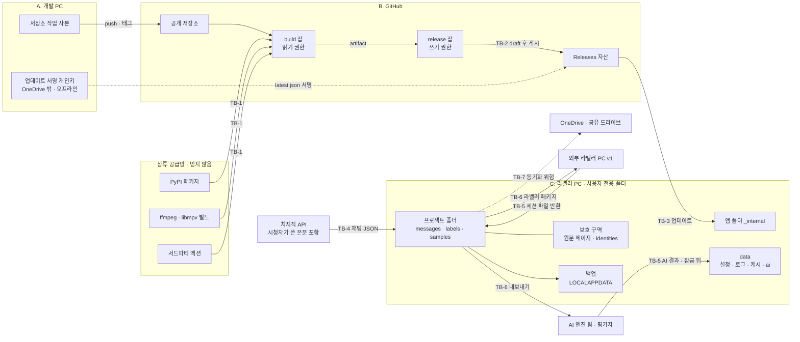

상태: 설계 초안 (2026-10-19) · 아직 구현되지 않음

# 05. 보안 분석 — 위협 모델 · 확정 항목 · 완화 · 개인정보

관련 문서: [01 분석·아이디어](01-analysis-and-ideas.md) · [02 아키텍처](02-architecture.md) · [03 데이터 모델](03-data-model.md) · [04 업데이트·릴리스](04-update-and-release.md) · [06 평가·일치도](06-evaluation-and-agreement.md) · [07 로드맵](07-roadmap.md) · [안내서 v0.1](../labeling-guide/v0.1.md) · [검토 의견](../labeling-guide/v0.1-review.md)

## 0. 이 문서가 하는 일

- ChatCoach 가 지켜야 할 것, 누가 무엇을 할 수 있는지, 어디서 믿음이 끊기는지를 정리한다.
- 검토를 거쳐 남은 발견 항목 45개(S-xx)를 모두 적고, 각 항목의 완화책과 실행 시점을 정한다.
- 개인정보 처리 원칙, 치지직 API 사용 주의, 보안 코딩 규칙, 의존성 고정 규칙, 사고 대응 절차를 둔다.
- 모듈 이름과 폴더 구조는 [02](02-architecture.md), 저장 형식은 [03](03-data-model.md), 업데이트 흐름은 [04](04-update-and-release.md) 가 정한다. 여기서는 '왜 그렇게 해야 하는가' 와 '무엇을 막는가' 만 적는다.
- 이 문서의 숫자(개수·기간·크기)는 모두 시작값이다.
- 법 조항 언급은 검토 의견을 옮긴 것이다. **이 문서는 법률 자문이 아니다.** 적용 여부는 '확인 필요' 로 둔다.

## 1. 범위와 전제

| 구분 | 내용 |
|---|---|
| 대상 | Windows 포터블 앱(PyInstaller onedir), GitHub 저장소·Actions·Releases, 라벨러 PC 의 앱 폴더·프로젝트 폴더, 치지직 VOD 채팅 수집 |
| 사용자 규모 | MVP: 개발자 1명 + 내부 라벨러 소수. v1: 외부 라벨러 투입 |
| 범위 안 | 업데이트 경로, 빌드·공급망, 시청자 개인정보, 정답 라벨 무결성, 블라인드(안내서 원칙 3), 로컬 입력 검증, Windows 실행 환경 |
| 범위 밖 | 같은 Windows 계정 권한으로 이미 돌고 있는 악성 코드(앱 폴더를 직접 고칠 수 있다) · 악의적 라벨러의 의도적 파일 위변조(탐지까지만) · 개발 PC 자체 침해(키 운영으로 피해만 줄인다) · PC·USB 물리 도난(BitLocker 는 운영 권장) · 치지직·GitHub 서버 쪽 사고 · 가상 채팅을 만들고 방송에 넣는 별도 프로그램 |

## 2. 지킬 것 (자산)

| 자산 | 지킬 성질 | 잃으면 |
|---|---|---|
| 라벨러 PC 의 코드 실행 경로 (앱 안 업데이트) | 무결성 | 라벨러 PC 장악, 아래 모든 자료 유출. 피해 범위가 가장 넓다 |
| 시청자 개인정보 (원 닉네임, `userIdHash`, 채팅 본문, 후원 기록) | 기밀성 | 동의 없는 제3자 제공·유출. 회수할 수 없다 |
| 정답 라벨 (`labels/*.jsonl`) | 무결성·가용성 | AI 평가가 조용히 틀린다. 시범 라벨링을 다시 해야 한다 |
| 블라인드 상태 (AI 결과, 다른 세션 라벨) | 라벨러에 대한 기밀성 | 7-3 의 '사람 불일치 vs AI 오류' 해석이 무효가 된다 |
| 시간 정렬·기준서·시작값 (`project.json`) | 무결성 | 모든 라벨이 함께 틀린다 |
| GitHub 계정·토큰, 업데이트 서명 키 | 기밀성 | 공격자가 업데이트 경로를 통제한다 |
| 빌드 입력과 CI | 무결성 | 정품처럼 보이는 악성 릴리스 |
| 스트리머 자료 (VOD 사본, 발화 전사, 웹캠 얼굴) | 기밀성 | 저작권·개인정보 문제 |
| 라벨러 신원·작업 기록 | 기밀성 | 근무 평가 등 목적 외 이용 |
| 가상 채팅 생성 기록·출처 라벨 | 기밀성 | 스트리머의 가상 채팅 사용 사실 노출, 분쟁 때 증거 통제 상실 |

## 3. 행위자

| 행위자 | 의도 | 할 수 있는 것 | 이 문서의 가정 |
|---|---|---|---|
| 개발자 (1인, 엔진 작성자 겸 라벨러) | 선의 | 모든 것 | 주된 위험은 실수다. 개발자 편향은 블라인드 장치로 막지 못하고 기록만 남긴다 |
| 내부 라벨러 | 선의 | 자기 PC 와 프로젝트 파일 | 실수와 습관(OneDrive 아래 설치, 예시값 그대로 쓰기, 경고 닫기) |
| 외부 라벨러 (v1) | 대체로 선의 | 받은 패키지, 자기 PC | 계약으로 관리한다. 파일 위변조는 탐지만 한다 |
| 검토자·조정자 | 선의 | AI 결과, 여러 세션 | 1차 라벨 잠금 뒤에만 AI 결과를 본다 |
| 시청자 (채팅 작성자) | 임의 | 채팅 본문 내용 | 본문은 믿지 않는 텍스트다(수식, 링크, 남의 개인정보) |
| 스트리머 | — | — | 정보주체이자 저작권자 |
| GitHub 계정·토큰 탈취자 | 악의 | 릴리스·노트·태그 조작 | MVP 기간에 가장 큰 위협 |
| 상류 공급망 침해자 | 악의 | PyPI 패키지, ffmpeg·libmpv 빌드, 서드파티 액션 교체 | 해시·커밋 SHA 고정으로 대응 |
| 같은 PC 의 다른 Windows 계정 | 임의 | 상속 권한이 열린 폴더에 파일 쓰기 | 권장 설치 위치로 막는다 |
| 네트워크 중간자 (TLS 검사 프록시) | 임의 | 응답 변조 | 매니페스트 서명 말고는 막을 수단이 없다 (§8 의 S-02) |
| OneDrive·공유 드라이브 | — | 사본 보관, 충돌 사본 생성, 파일 잠금 | 외부 저장소로 취급한다 |
| 치지직 | — | API 변경·차단 | 응답은 믿지 않는 입력이다 |

## 4. 신뢰 경계

### 4-1. 그림

TB-8(같은 PC 의 환경 → 앱 프로세스)과 TB-9(세션 ↔ 세션)는 그림에서 생략했다.

### 4-2. 경계별 검사

| 경계 | 넘어오는 것 | 믿지 않는 이유 | 검사 | 관련 항목 |
|---|---|---|---|---|
| TB-1 상류 → build 잡 | pip 패키지, ffmpeg·libmpv 바이너리, 액션 코드 | 소유자나 탈취자가 언제든 바꿀 수 있다 | 바이너리 SHA-256 상수, 잠금 파일, 액션 커밋 SHA, build 잡은 읽기 권한만 | S-03, S-04, S-40 |
| TB-2 build → Releases | zip, `SHA256SUMS`, 서명 전 `latest.json` | build 잡 안의 코드가 오염될 수 있다 | 잡 분리, draft 후 게시, immutable releases, 개발 PC 오프라인 서명(첫 릴리스부터), (v1) attestation | S-03, S-16, S-44 |
| TB-3 Releases → 앱 | 매니페스트·서명, 노트, URL, zip | 계정·토큰을 뺏기면 공격자가 통제한다 | 서명 fail-closed(첫 릴리스부터), 서명된 해시·크기 대조, zip 검사, URL 규칙, 교체 전 점검. 상세는 [04](04-update-and-release.md) 5~6장 | S-01, S-17, S-18, S-41, S-42, S-43 |
| TB-4 치지직 → 프로젝트 | 채팅 JSON(시청자가 쓴 본문) | 비공식 API, 누구나 쓴 텍스트 | 종료 조건·타입 검사, 수집 시점 가명화, CSV 셀 보호, 로그 금지 | S-05, S-14, S-27, S-28, S-45 |
| TB-5 외부 파일 → 프로젝트 | VOD 파일, 손으로 고친 `project.json`, 돌려받은 세션 파일, AI 결과, 생성 기록 | 실수·동기화 손상·다른 사람의 편집 | 영상 지문, 엄격 JSON·크기 검사, 경로 문자열 검사, 체인 검증, 허용 목록 | S-10, S-13, S-26, S-29, S-30, S-46, S-47 |
| TB-6 프로젝트 → 밖 | 라벨러 패키지, 정답 세트, CSV, 문제 보고, 커밋 | 받는 쪽은 라벨링 고지 범위 밖일 수 있다 | 허용 목록·manifest, 보호 구역 제외, 로그 가림, 합성 픽스처 | S-05, S-11, S-19, S-20, S-21, S-23, S-24, S-25, S-38, S-45 |
| TB-7 로컬 ↔ 동기화 저장소 | 프로젝트·data 파일 | 클라우드 업로드, 충돌 사본, 잠금 | OneDrive 감지 대화상자, 충돌 사본 경고, 재시도, rev 비교 | S-06, S-09, S-32, S-39 |
| TB-8 같은 PC 의 환경 → 앱 프로세스 | 폴더 ACL, PATH, Qt 환경변수, 긴 경로 | 다른 계정·다른 설치가 남긴 값 | 번들 폴더 고정, PATH 고정, Qt 변수 정리, 권장 설치 위치 | S-08, S-31, S-48, S-49 |
| TB-9 세션 ↔ 세션 (블라인드) | 1차 라벨, AI 결과, 등급 조건 표시, 자동 인식 문장 | 보면 판단이 쏠린다(원칙 3) | '숨김' 이 아니라 '열지 않음', 가시성 정책 한 곳, 등급은 제안하지 않고 조건과 다르게 고른 기록, 표본 고정 | S-11, S-12, S-33, S-35, S-36, S-37 |

### 4-3. 앱이 접속하는 곳 (예정)

주소·순서·주기는 [04](04-update-and-release.md) 6-2 가 정한다. 아래는 README·`install.md` 에 옮길 요약이다.

| 주소 | 언제 | 보내는 것 |
|---|---|---|
| `github.com/vtubeadmirer/chatcoach/releases/latest/download/latest.json` (+ `.minisig`) | 업데이트 확인 1차 경로. 자동(성공 뒤 24시간, 실패 뒤 1시간) + '지금 확인' | User-Agent `ChatCoach-updater/<버전>`. 발신 IP |
| `api.github.com/repos/vtubeadmirer/chatcoach/releases/latest` | 1차 경로가 실패할 때 2차 경로 | 위와 같음 |
| `api.github.com/repos/vtubeadmirer/chatcoach/releases?per_page=10` | 숨은 설정 `update_channel=beta` 일 때만(개발자·내부 확인용) | 위와 같음 |
| `github.com/…/releases/download/…` → `release-assets.githubusercontent.com` | 업데이트를 받을 때 (리다이렉트 호스트를 코드에 고정하지 않음) | 위와 같음 |
| `api.chzzk.naver.com/service/v1/videos/{no}/chats`, `/service/v2/videos/{no}` | 사용자가 채팅 수집을 누를 때 | 브라우저형 User-Agent, video_no. 쿠키 없음 |
| (v1, 선택) 자기 저장소의 `models-*` 릴리스 | 모델 팩을 받을 때 | 위 GitHub 와 같음 |

이 밖의 연결·텔레메트리·자동 충돌 보고는 두지 않는다. 문제 보고는 사용자가 복사해서 붙인다.

## 5. 심각도 기준

| 심각도 | 기준 |
|---|---|
| high | 특별한 전제 없이 일어나고, 피해가 넓거나 되돌릴 수 없다. **검토를 거친 뒤 남은 항목은 없다.** 처음 high 로 올라온 항목(S-01·S-04·S-05·S-13 등)은 '계정 탈취 전제', '라벨러 소수', 'v1 기능' 같은 이유로 medium 이하가 됐다 |
| medium | 전제(계정 탈취, 실수 한 번)가 필요하지만, 일어나면 라벨러 PC·개인정보·정답 데이터에 넓게 영향을 주거나 조용히 오염시킨다 |
| low | 조건이 좁거나 피해가 작다. 또는 운영 절차로 보완할 수 있다 |

## 6. 확정 발견 항목

### 6-0. 이 문서를 쓰며 직접 다시 확인한 사실

검토 의견을 그대로 옮기지 않으려고 아래는 파일과 명령으로 다시 확인했다. ClipSlicer 행 번호는 커밋 `07d13cc` 기준이다. 표의 '확인' 줄에 '확인함' 이 없는 실측(예: python-mpv DLL 검색 순서, Qt 환경변수 우선순위, zipfile 경로 정리)은 검토자의 기록이며 여기서 재현하지 않았다.

| 사실 | 위치 | 관련 |
|---|---|---|
| `.sha256` 이름이 안 맞으면 '유일한 `.sha256`' 을 전체 zip 의 것으로 본다 | `app/updater.py:82-85` | S-01, S-43 |
| 같은 릴리스에서 받은 `.sha256` 의 첫 토큰과 비교한다 | `app/updater.py:287-290` | S-01 |
| 작업 폴더가 `%TEMP%\ClipSlicer-update` 고정이고 매번 `rmtree` 한다. 압축은 `extractall` 로 푼다 | `app/updater.py:275-277, 299` | S-42 |
| 교체 스크립트의 `Under-App` 이 끝 구분자 없이 `StartsWith($App)` 로 비교하고 보조 프로세스를 `Stop-Process -Force` 한다 | `app/updater.py:329` (REPLACER) | 04 참고 |
| 보존 목록이 스크립트(`$keepFiles`, `*.jsonl`)와 Python(`USER_FILES`)에 따로 있고 내용이 다르다 | `app/updater.py:329, 340-341` | 04 참고 |
| 교체 명령이 `powershell -NoProfile -ExecutionPolicy Bypass -WindowStyle Hidden -File` 이다 | `app/updater.py:445` | S-17 |
| 워크플로 전역 `permissions: contents: write`, 액션 4개가 모두 움직이는 태그(@v2·@v4·@v5) 참조, `pip install --upgrade pip`·`pip install pillow` 는 버전 고정 없음 | `.github/workflows/release.yml:17-18, 28, 30, 49, 60, 117, 129` | S-03, S-04 |
| `upx=True` 가 EXE·COLLECT 두 곳에 있다 | `ClipSlicer.spec:32, 47` | S-17, S-44 |
| 릴리스 스크립트가 `git add -A` 로 작업 트리 전체를 커밋한다 | `tools/release.ps1:37` | S-21 |
| ffmpeg·libmpv 다운로드 스크립트에 해시 비교가 없다(`hashlib` 미사용) | `tools/get_ffmpeg.py`, `tools/get_libmpv.py` | S-04 |
| 가림 패턴은 인증 헤더·토큰 쿼리·bearer·access_token 류 4개뿐이고, 보고서에 실제 폴더 경로(`base_dir()`)가 들어간다 | `app/report.py:9-14, 31-43` | S-20 |
| 로거가 `DEBUG` 로 설정된다 | `app/logging_setup.py:50` | S-20 |
| 새 버전 대화상자가 노트 링크를 바로 열고(`setOpenExternalLinks(True)`), 다운로드 버튼이 JSON 의 URL 을 `os.startfile` 로 연다 | `app/dialogs.py:515-516, 532` | S-18 |
| 도구 탐색 순서가 `bin\ffmpeg → 앱 루트 → bin → _MEIPASS → PATH` 다 | `app/paths.py` `_candidate_dirs()`, `find_tool()` | S-08 |
| 프로젝트 전체에 `faulthandler` 호출이 없다 | grep | S-31 |
| 저장 실패를 `except OSError: return False` 로 삼키고, 불러올 때 영상 길이 밖 마커를 경고 없이 버리며, 구간 속성을 `round(start, 3)` 키로 붙인다 | `app/segments.py` `save()`, `load()` | S-09, S-13 |
| 채팅을 `(t, text, user)` 로 중복 제거하고 20만 건에서 솎아낸다. 닉네임은 `profile` JSON 에서 꺼낸다 | `app/chat.py:37, 68, 265-272, 313-328` | S-05, S-14 |
| 이 PC 의 `C:\` 는 `Authenticated Users:(OI)(CI)(IO)(M)` 를 상속시킨다 | `icacls C:\` | S-08 |
| Python 3.12 `json.loads('{"a": NaN}')` 가 예외 없이 `nan` 을 돌려준다 | 실행 | S-29 |
| chatcoach `.gitignore` 는 `*.jsonl` 을 막지만 `*.jsonl.gz`·`*.zip`·`*.json` 은 막지 않고, `*.jsonl` 이 테스트 픽스처까지 막는다 | `.gitignore` | S-10, S-21, A-2 |
| 안내서 v0.1 머리말이 '수정하지 않고 보존한다' 고 적고 있다 | `docs/labeling-guide/v0.1.md:5` | S-36 |

### 6-1. 요약표

단계: 지금 = 저장소를 GitHub 에 올리기 전·첫 릴리스 전 설정 · MVP = v0.1.0 시범 릴리스 전 · v1 = 외부 라벨러 투입 전 · 나중 = 조건이 생기면. 상세 순서는 [§7](#7-실행-목록).

| ID | 심각도 | 영역 | 구성요소 | 위협 (한 줄) | 수고 | 단계 |
|---|---|---|---|---|---|---|
| S-01 | medium | 업데이트 | updater, release.yml | 같은 릴리스의 `.sha256` 만 믿어 계정 하나로 모든 라벨러 PC 에서 코드 실행 | 약 1일 + 릴리스마다 10분 | 지금·MVP |
| S-03 | medium | 공급망 | release.yml, ci.yml | 서드파티 액션·pip 코드가 쓰기 토큰과 같은 잡에서 돈다 | 2~3h | 지금 |
| S-04 | medium | 공급망 | get_ffmpeg/get_libmpv, requirements | 빌드 입력을 해시 없이 받아 동봉한다 | 2~3h | 지금·MVP |
| S-05 | medium | 개인정보 | chzzk_chat, store | `messages.jsonl` 의 원문(raw)이 가명화를 무효화한다 | MVP 2~3h | MVP·v1 |
| S-06 | medium | 개인정보 | store 백업, session | 보존 기간·파기 절차가 없고 백업이 사본을 늘린다 | MVP 4h · v1 3h | MVP·v1 |
| S-08 | medium | 실행 환경 | paths, 설치 안내 | `C:\Tools` 상속 권한 + 탐색 순서로 ffmpeg·DLL 심기 | 2h | 지금·MVP |
| S-09 | medium | 개인정보·무결성 | paths, store, 설치 안내 | OneDrive·공유 드라이브 아래에서 클라우드 업로드·충돌 사본·무음 저장 실패 | MVP 2~3h | MVP·v1 |
| S-10 | medium | 라벨 무결성 | resolve, store | supersedes 교차 참조·순환·포크가 '현재 유효 라벨' 을 바꾼다 | MVP 2~3h · v1 3h | 지금·MVP·v1 |
| S-11 | medium | 블라인드 | export, visibility, 폴더 배치 | AI 결과·다른 세션 라벨이 잠금 전에 라벨러에게 닿는다 | 4h | v1 |
| S-12 | medium | 연구 타당성 | review_player, reaction_editor | 자석·자동 인식·등급 제안이 엔진과 상관되고 수용 여부가 남지 않는다 | MVP 1~2h | MVP·v1 |
| S-13 | medium | 라벨 무결성 | media, segments_model | 영상 교체·단일 오프셋으로 시각이 통째로 어긋난다 | MVP 2~3h | MVP·v1 |
| S-14 | medium | 라벨 무결성 | chzzk_chat, ids | `chat_id` 가 수집 순서에 의존해 재수집하면 라벨이 고아가 된다 | 2h | MVP |
| S-20 | medium | 개인정보 | logging_setup, report | 로그·문제 보고서가 가명화 밖에 있다 | 2h | MVP·v1 |
| S-21 | medium | 개인정보·비밀 | fixtures, .gitignore, release.ps1 | 공개 저장소로 실제 채팅·비밀이 새는 길 | 1h | 지금·MVP |
| S-16 | low | 서명 | sign_manifest, appspec | 서명 키 하나가 단일 장애점이 된다 | 반나절(키 의식) · v1 1h | 지금·v1 |
| S-17 | low | 실행 환경 | updater 교체 실행, spec | 실행 통제 PC 에서 교체가 막히고 앱이 먼저 꺼진다 | 2h | 지금·MVP·나중 |
| S-18 | low | 업데이트 UI | update_dialog | API 의 URL·노트 링크를 그대로 연다 | 0.5~1h | MVP |
| S-19 | low | 개인정보 | analysis, ocr_tool | OCR·썸네일이 화면 속 원 닉네임·얼굴을 담는다 | 2h | MVP·v1 |
| S-23 | low | 개인정보·저작권 | media, asr_tool, 패키지 | 스트리머의 VOD 사본·발화 전사본이 밖으로 나간다 | 2h | v1 |
| S-24 | low | 개인정보 | session, agreement | 라벨러 작업 기록이 모니터링 데이터가 된다 | 2~3h | MVP·v1 |
| S-25 | low | 기밀성 | origin_match, 패키지 | 가상 채팅 생성 기록·출처 라벨이 외부로 나간다 | 2h | v1 |
| S-26 | low | 로컬 입력 | media, analysis, player | 경로·영상을 검증 없이 ffprobe·mpv 에 넘겨 외부 접속 | 1h | MVP·v1 |
| S-27 | low | 로컬 입력 | export | CSV 셀 수식 주입 | 1h | MVP |
| S-28 | low | 로컬 입력 | chzzk_chat | 응답을 믿는 수집 루프 — 무한 수집·익명 병합 | 1h | MVP |
| S-29 | low | 로컬 입력 | validate, schema | NaN·타입 혼동·스키마 미검증으로 등급이 조용히 틀린다 | 2~3h | MVP·v1 |
| S-30 | low | 라벨 무결성 | jsonl, store | BOM·잘린 마지막 줄·중간 손상이 라벨을 '사라지게' 한다 | 2~3h | MVP |
| S-31 | low | 실행 환경 | crashguard, main.py | 네이티브 크래시가 흔적 없이 사라지고 `_backup` 이 지워진다 | 1h | MVP·v1 |
| S-32 | low | 라벨 무결성 | store, session | 같은 프로젝트를 둘이 열면 `project.json` 이 덮인다 | 1.5h | MVP |
| S-33 | low | 연구 타당성 | session RelabelPlan | 재라벨이 1차 경계·표본을 그대로 넘긴다 | 2h | v1 |
| S-34 | low | 라벨 무결성 | schema, session | 순서·3일 규칙이 PC 벽시계·고정 시간대에 의존 | 1h | MVP·v1 |
| S-35 | low | 연구 타당성 | sampling | 표본 모집단이 변하는 값에 의존 | 1~2h | MVP·v1 |
| S-36 | low | 라벨 무결성 | schema, ci.yml | 기준서 버전이 문자열 '0.1' 뿐이라 기준이 섞인다 | 2h | MVP·v1 |
| S-37 | low | 연구 타당성 | session, agreement | 라벨러 id 혼동으로 intra/inter 해석이 틀린다 | 1h | MVP·v1 |
| S-38 | low | 라벨 무결성 | export, store | 내보내기에 체크섬이 없고 충돌 사본을 정답으로 받는다 | 2h | MVP·v1 |
| S-39 | low | 가용성 | backup, paths | 백업이 라벨과 같은 폴더에만 있다 | 1.5h | MVP |
| S-40 | low | 공급망 | asr_tool, ocr_tool | 모델 다운로드의 기대 해시 출처가 비어 있다 | 1.5h | v1 |
| S-41 | low | 업데이트 | 업데이트 확인 | 실패를 '최신' 과 섞고 확인 시각을 먼저 기록 | 1h | MVP |
| S-42 | low | 업데이트 | updater 스테이징 | 검증과 교체 사이의 시간 창, 한 볼륨만 보는 용량 검사 | 1.5h | MVP |
| S-43 | low | 업데이트 | updater zip 처리 | 레이아웃·`.sha256` 파일명 미검사 | 1h | MVP |
| S-44 | low | 공급망 | release.yml, 저장소 설정 | 출처 증명·불변 릴리스가 없다 | 10분 · v1 1h | 지금·v1 |
| S-45 | low | 개인정보 | chzzk_chat, export | 후원 금액·본문 속 제3자 정보를 필요 이상 보관·내보냄 | 1h | MVP·v1 |
| S-46 | low | 로컬 입력 | ids, store | 레코드 속 id 로 만든 파일명의 경로 조작, 정션 | 1h | v1 |
| S-47 | low | 로컬 입력 | store import | 받은 패키지·보조 산출물의 바이너리·크기를 믿는다 | 1h | v1 |
| S-48 | low | 실행 환경 | main.py | Qt 플러그인 경로 환경변수가 번들보다 먼저 | 0.5h | MVP |
| S-49 | low | 실행 환경 | store, 프로젝트 폴더명 | 관리자 없는 PC 에서 긴 경로 저장이 조용히 실패 | 1h | MVP |

번호가 빈 S-02·S-07·S-15·S-22 는 검토에서 반박됐다([§8](#8-반박되어-제외한-항목)).

### 6-2. 항목별 상세

완화(채택)는 검토 단계에서 나온 개선안을 채택했다. 처음 제안된 원안은 각주로 남긴다.

#### S-01 · medium · 서명 없는 MVP 업데이트

| 항목 | 내용 |
|---|---|
| 구성요소 | `app/updater.py` 조회·다운로드·버전 비교, `.github/workflows/release.yml`, 설계의 '서명은 v1' 결정 |
| 위협 | 업데이트를 믿는 근거가 '같은 릴리스의 `.sha256`' 과 '더 큰 버전 번호' 뿐이다. 자산을 바꿀 수 있는 쪽은 둘을 함께 바꾼다. 공개키는 처음 설치된 바이너리에 있어야 효력이 있어서, 서명 없이 나간 사본은 이후에도 검증 없이 받는다 |
| 시나리오 | 개발 PC 의 git 자격 증명(OneDrive 로 동기화되는 홈 폴더 안)이나 GitHub 비밀번호 유출 → 더 높은 버전으로 트로이 zip 과 맞춘 `.sha256` 게시 → 하루 1회 확인하는 앱이 새 버전을 알리고, 한 번 누르면 폴더 전체가 교체 → 라벨러 권한 코드 실행, `identities.jsonl`·라벨 유출 |
| 완화 (채택) | 지금(첫 릴리스 v0.0.1 전, [04](04-update-and-release.md) 의 M0): ① GitHub 패스키/2FA 와 fine-grained 토큰(contents 쓰기만, 90일 만료) ② 서명 키 2개(현재·예비)를 같은 날 만들고 두 공개키를 앱에 내장한다(S-16) ③ 모든 릴리스의 매니페스트에 개발 PC 에서 서명하고, 업데이터는 처음부터 서명을 필수로 검사한다. 서명·해시·크기 중 하나라도 없거나 다르면 거부한다(fail-closed) ④ CI 는 서명 없는 초안까지만 만들고, 개발 PC 가 초안을 확인·서명한 뒤 게시한다 ⑤ 재생 하한(설치본보다 높은 버전, 설치본 빌드 시각보다 늦은 발행 시각)과 매니페스트의 size·sha256 대조도 같은 때 넣는다. MVP: prerelease 로 먼저 게시해 개발 PC 에서 받아 본 뒤 latest 로 바꾼다. 매니페스트 필드·검증 순서·게시 절차는 04 의 4-2·5장이 정한다. 앱에 PAT 를 넣어 API 한도를 피하지 않는다[^o01] |
| 이 문서의 판단 | '있으면 검증' 은 공격자가 서명 파일을 빼면 통과하므로 보호 효과가 없다. 그래서 검토 단계의 개선안(MVP 는 '있으면 검증', v1 에 fail-closed) 대신 04 의 결정(첫 릴리스부터 fail-closed)을 따른다. 공개키는 처음 설치된 사본에 있어야 효력이 있어, 늦게 시작할수록 서명 없는 사본을 걷어내는 수동 재설치가 필요해진다. 대가는 M0 의 키 의식과 릴리스마다 수동 서명 약 10분이다. 사용자 동의는 04 16장 질문 4 에서 묻는다 |
| 수고 | 약 1 작업일(서명·게시 도구, 04 15장 추정. 키 의식 반나절은 S-16) + 릴리스마다 약 10분 |
| 단계 | 지금(계정 설정·키·서명 필수 검증, 첫 릴리스 전) · MVP(prerelease 확인 단계). attestation 은 S-44 |
| 확인 | `updater.py:82-85, 287-290` 확인함 |

#### S-03 · medium · CI 의 서드파티 액션·pip 코드가 쓰기 토큰과 같은 잡에서 돈다

| 항목 | 내용 |
|---|---|
| 구성요소 | `release.yml` 17-18행(워크플로 전역 `contents: write`), 28·30·117·129행(태그 참조 액션), 49·60행(pip 비고정), `ci.yml` |
| 위협 | 액션을 움직이는 태그로 참조하므로, 태그가 옮겨지면 다음 실행부터 그 코드가 돈다(2025-03 tj-actions/changed-files 사고). checkout 이 토큰을 `.git/config` 에 남기고 권한이 전역이라, 그 뒤의 어떤 단계(pip 가 받아 실행하는 코드, PyInstaller 훅, 게시 액션)도 Release 자산을 바꿀 수 있다 |
| 시나리오 | 게시 액션의 태그가 악성 커밋으로 옮겨지거나 고정되지 않은 전이 의존성 하나가 PyPI 에서 탈취 → 정상 태그 push 때 그 코드가 방금 만든 zip 과 `.sha256` 을 함께 바꿔 씀 → 로그는 초록색, 모든 라벨러가 받는다 |
| 완화 (채택) | ① 잡 분리: build(`contents: read`, checkout `persist-credentials: false`, 빌드·selftest·zip·sha256 → upload-artifact) / release(`contents: write`, checkout 없음, download-artifact → `gh release create --draft` → 게시. gh 는 러너에 기본 설치돼 서드파티 코드가 0 이다) ② 남는 액션은 전체 커밋 SHA 로 고정하고 `# v4.2.2` 같은 주석, dependabot(github-actions) 주간 갱신 ③ 최상위 `permissions: {}`, 권한은 잡 단위 ④ 전이 의존성까지 고정한 잠금 파일(지금(M0) 버전 고정, MVP(M4) 해시 — S-04, [04](04-update-and-release.md) 15장) ⑤ ci.yml 도 같은 규칙. 선택: 저장소의 Actions 허용 목록. 'release.ps1 사후 해시 대조' 는 CI 산출물끼리 비교라 효과가 작아, 서명 전 개발 PC 의 초안 확인(S-01)으로 대신한다[^o03] |
| 수고 | 2~3시간 |
| 단계 | 지금 (release.yml 을 처음부터 이 구조로 쓴다) |
| 확인 | `release.yml:17-18, 28, 30, 49, 60, 117, 129` 확인함 |

#### S-04 · medium · 빌드 입력(ffmpeg·libmpv·pip)을 해시 없이 받아 동봉

| 항목 | 내용 |
|---|---|
| 구성요소 | `tools/get_ffmpeg.py`·`tools/get_libmpv.py`, `requirements.txt`(ClipSlicer. ChatCoach 는 `requirements.in` + `requirements.lock`, [02](02-architecture.md)), `release.yml` 49·60행, `build.ps1` |
| 위협 | TAG·ASSET 이름만 고정하고 받은 바이트의 해시를 비교하지 않는다. 상류 Release 자산은 소유자가 바꿀 수 있다(상류의 immutable 설정 여부는 확인 필요). libmpv 는 모든 라벨러 프로세스에 로드되고 ffmpeg 는 분석마다 실행된다. 이 경로로 들어온 변조는 이후의 `.sha256` 과 매니페스트 서명까지 '정품' 으로 보증받는다 |
| 시나리오 | 상류 계정 탈취자가 같은 이름의 트로이 7z·zip 으로 교체 → 평소처럼 태그 push → CI 가 번들·해시·게시 → 전체 zip 을 받는 라벨러(신규, ffmpeg·libmpv 태그가 바뀐 경우)가 실행 |
| 완화 (채택) | 지금(M0, [04](04-update-and-release.md) 4-4·15장): ① 두 스크립트에 SHA256 상수를 두고 다운로드 직후 다르면 빌드를 끊는다. 첫 값은 상류가 공개한 체크섬이 있으면 그것과 맞춘 뒤 기록한다(상류 체크섬 유무 확인 필요) ② `deps.txt` 에 `ffmpeg_sha256`·`libmpv_sha256` 을 적고 경량/전체 판정을 태그가 아니라 해시로 한다 ③ `requirements.in` → `requirements.lock` 으로 전이 의존성까지 버전을 고정하고(pip-compile 이 해시까지 문제없이 만들면 해시도 넣는다) 비고정 pip·pillow 줄을 지운다. MVP(M4): `pip install --require-hashes -r requirements.lock`. 선택: CI 에서 py7zr 를 빼고 러너의 7z 만 쓴다[^o04] |
| 수고 | 2~3시간 + 버전 올릴 때 10분 |
| 단계 | 지금(해시 상수·잠금 파일 버전 고정) · MVP(해시 잠금) |
| 확인 | 두 스크립트에 해시 비교 없음 확인함 |

#### S-05 · medium · `messages.jsonl` 의 원문이 가명화를 무효화

| 항목 | 내용 |
|---|---|
| 구성요소 | `app/chzzk_chat.py` 파서, `app/store.py`(messages·identities·패키지 내보내기), 원문 페이지 `pages-*.jsonl.gz` |
| 위협 | 앞선 설계 초안은 '수집 시점에 가명화가 끝난다' 면서 같은 줄에 API 9필드 원문(raw)을 두었다. `raw.profile` 은 `userIdHash`·`nickname` 을 담는 JSON 문자열이다. 그러면 `identities` 분리는 형식에 그치고 '원 닉네임 보기' 토글과 열람 기록도 우회된다 |
| 시나리오 | '가명 채팅' 패키지를 외부 라벨러에게 보냄 → `raw.profile` 로 수십만 시청자의 `userIdHash`(다른 방송에서도 같은 사람을 추적할 수 있는 영속 식별자)·닉네임·후원액이 넘어간다. 회수할 수 없다 |
| 완화 (채택) | 원문은 보호 구역에만 둔다: 페이지 원문은 `chat/protected/pages-<fetch_id>.jsonl.gz`([02](02-architecture.md) 와 같음), 메시지 단위 원문이 필요하면 같은 폴더의 `raw.jsonl`(chat_id 키). `messages.jsonl` 에는 가명 파생 필드만 둔다 — API 에 새 필드가 생겨도 새지 않는다. 내보내기는 허용 목록 방식. 골든 테스트(패키지 zip 안에 `userIdHash`·`nickname` 키와 32자 이상 hex 가 0건)는 MVP, 보호 구역 UI(수집 PC 에서만 원 닉네임 보기)와 `nickname_masked` 규칙은 v1 패키지와 함께[^o05] |
| 수고 | MVP 2~3시간 |
| 단계 | MVP · v1 |
| 확인 | `chat.py:265-272` 가 `profile` 에서 닉네임을 꺼냄 확인함 |

#### S-06 · medium · 보존 기간·파기 절차가 없고 백업이 사본을 늘린다

| 항목 | 내용 |
|---|---|
| 구성요소 | `app/backup.py`, `app/session.py`, 업데이트의 `_backup`·업데이트 직전 백업, `docs/install.md` |
| 위협 | '지우지 않는다' 가 라벨 이력에는 맞지만 채팅 로그와 identities 에도 그대로 적용되고, 보존 기간 필드와 파기 명령이 없다. 사본은 자동으로 늘어난다(일 1회·업데이트 전 백업, 패키지, 공유 드라이브, OneDrive 버전 기록). 보유 기간이 지나면 파기하는 의무(개인정보보호법 제21조)와 가명정보 처리 기록(제28조의4)을 이행할 수단이 없다(적용 범위 확인 필요) |
| 시나리오 | 시범 6개월 뒤 PC 3대·공유 드라이브·백업 zip 여러 개에 방송 10편분 채팅이 흩어져, 삭제 요구나 점검 때 '어디에 몇 부' 를 답할 수 없다 |
| 완화 (채택) | MVP: 백업 zip 순환 삭제(프로젝트당 14개, [§9](#9-의견이-갈린-쟁점과-이-문서의-결정) 결정 7), `project.json` 의 `retention_until`(시작값: 생성일 + 12개월)과 만료 표시, '프로젝트 파기' 명령과 `data\disposal_log.jsonl`, identities 는 일일 백업에서 빼고 주 1회 채팅 백업에서도 빼거나 별도 보존 기간. v1: 삭제·블라인드된 메시지(`messageStatusType ≠ NORMAL`)의 withdrawn 플래그, 가져오기 뒤 받은 zip 자동 삭제, 외부 라벨러 반납·파기 확인, `legal_basis` 필드[^o06] |
| 수고 | MVP 약 4시간 · v1 약 3시간 |
| 단계 | MVP · v1 |

#### S-08 · medium · `C:\Tools` 상속 권한과 도구 탐색 순서

| 항목 | 내용 |
|---|---|
| 구성요소 | `app/paths.py` 의 `_candidate_dirs()`·`find_tool()`·`prepare_libmpv()`, python-mpv 의 DLL 이름 검색, 설치 안내 |
| 위협 | `C:\` 바로 아래 새 폴더는 '인증된 사용자 수정' 을 상속한다. 탐색 순서가 앱 루트·`bin\` 을 번들 폴더보다 먼저 보고 PATH 로 폴백해서, 같은 PC 의 다른 계정이 심은 `ffmpeg.exe`·`libmpv-2.dll` 이 라벨러 권한으로 실행된다. 보안과 별개로 PATH 에 다른 `mpv-2.dll` 이 있으면 PC 마다 재생·프레임 이동 동작이 달라질 수 있다(python-mpv 의 이름 우선 검색은 검토자 실측 — 확인 필요) |
| 시나리오 | 공용 PC 의 다른 계정이 `C:\Tools\ChatCoach\ffmpeg.exe` 를 넣음 → 파형·썸네일·probe 때마다 실행 |
| 완화 (채택) | ① frozen 이면 `_internal\ffmpeg`·`_internal` 만 보고 `shutil.which` 폴백을 없앤다(소스 실행일 때만 `bin\` 허용) ② `import mpv` 동안 PATH 를 번들 폴더 하나로 바꿨다가 되돌린다 ③ 권장 위치를 `%LOCALAPPDATA%\Programs\ChatCoach` 로 한다(사용자 전용 ACL 상속, OneDrive 밖, 관리자 불필요). 폴백 안내도 같은 위치 ④ selftest 에서 `mpv.backend._name` 이 `_internal\libmpv-2.dll` 절대경로인지 확인. icacls 출력 문자열로 경고하는 원안은 출력이 현지화돼 오탐·누락이 생겨 뺀다[^o08] |
| 수고 | 약 2시간 |
| 단계 | 지금(권장 위치, README·02 반영됨) · MVP |
| 확인 | `icacls C:\`, `paths.py` 탐색 순서 확인함 |

#### S-09 · medium · OneDrive·공유 드라이브 아래의 앱·프로젝트 폴더

| 항목 | 내용 |
|---|---|
| 구성요소 | `paths.data_root()`, `store` 저장, 백업, 단일 인스턴스 잠금, 프로젝트 폴더 지정, `docs/install.md` |
| 위협 | 개인정보: 데이터를 앱 폴더 안 `data\` 에 두는데 사용자 습관(앱을 OneDrive\문서 아래에서 실행)대로면 채팅·identities·백업이 클라우드로 올라간다. 계약 없는 외부 저장(처리위탁, 제26조)과 국외 이전 고지 문제가 생길 수 있고(계정 종류·리전 확인 필요), 휴지통·버전 기록 때문에 파기가 끝나지 않는다. 무결성: 충돌 사본·잠금·하이드레이션으로 라벨이 사라져 보이거나 저장이 조용히 실패한다 |
| 시나리오 | 집·사무실 PC 가 같은 계정으로 `project.json` 을 저장 → 충돌 사본이 생기고 원본만 읽혀 상태 전이·`chat_offset_ms` 가 사라짐. 업로드 중 `os.replace` 가 WinError 32 로 실패하는데 차용 대상 `segments.save()` 는 이를 `return False` 로 삼킨다 |
| 완화 (채택) | MVP: ① 시작·프로젝트 열기 때 경로 조상이 `%OneDrive%`·`%OneDriveCommercial%`·`%OneDriveConsumer%` 이거나 UNC 면 막는 대화상자('이동 권장' / '그래도 계속', 계속하면 `project.json` 에 확인 기록). 경고만 띄우고 넘어가지 않는다 ② `os.replace` 짧은 재시도 뒤 실패는 화면 오류(조용한 False 금지) ③ 충돌 사본은 자동으로 읽지 않고 개수만 경고([§9](#9-의견이-갈린-쟁점과-이-문서의-결정) 결정 1) ④ `session_id` 에 PC 해시 ⑤ `docs/install.md`: 'OneDrive 밖에 풀 것, 프로젝트 공유는 패키지 zip 으로', 파기 한계. v1 전에 다시 판단: 보호 구역의 로컬 분리, Files On-Demand 속성 검사[^o09] |
| 수고 | MVP 2~3시간 |
| 단계 | MVP · v1 |
| 확인 | `segments.save()` 의 `except OSError` → False 확인함 |

#### S-10 · medium · supersedes 체인의 교차 참조·순환·포크

| 항목 | 내용 |
|---|---|
| 구성요소 | `app/core/resolve.py`, `store` 의 로드·append·가져오기, `labels/*.jsonl`, `tools/verify_project.py`, 테스트 픽스처 |
| 위협 | 수정은 새 라벨 + supersedes, 병합은 파일 합집합이다. 다른 세션을 가리키는 supersedes, 순환, 같은 label_id 다른 내용, 한 라벨을 둘이 대체하는 포크를 처리하는 규칙이 없다. 악의 없이 버그·USB 복사만으로 생긴다 |
| 시나리오 | (a) 재라벨 UI 버그로 1차 라벨 id 가 supersedes 에 들어가 직접 반응 수십 건이 '현재 유효' 뷰에서 사라짐. 순환이면 로드가 끝나지 않음 (b) 같은 `session_id` 를 두 PC 에서 이어 써서 포크 → 시계가 느린 PC 때문에 나중 판단이 버려짐 |
| 완화 (채택) | MVP: supersedes 는 같은 세션 안에서만 유효(위반 줄은 체인에서 빼고 '무효 N건' 표시), visited set 으로 순환을 찾아 '검토 필요', 포크는 자동으로 고르지 않고 충돌로 표시, `session_id` 에 machine_id 4자리, 줄마다 `seq`, 이름이 같은 세션 파일은 가져오기에서 덮어쓰지 않고 거부, 골든 테스트 2개(순환·포크). v1: 철회(retract) 레코드, 같은 label_id 내용 해시가 다르면 거부, 줄 단위 접두사일 때만 교체, 가져오기 전 `verify_project` 필수[^o10] |
| 수고 | MVP 2~3시간 · v1 약 3시간 |
| 단계 | 지금(`.gitignore` 에 `!tests/fixtures/*.jsonl`) · MVP · v1 |
| 확인 | `.gitignore` 의 `*.jsonl` 이 픽스처를 막음 확인함 |

#### S-11 · medium · AI 결과·다른 세션 라벨이 잠금 전 라벨러에게 닿는 경로

| 항목 | 내용 |
|---|---|
| 구성요소 | `app/export.py`(라벨러 패키지), `store` 로드, `core/visibility.py`, 상태 머신, 폴더 배치(`ai\`, `labels\`) |
| 위협 | 원칙 3(AI 판정을 보지 않고 먼저 라벨링)이 상태 머신 한 곳에만 걸려 있다. AI 결과와 모든 세션 라벨이 같은 폴더에 있으면 패키지 내보내기가 함께 싣고, 재라벨 블라인드가 메모리 필터면 누락 한 곳이 곧 노출이다 |
| 시나리오 | 개발자(엔진 작성자)가 AI 결과를 둔 채 2차 라벨러 패키지를 내보냄 → AI 결과와 1차 라벨이 섞여 나감 → 쏠린 라벨이 7-3 의 구분을 무효로 만들고 아무도 모른다 |
| 완화 (채택) | ① 내보내기는 허용 목록 + manifest 기록 ② AI 결과는 프로젝트 폴더 밖 `data\ai\<project_id>\`, 가져오기는 locked 상태의 reviewer 세션에서만 ③ 재라벨 세션은 다른 세션 파일을 열지 않는다(`visibility.files_to_open`, open 호출 감시 단위 테스트) ④ UI 는 `visibility.can_show` 한 경로로만 묻는다 ⑤ 숨김 해제 기록(view_exposed)은 W6 구현 때[^o11] |
| 수고 | 약 4시간 |
| 단계 | v1 (W5·W6·라벨러 패키지) |

#### S-12 · medium · 자석·자동 인식·등급 제안이 엔진과 상관되고 수용 여부가 남지 않음

| 항목 | 내용 |
|---|---|
| 구성요소 | `review_player` 반응 지점 자석, `reaction_editor`(자동 인식 문장 복사·등급 조건 표시), `rules.grade_conditions`, VAD 트랙, `ai_compare` |
| 위협 | 엔진이 같은 VAD·자동 인식·시간 창을 쓰면 엔진이 놓친 발화를 라벨러도 놓치기 쉬워 점수가 부푼다(엔진 구성은 확인 필요). 저장된 등급이 사람 판정인지 제안 수용인지 구분이 없어 원칙 4 를 기록으로 증명하지 못하고, v0.2 재분류 때 둘이 섞인다 |
| 시나리오 | 웃음에 묻힌 반응을 VAD 가 못 잡음 → 자석이 반응 지점을 다음 발화 시작으로 2초 끌어감 → 엔진도 같은 지점을 냄 → 시각 오차가 0 으로 보인다 |
| 완화 (채택) | MVP: 등급은 제안하지 않고 조건 충족만 보인다([01](01-analysis-and-ideas.md) 3-1, [07](07-roadmap.md) 질문 37 기본안). 반응 라벨 고유 필드 `raw_click_ms`, `snapped`(없으면 null), `eligible_grades`(저장 시점 조건 충족 상태), `grade_vs_conditions`(`consistent`·`deviates`·`not_applicable`), `aids_used`. 필드 이름은 [03](03-data-model.md) 6-7 이 정한다. 자석 기본값 off. `project.json` 에 `tool_models` 한 줄. v1(W5): 보조 도구 사용 여부별 층화 점수와 '공유 전처리' 경고. 시범 일부를 제안 없이 진행해 차이를 재는 것을 권한다[^o12] |
| 수고 | MVP 1~2시간 |
| 단계 | MVP(스키마) · v1 |

#### S-13 · medium · 영상 교체·단일 오프셋으로 시각이 통째로 어긋남

| 항목 | 내용 |
|---|---|
| 구성요소 | `app/media.py` 재연결, `project.json` 의 `chat_offset_ms`, `segments_model`, `review_player`, `ai_compare` |
| 위협 | 발화 시각은 영상 시계, 채팅은 `playerMessageTime` 이고 둘을 잇는 값은 하나다. 재연결 마지막 단계가 지문 불일치를 허용한다. 차용할 `segments.py` 는 영상 길이 밖 마커를 경고 없이 버리고 구간 속성을 `round(start, 3)` 키로 붙인다 |
| 시나리오 | 같은 VOD 를 다시 받아 앞 12초가 빠짐 → '이 파일로 열기' → 이후 발화 시각이 12초 앞서고 마지막 구간이 사라짐 → 후반부 AI 비교가 오염되는데 라벨 파일만으로는 가려낼 수 없다 |
| 완화 (채택) | MVP: ① 지문이 다르면 '그래도 열기' 없이 읽기 전용. '미디어 교체' 를 고르면 새 media_ref, `media_rev + 1`, 사유, 오프셋 재측정(앵커 1~2개) ② 영상 시각을 담는 라벨마다 `media_rev` 자동 기록 ③ 영상 길이 밖 마커는 버리지 않고 `out_of_media` 로 보존 ④ 구간 ID 는 uuid4(S-35 와 공유). v1: 앵커 보간·불연속 경고(실제 10시간 VOD 로 오프셋 변화를 잰 뒤)[^o13] |
| 수고 | MVP 2~3시간 |
| 단계 | MVP · v1 |
| 확인 | `segments.load()` 의 길이 필터와 `round` 키 확인함 |

#### S-14 · medium · `chat_id` 가 수집 순서에 의존

| 항목 | 내용 |
|---|---|
| 구성요소 | `app/core/ids.py` 의 chat_id 파생, `messages.jsonl`, `sampling`, 가져오기, 파서 테스트 |
| 위협 | '같은 ms 안의 순번' 은 페이지 안 순서라 재수집·페이지 경계·API 정렬 변경에 따라 바뀐다. 익명 도배는 같은 ms 같은 본문이 흔하다. 재수집 뒤 기존 라벨을 맞추는 절차가 없다 |
| 시나리오 | 치지직이 삭제된 채팅을 응답에서 빼기 시작 → 라벨러 B 가 '다시 받기' → 수백 건의 id 가 바뀌어 A 의 라벨·표본이 고아가 된다 |
| 완화 (채택) | MVP: ① 순서와 무관하게 메시지 내용 값의 해시로 정한다. 키 구성은 공개 규칙 `sl-chat-id-v1`([03](03-data-model.md) 13-1)이 정한다. `extras` 는 요청마다 바뀌는 값이 있을 수 있어 키에서 뺀다(확인 필요). 키 값이 모두 같은 메시지만 접미사로 나눈다(구별할 수 없는 메시지라 어느 쪽이 먼저인지는 의미가 없다) ② `project.json` 에 채팅 집합 해시(03 6-1), 라벨이 하나라도 있는 프로젝트에서는 '다시 받기' 금지(새 프로젝트로만), 패키지 가져오기에서 해시가 다르면 거부 ③ '페이지 경계를 다르게 잘라도 chat_id 집합이 같다' 테스트. v1: 재수집이 실제로 필요해지면 remap 표·`chat_ref`[^o14] |
| 수고 | 약 2시간 |
| 단계 | MVP |
| 확인 | ClipSlicer `chat.py:313-328` 의 `(t, text, user)` 중복 제거 확인함 |

#### S-20 · medium · 로그·문제 보고서가 가명화 밖에 있다

| 항목 | 내용 |
|---|---|
| 구성요소 | `logging_setup`(파일 로그 DEBUG), `report.py` 가림 패턴·`build_report`, 로그 호출, 열람 이벤트, 이슈 템플릿 |
| 위협 | 가림 패턴은 4개뿐이고 보고서에 최근 로그 120줄과 실제 폴더 경로(사용자명 포함)가 들어간다. 채팅 본문·원 닉네임이 로그에 한 줄만 섞여도 공개 이슈로 나간다. `cookie:` 접두사 없는 `NID_AUT=…` 는 걸리지 않는다 |
| 시나리오 | 라벨러가 '문제 보고 복사' → 공개 이슈에 붙여넣기 → 로그 속 채팅 본문(전화번호 포함), 열람한 원 닉네임, 사용자명 경로가 공개되고 편집 이력·알림 메일에 남는다 |
| 완화 (채택) | MVP: ① 로그에는 chat_id·viewer_id·길이만 쓴다. 파일 로그 기본 INFO(DEBUG 는 설정으로만). 열람 이벤트도 viewer_id 만 ② 가림 패턴 하나(`NID_*` 쿠키, `userIdHash`·`nickname` 키-값, 사용자 홈 → `%USERPROFILE%`)를 파일 로그 Filter 와 `report` 가 함께 쓴다 ③ 보고서에는 폴더 경로 대신 '포터블/폴백' 여부만 ④ 테스트 1개(픽스처 닉네임이 caplog·보고서에 나오지 않음). v1(외부 라벨러 투입 때): 소스 grep 테스트, 열린 프로젝트의 닉네임 목록 치환, 이슈 템플릿 체크[^o20] |
| 수고 | 약 2시간 |
| 단계 | MVP · v1 |
| 확인 | `report.py:9-14, 31-43`, `logging_setup.py:50` 확인함 |

#### S-21 · medium · 공개 저장소로 새는 길

| 항목 | 내용 |
|---|---|
| 구성요소 | `tests/fixtures`, 스키마 예시, `.gitignore`, `tools/release.ps1`(`git add -A`), `ci.yml`, 저장소 설정 |
| 위협 | `.gitignore` 는 픽스처·스키마 때문에 `.json` 을 막지 않는다(의도). 실제 응답을 손으로 비식별하면 `profile` 문자열 안 `userIdHash` 나 `extras` 후원액을 빠뜨리기 쉽고, release.ps1 은 작업 트리 전체를 커밋한다. push 되면 이력·포크·캐시에 영구히 남는다 |
| 시나리오 | 파서를 디버그하다 실제 응답으로 픽스처를 덮어쓰고 닉네임만 바꾼 채 release.ps1 실행 → 시청자 50명의 식별자·닉네임·후원 기록 공개 |
| 완화 (채택) | ① 픽스처는 `tools/make_fixture.py` 로 합성만 한다([§10-6](#10-6-샘플-데이터-규칙)) ② release.ps1 은 `git status --porcelain` 에 `??` 가 있으면 멈추고 `git add -u` 만 쓴다 ③ 테스트 하나가 `tests/fixtures` 안의 32자 이상 hex 와 0 이 아닌 video_no 를 검사, CI 에서 실행 ④ `.gitignore` 에 `*.real.json`, `*.raw.json`, `project.json`, `derived/`, `selftest*.json`, `.env` 추가. 이 문서가 더한다: `*.jsonl.gz`, `*.gz`, `*.zip`([§6-3](#6-3-추가-관찰-검토-단계를-거치지-않음) A-2) ⑤ secret scanning·push protection 켜기. 픽스처 해시 허용 목록을 쓰는 pre-commit 훅은 1인 개발에서 유지비가 커서 뺀다[^o21] |
| 수고 | 약 1시간 |
| 단계 | 지금 · MVP |
| 확인 | `release.ps1:37`, chatcoach `.gitignore` 확인함 |

#### S-16 · low · 서명 키 운영의 단일 장애점

| 항목 | 내용 |
|---|---|
| 구성요소 | `tools/sign_manifest.py`, `appspec` 의 공개키 2개, 개발 PC 저장소 위치(`…\OneDrive\문서\chatcoach`) |
| 위협 | 서명을 넣으면 보안이 개인키 하나로 옮겨 간다. 저장소가 OneDrive 아래라 저장소 안에서 만든 키는 `.gitignore` 와 상관없이 클라우드로 동기화된다. 예비 키를 첫 공개 릴리스 뒤에 넣으면 기존 설치본은 그 키를 모른다 |
| 시나리오 | 키 USB 분실이나 OneDrive 계정 피싱 → 새 키로 복구 업데이트를 낼 수 없어 전원 수동 재설치 |
| 완화 (채택) | ① 키는 저장소 밖·OneDrive 밖(`%LOCALAPPDATA%` 아래 또는 USB)에서 암호를 걸어 만든다. `sign_manifest.py` 는 키 경로에 `OneDrive` 가 있으면 거부한다. 오프라인 백업 2곳 ② key1·key2 를 같은 날 만들어, 첫 릴리스 전에 두 공개키를 모두 `appspec` 에 내장 ③ 재생 하한은 설치본 자신의 version·빌드 시각([04](04-update-and-release.md) 5-4, 데이터 초기화와 무관하게 남는다) ④ 태그 룰셋 `v*`, 2FA, 분실·유출 절차는 [§14](#14-사고-대응). beta/stable 채널, `next_pubkey`, revoked 목록은 이 규모에 과해 뺀다[^o16] |
| 수고 | 반나절(키 의식) · v1 약 1시간. 릴리스마다 서명 10분은 S-01 |
| 단계 | 지금(키 생성·백업·공개키 내장, 첫 릴리스 전 — S-01 과 함께) · v1(키 운영 문서, 연 1회 복원 시험) |

#### S-17 · low · 실행 통제 환경에서 교체가 막히고 앱이 먼저 꺼진다

| 항목 | 내용 |
|---|---|
| 구성요소 | 교체 실행 명령(`powershell -ExecutionPolicy Bypass -WindowStyle Hidden -File …\replace.ps1`), 교체 스크립트의 .NET 직접 호출, 실행 직후 앱을 닫는 흐름, spec 의 `upx=True`, `docs/install.md` |
| 위협 | GPO 가 걸린 PC 는 Bypass 를 무시한다. AppLocker/WDAC 환경은 PowerShell 을 Constrained Language Mode 로 돌려 .NET 호출이 막힐 수 있다(확인 필요). '임시 폴더의 서명 없는 ps1 을 숨김·Bypass 로 실행' 은 EDR 이 잡는 패턴이다. 앱은 프로세스를 띄운 것만 보고 닫혀서 스크립트가 바로 죽어도 모른다. `upx=True` 는 빌드 PC 에 upx 가 있을 때만 적용돼 결과물이 환경마다 달라진다 |
| 시나리오 | 업체 PC 에서 '지금 업데이트' → 앱이 닫힘 → 스크립트가 정책에 막힘 → 안내 없이 옛 버전으로 계속 라벨링, 기준서 버전과 앱 버전이 어긋난다 |
| 완화 (채택) | MVP: ① 앱은 `replace.ps1` 을 띄운 뒤 스크립트가 시작 표식을 쓸 때까지 최대 10초 기다리고, 없으면 닫지 않고 '자동 교체 실패 → 릴리스 페이지·수동 절차' 를 보인다(정책 차단·CLM·AMSI 로 인한 즉시 종료를 모두 잡는다) ② 스크립트는 끝에 결과 파일을 쓰고 다음 시작 때 앱이 읽어 안내. 표식·결과 파일의 이름과 위치는 [04](04-update-and-release.md) 6-8·6-9 가 정한다 ③ spec `upx=False` ④ `docs/install.md` 에 차단 해제 절차와 'AppLocker 환경은 IT 예외 필요'. 미룬다: 릴리스마다 VirusTotal, CLM 호환 재작성, .cmd·작은 exe 교체기 — 실제 차단 보고가 오면[^o17] |
| 수고 | 약 2시간 |
| 단계 | 지금(upx) · MVP · 나중 |
| 확인 | `updater.py:445`, `ClipSlicer.spec:32, 47` 확인함 |

#### S-18 · low · API 의 URL 과 노트 링크를 그대로 연다

| 항목 | 내용 |
|---|---|
| 구성요소 | 새 버전 대화상자(`setOpenExternalLinks(True)` + `setMarkdown(notes)`, `os.startfile(rel["url"])`), updater 의 notes·url |
| 위협 | `os.startfile` 은 https 뿐 아니라 UNC 실행 파일과 프로토콜 핸들러도 연다. 둘 다 서명 밖의 문자열이다. 자동 교체가 안 되는 PC 일수록 이 버튼을 믿는다 |
| 시나리오 | 탈취 계정이 릴리스 노트만 편집 → '다운로드 페이지' 가 원격 exe 를 열거나 노트 링크가 피싱 페이지로 간다 |
| 완화 (채택) | `open_trusted_url(u)` 하나로만 연다: https 이고 호스트가 `github.com` 이고 경로가 `/{repo}/` 로 시작할 때만, 아니면 릴리스 목록 주소. 다운로드 버튼은 JSON 의 URL 대신 `RELEASES_URL/tag/<태그>` 를 앱이 만들고 태그는 `^v\d+\.\d+\.\d+$` 로 검사한다. 노트(`notes_ko`)는 서명된 `latest.json` 안에 넣고 8KB 이하 일반 텍스트로만 보인다. 마크다운·링크를 해석하지 않고 링크를 열지 않는다([04](04-update-and-release.md) 5-2). 테스트: `javascript:`·`file:`·UNC 링크 3건이 열리지 않음[^o18] |
| 이 문서의 판단 | 검토 단계 채택안은 노트를 서명 밖에 두고(64KB 상한) 노트 링크를 `open_trusted_url` 로 걸렀다. 04 의 결정을 따라 노트를 서명된 매니페스트 안에 넣는다. 그러면 Release 본문만 고친 노트는 앱에 보이지 않고, 링크를 열지 않으니 거를 코드도 필요 없다 |
| 수고 | 30분~1시간 |
| 단계 | MVP |
| 확인 | `dialogs.py:515-516, 532` 확인함 |

#### S-19 · low · OCR·썸네일·프레임이 화면 속 원 닉네임·얼굴을 담는다

| 항목 | 내용 |
|---|---|
| 구성요소 | `analysis`(썸네일·프레임 추출), (v1) `tools/ocr_tool`, `origin_match`, 패키지 내보내기 |
| 위협 | 채팅 오버레이 OCR 결과는 '원 닉네임 + 본문' 평문이라 viewer_id 와 1:1 로 다시 잇는다. 앞선 설계 초안은 `derived/` 를 '버려도 됨' 으로 분류해 보호 대상에서 뺐다. 라벨러는 원래 영상을 보므로 실제 위험은 내보내기(AI 평가 데이터, 공유 드라이브, OneDrive) 쪽이다. 썸네일 추출은 예외가 나면 임시 폴더에 프레임을 남길 수 있다 |
| 시나리오 | `derived/` 를 포함한 패키지 → OCR 결과로 어느 `viewer_id` 가 누구인지 드러난다 |
| 완화 (채택) | `derived/` 안의 `ocr*`·`asr*` 는 보호 구역 기본값에 넣어 패키지·정답 세트·백업에서 기본 제외한다('보호 포함' 을 켤 때만, identities 와 같은 규칙. [03](03-data-model.md) 2-3). 썸네일은 프로젝트가 아니라 앱 `data\cache\` 에 두는 버려도 되는 파생이라([03](03-data-model.md) D15·2-2) 패키지·프로젝트 백업에 들어가지 않고, 파기 명령이 함께 지운다. 프레임 crop 은 image2pipe 로 넘겨 파일을 남기지 않는다. 썸네일 추출은 try/finally 로 임시 파일 정리. 'OCR·썸네일은 재식별 가능 자료' 를 [§10-1](#10-1-처리하는-개인정보와-위치) 에 기록한다[^o19] |
| 수고 | 약 2시간 |
| 단계 | MVP(try/finally, 썸네일은 `data\cache\` 에만) · v1(OCR, 패키지 규칙) |

#### S-23 · low · 스트리머도 정보주체·저작권자다

| 항목 | 내용 |
|---|---|
| 구성요소 | `media`, `review_player`, (v1) `tools/asr_tool`, 패키지 내보내기, 문서 |
| 위협 | 외부 라벨러에게 VOD 사본을 넘기면 저작물 복제·배포다(스트리머 계약 범위 확인 필요). `derived/asr.json` 은 발화 전체 전사본이고 발언은 스트리머 개인정보다. 썸네일에는 웹캠 얼굴이 있다 |
| 시나리오 | VOD 와 `asr.json` 을 USB 로 전달 → 분실·개인 클라우드 업로드로 방송 전편 사본 유출 |
| 완화 (채택) | ① `asr.json`·썸네일은 패키지 기본 제외, '포함' 을 켜면 경고 ② `project.json` 에 게이트가 아닌 자유 텍스트 `consent_note` ③ 운영 규칙([§10-7](#10-7-외부-라벨러에게-넘기기-전-운영-체크리스트)): 스트리머 동의·계약 확인, 라벨러 보안서약, VOD 사본은 암호화 드라이브 보관·작업 뒤 삭제 ④ `heard_text` 는 길이 초과 경고만(강제 상한은 라벨 품질을 해칠 수 있다). 사본 대신 라벨러가 치지직 원본을 직접 재생하는 방식은 S-26(로컬 경로만)과 충돌하므로 별도 설계가 필요하다(확인 필요)[^o23] |
| 수고 | 약 2시간 |
| 단계 | v1 |

#### S-24 · low · 라벨러 신원·작업 기록이 모니터링 데이터가 된다

| 항목 | 내용 |
|---|---|
| 구성요소 | `session`, `data\labelers.json`, `labels`, (v1) `agreement`, 패키지·보고서 |
| 위협 | 라벨 줄마다 labeler_id, 세션에는 시각·라벨 수·열람 이벤트·경고 무시 수가 남는다. display_name 과 묶이면 근무 행태 개인정보이고 일치도 보고서로 외부에 나갈 수 있다 |
| 시나리오 | 외부 직원의 '경고 무시 23회' 가 이름과 함께 발주처로 넘어가 평가 자료로 쓰인다 |
| 완화 (채택) | MVP 스키마에서 확정: 라벨·패키지·보고서에는 코드(L01)만, display_name 은 수집 PC 의 `labelers.json` 에만. 내보내기에 세션 행태 지표(휴식 반응, 시간당 라벨 수)는 기본으로 넣지 않는다. v1: 첫 세션 고지 화면(동의가 아니라 고지, `acknowledged_at`), 외부 라벨러 계약 체크리스트[^o24] |
| 수고 | 2~3시간(대부분 v1) |
| 단계 | MVP(스키마) · v1 |

#### S-25 · low · 가상 채팅 생성 기록·출처 라벨은 보호 자료

| 항목 | 내용 |
|---|---|
| 구성요소 | (v1) `origin_match`, 가상 채팅 생성 기록 스키마, `visibility`, 패키지 |
| 위협 | 생성 기록은 '어느 방송에 어떤 봇 계정으로 가상 채팅을 냈나' 를 증명하고 봇 계정 식별자를 담는다. 외부에 보이면 스트리머의 가상 채팅 사용 사실이 드러난다. 가상 채팅 자체의 적법성은 이 도구 범위 밖이다([§11-4](#11-4-범위-밖)) |
| 시나리오 | 패키지에 출처 자료가 섞여 외부 라벨러가 '이 스트리머는 가상 채팅을 쓴다' 를 알게 된다 |
| 완화 (채택) | 출처 판정은 내부 reviewer 만 하는 별도 세션 종류(`origin_review`)로 둔다. 외부 라벨러 패키지에서 출처 자료는 무조건 제외(포함 옵션 없음), 외부 라벨러 화면에는 출처 값을 보이지 않는다. 생성 기록의 `account_user_id_hash` 는 가져올 때 가명 처리하고 매핑은 보호 구역에. '도구 범위 밖' 문장은 별도 문서 대신 §11 에 둔다[^o25] |
| 수고 | 약 2시간 |
| 단계 | v1 |

#### S-26 · low · 경로와 영상 파일을 검증 없이 ffprobe·mpv 에 넘긴다

| 항목 | 내용 |
|---|---|
| 구성요소 | `media` 재연결, `analysis`(probe·파형), `player.py` 의 mpv 옵션, `settings.ini` 최근 목록, (v1) 패키지 가져오기 |
| 위협 | UNC 경로는 존재 확인만 해도 SMB 연결을 열고 현재 사용자로 NTLM 인증을 시도한다. mpv 는 `ytdl=no` 여도 http(s) 를 열고, 영상 옆 같은 이름의 자막을 자동으로 읽는다. ffmpeg 는 로컬 `.m3u8` 에 적힌 http·file 세그먼트를 연다. 공격자는 `project.json` 을 바꿀 수 있는 사람(공유 드라이브 접근자 등)이어야 한다 |
| 시나리오 | 돌아온 패키지의 경로가 `\\203.0.113.5\v\vod.mp4` → 재연결 확인만으로 NetNTLMv2 해시가 그쪽으로 간다 |
| 완화 (채택) | ① 밖에서 온 경로(`project.json`, 패키지)는 파일 시스템에 닿기 전에 문자열로 검사한다. `\\`·`//` 로 시작하거나 `://` 가 있으면 바로 '사용자 지정' 단계로. 패키지 가져오기는 경로를 받지 않고 지문(video_no, size, 부분 해시)만 받는다 ② mpv 에 `ytdl=no`, `sub_auto=no`, `audio_file_auto=no`, `load_scripts=no`, `config=no` 를 명시한다('player.py 무수정' 원칙의 예외, 파일 머리 주석에 기록) ③ ffprobe·ffmpeg 에 `-nostdin` 과 입력 옵션 `-protocol_whitelist file`(출력 pipe 에 영향이 없는지 첫 구현 때 확인). 외부 주소 목록은 §4-3 에 둔다[^o26] |
| 수고 | 약 1시간 |
| 단계 | MVP(②③, `project.json` 문자열 검사) · v1(패키지 지문) |

#### S-27 · low · CSV 수식 주입

| 항목 | 내용 |
|---|---|
| 구성요소 | `export` 의 CSV(UTF-8 BOM), (v1) 일치도·AI 비교 CSV |
| 위협 | 채팅 본문·근거·메모가 CSV 셀로 나간다. 시청자 누구나 `=HYPERLINK(…)` 를 채팅으로 칠 수 있고 Excel 은 더블클릭으로 연다. 더 흔한 피해는 `-2+3` 같은 본문이 수식으로 바뀌어 보고서가 왜곡되는 것이다 |
| 시나리오 | 검토자가 Excel 에서 셀을 클릭 → 같은 행의 라벨러 ID·세션 ID 가 외부 주소로 나간다 |
| 완화 (채택) | `safe_cell(s)`: `=`·`+`·`-`·`@`·탭·CR 로 시작하거나 앞 공백 뒤에 그 문자가 오면 `'` 를 붙이고 제어문자를 지운다. 문자열 열 전부에 적용, 숫자 열은 숫자형 그대로. 내보내기 함수 하나로 모아 모든 CSV 가 함께 쓴다. '보기용' 안내는 대화상자와 동봉 README 에만 둔다(CSV 첫 행 주석은 헤더를 깨므로 금지). 테스트 1건[^o27] |
| 수고 | 약 1시간 |
| 단계 | MVP |

#### S-28 · low · 치지직 응답을 믿는 수집 루프

| 항목 | 내용 |
|---|---|
| 구성요소 | `chzzk_chat` 커서 루프·파서·가명화, `ChatFetchWorker`, 픽스처 |
| 위협 | 설계가 ClipSlicer 의 '최대 페이지·영상 길이' 종료 조건을 '상한 없음' 으로 바꾼다. 응답 규칙이 조금만 바뀌어도 수집이 끝나지 않을 수 있다. `userIdHash` 가 null 이거나 `anonymous`(익명 후원에서 관측) 인 채팅이 한 시청자로 묶이면 '다른 시청자 3개' 규칙과 표본이 왜곡된다 |
| 시나리오 | 마지막 페이지에서 `nextPlayerMessageTime` 이 계속 영상 길이보다 큰 값으로 옴 → 디스크를 채운다 |
| 완화 (채택) | ① 커서 종료: `nxt` 가 정수이고 커서보다 크며 영상 길이 + 10분 이하, 페이지 수 상한. 멈추면 수집 기록(`fetch-<fetch_id>.json`)과 `project.json` 에 미완료(`complete = false`)와 사유를 남긴다 ② `userIdHash` 가 null·빈값·`anonymous` 면 `is_anonymous=true`, 가명 매핑과 '다른 시청자 수' 계산에서 뺀다 ③ `playerMessageTime` 을 정수로 못 바꾸면 VOD 시각 `t_ms` 를 null 로 두고 이상 표시, 원문은 보호 구역에 보존 ④ 테스트 2개(종료 조건, 익명). 필드·파일 형식은 [03](03-data-model.md) 6-2 가 정한다[^o28] |
| 수고 | 약 1시간 |
| 단계 | MVP |

#### S-29 · low · NaN·타입 혼동·스키마 미검증

| 항목 | 내용 |
|---|---|
| 구성요소 | `core/validate.py`, 시작값 로더, `store` 의 `project.json`·라벨 로드, `rules` |
| 위협 | 차용 패턴은 `float()` 캐스팅뿐이고 `json.loads` 는 NaN·Infinity 를 받아들인다. `threshold_snapshot` 이 바뀌어도 `guide_version` '0.1' 그대로 통과한다. 열거형 밖 값은 일치도 계산을 KeyError 로 멈춘다 |
| 시나리오 | 손으로 고친 `project.json` 의 `"time_window_sec": "20"` 이나 NaN → 시간 창 비교가 늘 False → '연결 가능성 높음' 0건인 세션을 끝까지 매긴다 |
| 완화 (채택) | MVP: ① `load_json_strict`(NaN·Infinity 거부, 최상위 dict 확인, BOM 은 S-30) 공통 ② 손 검증은 `threshold_snapshot` 수치 키(타입·범위)와 라벨 열거형만, 벗어나면 읽기 전용 ③ `thresholds_sha256` 비교 → `threshold_mismatch`(S-36 과 한 구현) ④ 모르는 열거형 값은 `unknown` 으로 세어 KeyError 를 막는다. 나머지 필드 전체 검증은 v1 패키지 가져오기와 함께[^o29] |
| 수고 | 2~3시간 |
| 단계 | MVP · v1 |
| 확인 | `json.loads` NaN 허용 확인함 |

#### S-30 · low · BOM·잘린 마지막 줄·중간 손상이 라벨을 '사라지게' 한다

| 항목 | 내용 |
|---|---|
| 구성요소 | `app/jsonl.py`, `store` 의 `project.json` 저장·복구, 로더, USB(exFAT·FAT32) 실행 |
| 위협 | `utf-8` 로 열면 BOM 붙은 JSON 은 실패한다(PowerShell 5.1 이 BOM 을 붙임). 전원 차단·USB 분리로 마지막 줄이 잘리면 다음 append 가 같은 줄에 붙어 두 건이 깨진다. ClipSlicer 로더는 깨진 줄을 조용히 건너뛰므로 그대로 쓰면 라벨이 사라진다 |
| 시나리오 | USB 를 저장 직후 뽑아 끝 줄이 잘림 → 다음 날 첫 라벨이 같은 줄에 붙어 두 건 손실, 재라벨 때까지 모른다 |
| 완화 (채택) | MVP: ① BOM 은 바이트로 벗긴다(`utf-8-sig` 코덱 모듈을 쓰지 않는다 — ClipSlicer 0.9.5 교훈) ② 끝이 잘린 마지막 줄은 `.partial-<ts>` 로 옮기고 경고 ③ append 전에 파일 끝이 개행인지 보고 아니면 개행부터 쓴다 ④ 중간 줄이 깨지면 건너뛰지 않고 읽기 전용 + 경고([§9](#9-의견이-갈린-쟁점과-이-문서의-결정) 결정 4) ⑤ 백업 복구는 자동이 아니라 사용자 확인 뒤, 깨진 원본은 보존 ⑥ 골든 테스트 4종(BOM, cp949 한 줄 섞임, 개행 없는 끝 줄, 중간 줄 깨짐). v1 또는 생략: 이동식 드라이브·FAT 감지, NFC 정규화(origin_match), 메모 제어문자 치환[^o30] |
| 수고 | 2~3시간 |
| 단계 | MVP |

#### S-31 · low · 네이티브 크래시가 흔적 없이 사라지고 `_backup` 이 지워진다

| 항목 | 내용 |
|---|---|
| 구성요소 | `logging_setup`(Python 예외 훅만), `main.py` 의 `--updated` 흐름, `_backup` 삭제 시점, `report` |
| 위협 | libmpv·Qt·ffmpeg 의 액세스 위반은 Python 훅에 걸리지 않는다. 업데이트 직후 크래시를 정상 시작으로 보면 되돌릴 사본까지 잃는다. 앞선 초안의 '창 표시 60초 뒤 삭제' 는 재생 시작에서 죽는 경우를 잡지 못한다 |
| 시나리오 | 원격 데스크톱 PC 에서 첫 렌더 중 libmpv 가 죽음 → 로그에는 '시작' 뒤가 비어 있고 `_backup` 은 이미 지워졌다 |
| 완화 (채택) | MVP: ① `main.py` 맨 앞에서 `data\logs\crash.log` 를 열어 `faulthandler.enable(file=f, all_threads=True)` ② 시작 때 `data\run\<pid>.running`, 정상 종료 때 삭제. 남아 있으면 '이전 실행이 비정상 종료됨' 알림 ③ `_backup` 은 새 버전의 첫 정상 종료 뒤에 지운다 ④ 업데이트 직후 비정상 종료가 2회 이어지면 되돌리기를, 그 밖의 비정상 종료에는 호환 모드를 제안한다([04](04-update-and-release.md) 6-9·15장 M4, [02](02-architecture.md) 6-5)[^o31] |
| 수고 | 약 1시간 |
| 단계 | MVP · v1 |
| 확인 | ClipSlicer 에 `faulthandler` 없음 확인함 |

#### S-32 · low · 같은 프로젝트를 둘이 열면 `project.json` 이 덮인다

| 항목 | 내용 |
|---|---|
| 구성요소 | 단일 인스턴스 잠금(`data\instance.lock`), 상태 머신, `store` 의 `project.json` 저장, 데이터 폴백 |
| 위협 | 단일 인스턴스 잠금은 앱 폴더를 지키는데, 배타가 필요한 대상은 프로젝트 폴더다. 기본 프로젝트 위치는 사본마다 다르지만 사용자가 공유 폴더를 지정하면 생긴다. 라벨은 세션 파일이라 덮이지 않고, 덮이는 것은 `project.json` 의 몇 필드(`chat_offset_ms`, `status`)다 |
| 시나리오 | 두 창이 같은 공유 프로젝트를 열어 한쪽은 단계 완료, 한쪽은 오프셋 보정 → 뒤에 쓴 쪽이 앞을 지워 오프셋이 0 으로 돌아간다 |
| 완화 (채택) | MVP: ① 프로젝트 폴더 `locks\open.lock` 에 QLockFile(staleLockTime 지정). 못 잡으면 잠금의 호스트명·라벨러를 보여 주고 읽기 전용으로 연다 ② `project.json` 은 rev 를 비교해 저장(compare-and-swap), 다르면 저장하지 않고 '다른 곳에서 먼저 저장함' 경고. 네트워크·OneDrive 위 QLockFile 의 stale 판정은 확인 필요[^o32] |
| 수고 | 약 1.5시간 |
| 단계 | MVP |

#### S-33 · low · 재라벨 계획이 1차 경계·표본을 그대로 넘긴다

| 항목 | 내용 |
|---|---|
| 구성요소 | `session` 의 RelabelPlan, `relabel/plan-*.json`, `sampling`, `agreement` |
| 위협 | 계획이 1차 라벨러의 구간 id 로 범위를 정하면 2차 라벨러는 1차 구간 판단을 전제로 시작한다. 7-3 의 '독립적으로' 가 깨지고 구간 일치도는 측정되지 않는다 |
| 시나리오 | 1차가 게임 시작을 1분 늦게 잡음 → 그 1분의 채팅은 아무도 판정하지 않고, 구간 κ 는 숫자조차 없다 |
| 완화 (채택) | W6 구현 때: 재라벨 세션은 1차 마커 없이 빈 상태로 시작하고, 계획은 원시 10분 블록 단위로 정한다. 확신도 밀집 블록 가중과 초 단위 κ 는 시범 뒤. 상세는 [06](06-evaluation-and-agreement.md)[^o33] |
| 수고 | 약 2시간 |
| 단계 | v1 |

#### S-34 · low · 순서·3일 규칙이 PC 벽시계와 고정 시간대에 의존

| 항목 | 내용 |
|---|---|
| 구성요소 | 공통 메타 `created_at`, 재라벨 `earliest_start_at`, 잠금 시각, 백업 이름 |
| 위협 | 앞선 초안이 `created_at` 을 'ISO 8601 +09:00' 으로 적었다. 오프셋을 코드에 박으면 UTC PC 에서 틀린 시각에 그럴듯한 시간대가 붙는다. 그 값으로 순서·3일 규칙·보존 정책을 판단하면 결과가 조용히 바뀐다 |
| 시나리오 | 외부 라벨러 노트북이 UTC → 3일 규칙이 9시간 일찍 허용되고 두 세션의 순서가 뒤집힌다 |
| 완화 (채택) | MVP: ① `datetime.now().astimezone().isoformat()` 로 PC 의 실제 오프셋을 기록. `+09:00` 하드코딩과 naive 시각은 테스트로 막는다 ② 순서 판단(supersedes 해소, 나중 세션 선택, 백업 보존)은 `(session_id, seq)` 와 zip manifest 기준(S-10 과 공유) ③ 업데이트 확인 응답의 Date 헤더와 비교한 `skew_sec` 를 세션 메타에 기록, 300초를 넘으면 상태바 경고만. v1(W6): 시계 점검 레코드와 보고서 표기[^o34] |
| 수고 | 약 1시간 |
| 단계 | MVP · v1 |

#### S-35 · low · 표본 모집단이 변하는 값에 의존

| 항목 | 내용 |
|---|---|
| 구성요소 | `sampling`, `samples/<sample_set_id>.json`([03](03-data-model.md) 6-13), 표본 화면 |
| 위협 | seed 는 고정이지만 모집단 필터(완충 제외, 가상 채팅 제외)가 구간 경계와 v1 출처 판정에 의존해 뽑는 시점마다 모집단이 달라진다. 구간 id 를 시작 시각에서 만들면 경계를 1초만 옮겨도 seed 가 바뀐다 |
| 시나리오 | A 는 출처 판정 전, B 는 가상 채팅 40건 확정 뒤 뽑음 → 표본이 60개만 겹쳐 일치도 분모가 준다 |
| 완화 (채택) | MVP: [06](06-evaluation-and-agreement.md) 2장의 τ 방식(`sha256-tau-v1`)을 쓴다. ① 순서 키는 `sha256(sample_seed\|draw_no\|chat_id)` 이고, seed 는 프로젝트를 만들 때 한 번 정하는 `project.json` 의 `sample_seed`(16바이트 hex) 하나다. 구간·기준서 버전을 넣지 않아 경계를 옮겨도 순서 키가 바뀌지 않는다 ② 적격 채팅 = 저스트채팅 구간 안 일반 채팅에서 경계 완충·후원·시스템 메시지를 뺀 것. 출처는 뽑기 조건으로 쓰지 않고 판정 뒤 집계에서 가른다 ③ τ = 적격 채팅 중 100번째(시작값 `sample.per_segment`)로 작은 키, 표본 = 키가 τ 이하인 적격 채팅. 적격이 100개 이하면 전수. 처음 뽑을 때 판정 수는 정확히 100개 ④ 뽑은 표본을 `samples/<sample_set_id>.json` 에 고정하고 고치지 않는다. 경계가 바뀌면 τ 는 내려가지 않고(불감소) `sample_rev` 를 올린 새 매니페스트를 쓴다. 그래서 구간 안에 남은 표본은 빠지지 않는다. 라벨러가 다시 뽑는 기능은 없다 ⑤ 구간 id 는 uuid4. v1: 잠금 때 재현 검증이 실패하면 잠금 차단. 결정: [07](07-roadmap.md) ADR-09 (사용자 확정 전 — 반대하면 되돌린다)[^o35] |
| 이 문서의 판단 | 검토 단계 채택안은 모집단을 '구간 안 일반 채팅 전부' 로 고정하고 완충·출처는 표시만 했다. 그러면 실제 판정 수가 구간마다 100보다 적다. τ 방식에서는 순서 키가 경계와 무관하고, 완충은 구간표가 끝난 뒤(안내서 1장 5) 정해지며, 경계를 고쳐도 τ 불감소가 기존 표본을 지킨다. 그래서 '뽑는 시점에 따라 표본이 달라짐' 을 같은 정도로 막으면서 판정 수가 정확히 100 이 된다. 출처는 어느 쪽에서도 뽑기 조건이 아니다 |
| 수고 | 1~2시간 |
| 단계 | MVP · v1 |

#### S-36 · low · 기준서 버전이 문자열 '0.1' 뿐

| 항목 | 내용 |
|---|---|
| 구성요소 | 기준서 해시 상수, 시작값 파일 `assets/guide-config.v0.1.json`([03](03-data-model.md) 9-3), 설정 화면, `release.ps1`, `ci.yml` |
| 위협 | 라벨에는 `guide_version` 만 복사된다. 본문이나 시작값을 버전 올림 없이 고치면 두 기준으로 매긴 라벨이 모두 '0.1' 로 같은 정답 세트에 섞인다. 공격이 아니라 개발자 실수다 |
| 시나리오 | 오타를 고치며 '20초' 를 '15초' 로 손봄 → 해시 상수만 바꿔 릴리스 → 옛 번들과 새 번들 라벨러의 라벨이 섞인다 |
| 완화 (채택) | ① `store` 가 라벨 공통 메타에 `guide_sha12`·`thresholds_sha12`(각 SHA-256 앞 12자리, [03](03-data-model.md) 6-3·8-4)를 자동 복사 ② CI: 해시 상수와 파일 해시가 다르면 실패, 이미 릴리스된 `v0.N.md` 를 바꾸는 커밋은 실패. `release.ps1` 도 태그 전에 같은 검사 ③ 세션 해시가 `project.json` 과 다르면 거부 대신 경고 + 세션 로그 기록, 내보내기는 해시로 나눈다. '프로젝트 개정' 흐름(project_rev, 옛 라벨 읽기 전용)은 v1[^o36] |
| 수고 | 약 2시간 |
| 단계 | MVP · v1 |
| 확인 | `v0.1.md:5` '수정하지 않고 보존한다' 확인함 |

#### S-37 · low · 라벨러 id 혼동

| 항목 | 내용 |
|---|---|
| 구성요소 | 라벨러 선택, `labelers.json`, `agreement`, 가져오기, 패키지 |
| 위협 | `labelers.json` 은 PC 마다 있고 `--labeler L01` 로 아무 id 나 쓸 수 있다. 일치도 계산은 id 가 같으면 intra-rater, 다르면 inter-rater 로 해석한다 |
| 시나리오 | 외부 라벨러 2명이 예시값 L01 을 그대로 씀 → '같은 사람 재라벨' 로 집계된다 |
| 완화 (채택) | MVP: 세션 생성 화면에 예시값을 미리 채우지 않는다. 세션 레코드에 machine_id. v1: 패키지 발급 때 labeler_id 를 미리 지정해 `project.json` 에 넣고(id·role 만, display_name 제외 — S-24), 세션 화면에서 고정. 일치도 보고서는 session_id 쌍·labeler_id·machine_id 를 함께 적고 intra/inter 는 관리자가 확인. 가져오기는 거부 대신 '명부에 없는 id', '같은 id 다른 PC' 경고[^o37] |
| 수고 | 약 1시간 |
| 단계 | MVP · v1 |

#### S-38 · low · 내보내기에 체크섬이 없고 충돌 사본을 정답으로 받는다

| 항목 | 내용 |
|---|---|
| 구성요소 | `export`·가져오기, `locks/*.json`, `tools/verify_project.py` |
| 위협 | 가져오기 검사가 label_id 중복·버전·project_id 뿐이라 잠금 뒤 바뀐 파일도 통과한다. 낱개 CSV/JSONL 은 손상·편집을 받는 쪽이 모른다. OneDrive 충돌 사본을 세션으로 읽으면 같은 라벨이 두 세션으로 집계돼 κ 가 부푼다 |
| 시나리오 | Excel 로 저장한 CSV(긴 chat_id 가 지수 표기로 바뀜)를 '최종' 으로 전달 → 30% 가 '정답 없음' 처리 |
| 완화 (채택) | MVP: ① 세션 파일로 인정하는 것은 파일명과 줄의 `session_id` 가 같은 파일뿐. 충돌 사본은 자동으로 읽지 않고 '충돌 파일 발견' 경고 ② 잠긴 세션은 로드 때 SHA-256 을 비교해 다르면 읽기 전용 경고 ③ JSONL 내보내기는 zip + `manifest.json`(파일별 이름·크기·sha256, app_version, guide_version), CSV 는 '참고용 · 다시 가져올 수 없음'. v1: `verify_project`, `.sha256` 사이드카[^o38] |
| 수고 | 약 2시간 |
| 단계 | MVP · v1 |

#### S-39 · low · 백업이 라벨과 같은 폴더에만 있다

| 항목 | 내용 |
|---|---|
| 구성요소 | `backup`, `paths`, `docs/install.md`, 첫 실행 안내 |
| 위협 | 백업이 `<앱>\data\backups` 에 있으면 옛 앱 폴더를 지울 때 원본과 함께 사라진다. 열린 프로젝트만 백업하면 다른 프로젝트가 빠진다 |
| 시나리오 | 새 zip 을 다른 폴더에 풀고 옛 폴더를 휴지통에서 비움 → 2주치 라벨과 백업이 함께 사라진다 |
| 완화 (채택) | ① 백업 기본 위치 `%LOCALAPPDATA%\ChatCoach\backups`(OneDrive 리디렉션 회피, `settings.ini` 로 변경 가능). `data\backups` 는 쓸 수 없을 때만 ② 일 1회·업데이트 직전 백업 대상은 `data\projects\*` 전부의 `labels\`·`project.json`·`samples\`·`locks\`, 보존 개수 14 ③ 세션 종료 때 자기 세션 jsonl 하나를 백업 폴더에 복사 ④ `install.md`·시작 화면: '새 버전은 앱 안 업데이트로, 옛 폴더를 지우기 전에 `data\` 를 확인'. 다른 기기로의 백업은 패키지 내보내기(v1)와 운영 절차에 맡긴다. 이 위치는 '폴더째 복사' 원칙의 유일한 예외다[^o39] |
| 수고 | 약 1.5시간 |
| 단계 | MVP |

#### S-40 · low · 모델 다운로드의 기대 해시 출처가 비어 있다

| 항목 | 내용 |
|---|---|
| 구성요소 | (v1) `tools/asr_tool`·`tools/ocr_tool`, 도구 워커, `derived/asr.json` |
| 위협 | 'SHA-256 검증 후 받는다' 지만 기대 해시를 어디서 가져오는지 비어 있다. 같은 곳에서 오면 S-01 과 같은 구조다. `.pt`·`.pkl` 을 받으면 로드가 곧 코드 실행이다. 남는 현실적 위험은 정답 데이터의 조용한 오염이다(원칙 4 가 일부 막는다) |
| 시나리오 | 모델 미러가 폴더를 바꿈 → 다른 전사가 참고 문장으로 들어간다 |
| 완화 (채택) | 도구 소스의 MODELS 표에 url·size·sha256 을 고정, `.partial` 로 받아 일치하면 `os.replace`. `HF_HUB_OFFLINE=1`·`HF_HUB_DISABLE_TELEMETRY=1`·로컬 경로. torch 는 번들하지 않는다. 모델은 외부 미러가 아니라 자기 저장소의 `models-*` 릴리스(immutable)에만 올린다. `asr.json` 에 `model_sha256`[^o40] |
| 수고 | 약 1.5시간(ASR 도구 작업에 포함) |
| 단계 | v1 |

#### S-41 · low · 업데이트 확인 실패를 '최신' 과 섞고 확인 시각을 먼저 기록

| 항목 | 내용 |
|---|---|
| 구성요소 | 시작 시 자동 확인과 결과 처리, `UpdateCheckWorker`, 하루 1회 확인 |
| 위협 | ClipSlicer 는 결과가 오기 전에 확인 시각을 저장하고 403·차단·오프라인을 모두 '없음' 으로 보낸다(검토자 기록). 주기만 하루 1회로 늘리면 실패 한 번이 24시간 재시도를 막는다. 설계의 3상태 표시는 혼동은 막지만 재시도 문제는 남긴다 |
| 시나리오 | 사무실 NAT 에서 미인증 한도 60회/시간이 소진돼 403 → 내일까지 다시 묻지 않음 → 낮에 나온 저장 버그 수정판을 아무도 모른다 |
| 완화 (채택) | MVP: 확인 시각은 성공했을 때만 기록, 실패면 1시간 뒤 다시 확인. 세션 메타에 확인 결과와 시각. 1차 경로는 REST API 가 아니라 최신 릴리스 자산 고정 링크(`releases/latest/download/latest.json`), 2차가 REST API 다. 고정 링크는 미인증 한도(시간당 60회) 밖으로 본다(확인 필요). raw.githubusercontent 채널 파일과 302 Location 읽기는 쓰지 않는다. '업데이트 필요' 차단은 서명 매니페스트의 지원 하한으로 한다. 경로·주기·기록 형식·차단 규칙은 [04](04-update-and-release.md) 5-5·6-2 가 정한다. 앱에 PAT 를 넣지 않는다[^o41] |
| 수고 | 약 1시간 |
| 단계 | MVP |

#### S-42 · low · 검증과 교체 사이의 시간 창, 한 볼륨만 보는 용량 검사

| 항목 | 내용 |
|---|---|
| 구성요소 | 다운로드 워커(zip 검증 → 압축 해제 → zip 삭제), `replace.ps1`, 교체 전 조건 |
| 위협 | 고정 경로와 동시 업데이트 레이스는 설계(임의 이름 폴더, 단일 인스턴스)가 이미 막는다. 남는 것 둘: 검증 시점과 robocopy 시점 사이에 백신이 `python312.dll` 같은 파일을 격리하면 반쪽 설치가 된다. 임시 폴더와 앱이 다른 볼륨이면 용량 검사가 한쪽만 본다. 같은 사용자 권한의 바꿔치기는 실질 위협이 아니다 |
| 시나리오 | 백신이 풀린 폴더에서 DLL 을 격리 → '지금 업데이트' → 그 파일 없는 폴더로 덮어씀 → robocopy 는 성공으로 끝나 복구도 안 돌고 창 생성 실패 |
| 완화 (채택) | ① 다운로드 워커는 zip 을 받아 검증만 하고 지우지 않는다. 압축 해제는 적용 시점에 ② 두 볼륨 용량 검사 ③ 준비 폴더는 앱과 같은 볼륨([02](02-architecture.md) 의 `<앱>\_update\<임의 이름>`, 개선안의 `data\update` 와 보안상 차이 없음), 앱 폴더에 쓸 수 없을 때만 `%LOCALAPPDATA%` ④ `replace.ps1` 은 robocopy 직전에 `ChatCoach.exe`·`_internal\python312.dll`·`libmpv-2.dll` 을 `Test-Path` 로 확인하고, 없으면 바꾸지 않고 `--update-failed`. 파일별 해시는 v1 매니페스트[^o42] |
| 수고 | 약 1.5시간 |
| 단계 | MVP |
| 확인 | `updater.py:275-277, 299` 확인함 |

#### S-43 · low · zip 레이아웃·`.sha256` 파일명 미검사

| 항목 | 내용 |
|---|---|
| 구성요소 | `extractall`, `find_app_dir`, `.sha256` 파싱, `release.yml` 의 sha256 형식 |
| 위협 | 경로 탈출은 Python 3.12 zipfile 이 막는다(검토자 실측). 압축 해제 총량·exe 존재·`.sha256` 이름 일치는 설계에 있다. 남는 것은 `find_app_dir` 이 아무 깊이의 첫 exe 를 고르는 점, 릴리스 실수(이중 레이아웃, `data/` 포함)가 그대로 복사되는 점이다 |
| 시나리오 | 경량 사본을 잘못 묶은 릴리스가 '체크섬 일치' 로 통과한 뒤 엉뚱한 레이아웃으로 덮어쓴다 |
| 완화 (채택) | `validate_zip()` 하나: 해제 크기 합 ≤ 설치 크기 ×1.5, 항목 ≤ 3000, 최상위 폴더 하나, `<top>/ChatCoach.exe` 가 정해진 깊이에(os.walk 제거), 대소문자 무시 중복 없음, `<top>/data/` 없음. `.sha256` 은 `hash *name` 의 name 이 받은 zip 이름과 다르면 거부. 테스트 4종(폭탄, 이중 exe, 대소문자 중복, data 포함). 같은 검사를 release.yml 자체 점검에서도 돌려 잘못 묶인 릴리스는 게시 전에 막는다. 심링크 검사는 뺀다(extractall 은 심링크를 만들지 않는다)[^o43] |
| 수고 | 약 1시간 |
| 단계 | MVP |

#### S-44 · low · 출처 증명·불변 릴리스가 없다

| 항목 | 내용 |
|---|---|
| 구성요소 | `release.yml`(attestation 없음), 저장소 설정, `release.ps1` |
| 위협 | 자산이 '이 커밋을 이 워크플로가 빌드했다' 는 기록이 없고, 게시된 자산을 조용히 바꿀 수 있다. 사고가 나면 어느 태그부터 오염됐는지 증명할 수 없다 |
| 시나리오 | 백신 경보로 v0.5.2 자산 교체가 의심되나 비교할 자료가 없어 전원 재설치 |
| 완화 (채택) | immutable releases 와 태그 룰셋 `v*` 는 저장소 첫날 켠다(켜기 전 릴리스에는 소급되지 않는다). release 잡은 draft 에 자산을 모두 올린 뒤 게시한다(S-03 의 gh CLI 흐름. softprops 액션은 immutable 과의 호환이 확인 필요라 쓰지 않는다). attestation(`actions/attest-build-provenance`, `id-token`·`attestations` 권한)은 v1 에. `install.md` 에 `gh attestation verify` 한 줄. upx 는 S-17[^o44] |
| 수고 | 첫날 설정 10분 · v1 약 1시간 |
| 단계 | 지금 · v1 |

#### S-45 · low · 후원 금액·본문 속 제3자 정보

| 항목 | 내용 |
|---|---|
| 구성요소 | `chzzk_chat` 의 후원 파생, 스키마, 정답 세트 내보내기 |
| 위협 | 안내서 2장은 후원·시스템 메시지를 판정에서 뺀다(사유 코드 F). 금액 보존은 라벨링에 쓰이지 않는 수집이다. 본문에는 제3자 전화번호 등이 들어올 수 있고, 정답 세트는 라벨링 고지 범위 밖의 평가자에게 간다 |
| 시나리오 | 정답 세트 CSV 에 '10만원 후원 + 가명' 과 본문 속 전화번호가 그대로 평가자에게 간다 |
| 완화 (채택) | ① 후원은 메시지 종류(`kind` = `donation`, [03](03-data-model.md) 5-8) 하나로만 남긴다. 금액은 구간으로도 파생하지 않는다(원문 금액은 보호 구역에만, S-05) ② 정답 세트 기본값은 본문 없이 chat_id·`t_ms` 참조만(평가 쪽이 같은 VOD 채팅을 가진다는 전제 — 확인 필요). 본문 포함은 명시 옵션(경고, manifest 기록). 정규식 마스킹은 선택(엔진이 본 본문과 정답 본문이 달라져 평가를 오염시킬 수 있다) ③ 일반 채팅이 아닌 메시지는 기본 제외[^o45] |
| 수고 | 약 1시간 |
| 단계 | MVP(①) · v1(②③) |

#### S-46 · low · 레코드 속 id 로 만든 파일명의 경로 조작, 정션

| 항목 | 내용 |
|---|---|
| 구성요소 | `core/ids.py`, `store`(세션·표본·잠금·패키지·백업 파일), 가져오기 |
| 위협 | 가져온 레코드의 `session_id` 에 `..\` 가 들어가면 앱이 직접 만드는 경로가 `data\` 밖을 가리킨다(zipfile 의 이름 정리를 거치지 않는다). 폴더를 zip 으로 묶을 때 정션을 따라갈 수 있다(3.12 동작 확인 필요) |
| 시나리오 | `session_id` 가 `..\..\settings` → `data\` 밖에 파일을 쓴다 |
| 완화 (채택) | 앱이 만드는 id 는 형식이 고정돼 있다(uuid4, session_id 규칙). 생성할 때와 가져올 때 같은 정규식(`^[A-Za-z0-9][A-Za-z0-9_.-]{0,63}$`, `..`·장치 예약어 금지)으로 검사하고 다르면 거부한다. 만든 경로는 realpath 뒤 기준 폴더 + 구분자 접두사로 비교. 가져오기는 허용 목록 경로만(S-47), 폴더 순회는 `os.path.islink`·`os.path.isjunction` 항목을 건너뛴다[^o46] |
| 수고 | 약 1시간 |
| 단계 | v1 (생성 시 정규식 검사는 MVP 에 함께) |

#### S-47 · low · 받은 패키지·보조 산출물의 바이너리·크기를 믿는다

| 항목 | 내용 |
|---|---|
| 구성요소 | 가져오기, `derived` 캐시 로드, `ai_compare`, `origin_match`, 타임라인 썸네일 |
| 위협 | 받은 JPEG 는 Qt 디코더가 메인 프로세스에서 파싱하고, 거대한 JSON 은 메모리·CPU 를 멈춘다. 라벨러가 아는 사람이라 악성 JPEG 는 추측에 가깝고, 실수로 들어온 거대 파일이 현실적이다 |
| 시나리오 | 10GB OCR 결과가 섞여 프로젝트 열기가 수십 분 멈추고 강제 종료 |
| 완화 (채택) | 가져오기는 허용 목록(`labels/*.jsonl`, `samples/`, `locks/`)만 받고 `derived/`·원문 페이지는 무시한 뒤 로컬에서 다시 만든다. 밖에서 온 JSON/JSONL 은 열기 전 파일 크기 상한 하나(시작값 300MB). '없는 chat_id 건수' 는 보안 항목이 아니라 `ai_compare` 의 데이터 품질 검사로 둔다[^o47] |
| 수고 | 약 1시간 |
| 단계 | v1 |

#### S-48 · low · Qt 플러그인 경로 환경변수가 번들보다 먼저

| 항목 | 내용 |
|---|---|
| 구성요소 | `main.py` 시작 순서, PySide6 `libraryPaths`, selftest |
| 위협 | 다른 Qt 설치가 남긴 `QT_PLUGIN_PATH` 가 번들 플러그인보다 앞서면 다른 버전의 `qwindows.dll` 을 읽어 Python 예외 없이 시작에 실패한다(검토자 실측 — 확인 필요). 플러그인 주입은 같은 사용자 권한 전제라 실익이 거의 없다 |
| 시나리오 | Anaconda 를 쓰는 라벨러 PC 에서 'no Qt platform plugin' 으로 꺼지고 로그는 비어 있다 |
| 완화 (채택) | QApplication 전에 `QT_PLUGIN_PATH`·`QT_QPA_PLATFORM_PLUGIN_PATH` 를 지우고 `_internal\PySide6\plugins` 로 지정. `QT_QPA_PLATFORM` 은 windows 가 아닐 때만 지운다. 지운 변수 이름만 로그. `QT_SCALE_FACTOR` 같은 사용자 배율 설정은 건드리지 않는다. selftest 에서 `libraryPaths()[0]` 이 번들 아래인지 확인[^o48] |
| 수고 | 약 30분 |
| 단계 | MVP |

#### S-49 · low · 관리자 없는 PC 에서 긴 경로 저장이 조용히 실패

| 항목 | 내용 |
|---|---|
| 구성요소 | 매니페스트 `longPathAware`, 프로젝트 폴더명, 첫 실행 점검, `install.md` |
| 위협 | `longPathAware` 는 HKLM `LongPathsEnabled` 가 함께 켜져야 동작한다. 긴 한글 제목 폴더와 사용자 경로가 260자를 넘으면 라벨 append 만 실패한다. 보안보다 신뢰성 문제다 |
| 시나리오 | 회사 OneDrive 경로 + 100자 제목 폴더 → 어떤 프로젝트만 저장이 안 된다 |
| 완화 (채택) | 폴더명 = 제목 앞 30자 정리 + `-` + video_no. append 의 OSError 는 모달 오류 + 상태바 빨간 표시 + 실패한 라벨을 메모리 큐에 두고 재시도(S-09 의 '무음 실패 금지' 와 같은 규칙). 프로젝트 경로 180자·앱 경로 120자를 넘으면 경고. `\\?\` 접두 폴백은 확인 필요. HKLM 을 바꾸는 코드·안내는 넣지 않는다('관리자 권한 불필요' 보장)[^o49] |
| 수고 | 약 1시간 |
| 단계 | MVP |

### 6-3. 추가 관찰 (검토 단계를 거치지 않음)

이 문서를 쓰며 발견했다. 심각도는 붙이지 않고 해당 항목에 묶어 처리한다.

| ID | 관찰 | 처리 |
|---|---|---|
| A-1 | 안내서 7-1 의 근거 예시가 "13:42 ○○님 호명" 이다. 라벨러가 근거 한 줄·메모에 원 닉네임을 그대로 쓰면, 가명화한 라벨 파일이 다시 식별 정보를 품는다. '라벨만 남기기' 파기 옵션도 의미를 잃는다 | 편집기에서 채팅을 누르면 저장 가명 `viewer_id`(`vw_…`, [03](03-data-model.md) 14-2)가 삽입되게 하고(화면의 표시용 번호 '시청자 00NN' 은 저장하지 않는다), 근거·메모에 원 닉네임을 쓰지 말라고 안내한다. 내보내기 전 identities 의 닉네임 목록과 대조해 경고(v1). 안내서 v0.2 초안 7-1 에 '근거에는 저장 가명 `vw_…` 를 쓴다' 를 제안했다. `heard_text` 의 호명 닉네임 처리는 라벨 품질과 함께 시범에서 판단(확인 필요) |
| A-2 | `.gitignore` 의 `*.jsonl` 은 `pages-*.jsonl.gz` 를 막지 못하고, `*.zip`(백업·패키지)도 막지 않는다. `data/`·`projects/` 밖에 두면 커밋될 수 있다 | S-21 의 `.gitignore` 보강에 `*.jsonl.gz`·`*.gz`·`*.zip` 추가 |
| A-3 | `.gitignore` 의 `*.jsonl` 이 골든 테스트 픽스처도 막는다 | S-10 의 `!tests/fixtures/*.jsonl` 예외 |
| A-4 | ClipSlicer 의 `softprops/action-gh-release` 가 immutable releases(게시 후 자산 추가 불가)와 맞는지 확인되지 않았다 | S-03·S-44 의 `gh release create --draft` 흐름으로 대신 |

## 7. 실행 목록

단계 안에서는 심각도 순(medium → low)이다. 수고는 시작값이며, MVP 전 항목의 절반 이상은 해당 모듈(store, chzzk_chat, updater, export)을 쓸 때 함께 들어가는 규칙이다.

### 7-1. 지금 — 저장소를 GitHub 에 올리기 전·첫 릴리스 전

| 심각도 | ID | 할 일 | 수고 |
|---|---|---|---|
| medium | S-01 | GitHub 패스키/2FA. git·gh 토큰은 fine-grained(contents 쓰기만, 90일 만료) | 30분 |
| medium | S-01 | 서명 필수 검증(fail-closed)과 초안 → 개발 PC 서명 → 게시 흐름을 첫 릴리스부터([04](04-update-and-release.md) 의 M0) | 1일 |
| medium | S-03 | `release.yml` 을 처음부터 build/release 잡 분리, 액션 커밋 SHA 고정, `permissions: {}`, dependabot 으로 작성 | 2~3시간 |
| medium | S-04 | `get_ffmpeg.py`·`get_libmpv.py` 에 SHA256 상수 | 1시간 |
| medium | S-04 | `requirements.in` → `requirements.lock`(전이 의존성 버전 고정, 해시가 되면 해시까지), `deps.txt` 해시 | 1시간 |
| medium | S-10, S-21 | `.gitignore` 보강: `!tests/fixtures/*.jsonl`, `*.jsonl.gz`, `*.gz`, `*.zip`, `*.real.json`, `*.raw.json`, `project.json`, `derived/`, `selftest*.json`, `.env` (예시 파일은 `project.example.json` 처럼 다른 이름으로) | 15분 |
| medium | S-21 | secret scanning·push protection 켜기, 기본 브랜치 force-push 금지. 픽스처는 `tools/make_fixture.py` 로 합성만 | 30분 |
| medium | S-08 | 권장 설치 위치 `%LOCALAPPDATA%\Programs\ChatCoach` (README·02 반영됨, `install.md` 도 같은 문장) | 문서 |
| low | S-44 | immutable releases, 태그 룰셋 `v*` | 10분 |
| low | S-16 | 서명 키 2개를 OneDrive 밖에서 만들고 백업 2곳에 둔 뒤, 두 공개키를 `appspec` 에 내장 | 반나절 |
| low | S-17 | spec `upx=False` | 5분 |

합계 약 6~7시간 + 서명 경로 약 1.5 작업일([04](04-update-and-release.md) 15장 추정).

### 7-2. MVP 전 — v0.1.0 시범 릴리스 전

| 심각도 | ID | 할 일 | 수고 |
|---|---|---|---|
| medium | S-01 | prerelease 로 먼저 게시해 개발 PC 에서 받아 본 뒤 latest 로 바꾸는 단계 | 릴리스마다 5~10분 |
| medium | S-04 | `pip install --require-hashes -r requirements.lock`(해시 잠금) | 1시간 |
| medium | S-05 | 원문은 보호 구역에만, `messages.jsonl` 은 가명 필드만, 패키지 골든 테스트 | 2~3시간 |
| medium | S-06 | `retention_until`, 프로젝트 파기 명령, 파기 기록, 백업 순환, identities 백업 제외 | 4시간 |
| medium | S-08 | 번들 폴더 고정 탐색, `import mpv` 동안 PATH 고정, selftest | 2시간 |
| medium | S-09 | OneDrive·UNC 막는 대화상자, `os.replace` 재시도와 화면 오류, 충돌 사본 경고, 설치 문서 | 2~3시간 |
| medium | S-10 | 같은 세션 supersedes, 순환·포크 표시, machine_id·seq, 같은 이름 가져오기 거부, 골든 테스트 | 2~3시간 |
| medium | S-12 | 반응 라벨에 클릭 원값·자석 값·조건 충족 상태·조건과 다르게 골랐는지·보조 자료 사용, 자석 기본 off | 1~2시간 |
| medium | S-13 | 지문 불일치 시 읽기 전용, 미디어 교체 절차, `media_rev`, `out_of_media`, 구간 uuid4 | 2~3시간 |
| medium | S-14 | 값 기반 chat_id(`sl-chat-id-v1`), 채팅 집합 해시, 재수집 금지, 페이지 경계 테스트 | 2시간 |
| medium | S-20 | 로그 정책, 공통 가림 필터, 보고서 경로 제거, 테스트 | 2시간 |
| medium | S-21 | release.ps1 의 `??` 검사와 `git add -u`, 픽스처 검사 테스트 | 1시간 |
| low | S-17 | 시작 표식 10초 대기, 결과 파일([04](04-update-and-release.md) 6-8), 설치 문서 | 2시간 |
| low | S-18 | `open_trusted_url`, 노트는 서명된 `notes_ko` 일반 텍스트(링크 열지 않음) | 0.5~1시간 |
| low | S-19 | 썸네일 추출 try/finally, 썸네일은 `data\cache\` 에만 | 0.5시간 |
| low | S-24 | 라벨·보고서에 코드만(display_name 은 수집 PC 에만) | 스키마 |
| low | S-26 | mpv 옵션 명시, ffmpeg `-nostdin`·`-protocol_whitelist file`, `project.json` 경로 문자열 검사 | 1시간 |
| low | S-27 | `safe_cell` | 1시간 |
| low | S-28 | 커서 종료 조건, 익명 분리, 시각 null 처리 | 1시간 |
| low | S-29 | `load_json_strict`, 시작값·열거형 검증, `threshold_mismatch` | 2~3시간 |
| low | S-30 | BOM 처리, 잘린 끝 줄 격리, 끝 개행 확인, 중간 손상 시 읽기 전용, 테스트 4종 | 2~3시간 |
| low | S-31 | `faulthandler`, 실행 중 표식, `_backup` 은 첫 정상 종료 뒤 | 1시간 |
| low | S-32 | 프로젝트 잠금, `project.json` rev 비교 | 1.5시간 |
| low | S-34 | 시간대 포함 시각, `(session_id, seq)` 순서, `skew_sec` | 1시간 |
| low | S-35 | τ 방식 표본(`sha256-tau-v1`, 완충은 적격에서 제외), 매니페스트 고정과 τ 불감소 | 1~2시간 |
| low | S-36 | 라벨에 기준서·시작값 해시, CI 불변 검사, 불일치 경고 | 2시간 |
| low | S-37 | 예시값 없는 세션 화면, machine_id | 0.5시간 |
| low | S-38 | 세션 파일 인정 규칙, 잠금 해시 비교, 내보내기 zip + manifest | 2시간 |
| low | S-39 | 백업 위치 `%LOCALAPPDATA%`, 전체 프로젝트 백업, 세션 종료 때 복사 | 1.5시간 |
| low | S-41 | 성공 시에만 확인 시각 기록, 1시간 뒤 재시도, 1차 고정 링크 → 2차 REST API | 1시간 |
| low | S-42 | 적용 시점 압축 해제, 두 볼륨 용량 검사, 교체 직전 필수 파일 확인 | 1.5시간 |
| low | S-43 | `validate_zip()`, `.sha256` 이름 검사, 릴리스 자체 점검에도 | 1시간 |
| low | S-45 | 후원은 `kind` = `donation` 만 남김 | 스키마 |
| low | S-46 | 파일명이 되는 id 를 생성할 때 정규식 검사 | 스키마 |
| low | S-48 | Qt 플러그인 경로 변수 정리, selftest | 0.5시간 |
| low | S-49 | 폴더명 규칙, 저장 실패 화면 표시와 재시도, 길이 경고 | 1시간 |

합계 약 46시간(6 작업일 안팎). 서명 경로는 '지금' 으로 옮겼다. 모듈 작성에 원래 들어갈 몫을 빼면 순수 추가분은 약 3 작업일로 본다(확인 필요). 일정 반영은 [07](07-roadmap.md).

### 7-3. v1 전 — 외부 라벨러 투입·AI 비교 시작 전

| 심각도 | ID | 할 일 | 수고 |
|---|---|---|---|
| medium | S-05 | 보호 구역 UI(수집 PC 에서만 원 닉네임), `nickname_masked` | 3시간 |
| medium | S-06 | withdrawn 플래그, 가져오기 뒤 zip 삭제, 반납·파기 확인, `legal_basis` | 3시간 |
| medium | S-09 | 보호 구역 로컬 분리, Files On-Demand 속성 검사를 다시 판단 | 2시간 |
| medium | S-10 | 철회 레코드, 내용 해시 다르면 거부, 접두사 교체, 가져오기 전 `verify_project` | 3시간 |
| medium | S-11 | AI 결과 위치, 내보내기 허용 목록, 재라벨은 다른 세션 파일을 열지 않음, 숨김 해제 기록 | 4시간 |
| medium | S-12 | 보조 도구 사용별 층화 점수, 공유 전처리 경고 | 1시간 |
| medium | S-13 | 앵커 보간·불연속 경고 | 2시간 |
| medium | S-20 | 소스 grep 테스트, 닉네임 목록 치환, 이슈 템플릿 | 1시간 |
| low | S-16 | 키 운영 문서, 연 1회 키 복원 시험(서명 운영은 첫 릴리스부터) | 1시간 |
| low | S-19 | OCR·자동 인식 결과 보호 등급, 패키지 제외 | 1.5시간 |
| low | S-23 | ASR·썸네일 패키지 제외, `consent_note`, 운영 문서 | 2시간 |
| low | S-24 | 첫 세션 고지, 외부 라벨러 계약 체크리스트 | 1시간 |
| low | S-25 | `origin_review` 세션, 출처 자료 외부 제외, 봇 계정 가명 처리 | 2시간 |
| low | S-26 | 패키지 가져오기는 경로 대신 지문만 | 0.5시간 |
| low | S-29 | 나머지 필드 검증 | 1시간 |
| low | S-31 | 비정상 종료 2회면 되돌리기·호환 모드 제안 | 1시간 |
| low | S-33 | 재라벨은 빈 마커 + 10분 블록 | 2시간 |
| low | S-34 | 시계 점검 레코드, 보고서 표기 | 1시간 |
| low | S-35 | 잠금 때 표본 재현 검증, 실패면 잠금 차단 | 1시간 |
| low | S-36 | 프로젝트 개정 흐름 | 1시간 |
| low | S-37 | 패키지 명부(id·role 만), 보고서 표기, 가져오기 경고 | 1시간 |
| low | S-38 | `verify_project`, `.sha256` 사이드카 | 1.5시간 |
| low | S-40 | MODELS 표, 오프라인 환경변수, 자기 저장소 모델 릴리스 | 1.5시간 |
| low | S-44 | attestation 단계, 검증 명령 문서 | 1시간 |
| low | S-45 | 정답 세트 본문 기본 제외, 일반 채팅 아닌 메시지 제외 | 1시간 |
| low | S-46 | 가져오기 id 정규식, 정션 건너뛰기 | 1시간 |
| low | S-47 | 가져오기 허용 목록, 크기 상한 | 1시간 |

합계 약 39시간. S-01 의 '서명 없으면 거부' 는 첫 릴리스부터라 v1 몫이 없다.

### 7-4. 나중 — 조건이 생기면

| 심각도 | ID | 할 일 | 조건 |
|---|---|---|---|
| low | S-17 | 릴리스마다 VirusTotal, CLM 호환 재작성, .cmd·작은 exe 교체기 | 실행 정책·백신 차단이 실제로 보고될 때 |
| low | S-30 | 이동식 드라이브·FAT 감지와 업데이트 경고 | USB 에서 실행하는 라벨러가 생길 때 |
| low | S-41 | 1차 고정 링크 말고 다른 확인 경로 검토 | `releases/latest/download` 경로도 REST API 와 같은 한도에 걸린다고 확인될 때([04](04-update-and-release.md) 16장) |
| low | S-44 | 재현 가능 빌드 | PyInstaller 의 SOURCE_DATE_EPOCH 지원을 확인한 뒤 |
| — | (04) | Authenticode 코드 서명 | 외부 배포가 늘고 사업자 자격이 생길 때 ([04](04-update-and-release.md)) |
| — | (04) | 런처 + 버전별 폴더 업데이트로 전환 | PowerShell 교체 차단이 실제로 생길 때 ([04](04-update-and-release.md)) |

## 8. 반박되어 제외한 항목

나중에 조건이 바뀌면 다시 본다.

| ID | 제목 | 왜 해당하지 않나 | 다시 볼 조건 |
|---|---|---|---|
| S-02 | 다운로드 URL·리다이렉트의 호스트·스킴·크기 미검증 | 이 공격을 할 수 있는 위치(TLS 검사 프록시, 사용자 권한 악성 코드)는 API 응답과 302 응답도 바꿀 수 있어 호스트 허용 목록으로는 막지 못한다. 막는 것은 오프라인 서명(S-01, 첫 릴리스부터)뿐이다. 크기·디스크 검사는 설계에 이미 있다 | 다운로드 미러를 도입할 때, 서명 도입 뒤에도 호스트 고정이 필요해질 때, 크기 검사 누락이 발견될 때 |
| S-07 | 치지직 19+ VOD 용 로그인 쿠키의 확산 | MVP·v1 범위에 쿠키 입력 기능이 없고, 19+ VOD 에 쿠키가 필요한지도 확인 전이다 | 쿠키 입력 기능을 넣을 때: DPAPI 저장, 보호 경로, 로그 가림(`NID_*`), 백업·패키지 제외를 함께 넣는다 |
| S-15 | 버전 되돌리기(재생) 공격 | 같은 응답 경로를 쥔 공격자는 구버전 대신 임의 zip 을 보낼 수 있어 S-01 에 포함된다. 서명 매니페스트는 version 을 해시와 묶고 '현재 이하면 거부' 하며, 하한이 설치본 자신의 버전이라 별도 상태 없이 막힌다 | 롤백 메뉴를 서명 경로로 허용할 때, 매니페스트를 채널 파일로 옮겨 버전 외의 하한이 필요해질 때 |
| S-22 | 비공식 API 자동 수집과 브라우저형 UA — 약관·데이터베이스제작자권 | 약관 조항과 법 적용 여부를 검토자도 읽지 못한 추측이었다. 공개 엔드포인트에서 방송 한 편씩 받는 방식이고 ClipSlicer 에서 이미 써 왔다 | 약관 원문을 확인할 때, 여러 방송 일괄 수집을 넣을 때, 결과를 외부에 공개·상업 이용할 때. 주의 사항은 §11 에 남긴다 |

## 9. 의견이 갈린 쟁점과 이 문서의 결정

| # | 쟁점 | 의견 | 결정 | 이유 |
|---|---|---|---|---|
| 1 | OneDrive 충돌 사본(`…-PC명.jsonl`, `… (1).jsonl`)의 로컬 로드 | S-09: label_id 합집합으로 읽고 개수 표시 / S-38: 병합하지 않고 경고 | 자동으로 읽지 않고 개수·파일명을 경고. 세션 구분은 파일명이 아니라 줄의 `session_id`. 정리는 v1 `verify_project` | 합집합은 포크와 내용 차이를 숨긴다. session_id 에 machine_id 가 들어가면 충돌 사본은 드문 이상 상황이라 경고로 충분하다 |
| 2 | 밖에서 받은 패키지의 충돌 사본 | 모두 거부 | 거부 | — |
| 3 | 패키지의 라벨러 명부 | S-37: display_name 포함 / S-24: 수집 PC 에만 | id·role·assigned_kind 만 | 이름 없이도 id 혼동은 막히고 노출이 준다 |
| 4 | JSONL 중간 줄 손상 | 깨진 줄을 따로 옮기고 계속 / 읽기 전용 | 읽기 전용 + 경고 | 계속 쓰면 손상 원인(동기화, 디스크)을 덮고 이후 append 가 꼬일 수 있다. 원본은 남아 복구할 수 있다 |
| 5 | 업데이트 준비 폴더 | `data\update` / `%LOCALAPPDATA%` / 02 의 `_update` | 앱과 같은 볼륨(02 의 `<앱>\_update\<임의 이름>`), 쓸 수 없을 때만 `%LOCALAPPDATA%` | 같은 볼륨이면 용량 검사가 단순하다. 권장 설치 위치가 사용자 전용 권한이라 S-08 우려가 줄었다 |
| 6 | 백업 위치 시점 | S-09 개선안: 이동은 v1 / S-39: MVP 부터 `%LOCALAPPDATA%` | MVP 부터 `%LOCALAPPDATA%\ChatCoach\backups` | 옛 폴더 삭제로 원본·백업이 함께 사라지는 길을 싸게 막는다. '폴더째 복사' 원칙의 유일한 예외로 문서화한다. 프로젝트는 여전히 `data\` 에 있어 복사하면 따라간다 |
| 7 | 백업 보존 개수 | 7 / 14 | 프로젝트당 14개 (시작값) | 시범 2~3주와 재라벨 3일 규칙을 덮을 여유. 파기 명령이 백업도 지운다 |
| 8 | 서명 키 위치 | `C:\Tools\keys` 또는 USB / `%LOCALAPPDATA%` 또는 USB | `%LOCALAPPDATA%` 아래 또는 USB. 저장소·OneDrive·`C:\` 바로 아래 금지 | `C:\` 직속 새 폴더는 다른 계정도 수정할 수 있다(S-08 실측) |
| 9 | ffmpeg 프로토콜 허용 목록 | `file,crypto,data` / `file,pipe` / `file` | 입력 옵션으로 `file`. 출력 pipe 동작은 첫 구현 때 확인 | 로컬 파일만 열면 된다 |
| 10 | MVP 서명 수준 | 원안: 첫날부터 fail-closed / 개선안: 있으면 검증, v1 에 fail-closed | [04](04-update-and-release.md) 의 결정을 따른다: 첫 릴리스(M0, v0.0.1)부터 서명 필수 검증(fail-closed) | '있으면 검증' 은 서명 파일만 지우면 우회돼 보호 효과가 없다. 공개키는 처음 설치된 사본에 있어야 효력이 있다(§6-2 S-01 '이 문서의 판단') |
| 11 | 업데이트 확인 1차 경로 | 접목 아이디어: raw.githubusercontent 채널 파일 / S-41 개선안: API → 302 / 04: 최신 릴리스 자산 고정 링크 → REST API | [04](04-update-and-release.md) 6-2 를 따른다: 1차 `releases/latest/download/latest.json`, 2차 REST API. 채널 파일과 302 Location 읽기는 쓰지 않는다 | 서명된 매니페스트가 릴리스 자산이라 같은 릴리스의 고정 링크로 받으면 된다. 고정 링크는 미인증 API 한도 밖으로 본다(확인 필요). 채널 파일은 'main 커밋 = 즉시 전원 배포' 운영 위험이 있다 |
| 12 | 라벨러가 치지직 원본을 직접 재생(S-23) vs 로컬 경로만(S-26) | — | MVP 는 로컬 파일만. 원본 재생은 별도 설계 | URL 재생은 S-26 의 검사 전체를 다시 설계해야 한다 |
| 13 | 서명 절차·법적 범위 문서 위치 | 별도 `signing.md`, `legal-checklist.md` | 이 문서 §14·§11 에 둔다 | 같은 내용을 여러 문서에 흩지 않는다 |
| 14 | pip 해시 잠금 시점 (S-03·S-04) | S-04 채택안: MVP 잠금 파일(버전 고정), v1 해시 / 04: M0 버전 고정(해시가 되면 해시), M4 해시 | [04](04-update-and-release.md) 4-4·15장을 따른다: 지금(M0) `requirements.in` → `requirements.lock` 버전 고정, MVP(M4) `--require-hashes` | 04 는 해시 잠금을 M0 부터 목표로 하고, PySide6 휠 해시 생성이 확인되지 않을 때만 M4 로 미룬다. v1 까지 미룰 이유가 없다 |
| 15 | 릴리스 노트 위치 (S-18) | S-18 채택안: 서명 매니페스트 밖, 64KB, 링크는 허용 목록으로 / 04: 서명된 `latest.json` 의 `notes_ko`, 8KB 일반 텍스트 | 04 를 따른다 | 노트만 바꾸는 계정 탈취 공격이 서명에서 막히고, 링크를 열지 않으면 거를 코드가 필요 없다 |
| 16 | 표본 모집단의 완충 처리 (S-35) | S-35 채택안: 구간 안 일반 채팅 전부를 모집단으로 고정하고 완충·출처는 표시만 / 06 2장: 완충은 적격에서 빼고 임계 키 τ 로 처음에 정확히 100개 | 06 2장의 τ 방식(`sha256-tau-v1`)을 따른다. [07](07-roadmap.md) ADR-09, 사용자 확정 전 — 반대하면 되돌린다 | 순서 키가 경계와 무관하고 경계를 고쳐도 τ 가 내려가지 않아, 뽑는 시점에 따라 표본이 달라지는 문제를 같은 정도로 막으면서 판정 수가 정확히 100 이 된다 |

## 10. 개인정보 처리 원칙

이 절은 도구가 하는 기술적 조치다. 처리 근거·고지·위탁 계약 같은 법적 판단은 운영자 몫이며 확인 필요다(§11-3).

### 10-1. 처리하는 개인정보와 위치

| 정보주체 | 항목 | 쓰는 곳 | 저장 위치 | 기본 내보내기 |
|---|---|---|---|---|
| 시청자 | 채팅 본문 | 반응 판정(필수) | `chat/messages.jsonl` | 검토용 CSV 포함. 정답 세트는 옵션(S-45) |
| 시청자 | `userIdHash` (영속 식별자) | '같은 사람' 판정(도배 E, 다른 시청자 3개) | `chat/protected/identities.jsonl`. 화면·라벨에는 가명 `viewer_id`(`vw_…`, [03](03-data-model.md) 14-2) 만 | 제외 |
| 시청자 | 닉네임 원문 | 호명 확인(강한 증거) | `chat/protected/` | 제외. 화면은 기본 가림 |
| 시청자 | 후원 여부·금액, 구독 개월, 배지, 기기 종류 | 후원은 판정 제외 표시에만 | 후원 여부는 `kind`(`donation`)로만. 나머지는 보호 구역 원문에만 | 제외 |
| 시청자 | 화면 속 닉네임·본문 (OCR, 썸네일·프레임) | v1 출처 대조, 노출 추정 | OCR 은 `derived/`(보호 구역), 썸네일은 앱 `data\cache\`(프로젝트 밖), 프레임은 파일로 남기지 않음 | 제외 |
| 스트리머 | 영상·음성 | 판정의 원본 | 프로젝트 밖. 경로·지문으로만 참조 | 넣지 않는다 |
| 스트리머 | 발화 내용(`heard_text`), 자동 인식 전사 | 연결 발화 기록, 참고 | 라벨 / `derived/asr.json`(보호 구역) | `heard_text` 는 라벨과 함께, 전사는 제외 |
| 스트리머 | 웹캠 얼굴 | 썸네일 | 앱 `data\cache\`(버려도 되는 파생, 프로젝트 밖) | 넣지 않는다 |
| 스트리머 | 채널명·방송 제목·video_no | 프로젝트 식별 | `project.json` | 포함 |
| 라벨러 | labeler_id, 작업 기록(시각, 열람 이벤트, 경고) | 7-1, 품질 관리 | 라벨, 세션 로그 | 코드만. 행태 지표 제외 |
| 라벨러 | display_name | 화면 표시 | 수집 PC 의 `data\labelers.json` | 제외 |
| 라벨러·개발자 | 사용자명이 든 경로, PC 이름 | — | 로그 | 보고서에서 가림 |
| 가상 채팅 봇 계정 | `account_user_id_hash` | v1 출처 대조 | 보호 구역 | 외부 패키지에서 무조건 제외 |

### 10-2. 원칙

| # | 원칙 | 규칙 | 관련 |
|---|---|---|---|
| 1 | 수집 최소화 | 판정에 쓰지 않는 값은 파생하지 않는다(후원 금액, 기기, 배지). 원문은 보호 구역에 한 벌만. 영상은 복사하지 않는다. 로그인 쿠키는 받지 않는다 | S-05, S-45 |
| 2 | 목적 제한 | 라벨은 정답 데이터와 기준서 개정에만 쓴다. 라벨러 작업 기록은 품질 관리에만 쓰고 인사 평가 자료로 넘기지 않는다(운영 규칙) | S-24 |
| 3 | 수집 시점 가명처리 | `viewer_id` 는 프로젝트마다 새로 만든 솔트로 계산한 HMAC(`vw_…`, 규칙은 [03](03-data-model.md) 14-2). 다시 받아도 같은 값이고 다른 방송과는 이어지지 않는다. 익명(`userIdHash` 없음·`anonymous`)은 매핑하지 않고 '다른 시청자 수' 계산에서 뺀다 | S-05, S-28 |
| 4 | 분리 보관 | 원 닉네임·`userIdHash`·API 원문은 `chat/protected/` 에만. `project.json` 의 보호 구역 목록이 경로를 선언하고, 내보내기·패키지·백업 코드가 모두 이 목록을 따른다 | S-05, S-19, S-25 |
| 5 | 기본 가림, 해제는 기록 | 원 닉네임 보기·자동 인식 문장 보기·블라인드 해제는 기록한다. 기록에는 viewer_id·chat_id 만 | S-11, S-20 |
| 6 | 근거에 원 닉네임 쓰지 않기 | 편집기는 저장 가명 `vw_…`([03](03-data-model.md) 14-2)를 삽입한다. 표시용 번호 '시청자 00NN' 은 저장하지 않는다. 근거·메모에 원 닉네임을 적지 않도록 안내 | A-1 |
| 7 | 내보내기는 허용 목록 | 목록에 있는 파일·필드만 나간다. manifest 를 동봉한다 | S-05, S-11, S-38 |
| 8 | 보관 기간 | `retention_until` 시작값 생성일 + 12개월, 만료 표시 | S-06 |
| 9 | 파기는 명령으로, 기록과 함께 | OneDrive·공유 드라이브·외부 PC 사본은 도구가 지울 수 없음을 화면과 문서로 알린다 | S-06, S-09 |
| 10 | 로그·보고서에 넣지 않기 | 본문·닉네임·식별자·쿠키·경로 | S-20 |

가명정보 해당 여부(개인정보보호법 제2조 제1호의2, 제28조의2~5)와 처리 근거는 확인 필요다.

### 10-3. 보관 기간과 파기

| 자료 | 위치 | 보관 (시작값) | 파기 |
|---|---|---|---|
| `chat/messages.jsonl`, `chat/protected/*` | 프로젝트 | `retention_until` 또는 목적 달성 | '프로젝트 파기' 명령 |
| `labels/`, `samples/`, `locks/` | 프로젝트 | 정답 데이터. 파기 때 '라벨만 남기기' 를 고르면 채팅 본문·identities 없이 남긴다(A-1 이 지켜져야 의미가 있다) | 파기 명령 |
| `derived/` | 프로젝트 | 프로젝트와 같이. ASR·OCR 결과(보호 구역, S-19)는 몇 시간 걸리는 비싼 파생이라 프로젝트와 함께 보관한다([03](03-data-model.md) D15) | 파기 명령이 함께 삭제 |
| 백업 zip | `%LOCALAPPDATA%\ChatCoach\backups\<project_id>\` | 프로젝트당 최근 14개 | 순환 삭제, 파기 명령이 함께 삭제 |
| `data\cache\` 의 이 프로젝트 몫(채팅 색인, 영상 지문별 파형·썸네일 — [03](03-data-model.md) 2-2), `data\ai\<project_id>\` | 앱 `data` | 프로젝트와 같이 | 파기 명령 |
| `_backup\` (업데이트 직후 이전 버전) | 앱 폴더 | 새 버전의 첫 정상 종료까지 | 자동 |
| 로그 | `data\logs` | 회전(용량 기준, ClipSlicer 설정을 따름 — 확인 필요) | 개인정보를 쓰지 않으므로 별도 파기 없음 |
| 외부 라벨러에게 준 패키지 | 외부 PC | 반납까지 | 반납 뒤 삭제, 확인 회신(운영) |
| `data\disposal_log.jsonl` | 앱 `data` | 계속(파기 증빙) | — (project_id, 시각, 지운 경로, 실행 라벨러 코드만. 개인정보 없음) |

### 10-4. 내보내기 기본값

| 내보내기 | 받는 쪽 | 기본 포함 | 기본 제외 | 옵션 |
|---|---|---|---|---|
| 라벨러 패키지 (v1) | 외부 라벨러 | `project.json`(명부는 id·role 만), `guide/`, `chat/messages.jsonl`(가명), `samples/` | `chat/protected/`, `derived/` 의 보호 구역(OCR·전사), AI 결과, 출처 자료, 다른 세션 라벨, 백업. 썸네일·파형은 앱 `data\cache\` 에 있어 원래 들어가지 않는다 | `derived/` 의 보호 구역 밖 파생(`vad.json`)만 선택 포함. 출처 자료는 옵션 없음 |
| 정답 세트 (v1) | AI 엔진 팀·평가자 | 라벨, chat_id, `t_ms`, 제외 사유별 건수 | 채팅 본문, 일반 채팅 아닌 메시지, 세션 행태 지표, display_name | 본문 포함(경고·manifest 기록) |
| 검토용 CSV (MVP) | 내부 검토자 | 가명(`vw_…` 와 표시용 번호 '시청자 00NN', [03](03-data-model.md) 16-4), 본문, 라벨 | 보호 구역 전부 | — (셀 보호, '참고용·다시 가져올 수 없음') |
| 문제 보고 | 개발자(공개 이슈일 수 있음) | 버전, OS, 포터블/폴백 여부, 가림 처리한 최근 로그, `crash.log` 끝부분 | 경로, PC 이름, identities, 열람 기록 | — |
| 공개 저장소 | 누구나 | 코드, 문서, 합성 픽스처 | §10-5 전부 | — |

### 10-5. 공개 저장소에 올리지 말 것

- 실제 치지직 응답(일부라도), `messages.jsonl`, `identities.jsonl`, 원문 페이지 gz, 라벨 파일
- 실제 `project.json`, 표본 파일, 잠금 파일
- VOD·오디오·썸네일·방송 화면 스크린샷, 자동 인식·OCR 결과
- 라벨러 이름·작업 기록, `labelers.json`
- 로그, `selftest.json`, 문제 보고(경로에 사용자명)
- 서명 개인키, `.env`, 토큰, 쿠키
- 가상 채팅 생성 기록, 출처 판정 결과
- 백업·패키지 zip, AI 결과 파일
- 이슈·PR·문서 예시 속 실제 video_no·채널명·닉네임(예시에는 가짜 값을 쓴다)

### 10-6. 샘플 데이터 규칙

| 규칙 | 내용 |
|---|---|
| 만드는 법 | `tools/make_fixture.py` 가 스키마에서 합성한다. 실제 응답을 복사하지 않는다. 스크립트를 커밋한다 |
| userIdHash | `sha1('fixture-N')` (알려진 가짜 집합) |
| 닉네임 | `시청자N` |
| video_no | `0` |
| 채널명·제목 | `test-channel`, `테스트 방송` |
| 후원 금액 | `1000` 고정 |
| 본문 | 직접 지은 문장. 실제 채팅을 옮기지 않는다 |
| 검사 | CI 테스트가 `tests/fixtures` 안의 32자 이상 hex(가짜 집합 밖), 0 이 아닌 video_no 를 찾으면 실패 |
| 실제 응답이 필요할 때 | 로컬에서만 `*.real.json`·`*.raw.json` 이름으로 둔다(`.gitignore`) |
| JSONL 픽스처 | `.gitignore` 에 `!tests/fixtures/*.jsonl` 예외 |

### 10-7. 외부 라벨러에게 넘기기 전 (운영 체크리스트)

- 계약: 비밀유지, 개인정보 처리 위탁 여부(확인 필요), 반납·파기와 확인 회신, 작업 기록 항목 고지.
- 스트리머 동의·계약에 '분석 목적 열람', '외부 라벨러 제공', 'VOD 사본 제공' 이 들어 있는지 확인.
- 패키지의 `manifest.json` 을 열어 포함 파일을 눈으로 확인한다.
- 전달 수단: 만료가 있는 공유 링크나 암호 걸린 zip. 메신저에 원본 첨부는 피한다.
- VOD 사본은 암호화 드라이브(BitLocker To Go 등 — 확인 필요)에 두고 작업이 끝나면 지운다.
- 반납받은 세션 파일을 가져온 뒤 받은 zip 은 지운다.

## 11. 치지직 API·약관 주의와 사용자 책임 범위

> 이 절은 법률 자문이 아니다. 약관 원문은 이 설계 과정에서 확인하지 못했다(확인 필요).

### 11-1. 알려진 사실 (실현성 조사 기준, 2026-10-19)

| 사실 | 함의 |
|---|---|
| VOD 채팅은 `api.chzzk.naver.com/service/v1/…` 웹 클라이언트용 비공개 엔드포인트로만 받을 수 있다. 공식 개발자 API 에는 VOD 채팅 이력이 없다 | 필드·규칙·차단 정책이 예고 없이 바뀔 수 있다 |
| 커뮤니티 라이브러리(chzzkpy)는 '네이버가 비공식 API 사용을 공식 허락하지 않았다' 고 적고 있다 | 허락받은 사용이 아니다 |
| 공개 VOD 는 쿠키 없이 응답한다. 19+ VOD 는 쿠키가 필요할 가능성이 있다 | MVP 는 쿠키를 다루지 않는다(S-07 제외 이유) |
| Python 기본 User-Agent 는 응답이 보류됐고 브라우저형 UA 는 응답했다 | UA 정책은 아래 11-2 |
| rate-limit 헤더도 문서화된 한도도 없다 | 요청 간 간격을 스스로 둔다 |

### 11-2. 도구가 지키는 것

| 항목 | 규칙 |
|---|---|
| 요청 간격 | 요청 사이 100~200ms, 실패는 1·2·4초 지수 백오프 |
| 범위 | 사용자가 지정한 방송 한 편씩. 일괄 수집 기능은 두지 않는다 |
| 인증 | 쿠키·로그인 없음 |
| 보관 | 원문은 로컬 보호 구역에만. 외부 서버로 보내지 않는다 |
| 가명화 | 수집 시점 |
| 기록 | 수집 시각, 엔드포인트, 앱 버전을 수집 기록(`fetch-<fetch_id>.json`, [03](03-data-model.md) 6-2)에 |
| User-Agent | ClipSlicer 처럼 브라우저형 UA 가 필요하다. 도구 이름을 함께 밝힌 UA(예: `Mozilla/5.0 (compatible; ChatCoach/0.1)`)로도 응답하는지 확인해 가능하면 그쪽을 쓴다(확인 필요) |

### 11-3. 사용자(운영자) 책임 범위

| 도구가 하는 것 | 사용자가 할 것 |
|---|---|
| 요청 간격·범위 제한 | 치지직·네이버 이용약관의 자동 수집 조항을 직접 읽고 판단 |
| 가명화·분리 보관·파기 명령 | 개인정보 처리 근거, 목적·보관 기간 결정, 필요하면 고지 |
| 패키지 허용 목록·manifest | 외부 라벨러 계약(비밀유지·위탁·반납·파기) |
| VOD 를 프로젝트에 넣지 않음 | 스트리머 동의·계약 범위 확인(분석, 외부 열람, VOD 사본) |
| OneDrive·UNC 경로 경고 | 클라우드 저장 여부 결정(처리위탁, 국외 이전 규정 — 확인 필요) |
| 정답 세트 본문 기본 제외 | 결과 공개 범위 결정(논문, 발주처) |
| 사고 대응 절차(§14) | 유출 시 법적 통지·신고 의무 판단(개인정보보호법 제34조 — 확인 필요) |

### 11-4. 범위 밖

가상 채팅을 실제 시청자 채팅처럼 보이게 하는 행위의 적법성(표시·광고 관련 법, 전자상거래 관련 법, 플랫폼 약관)은 가상 채팅을 만드는 프로그램과 서비스의 문제다. 이 도구는 출처를 판정만 한다. 서비스 쪽 법률 검토가 필요하다.

## 12. 보안 코딩 규칙

규칙마다 '지키는 방법' 에 적은 테스트나 검사가 있어야 규칙이다. 모듈 이름은 [02](02-architecture.md) 를 따른다.

| # | 규칙 | 지키는 방법 | 관련 |
|---|---|---|---|
| 1 | 역직렬화는 JSON 만. `pickle`·`marshal`·`shelve`·`yaml.load`·`eval`·`exec`·`torch.load` 금지. 캐시도 JSON 또는 원시 바이너리 | grep 테스트(금지어가 `app/`·`tools/` 에 있으면 실패) | ClipSlicer `cache.py` 미차용, S-40 |
| 2 | 밖에서 온 JSON 은 `core.validate.load_json_strict`(크기 상한, NaN·Infinity 거부, 최상위 dict) + 필드 표 검증. 실패하면 조용히 기본값으로 바꾸지 않고 읽기 전용 + 사유 | 단위 테스트(문자열 숫자, NaN, 음수, 열거형 밖) | S-29, S-47 |
| 3 | 경로: 파일명이 되는 id 는 `core.ids` 정규식 통과 필수. 만든 경로는 realpath 뒤 기준 폴더 + 구분자 접두사로 비교. 밖에서 온 경로 문자열은 파일 시스템에 닿기 전에 UNC·URL·장치 경로를 거부. 폴더 순회는 링크·정션을 건너뛴다 | 단위 테스트(`..`, UNC, 정션) | S-26, S-46 |
| 4 | 서브프로세스: 인자 리스트, `shell=False`, 출력은 bytes 로 받아 utf-8 → cp949 → replace 순으로 디코딩, timeout, `CREATE_NO_WINDOW`. ffmpeg·ffprobe 는 `-nostdin` 과 입력 `-protocol_whitelist file`. PowerShell 은 업데이트 교체 말고는 쓰지 않는다 | 리뷰 + grep(`shell=True` 금지) | S-17, S-26, ClipSlicer cp949 사고 |
| 5 | 로그·보고서에 채팅 본문·닉네임·`userIdHash`·쿠키·요청 헤더·토큰을 쓰지 않는다. 식별자는 chat_id·viewer_id·길이만. 파일 로그 기본 INFO. 가림 필터는 파일 로그와 보고서가 함께 쓴다 | caplog 테스트(픽스처 닉네임 0건), v1 grep 테스트 | S-20 |
| 6 | 저장: 덮어쓰기는 임시 파일 + `os.replace`(짧은 재시도). append 는 끝 개행 확인 → `os.write` 한 번 → `fsync`. 실패는 화면으로 올린다(`return False` 로 삼키지 않는다). 읽을 때 BOM 은 바이트로 벗기고 잘린 끝 줄은 격리, 중간 손상은 읽기 전용 | 골든 테스트 4종 | S-09, S-30, S-49 |
| 7 | 다운로드·업데이트는 fail-closed(첫 릴리스부터 서명 포함). 기대 해시·크기는 코드 상수나 서명 매니페스트에서만 가져온다. 같은 출처의 `.sha256` 은 무결성 확인일 뿐이다. zip 은 풀기 전 `validate_zip()` | `test_updater.py` 거부 케이스 | S-01, S-04, S-40, S-43 |
| 8 | 외부 URL 은 `open_trusted_url` 하나로만 연다. `os.startfile` 에 밖에서 온 문자열을 넘기지 않는다. 링크를 보이는 위젯은 `setOpenExternalLinks(False)` | 단위 테스트(링크 3건) + grep | S-18 |
| 9 | 비밀을 바이너리·저장소에 넣지 않는다. 앱에 PAT·토큰 없음. 서명 개인키는 저장소·OneDrive 밖. 쿠키 기능이 생기면 DPAPI + 보호 경로 | secret scanning, `.gitignore`, `sign_manifest.py` 경로 검사 | S-01, S-16, S-21 |
| 10 | 내보내기는 허용 목록 + manifest(sha256). CSV 셀은 `safe_cell` | 패키지 골든 테스트, CSV 테스트 | S-05, S-27, S-38 |
| 11 | 블라인드는 '숨김' 이 아니라 '열지 않음'. 무엇을 열고 보일지는 `core.visibility` 만 정하고 UI 는 묻기만 한다 | open 호출 감시 테스트 | S-11 |
| 12 | 시각은 `datetime.now().astimezone()`. 오프셋 하드코딩과 naive 시각 금지. 순서 판단은 `(session_id, seq)` | 단위 테스트 | S-34 |
| 13 | 실행 환경 격리: 시작 시 Qt 플러그인 경로 변수 정리, frozen 이면 도구는 번들 폴더에서만, `import mpv` 동안 PATH 고정 | selftest 항목 | S-08, S-48 |

## 13. 의존성·GitHub Actions 고정 규칙

| 대상 | 규칙 | 검사 | 갱신 |
|---|---|---|---|
| Python 패키지 | `requirements.in`(직접 의존성) → `requirements.lock`(전이 포함 버전 고정, 지금 = M0). MVP(M4) 부터 `--generate-hashes` + `pip install --require-hashes`(M0 에 해시가 문제없이 만들어지면 그때부터, [04](04-update-and-release.md) 4-4·15장). pip 자체도 버전 고정. CI 에서 잠금 파일 밖 `pip install` 금지 | CI 가 잠금 파일로만 설치 | 갱신은 묶어서, 변경 이유 한 줄을 커밋 메시지에 |
| 새 의존성 | 순수 Python·작은 것을 먼저 고른다. 네이티브 확장은 이유를 적는다 | 리뷰 | — |
| 네이티브 바이너리 (ffmpeg, libmpv) | TAG + ASSET + SHA256 상수. 다르면 빌드 중단. `deps.txt` 에 해시 | 빌드 스크립트 | 분기 1회(파서 취약점 대응) 또는 필요할 때. 두 값을 같이 바꾼다 |
| GitHub Actions | 전체 커밋 SHA + `# vX.Y.Z` 주석. 최상위 `permissions: {}`, 잡 단위 최소 권한. checkout 은 `persist-credentials: false`. build 잡에는 쓰기 권한 없음. 게시는 러너 기본 `gh` CLI | 리뷰, dependabot | dependabot(github-actions) 주간 PR 을 읽고 병합 |
| 러너 이미지 | `windows-latest` 는 바뀐다. 고정 라벨을 쓸지 확인 필요 | — | — |
| 모델·선택 팩 (v1) | 도구 소스의 MODELS 표(url·size·sha256). 자기 저장소 `models-*` 릴리스에만 | 다운로드 코드 | 모델 교체 때 표를 같이 |
| ClipSlicer 에서 복사한 코드 | 파일 머리에 출처 커밋. 보안 수정은 두 저장소에 같은 날 적용(release.ps1 체크리스트에 한 줄) | 리뷰 | 수정할 때 |
| 갱신 후 공통 | 변경 기록을 읽고, 테스트와 한글 폴더 selftest 를 통과해야 릴리스 | release.yml | — |

## 14. 사고 대응

공통 준비:

- 라벨러에게 알릴 앱 밖 연락 경로를 미리 정해 둔다(열린 질문 6).
- 사고 기록은 비공개 위치에 남긴다. 개인정보가 섞일 수 있어 공개 저장소·이슈에 쓰지 않는다.
- 아래 '즉시' 는 1시간 안, '당일' 은 24시간 안이다(시작값).

### 14-1. 악성 릴리스 의심 (자산 변조, 계정 탈취, CI 침해)

즉시:
1. GitHub 비밀번호·패스키를 재설정하고 모든 세션에서 로그아웃한다. PAT·gh 토큰을 폐기하고 2FA 복구 코드를 다시 받는다.
2. 저장소 Settings → Actions 를 잠시 끈다.
3. 의심 릴리스를 내린다. immutable releases 가 켜져 있으면 고칠 수 없으므로 삭제만 가능하고 그 태그 이름은 다시 쓸 수 없다.
4. 라벨러에게 앱 밖 경로로 알린다: '업데이트를 누르지 말 것, 이미 받았다면 앱을 끄고 연락'.
5. 증거를 보존한다: 의심 자산 다운로드와 해시, Actions 로그, 계정 보안 로그.

당일:
1. 범위 파악: 어느 태그부터인지, 누가 받았는지(라벨러 PC 의 `update.log`, 업데이트 상태 파일).
2. 서명 매니페스트(첫 릴리스부터)와 (v1) attestation 으로 정상 자산과 비교한다. 서명 키가 함께 털리지 않았다면 앱 안 업데이트는 서명 없는 자산을 설치하지 않으므로, 피해 범위는 Releases 에서 손으로 받은 사람이다([04](04-update-and-release.md) 9-4). 키도 의심되면 14-2 를 함께 진행한다.
3. 깨끗한 새 버전을 더 높은 번호로 낸다. 의심 기간에 손으로 받은 라벨러에게는 수동 재설치를 안내한다.
4. 받은 PC 는 감염으로 보고 정리 후 재설치한다. 보호 구역 자료가 유출됐다고 가정하고 14-5 를 함께 진행한다. 라벨은 append-only 라 백업과 대조해 확인한다.

이후: 원인(토큰, 액션, 의존성)에 따라 S-03·S-04 를 다시 점검하고 이 문서를 고친다.

### 14-2. 서명 키 유출 의심

1. 유출 키로 서명하는 일을 멈춘다. GitHub 자격 증명도 14-1 의 1번처럼 바꾼다(키만으로는 게시할 수 없지만 계정과 합쳐지면 위험하다).
2. 예비 키(key2)로 서명한 '키 교체 릴리스' 를 최대한 빨리 낸다. 이 버전은 내장 공개키 목록에서 유출 키를 빼고 새 예비 키(key3)를 넣는다. 기존 설치본은 key2 를 이미 알고 있어 받아들인다.
3. 공격자가 유출 키로 더 높은 버전을 먼저 낼 수 있으므로, 키 교체 릴리스 전까지 라벨러에게 '앱 밖에서 확인하기 전에는 업데이트 금지' 를 알린다.
4. 이미 악성 매니페스트가 게시됐으면 14-1 을 함께 진행한다.
5. 새 키는 §9 결정 8 의 위치에 만들고 백업 2곳을 갱신한다.

### 14-3. 서명 키 분실

1. key2 로 서명한 키 교체 릴리스를 낸다(key1 제거, key3 추가).
2. key2 까지 잃으면 자동 업데이트로는 복구할 수 없다. 새 키를 내장한 버전을 수동 재설치로 배포한다.
3. 그래서 백업 2곳에 두고 연 1회 복원 시험을 한다(S-16).

### 14-4. 토큰 유출 (fine-grained PAT, Actions secret)

1. 토큰을 폐기한다.
2. 계정 보안 로그에서 사용 흔적을 확인한다.
3. 릴리스·태그·워크플로 파일에 이상이 있는지 본다. 있으면 14-1.

### 14-5. 개인정보 유출 (패키지 잘못 보냄, 공개 저장소 커밋, PC·USB 분실)

즉시:
1. 확산을 멈춘다. 받은 사람에게 삭제를 요청하고 확인을 받는다. 공개 저장소면 저장소를 잠시 비공개로 돌리는 것을 고려한다.
2. 비밀(토큰·키)이 함께 나갔으면 먼저 폐기한다.

당일:
1. 범위 파악: 어느 프로젝트, 시청자 몇 명, 어떤 항목(가명만인지, 원 닉네임·`userIdHash`·후원액까지인지).
2. 공개 저장소면 이력을 고친다(`git filter-repo` → force push, 룰셋 바이패스 필요). GitHub 지원에 캐시 정리를 요청한다. 포크에는 남을 수 있다.
3. 법적 통지·신고 의무를 판단한다(개인정보보호법 제34조 — 확인 필요, 법률 자문 대상).
4. 사고 기록을 비공개 위치에 남긴다.

이후: 어느 규칙이 뚫렸는지(§10-4 허용 목록, §10-6 픽스처, S-21 release.ps1) 확인하고 테스트를 더한다.

### 14-6. 상류 의존성 침해 공지 (PyPI 패키지, 액션, ffmpeg·libmpv 빌드)

1. 해당 버전을 썼는지 확인한다: `requirements.lock`, `deps.txt` 해시, 워크플로의 액션 SHA.
2. 썼다면 그 기간의 릴리스를 14-1 처럼 다룬다.
3. 안 썼다면 고정 값을 그대로 두고, 갱신은 공지가 정리된 뒤 한다.

## 15. 다른 문서로 넘길 것

| 문서 | 받아 적을 내용 |
|---|---|
| [02 아키텍처](02-architecture.md) | 이미 반영된 것: 권장 설치 위치, 백업 위치·보존 14개, 준비 폴더 `_update`, `crashguard`, `visibility`, 경로·mpv·ffmpeg 규칙. 더할 것: 백업 위치가 '폴더째 복사' 의 유일한 예외라는 문장, mpv 옵션 명시가 'player.py 무수정' 원칙의 예외라는 문장. 맞춘 것: 업데이트 확인 경로는 04 6-2(1차 `releases/latest/download/latest.json`, 2차 REST API), 프로젝트·`data\` 안 파일 이름과 위치(수집 기록, 썸네일 캐시, 세션·표본 파일)는 03 2장 |
| [03 데이터 모델](03-data-model.md) | 이미 반영된 것: `messages.jsonl` 에 원문 금지(보호 구역만), 값 기반 `chat_id`(`sl-chat-id-v1`, `extras` 제외), `viewer_id` HMAC, 후원은 `kind` 로만, 수집 기록 파일과 미완료 표시, 썸네일은 `data\cache\`, OCR·전사는 보호 구역, `media_rev`·기준서·시작값 해시·`seq`·`machine_id`, OS 오프셋을 담은 `created_at`, 자석·조건 충족 상태 기록(등급 제안 없음), supersedes 는 같은 세션 안, `project.json` 의 `rev`·`retention_until`·`consent_note`·채팅 집합 해시·보호 구역 목록·저장 위치 경고 확인 기록, 패키지 명부는 id·역할·배정 세션 종류만, 충돌 사본 처리(§9 결정 1), 파일명 id 정규식. 이 문서와 이름이 다르면 03 을 따른다(예: `snapped_ms` → `snapped`, `asr_text_copied` → `aids_used`, `guide_sha256` → `guide_doc_sha256`(세션)·`guide_sha12`(라벨), `samples/<segment_id>.json` → `samples/<sample_set_id>.json`, 세션 id 의 PC 4자리 → 파일 이름의 `machine4`). §10-3 의 `derived/` 보관과 A-1·§10-2 의 가명 표기(저장 `vw_…`, 표시용 '시청자 00NN')도 03(D15, 14-2)을 따른다. 더할 것: 없음 |
| [04 업데이트·릴리스](04-update-and-release.md) | 이미 반영된 것: S-01(첫 릴리스부터 서명 필수 검증, 공개키 2개, 초안 → 개발 PC 서명 → 게시), release.yml 잡 분리·SHA 고정·`gh release create --draft`, immutable releases·태그 룰셋 첫날, 시작 표식 10초 대기와 결과 파일, `_backup` 은 첫 정상 종료 뒤, 두 볼륨 용량 검사, 교체 직전 필수 파일 확인, zip 검사, 앱이 만든 릴리스 주소, 확인 실패 처리(성공 때만 시각 기록)와 두 확인 경로, `upx=False`, 바이너리 해시 고정, attestation 은 v1. 이 문서의 S-01·S-04·S-17·S-18·S-41, §4-3·§13 은 04 를 따른다. 더할 것: 없음 |
| [06 평가·일치도](06-evaluation-and-agreement.md) | 표본은 06 2장의 τ 방식(`sha256-tau-v1`: 완충은 적격에서 제외, 출처는 뽑기 조건 아님, τ 불감소와 `sample_rev` — [07](07-roadmap.md) ADR-09), 첫 표본 파일 고정, 재라벨은 빈 마커 + 10분 블록, 보고서에 session_id·labeler_id·machine_id 표기와 intra/inter 관리자 확인, `grade_vs_conditions`·`aids_used` 별 층화, 공유 전처리 경고, `threshold_mismatch`·숨김 해제 세션 분리 |
| [07 로드맵](07-roadmap.md) | §7 실행 목록(지금 6~7시간 + 서명 경로 약 1.5 작업일, MVP 전 약 46시간 중 순수 추가 약 3 작업일, v1 전 약 39시간), 열린 질문. 맞춘 것: 07 의 ADR-13·M0 묶음은 04 와 같이 '서명 없으면 거부' 를 첫 릴리스(v0.0.1)부터 적는다(사용자 동의는 04 16장 질문 4·07 질문 11) |
| README · `docs/install.md` | 설치 위치(`%LOCALAPPDATA%\Programs\ChatCoach`), zip 차단 해제와 SmartScreen '자세히 → 실행', OneDrive 밖에 풀기, 옛 폴더를 지우기 전 `data\` 확인, '관리자 권한 불필요', AppLocker 환경은 IT 예외, 앱이 접속하는 곳(§4-3), `gh attestation verify`(v1) |
| [안내서 v0.2 초안](../labeling-guide/v0.2-draft.md) | 근거 한 줄에는 원 닉네임 대신 저장 가명 `vw_…` 를 쓴다(A-1. v0.2 초안 7-1 에 반영됨) |

---

[^o01]: 원안: 서명 전체를 저장소 첫날(D0.5)로 당긴다. `tools/sign_manifest.py` 가 release.yml 자산 해시로 `latest.json` 을 만들어 py-minisign 으로 서명, release.yml 은 `--draft` → 로컬 업로드 → 게시. 검증 순서 고정(minisig → version > 현재 → `pub_date` ≥ 마지막 수락값 → zip size·sha256 → 압축 해제), API JSON 의 sha256·size 는 보지 않음, 거부 테스트 4건, PAT 금지, 계정 패스키·fine-grained 토큰. 7~9시간.
[^o03]: 원안: 잡 분리, 커밋 SHA 고정, dependabot, Actions 허용 목록, 서명 때 개발자가 로컬에서 해시를 다시 계산, 서명 전까지 release.ps1 끝에서 `gh release download` 로 받은 zip 해시를 대조, ci.yml 도 같은 규칙. 2~3시간 + 30분.
[^o04]: 원안: 해시 상수(`--tag`·`--latest` 는 '해시 미검증' 경고, CI 에서 금지), 상수 형식 테스트, `pip-compile --generate-hashes` + `--require-hashes` 를 처음부터, pip 고정, pillow 줄 삭제, CI 에서 py7zr 제거, `deps.txt` 해시와 selftest 해시 비교(선택), 선택 팩에도 같은 규칙. 2~3시간.
[^o05]: 원안: 파서에서 식별 키(`userIdHash`, `nickname`, 배지, 칭호, 인증 표시, 후원 금액, 기기 등)만 골라 뺀 `raw_public` 을 `messages.jsonl` 에 두고, 뺀 키는 `protected/raw_fields.jsonl`·identities 로. 원문 페이지는 보호 구역 목록에 선언, 팩 해시는 가명본만 대상, 골든 테스트, 원 닉네임 보기는 수집 PC 한정, `nickname_masked` 는 첫 글자 + 길이. 6~8시간.
[^o06]: 원안: `purpose`·`legal_basis`·`retention_until`(+12개월), 파기 명령(라벨과 `project.json` 은 '라벨만' 남길지 선택)과 파기 기록, 백업 보존 7개, withdrawn 플래그, 가져오기 뒤 zip 삭제와 반납 확인, OneDrive 휴지통·버전 기록 한계 문서화. 8~10시간.
[^o08]: 원안 ④: 첫 실행과 업데이트 전에 `icacls <앱 폴더>` 출력에서 Users·Authenticated Users·Everyone 과 (M)·(F)·(W) 가 같은 줄에 있으면 '다른 사용자가 이 폴더를 고칠 수 있습니다' 경고와 이동 권고. 합계 3~4시간.
[^o09]: 원안: 감지되면 기본 프로젝트 위치를 `%LOCALAPPDATA%` 로 바꾸고 선택 요구, UNC·클라우드 경로는 확인 체크(`storage_warning_acknowledged`), 보호 구역과 identities 는 항상 로컬 `data\protected`, 로더가 충돌 사본까지 label_id 합집합으로 읽고 `project*.json` 중 rev 최대 선택, `os.replace` 4회 재시도, session_id 에 PC 해시, 백업·`_backup` 을 `%LOCALAPPDATA%` 로, install.md 에 처리위탁·파기 한계. 6~8시간.
[^o10]: 원안: supersedes 는 같은 세션 안, visited set + 깊이 상한, 포크는 conflict 가상 레코드로 조정 요구, 줄마다 seq, 세션에 machine_id, label_id uuid4 검사, 내용 해시가 다르면 파일 전체 거부, 기존 파일이 줄 단위 접두사일 때만 교체, 철회 레코드, 가져오기 전 `verify_project` 필수, 골든 테스트 3종. 7~9시간.
[^o11]: 원안: ①~⑤ 같음. ③ 의 테스트를 '다른 세션 파일을 읽기 금지 ACL 로 두고도 로드가 성공해야 통과' 로. 약 6시간.
[^o12]: 원안: `raw_click_ms`·`snapped_to`·`snap_enabled` 저장과 자석 기본 off, `suggested_grade`·`grade_source`·`asr_viewed`·`aids_used[]` 를 공통 메타로 store 가 자동 기록, `tool_models` 와 AI 결과 스키마의 `engine_components` 필수(구성요소가 겹치면 보고서 경고와 층화 점수), 재분류는 `derived/reclass-<guide>.json` 뷰로만. 약 3시간.
[^o13]: 원안: 불일치면 읽기 전용 + 미디어 교체 절차(앵커 3개 이상), 영상 시각 레코드에 `media_rev`·`calibration_id`, AI 비교는 채팅 시계로 환산한 값만, 앵커 목록 선형 보간과 잔차 1초 초과 경고, `out_of_media` 보존, 구간 uuid4. 약 6시간.
[^o14]: 원안: 채택안 ①②③ + `derived/chat_remap.json`(값 기준 매칭, 미매칭 건수 보고) + 라벨에 `chat_ref{t_player_ms, text_sha1[:8]}`. 약 3시간.
[^o16]: 원안: 키 위치(업데이터 관점 `C:\Tools\keys` 또는 USB, 네트워크 관점 `%LOCALAPPDATA%` 또는 USB), OneDrive 경로 거부, 예비 키와 `next_pubkey`, 재생 하한을 `_internal\VERSION` 옆 `pub_date` 로, `beta.json` → `stable.json` 승격과 같은 version 재서명 금지·revoked 목록, 태그·브랜치 룰셋, `docs/design/signing.md`. 3시간 + 릴리스마다 10분.
[^o17]: 원안: `replace.ps1 -DryRun` 또는 `probe.ps1` 로 앱을 끄기 전에 사전 점검(실패하면 앱을 닫지 않고 LanguageMode·ExecutionPolicy 목록을 로그에), .NET 정적 호출을 내장 cmdlet 으로 바꿔 CLM 호환, `update_result.json`, `upx=False`, 릴리스마다 VirusTotal, Zone.Identifier 가 있으면 Unblock 안내, v1 에 .cmd 또는 작은 exe 교체기. 4~8시간.
[^o18]: 원안: `open_trusted_url`, 태그 정규식, `setOpenExternalLinks(False)` + `anchorClicked`, 노트 64KB·이미지 금지, v1 매니페스트에 url·`notes_sha256` 을 넣거나 notes 를 빼기, `os.startfile(log_dir())` 경로 확인, 테스트 3건. 약 1시간.
[^o19]: 원안: identities 의 닉네임 목록으로 OCR 텍스트를 유사도 치환(원문은 `protected/ocr_raw.jsonl`), 자동 인식도 같은 규칙, image2pipe, 썸네일 패키지·백업 제외, crop 설정, UNC·OneDrive 경로면 보호 자료를 로컬로 옮기기 제안. 4~6시간.
[^o20]: 원안: 로그 정책, 소스 grep 테스트(로그 포맷 인자에 text·nickname·profile 금지)·caplog 테스트·쿠키 가림 테스트, 공용 패턴(`NID_*`, 32자 hex, 키-값, `projects\<이름>` → `projects\***`, 열린 프로젝트 닉네임 목록, 홈 경로), 보고서 경로 축약·PC 이름 제외·identities 는 해시·줄 수만·열람 기록 제외·`crash.log` 끝부분, 이슈 템플릿 체크. 2~3시간.
[^o21]: 원안: 합성 스크립트, 픽스처 검사 3조건(hex, video_no, 닉네임 형식), `.githooks/pre-commit`(1MB 초과, 비밀 패턴, 픽스처 sha256 허용 목록), release.ps1 `git add -u` + `??` 중단, `.gitignore` 추가, secret scanning·push protection·force-push 금지. 2~3시간.
[^o23]: 원안: `streamer_consent_ref`·`consent_scope{analysis, external_labelers, asr}` 를 게이트로(외부 라벨러 false 면 패키지 비활성, asr false 면 ASR 비활성), `heard_text` 30자 UI 강제 상한, VOD 보관 규칙 문서. 4~5시간.
[^o24]: 원안: 코드 표기와 display_name 수집 PC 한정(reviewer 옵션으로 이름 병기), 첫 세션 고지와 `acknowledged_at`, 품질과 무관한 항목(휴식 알림 반응, 타이머)은 로컬 세션 로그에만, 외부 라벨러 계약 체크리스트. 2~3시간.
[^o25]: 원안: 생성 기록과 출처 라벨을 보호 구역 목록에, 패키지 기본 제외, primary·relabel 세션에서는 출처 폴더를 열지 않음, 가져오기는 reviewer 세션에서만·원본 경로 미기록, `docs/legal-checklist.md`. 2.5시간. 출처 판정 자체가 생성 기록과의 대조라 primary 세션에서 열지 않으면 판정할 사람이 없어지는 모순이 있어 고쳤다.
[^o26]: 원안: `is_local_media_path`(드라이브 문자 시작, UNC·URL·장치 경로 금지, 확장자 허용 목록, `.m3u8` 등 거부, realpath 뒤 드라이브 유지), `-protocol_whitelist` 와 timeout, mpv 에 `access_references=no` 추가, `settings.ini` 경로 검사, http 세그먼트가 든 m3u8 selftest, 분기 1회 deps 갱신, install.md 외부 주소 목록과 `update_check=0` 오프라인 모드. 3~3.5시간.
[^o27]: 원안: `safe_cell`, CSV 첫 행에 '# 보기용 — 정답 원본은 JSONL' 주석, 테스트 1건. 1시간.
[^o28]: 원안: 종료 조건 3중(누적 200만 건·원문 gz 500MB 상한 포함), 본문 4,000자 자르기, `viewer_anon_<n>`, extras·profile 파싱 실패 시 원문 보존, 응답 20MB 상한, 변형 6종 픽스처. 3~4시간.
[^o29]: 원안: `load_json_strict` + 필드 전체 손 검증표(예: `time_window_sec` 1..600, `buffer_sec` 0..120), `threshold_snapshot` sha256 과 `threshold_mismatch`, 라벨 열거형 검증, 테스트 4건. 4~6시간.
[^o30]: 원안: 바이트 BOM 처리와 줄 단위 디코딩, 끝 줄 격리, 중간 줄은 '따로 옮기고 계속'(로컬 입력 관점) 또는 '읽기 전용'(실행 환경 관점), 한 번의 `os.write` + `fsync`, BOM 없는 UTF-8 쓰기와 제어문자 치환, NFC 정규화, 사용자 확인 복구, 드라이브 종류·FAT 감지와 업데이트 경고, 테스트 4종. 4~5시간.
[^o31]: 원안: `faulthandler`, 실행 중 표식과 호환 모드 제안, `_backup` 은 첫 정상 종료 뒤·비정상 2회면 되돌리기 제안, 보고서에 `crash.log` 끝부분, WER·HKLM 미변경 명시. 2시간.
[^o32]: 원안: `rev`·`modified_by`·`modified_at` compare-and-swap, `locks/open-<labeler>@<host>.json` heartbeat(60초 갱신, 180초 안이면 읽기 전용 기본), session_id 에 호스트 해시, 같은 seed 면 매니페스트가 바이트 단위로 같음을 테스트, 폴백 모드 배지. 3시간.
[^o33]: 원안: 10분 블록(무작위 15% + 1차 확신도 낮음이 몰린 블록 10%), 재라벨은 빈 마커로 시작, 블록 시간 범위 모집단, 블록 단위로 초 단위 구간 시퀀스 κ 와 경계 오차. 약 4시간.
[^o34]: 원안: `(session_id, seq)` 순서, 시계 점검 레코드(`time.time`, `tzname`, Date 헤더 차이), 차이가 기록된 세션은 계획·보고서에 표기, 백업 보존은 manifest 기준. 약 2시간.
[^o35]: 원안: 모집단 고정 + 플래그, 구간 uuid4·`draw_no`·사유, `sha256(seed|chat_id)` 정렬 순열과 `algorithm_version`·모집단 해시, 가져오기와 잠금 때 재현 검증 자동 실행·실패면 잠금 차단. 약 2시간.
[^o36]: 원안: 공통 메타 해시, 세션 해시가 다르면 append 거부 + 프로젝트 개정 흐름, CI 해시·불변 검사, 시작값은 스냅샷만 쓰고 설정 편집은 새 프로젝트에만. 약 2시간.
[^o37]: 원안: `project.json` 의 `labelers[]{id, display_name, role, assigned_kind}` 를 패키지에 동봉, 세션에 machine_id·OS 사용자 해시·app_version, 가져오기에서 발급 기록과 다른 세션 거부, 보고서 표기와 관리자 확인. 약 2시간.
[^o38]: 원안: 모든 내보내기를 zip + manifest, 가져오기에서 파일명=session_id·잠금 해시·줄 파싱·충돌 사본 거부, 잠금 때 `.sha256` 사이드카, `verify_project` 를 MVP 에. 약 3시간.
[^o39]: 원안: 첫 실행 마법사로 백업 위치(`Documents\ChatCoach-backups` 또는 두 번째 드라이브), 라벨 50건마다 세션 파일 복사, 전체 프로젝트 백업, 백업 위치에 쓸 수 없으면 경고·세션 잠금 조건, install.md. 약 3시간. 이 PC 의 '문서' 는 OneDrive 아래라 S-09 와 충돌한다.
[^o40]: 원안: MODELS 표와 `.partial`, 확장자 허용 목록(`model.bin`, `config.json`, `tokenizer.json`, `vocabulary.*`, `preprocessor_config.json`, `*.onnx`), torch 미번들, HF 오프라인 환경변수, `model_sha256`, Windows OCR 이 기기 안에서 동작함을 문서화. 약 2시간.
[^o41]: 원안: `UpdateCheckResult` 3상태와 실패 시 1시간 재시도, 1차 raw.githubusercontent `channels/stable.json` · 2차 API · 3차 302 Location, 채널 파일의 `min_app_version`·`guide_version` 으로 '업데이트 필요' 차단 모드, 세션 메타 기록, PAT 금지. 약 1.5시간.
[^o42]: 원안: 준비 위치 두 의견(`<앱>\data\update\<임의>` 또는 `%LOCALAPPDATA%\ChatCoach\update\<임의>`), 적용 때 재검증 뒤 압축 해제, zip 안 `_internal\files.sha256` 과 robocopy 직전 `Get-FileHash` 3개 비교, 두 볼륨 검사, 단일 인스턴스, 썸네일 image2pipe, 백신 제외 안내. 2~3시간.
[^o43]: 원안: 채택안 검사 + 심링크 비트(0o120000) 거부, 테스트 5종(심링크 포함). 1시간.
[^o44]: 원안: release 잡에 `actions/attest-build-provenance`(커밋 SHA 고정)와 권한, immutable releases·태그 룰셋, install.md 검증 명령, 재현 가능 빌드는 당장 목표로 두지 않음, `upx=False`. 1.5시간.
[^o45]: 원안: 금액은 구간 버킷만 파생, 내보내기 본문 마스킹 기본 켬(전화번호·이메일·주민번호·계좌번호 형태 정규식, 건수를 manifest 에), 일반 채팅 아닌 메시지 기본 제외. 2시간.
[^o46]: 원안: ID 정규식과 예약어 거부, realpath 접두사 검사, `os.walk(followlinks=False)` + 링크·정션 건너뛰기, 가져오기 허용 경로 패턴, 테스트 2종. 2시간. 개선안은 파일명을 앱이 만든 uuid4 로 바꾸자고 했으나, '파일명 = session_id' 규칙(S-38)과 맞추려고 정규식 검사 방식으로 정리했다.
[^o47]: 원안: `derived`·원문 페이지는 받지 않음, 파일별 크기 상한(AI 200MB, OCR 300MB, 생성 기록 50MB, 파형 20MB), OCR·생성 기록 본문 500자와 레코드 수 상한, 썸네일 200KB·320×180 검사, 없는 chat_id 건수 보고. 2시간.
[^o48]: 원안: `QT_` 로 시작하는 환경변수를 모두 지운 뒤 플러그인 경로 지정, selftest. 1시간. 사용자 배율 설정까지 지워지므로 범위를 좁혔다.
[^o49]: 원안: 폴더명 규칙과 세션 파일명 40자 이내, 프로젝트 경로·앱 경로 길이 경고, HKLM 미변경, 250자 경로 테스트. 1시간.
