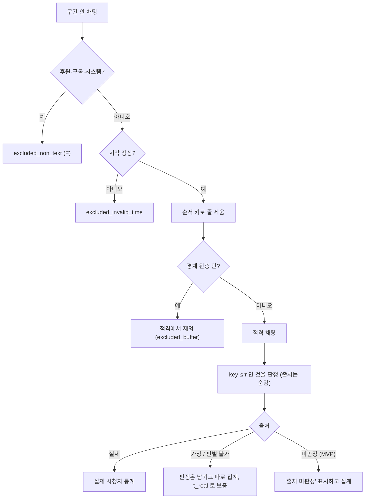
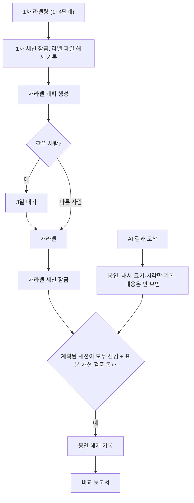

상태: 설계 초안 (2026-10-19). 2·3·4·5·7장의 사람 쪽은 C단계에서 구현했고, 6장과 7장의 봉인·해제는 E 첫 묶음에서 만든다 (D-14 8, D-15 7).

# 평가·일치도 설계

사람이 매긴 라벨을 '정답'으로 쓰려면 세 가지가 정해져 있어야 한다.

1. 무작위 표본과 재라벨 대상을 어떻게 뽑는가. 누가 뽑아도 같은 결과가 나와야 한다.
2. 사람끼리 얼마나 일치하는지 어떻게 재는가. 라벨 종류마다 지표가 다르다.
3. AI 결과와 어떻게 비교하는가. 블라인드, 점수 두 종류, 제외 집계가 필요하다.

판단 기준은 [안내서 v0.1](../labeling-guide/v0.1.md)을 따른다. 저장 형식은 [03-data-model](03-data-model.md), 화면·모듈·상태 머신은 [02-architecture](02-architecture.md), 블라인드와 개인정보의 보안 측면은 [05-security](05-security.md), 각 기능이 어느 단계에 들어가는지는 [01-analysis-and-ideas](01-analysis-and-ideas.md)와 [07-roadmap](07-roadmap.md)에 있다. 이 문서는 계산 규칙만 다룬다.

## 0. 이 문서에서 정한 것

| # | 결정 | 이유 한 줄 |
|---|---|---|
| D1 | 채팅마다 순서 키 `sha256(sample_seed\|draw_no\|chat_id)` 를 매겨 작은 순으로 줄 세운다. seed 는 project.json 의 `sample_seed` 하나이고 구간·기준서 버전을 넣지 않는다. 알고리즘 이름은 처음에 `sha256-tau-v1` 이었고, 지금 기본은 `sha256-tau-v2`(완충은 분류가 바뀌는 경계에만, 영상 밖 채팅 제외 — D-10 1·3)다. v1 은 옛 판이라 이미 쓴 매니페스트의 재현 검증만 한다(D-11 5, D-12 2). 옛 방식 `sha256-sort-v1`(seed 에 구간·기준서가 들어가고 상위 N개를 고름, 완충은 모집단에 넣고 표시만)은 폐기했다 (2-1). 이 안을 문서 세트 전체의 결정으로 정했고([07](07-roadmap.md) 질문 42 → ADR-09, 사용자 확정 전 — 반대하면 되돌림), [03](03-data-model.md) 15장·6-13 과 표본 매니페스트 스키마도 이 규칙으로 맞췄다 (12-1). D2·D3 도 같다 | 언어·Python 버전과 무관하게 재현된다. 구간을 쪼개거나 기준서를 올려도 같은 채팅은 같은 자리에 선다 |
| D2 | 표본 = 적격 채팅 중 순서 키가 임계값 τ 이하인 것. τ 는 처음 뽑을 때 100번째 키이고, 그 뒤로 내려가지 않는다. 매니페스트는 고치지 않고, 구간이 바뀌면 sample_rev 를 올린 새 매니페스트를 쓴다 (2-3, 2-6) | 구간이 바뀌어도 이미 뽑힌 표본이 빠지지 않고, 표본은 계속 단순 무작위다. '부족분만 더 뽑기' 같은 근사가 필요 없다 |
| D3 | 후원·구독·시스템은 줄 세우기 전에 뺀다. **경계 완충 안의 채팅은 적격에서 제외한다: 순서 키는 매기지만 τ 계산과 100개에 넣지 않는다.** 출처(가상·판별 불가)와 클린봇 가림은 판정한 뒤 집계에서 가른다 (2-2) | 판정 수가 정확히 100이 되고 [v0.2 초안](../labeling-guide/v0.2-draft.md) 2장의 '경계 완충 제외' 와 맞는다. 출처는 나중에 정해지고 라벨러에게 숨겨야 하므로 뽑기 조건으로 쓸 수 없다 |
| D4 | 적격 채팅이 100개 이하면 전수 (v0.1 그대로). 120개 이하 전수는 v0.2 후보 (2-3) | 안내서를 바꾸려면 개정이 먼저다 ([01](01-analysis-and-ideas.md) G9) |
| D5 | 재라벨 단위는 10분 블록, 25% (무작위 15% + 어려운 블록 10%) (3장, 시작값) | 구간 경계까지 다시 매겨야 구간 일치도를 잴 수 있다 |
| D6 | 같은 사람 재라벨은 1차 잠금 3일 뒤부터. 그 전에는 사유를 받고 기록한다. 두 번째 사람에게는 적용하지 않는다 (3-3) | 안내서 7-3. 간격의 목적은 기억 효과를 줄이는 것이다 |
| D7 | 등급 일치도의 대표값은 정확 일치율과 한 단계 어긋남 비율이다. 우연 보정 값은 두 세션이면 선형 가중 κ, 세 세션 이상이면 Krippendorff α 를 쓴다 (4-2) | 안내서 7-3 의 '나눠 센다' 를 그대로 보이고, 보정값은 손으로 검산할 수 있게 한다 |
| D8 | '불명확' 은 등급 척도 밖이다. 일치도와 AI 점수에서 빼고 건수를 따로 보인다 (4-2, 6-5) | 후보는 있는데 가릴 수 없다는 판정이라 한 줄 순서에 놓을 수 없다 |
| D9 | AI 결과는 받는 즉시 봉인해 해시와 시각만 기록한다. 계획된 사람 세션이 재라벨까지 모두 잠긴 뒤에만 연다 (7장) | 사람이 AI 쪽으로, 엔진이 정답 쪽으로 쏠리는 것을 순서와 기록으로 막는다 |
| D10 | 엄격 점수는 확실함이면서, 재라벨된 것은 두 번 같고, 그 라벨 종류의 사람 일치도가 기준을 넘은 것만 쓴다. 참고 점수는 아마도까지 포함한다 (6-5) | 안내서 7-3 마지막 표 |
| D11 | 제외는 정해진 순서에서 처음 걸린 사유 하나로만 세고, 모집단부터 최종 점수까지 계단식 표로 보인다 (6-6) | 같은 채팅을 두 번 빼거나 빠진 이유가 사라지는 일을 막는다 |
| D12 | 시작값을 바꿔도 라벨은 그대로 둔다. '재해석 보기' 만 새로 만들고, 재해석 결과는 엄격 점수에 넣지 않는다 (9장) | 안내서 0장 '이전 라벨 보존'. 그 기준으로는 사람이 본 적이 없다 |
| D13 | 설정을 두 묶음으로 나눈다. 기준서 시작값(guide-config 의 `values`, 해시는 thresholds_sha256)은 바꾸면 기준서 버전을 올린다. 분석 설정(eval_settings)은 guide-config 밖의 별도 파일이고, 보고서마다 값과 해시를 기록만 한다. guide-config 에 있던 `agreement` 블록은 eval_settings 로 옮겼다 (10장, [03](03-data-model.md) 9-3·19장) | 허용 오차 같은 분석값을 바꿀 때마다 기준서 버전이 오르면 안 된다 |

### 용어

| 용어 | 뜻 |
|---|---|
| 세션 | 한 라벨러가 한 프로젝트에서 연속으로 작업한 묶음. 1차(primary), 같은 사람 재라벨(relabel_same), 두 번째 사람(relabel_second) 이 있다. 저장은 [03-data-model](03-data-model.md) |
| 잠금 | 세션을 더 고칠 수 없게 닫고 라벨 파일 해시를 기록하는 일 |
| 적격 채팅 | 표본 판정 대상이 될 수 있는 채팅 (2-2) |
| 순서 키 | 채팅마다 매기는 sha256 값. 무작위 순서를 정한다 (2-1) |
| τ (임계 키) | 표본에 들어가는 순서 키의 상한 (2-3) |
| 블록 | 채팅 시계 10분 단위 시간 칸 (3-1) |
| 판정 큐 | 라벨러가 판정할 표본 채팅 목록 |

### 단계별로 언제 생기나

| 기능 | 시기 |
|---|---|
| 순서 키·τ·제외 순서에 따른 표본 추출, 매니페스트, 재현 검증, 제외 건수 표시 | MVP |
| '출처 미판정'(origin_unknown) 집계 — 저장하는 값이 아니라 출처 라벨이 없다는 사실에서 계산한다([03](03-data-model.md) 5-6·6-11, [01](01-analysis-and-ideas.md) 2-1) | MVP. 출처 보충 규칙(2-4)은 출처 판정이 생기는 v1 |
| 블라인드 재라벨 세션, 무작위 블록 선정, 3일 경고 | MVP 끝 (최소 기능) |
| 어려움 층 선정 | v1 |
| 일치도 계산과 비교 화면 | v1. 그 전에는 내보낸 JSONL 로 앱 밖에서 이 문서의 식을 그대로 쓴다. 식이 같아야 나중 결과와 비교된다 |
| AI 봉인·비교·점수 | **E 첫 묶음**(방송 분석 모드의 나란히 보기와 함께, D-14 8). 그 전에는 운영 규칙(7-4)으로 대신한다. E 는 label-event 스키마를 바꾸지 않고, 시범 라벨이 잠기기 전에는 합성 프로젝트·합성 엔진 결과로 시험한다 (D-15 7) |
| 8장 자동 보고서, 재해석 보기 | v1. 재해석에 필요한 원시값 저장은 MVP 부터 |

## 1. 공통 규칙

- 모든 시각은 채팅 시계로 비교한다. 채팅 시계는 API 의 playerMessageTime 이며 ms 정수다. 영상 파일 시각과의 보정값은 프로젝트에 따로 둔다 ([03-data-model](03-data-model.md)). 보정 판(calibration_rev)이 다른 라벨끼리 비교하면 보고서에 표시한다.
- 라벨은 고치지 않는다. 비교와 재해석은 모두 라벨을 읽어서 계산한 '보기' 다.
- 입력이 같으면 보고서도 같다. 보고서에는 입력을 모두 적는다: 세션 ID, 라벨 파일 해시, guide_version, thresholds_sha256, eval_settings 값과 eval_settings_sha256, 앱 버전, AI 결과 해시. 부트스트랩 난수 시드도 이 입력의 해시에서 만든다.
- 비교에는 잠긴 세션만 쓴다. 잠기지 않은 세션으로는 '미리보기' 만 낸다.
- 기준서 버전이나 시작값 해시가 다른 라벨은 한 점수에 섞지 않는다 (9-4).

## 2. 무작위 표본 추출 (안내서 2장 3단계)

### 2-1. 고정하는 것

| 항목 | 값 | 이유 |
|---|---|---|
| sample_seed | 프로젝트를 만들 때 한 번 만드는 임의 16바이트(hex). project.json 에 저장하고 화면에서는 바꿀 수 없다 | 라벨러가 고를 수 없게 한다 |
| draw_no | 1 부터 시작. 바꾸려면 검토자(role=reviewer)가 사유를 적고, 그 기록이 남는다 | 다시 뽑기를 흔적 없이 할 수 없게 한다 |
| seed_material | `"{sample_seed}\|{draw_no}"` | 매니페스트에 그대로 적는다. 매니페스트 하나만 받아도 재현할 수 있다 |
| 순서 키 | `key = sha256( UTF-8(seed_material + "\|" + chat_id) )` 의 소문자 hex. 곧 `sha256("{sample_seed}\|{draw_no}\|{chat_id}")` | Python 버전·언어와 무관하다. AI 엔진 쪽에서도 같은 표본을 만들 수 있다 |
| 순서 | key 오름차순 (hex 문자열 비교와 숫자 비교가 같다) | |
| 알고리즘 이름 | `sha256-tau-v2` (지금 기본). `sha256-tau-v1` 은 이미 쓴 매니페스트의 재현 검증에만 쓴다 | 매니페스트 `algorithm` 에 기록한다. 규칙을 바꾸면 이름을 올린다. 기준서 시작값이 아니다 (10장). v2 에서 바뀐 것은 둘이다([08](08-decisions-2026-10-20.md) D-10 1·3): 경계 완충을 분류가 바뀌는 경계에만 두고, 영상 밖 채팅을 적격에서 뺀다(2-2). 순서 키·τ·불감소는 v1 과 같다. 같은 계열(원 구간·draw_no) 안에서는 알고리즘을 바꾸지 않는다 |

- `random.Random(seed).sample` 은 쓰지 않는다. 결과가 CPython 구현에 묶이기 때문이다.
- seed 는 비밀이 아니다. 무작위의 목적은 숨기는 것이 아니라 라벨러가 고르지 않게 하는 것이다.
- seed 에 segment_id 와 guide_version 을 넣지 않는다. 구간을 쪼개거나 합쳐도 순서가 섞이지 않고, 같은 방송을 v0.2 로 다시 매길 때 같은 채팅끼리 비교할 수 있다. (옛 `sha256-sort-v1` 의 seed_material(프로젝트·구간·기준서·draw_no)과 [03](03-data-model.md) 9-2 4번의 '표본 시드에 guide_version 이 들어가 표본도 새로 뽑힌다' 는 이 규칙으로 바꿨다. [01](01-analysis-and-ideas.md) G10 도 같다. 반영 목록은 12-1.)
- draw_no 는 seed 의 일부라서 올리면 순서 전체가 바뀐다. 검토자의 '다시 뽑기' 에만 쓴다. 구간 경계 변경에는 쓰지 않고 sample_rev 로 다룬다 (2-6). 옛 03 15-4 의 '경계 변경 뒤 draw_no + 1 로 부족분 추가' 는 폐기했다 (12-1).
- chat_id 는 수집 순서와 무관하게 정해져야 한다. 재수집해도 같은 값이어야 순서 키가 같다. 규칙은 [03-data-model](03-data-model.md).

### 2-2. 줄 세우기와 제외 순서

한 채팅은 처음 걸린 사유 하나로만 센다.

| 순서 | 조건 | 근거 데이터 | 처리 | 집계 이름 | 안내서 |
|---|---|---|---|---|---|
| 0 | 이 저스트채팅 구간 밖 | 활동 구간 라벨 | 이 구간의 대상 아님 | — | 1장 5, 2장 |
| 1 | 후원·구독·시스템 메시지 | API messageTypeCode | 줄 세우기 전에 뺀다 | excluded_non_text | 2장, 6장 F |
| 2 | 채팅 시각이 없거나 범위 밖 | 수집 검사 | 줄 세우기 전에 뺀다 | excluded_invalid_time | — |
| 2-1 | 영상 밖 (v2) | 영상이 덮는 VOD 범위(media coverage, 보정 offset 반영) | 7-2 확인 범위(채팅 −10초 ~ +30초, recheck.pre_roll_sec·post_roll_sec)가 영상 범위 하나 안에 다 들지 않으면 적격에서 제외한다. 완충에도 걸리면 이쪽으로 센다 | excluded_out_of_media | 7-2 |
| 3 | 경계 완충 안 | 분류가 바뀌는 구간 경계 ± boundary_buffer_sec | 적격에서 제외한다. 순서 키는 매기지만 τ 계산·표본 수·판정 큐에 넣지 않는다 | excluded_buffer | 3장 |
| — | 여기까지 남은 것이 적격 채팅 | | | | |
| 4 | 상태가 정상이 아님 (클린봇 가림 등) | API messageStatusType | 판정한다. 표시하고 따로 센다 (확인 필요) | flag_status | — |
| 5 | 출처 가상 | 출처 판정 (v1) | 판정한다. 실제 시청자 통계에서 뺀다 | origin_virtual | 검토 의견 1 |
| 6 | 출처 판별 불가 | 출처 판정 (v1) | 판정한다. 실제 시청자 통계에서 기본 제외 | origin_undeterminable | 검토 의견 1 |
| 7 | 출처 미판정 | MVP 에는 출처 판정이 없다 | 보고서 머리에 '출처 미판정' 을 표시하고 집계 | origin_unknown | — |

- 경계 완충은 '구간 분류가 바뀌는 경계마다 양쪽 각 10초' (시작값) 로 계산한다. 방송 시작과 끝은 경계가 아니다. 안내서 3장의 '앞뒤 10초' 를 이렇게 읽는다 ([01](01-analysis-and-ideas.md) G3, [v0.2 초안](../labeling-guide/v0.2-draft.md)). `sha256-tau-v2` 의 세부 규칙(`core.segments` 의 `category_change`):
  - 같은 분류끼리 맞닿은 경계는 전환이 아니라 완충이 없다([03](03-data-model.md) 4-3 규칙 4).
  - 한쪽이 빈틈('아직 안 매긴 시간')이거나 분류를 안 매긴 구간이면 무엇으로 바뀌는지 모르므로 전환으로 보고 완충을 둔다.
  - '판단 불가' 끼리 맞닿은 경계도 같은 활동이라는 근거가 없어 전환으로 본다.
  - `sha256-tau-v1` 은 같은 분류끼리의 경계를 포함해 모든 안쪽 경계에 완충을 두었다(`all_boundaries`). v1 매니페스트는 이 규칙으로 계속 재현 검증한다.
- 영상 밖(2-1번, v2): 소리를 들을 수 없는 자리는 라벨을 매길 수 없으므로 처음부터 모집단의 적격을 '영상이 있는 범위' 로 정한다([08](08-decisions-2026-10-20.md) D-10 3). 표본을 뽑을 때는 반응 후보 발화가 없으니 확인 범위는 채팅 시각 기준 [max(0, t − 10초), t + 30초] 다. 영상 범위는 부르는 쪽이 보정 offset 을 반영한 VOD ms 로 넘기고, 매니페스트 `media` 에 쓴 범위·확인 범위 값을 남겨 재현 검증이 그 값으로 다시 계산한다. 영상 범위를 넘기지 않으면 검사하지 않고 `media.coverage = null`('coverage 없음')로 남긴다(`out_of_media` = 0).
- 완충을 '뽑은 뒤 표시만' 하지 않고 적격에서 빼는 이유 (옛 [03](03-data-model.md) 15-2·[05](05-security.md) S-35 의 방식을 폐기한 이유. 지금은 03·05 도 이 규칙을 따른다):

| | 옛 방식 (100개 안에 넣고 표시, 폐기) | 이 문서 (적격에서 제외) |
|---|---|---|
| 실제 판정 수 | 100 − 완충에 걸린 수 (구간마다 다름) | 정확히 100 (경계 변경 뒤에는 조금 넘을 수 있음) |
| 안내서와 | v0.2 초안 2장 '경계 완충 제외' 와 다름 | 같음 |
| '뽑는 시점에 따라 표본이 달라짐' (S-35) | 모집단을 고정해 막음 | 순서 키는 경계와 무관하고, 완충은 구간표가 끝난 뒤(안내서 1장 5) 정해지며, 경계를 고치면 τ 불감소(2-6)가 기존 표본을 지킨다. 출처는 어느 쪽도 뽑기 조건이 아니다 |

- 스티커 같은 다른 메시지 유형은 아직 관측되지 않았다. 관측되면 정한다. 정하기 전에는 일반 채팅으로 다루고 유형을 표시한다 (확인 필요).
- 클린봇 가림 채팅은 v0.1 에 규칙이 없으므로 빼지 않는다. 스트리머 화면에 가림 문구만 보였는지 확인한 뒤 v0.2 에서 정한다 (확인 필요).
- 출처를 뽑기 조건으로 쓰지 않는 이유는 셋이다. (1) MVP 에는 출처 판정이 없고, v1 에서도 판정이 나중에 바뀔 수 있다. (2) 반응을 매기는 동안에는 라벨러에게 출처를 숨겨야 한다 (편향 방지, [05-security](05-security.md)). (3) 2-4 의 보충 규칙으로 실제 시청자 표본을 나중에 만들 수 있다.
- 스트리머가 가상 채팅에 반응한 사례는 정답 집계에서는 빠지지만 건수는 따로 보인다. 그 사례의 의미는 이 문서가 다루지 않는다 (시험 평가표).



### 2-3. 표본 크기와 임계 키 τ

| 적격 채팅 수 E | 표본 | 근거 |
|---|---|---|
| 0 | 없다. 매니페스트에 0 으로 기록한다 | |
| 1 ~ 100 | 전수 (census=true, τ = 적격 채팅 중 가장 큰 key) | 안내서 2장. 모집단이 100 이하면 전부 ([01](01-analysis-and-ideas.md) G9) |
| 101 이상 | τ = 적격 채팅 중 key 순서 100번째 채팅의 key. 표본 = 적격이면서 key ≤ τ | 안내서 2장 시작값 100 |

- 'key ≤ τ' 는 모든 채팅에 같은 규칙을 적용하는 것이다. 순서 키는 채팅마다 고르게 퍼진 난수와 같으므로, 이렇게 뽑은 집합은 단순 무작위 표본이다.
- 처음 뽑을 때는 정확히 100개다. 구간이 바뀐 뒤에는 100개를 조금 넘을 수 있다 (2-6).
- v0.2 후보: 적격 채팅이 120개 이하면 전수 (sample.census_max = 120). 110개 가운데 100개를 뽑는 것은 수고는 거의 같은데 표본 오차만 남는다. 안내서 개정 전에는 100 으로 둔다.
- 구간 길이와 상관없이 구간당 100개라서, 방송 전체 비율을 낼 때는 구간마다 가중치 E_s/n_s 를 곱한다 (6-4).
- 긴 구간 안에서 시간 층화(10분 블록마다 고르게 뽑기)는 하지 않는다. 시범에서 표본이 한 시간대로 몰리는지 보고 정한다 ([01](01-analysis-and-ideas.md) P31).

### 2-4. 출처로 가른 표본 — 보충 규칙 (v1)

- 실제 시청자 통계용 임계 키: `τ_real = max(τ, 출처가 '실제' 인 적격 채팅 중 100번째 key)`.
- 실제 시청자 표본 = 출처 실제 ∧ key ≤ τ_real. key 가 τ 와 τ_real 사이인 채팅을 판정 큐에 보탠다.
- 보충 상한은 n 의 0.5배다 (시작값, sample.max_extend_ratio). 상한에 닿으면 거기서 멈추고, 실제 시청자 표본이 n 보다 적다고 보고서에 적는다.
- 보충분도 출처를 모르는 채로 같은 화면에서 같은 규칙으로 판정한다.

### 2-5. 예시

작게 보이려고 n = 3 으로 두고 전수 기준은 무시한다. key 는 앞 4자리만 보인 예시 값이다.

| 채팅 | 종류 | 완충 | key | 결과 |
|---|---|---|---|---|
| c01 | 일반 | 밖 | 9f21… | 적격 |
| c02 | 후원 | — | 0a13… | excluded_non_text |
| c03 | 일반 | 안 | 1b77… | excluded_buffer |
| c04 | 일반 | 밖 | 3c05… | 적격 |
| c05 | 일반 | 밖 | e410… | 적격 |
| c06 | 일반 | 밖 | 2d98… | 적격 |
| c07 | 일반 | 밖 | 7a3e… | 적격 |
| c08 | 일반 | 밖 | 5512… | 적격 |

1. 적격 채팅을 줄 세우면 c06(2d98) → c04(3c05) → c08(5512) → c07(7a3e) → c01(9f21) → c05(e410) 이다. 세 번째 key 가 τ = 5512… 이므로 표본은 {c06, c04, c08}.
2. 나중에 c04 가 '가상' 으로 판정된다. 전체 통계의 표본은 그대로 {c06, c04, c08}. 실제 채팅 중 세 번째 key 는 c07(7a3e) 이므로 τ_real = 7a3e…, 실제 시청자 표본은 {c06, c08, c07}. c07 을 판정 큐에 보탠다.
3. 경계를 옮겨 c08 이 완충에 들어간다 (2단계와 따로 본다). 적격 중 세 번째 key 는 c07(7a3e) 이므로 τ = max(5512, 7a3e) = 7a3e…, 표본은 {c06, c04, c07}. c08 의 판정은 지우지 않고 out_of_sample(사유 boundary_changed) 로 둔다. c07 을 큐에 보탠다.
4. 경계를 옮겨 key 1a00… 인 c09 가 구간에 들어온다 (3과 따로 본다). 적격 중 세 번째 key 는 3c05 이지만 τ 는 내려가지 않아 5512… 그대로다. 표본은 {c09, c06, c04, c08} 4개. 기존 3개는 모두 남고 c09 만 큐에 들어간다.

### 2-6. 구간이 바뀌었을 때

순서 원칙(안내서 1장 5) 때문에 표본은 구간표가 끝난 뒤 뽑는다. 그래도 나중에 경계를 고칠 수 있다.

1. 적격 채팅을 다시 계산하고 `τ ← max(τ, 새 적격 채팅 중 100번째 key)`. τ 는 내려가지 않는다.
2. 그래서 구간 안에 남은 표본 채팅은 표본에서 빠지지 않는다. 뽑힌 표본은 유지된다.
3. 구간 밖이나 완충으로 나간 채팅의 판정은 지우지 않고 out_of_sample 로 표시한다. 표본 통계에서만 빠진다.
4. 새로 key ≤ τ 가 된 채팅을 판정 큐에 넣는다. 표본이 100개를 조금 넘으면 보고서에 '기준 100 + 경계 변경 3' 처럼 적는다.
5. 이전 매니페스트는 고치지 않는다 ([03](03-data-model.md) 15-3 의 '매니페스트는 불변' 을 따른다). sample_rev 를 올린 새 매니페스트를 쓰고, previous_sample_rev, 사유, 들어오고 나간 chat_id(changes)를 적는다. 유효한 것은 가장 큰 sample_rev 다.

- 구간을 쪼개거나 합쳐 새 구간(새 entity_id)이 생기면 새 매니페스트 계열을 시작한다. 이때 τ = max(원 구간들의 τ, 새 구간 적격 채팅 중 100번째 key). 원 구간에서 뽑힌 채팅은 새 구간 안에 남으면 표본에 남는다.
- 기준서 버전이 바뀌면 새 매니페스트 계열이라 τ 불감소를 이어받지 않는다. seed 가 같아 순서는 같다 (9-2).

반응 라벨(2단계)도 같은 원칙을 따른다. 경계를 옮겨 반응 라벨의 채팅이 저스트채팅 구간 밖이나 완충 안에 들어가면, 지우지 않고 '구간 재확인 필요' 를 붙여 평가에서 뺀다 ([01](01-analysis-and-ideas.md) 1-3 규칙 1). 이어짐 구간은 새 구간 끝에서 다시 자른다. 이런 건수를 보고서에 보인다. 경계 수정이 숨겨진 비용을 만들지 않아야 라벨러가 경계 수정을 피하지 않는다.

### 2-7. 매니페스트와 재현 검증

구간·sample_rev 마다 `samples/<sample_set_id>.json` 이 하나 있다. sample_set_id 는 `S-<구간 entity_id 앞 8자>-d<draw_no>-r<sample_rev>` 다. 필드 정의는 [03-data-model](03-data-model.md) 6-13 과 [sample-manifest 스키마](../../schemas/sample-manifest.schema.json) 에 둔다. 아래는 이 문서가 정한 모양이고, 스키마는 12-1 표대로 이 모양에 맞췄다.

```json
{
  "schema": "chatcoach/sample-manifest",
  "schema_version": 1,
  "sample_set_id": "S-7f3c2a1b-d1-r1",
  "project_id": "…",
  "source_segment": {"session_id": "L01-P-20261021-a1b2", "entity_id": "7f3c2a1b-…", "version_id": "…", "start_ms": 3600000, "end_ms": 9180000},
  "guide_version": "0.1",
  "thresholds_sha256": "…",
  "algorithm": "sha256-tau-v2",
  "seed_material": "9b1f…|1",
  "draw_no": 1,
  "sample_rev": 1,
  "previous_sample_rev": null,
  "reason": "initial",
  "changes": null,
  "population": {"kinds": ["text"], "statuses": null, "range_start_ms": 3600000, "range_end_ms": 9180000, "size": 1855, "chat_ids_sha256": "…", "messages_sha256": "…"},
  "excluded": {"non_text": 45, "invalid_time": 0, "buffer": 60, "out_of_media": 0},
  "media": {"coverage": [[3500000, 9300000]], "pre_roll_ms": 10000, "post_roll_ms": 30000},
  "boundary_buffers": [[9170000, 9180000]],
  "eligible": {"size": 1795, "chat_ids_sha256": "…"},
  "requested_size": 100,
  "census": false,
  "tau_key": "0e4b…",
  "tau_real_key": null,
  "items": [
    {"order": 1, "chat_id": "c…", "t_ms": 3612400, "rank": 37, "sort_key": "…", "role": "base"},
    {"order": 2, "chat_id": "c…", "t_ms": 3650100, "rank": 104, "sort_key": "…", "role": "origin_extend"}
  ],
  "presentation_order": "time",
  "drawn_at": "2026-10-21T14:03:11+09:00",
  "drawn_by": "L01",
  "app_version": "0.1.0"
}
```

| 필드 | 뜻 |
|---|---|
| population | 구간 범위 안의 kind=text 채팅 (2-2 의 1·2번을 뺀 것) |
| excluded | 2-2 의 1~3번에서 뺀 건수와 (v2) 영상 밖 `out_of_media` |
| media | (v2) 영상 밖 판정에 쓴 영상 범위 `coverage`(VOD ms 목록, null = coverage 없음)와 확인 범위 `pre_roll_ms`·`post_roll_ms`. v1 매니페스트에는 `media`·`out_of_media` 가 없다 |
| boundary_buffers | (v2) 뽑을 때 쓴 경계 완충 [start, end) 중 원 구간 범위에 걸치는 것을 그 범위로 자르고 합친 목록. v2 완충은 이웃 구간의 분류에 달려 있어 매니페스트에 남겨야 하나만 받아도 재현된다. 재현 검증은 이 값으로 다시 계산한다. v1 에는 없다(v1 완충은 원 구간 경계만으로 다시 만든다) |
| eligible | 적격 채팅. `chat_ids_sha256` 는 적격 채팅의 chat_id 를 정렬해 줄바꿈으로 이은 UTF-8 바이트의 sha256 이다 |
| tau_key · tau_real_key | 2-3 의 τ, 2-4 의 τ_real (v1, 없으면 null) |
| items[].order · rank | order 는 화면 제시 순서(2-8), rank 는 적격 채팅 중 key 순위 |
| items[].role | `base`(key ≤ τ) 또는 `origin_extend`(2-4 보충분) |
| changes | sample_rev 2 이상에서 `{"added": [...], "removed": [{"chat_id": …, "reason": "boundary_changed"}]}`. removed 채팅의 판정은 남고 out_of_sample 로 계산된다 |

- 옛 sample-manifest 스키마의 `in_buffer_at_draw` 는 뺐다. 완충 채팅은 처음부터 items 에 들어가지 않기 때문이다 (2-2).
- 재현 검증은 messages.jsonl, 구간 라벨, seed_material, 이전 sample_rev 들의 tau_key 로 다시 계산해 items 와 비교한다. 버튼은 표본 화면 위에 늘 둔다. 세션을 잠글 때와 라벨러 패키지를 가져올 때는 자동으로 돌린다. 결과가 다르면 잠금을 막고 무엇이 다른지 보인다. 앱 밖 검증 도구는 [01](01-analysis-and-ideas.md) P27.
- 라벨러가 표본을 고르거나 다시 뽑는 기능은 없다.

### 2-8. 제시 순서

표본은 순서 키로 정해진 집합이다. 화면에 보일 때는 구간 안 시각 순서가 기본이다. 안내서 7-2 의 확인 범위(채팅 10초 전 ~ 발화 끝 30초 뒤)가 가까운 채팅끼리 겹치므로, 시각 순서가 다시 듣는 시간을 줄인다. 시각 순서 때문에 앞 판정이 뒤 판정에 영향을 주는지는 시범에서 본다 (확인 필요). 제시 순서는 매니페스트에 기록한다.

### 2-9. 4단계(놓친 채팅 후보) 대상

일치도와 비율을 내려면 4단계 대상도 정해진 모집단이어야 한다. 그래서 체계적으로 판정하는 대상은 '3단계 표본 중 결과가 반응 미확인·관련성만 있음·불명확인 채팅' 으로 한다. 라벨러가 표본 밖에서 찾은 후보는 extra_candidate 로 남기고 비율 계산에서 뺀다 ([01](01-analysis-and-ideas.md) G12, [v0.2 초안](../labeling-guide/v0.2-draft.md)).

- 4단계는 **재라벨 세션의 블록 안에서만** 한다. 1차는 ④ 를 하지 않는다 (D-12 5, D-13 4).
- ④ 를 매긴 뒤 ③ 판정을 직접·높음으로 고쳐 대상에서 빠진 채팅의 놓친 후보는 지우지 않고, 일치도에서만 뺀다. 보고서에 `missed.dropped_not_target` 건수와 경고 1줄을 낸다 (D-13 2, 14 3-2 4번·4-2 13번).
- ③ 반응을 물러 **유효 반응이 없어진** 채팅의 놓친 후보도 지우지 않고 일치도에서만 뺀다(④ 는 ③ 이 대상일 때만 생기므로 근거가 없어졌다). 보고서에 `missed.dropped_no_reaction`(A·B 건수)과 1줄을 낸다. 유효 반응이 둘 이상이면 가를 수 없어 남기고, 표본 밖 후보(`scope = extra`)는 ③ 과 상관없이 남긴다. 계산은 새 함수 `agreement.drop_missed_stale` 이 하고, 앞 판 `drop_missed_not_target` 은 하위 호환으로 그대로 둔다 (D-14 1·2, 15 1-2 4번·5-1 17번·5-2 17번).
- **③ 을 직접·높음으로 고칠 때 경고**: 그 채팅에 ④ 놓친 후보(표본 안)가 있으면 작업대 띠와 상태 줄에 1줄 낸다('일치도에서 빠짐'). 저장은 막지 않는다. 로그에는 건수만 (16 1-2 13번·5-2 2번. 앞 문구 '아직 없다' 를 고침).
- **표본 밖 후보**(`scope = extra`, 위 extra_candidate): 채팅 표 오른쪽 메뉴 '표본 밖 후보로 적기' 로 적는다. 재라벨 세션에서, ④ 문이 열린 뒤, 블록 안 채팅만 된다. 누르면 작업대가 ④ 모드로 바뀌고 그 채팅을 폼 목록 끝에 더한다(④ 모드에는 채팅 표가 없어 누를 곳이 없어서다). 비율 계산에서는 빠진다 (D-14 1, 15 1-2 11번·5-1 21번·5-2 17번).

## 3. 재라벨링 대상 선정 (안내서 7-3)

### 3-1. 단위: 10분 블록

- 블록 k 는 채팅 시계로 [k×600,000, (k+1)×600,000) ms 다 (시작값 relabel.unit = block, relabel.block_minutes = 10).
- 후보는 1차 세션이 라벨을 마친 범위와 겹친 길이가 300초(`min_block_ms`) 이상인 블록이다. 방송 끝·영상 끝의 짧은 블록도 300초 이상일 때만 넣는다.
- 블록 범위는 **블록 칸 ∩ 영상(방송) 범위**다. 1차 구간 경계로 자르지 않는다. 1차가 마친 범위(`done_ranges`)는 후보를 가리는 데만 쓰고 계획에 남기지 않는다. 블록 가장자리가 1차 구간 경계와 같아져 경계가 드러나는 것을 막는다(D-12 1, 13 3-2 5번).
- 저스트채팅 구간이 아니라 시간 블록으로 고르는 이유: 구간 단위로 고르면 재라벨러가 1차 라벨러의 경계를 받아 쓰게 되어 구간 일치도를 잴 수 없다 (05 S-33). 블록 안에서는 활동 구간부터 다시 매긴다. 블록 가장자리는 경계가 아니다.
- 기준서 v0.1 의 `relabel.unit` 은 `segment`(안내서 문구 '구간') 다. 계획은 그래도 블록으로 고르고 계획 `notes` 에 적는다. v0.2 기준서에서 `block` 으로 바꾼다(D-12 1, 13 4-1 16번).

### 3-2. 비율과 층화

| 층 | 비율 (시작값) | 고르는 법 | 보고 |
|---|---|---|---|
| 무작위 | 15% | `sha256("{sample_seed}\|relabel\|{원 세션 ID}\|{block_index}")` 가 작은 순 (D-12 1) | 일치도의 대표값 |
| 어려움 (v1) | 10% | 무작위 층에 없는 블록 중 어려움 점수가 높은 순 | 진단용. 대표값에 섞지 않는다 |
| 합계 | 25% | 안내서 20~30% 의 가운데 | |

- **블록 seed 는 `"{sample_seed}|relabel|{원 세션 ID}"`** 다(`selection.seed_material`, 알고리즘 `sha256-relabel-v1`). 처음 설계는 `plan_no` 를 넣었지만 빼고 원(잠긴 1차) 세션 ID 를 넣었다. 그래서 같은 1차 세션이면 같은 사람(`relabel_same`)·다른 사람(`relabel_second`) 계획이 같은 블록을 고르고, 세 판(1차·같은 사람·다른 사람)을 같은 블록에서 비교할 수 있다(4-2 의 α). `plan_no` 는 기록용 순번으로만 남는다(D-12 1, 13 4-1 2번).
- 개수 = max(1, (무작위 + 어려움 비율) × 후보 수 를 반올림), 후보 수 상한. 지금은 후보의 25%(최소 1개)다.
- 어려움 점수 = (확신도 아마도·판단 불가 라벨 수 + 불명확 등급 수 + 2 × 구간 경계 수) ÷ (블록 안 라벨 수 + 1). 1차 라벨로 프로그램이 계산한다.
- MVP 끝의 최소 기능에서는 25% 를 모두 무작위로 고른다. 무작위만으로도 대표값은 치우치지 않는다.
- 후보 블록이 4개 미만이면 무작위 층에서 1개 이상만 고른다.
- **시범** (D-15 1·4): 영상마다 VOD 00:20:00~01:00:00 만 매기므로 후보는 10분 블록 2~5번 4개(경계가 블록 칸과 맞는다)이고, 개수 = max(1, 0.25 × 4 반올림) = **무작위 블록 1개**다. 어려움 층은 v1. [07](07-roadmap.md) 4-1 의 옛 '블록 2개(무작위 1 + 어려운 1)' 를 대신한다.
- 재라벨러에게는 블록이 어느 층인지 보이지 않는다. 블록 제시 순서도 seed 로 섞는다. 여러 방송이 대기 중이면 방송을 섞어 제시한다.
- 층을 나누는 이유: 무작위만 쓰면 드문 등급(직접 반응)의 비교 사례가 모자라고, 어려운 것만 쓰면 일치도가 실제보다 낮게 나온다. 그래서 둘을 따로 보고한다.

### 3-3. 3일 간격

| 항목 | 규칙 |
|---|---|
| 적용 대상 | 같은 사람 재라벨(relabel_same) 만. 두 번째 사람(relabel_second)은 기억 효과가 없으므로 1차 잠금 직후에 시작할 수 있다. 누가 두 번째 사람이 될 수 있는지는 3-4 아래 |
| 시작 가능 시각 | earliest_start_at = 1차 세션 잠금 시각 + relabel.min_interval_days (3일, 시작값) |
| 그 전 | 시작 화면에 남은 시간을 보인다. 시작하려면 사유를 받는다 ([01](01-analysis-and-ideas.md) 의 '경고'). 계획 파일은 불변이므로 앞당긴 시작은 재라벨 세션의 `warning(relabel_too_early)` 줄(사유 포함)로 남기고, 보고서는 그 줄에서 따로 표시한다(D-12 1, [03](03-data-model.md) 6-14) |
| 설정 | relabel.enforce_interval = true 이면 사유를 적어도 열리지 않는다 ('강제'). 기본값은 false |
| 시계 | 세션 시작 때 PC 시각을 기록하고, 온라인이면 최근 HTTP 응답의 Date 헤더와의 차이(skew)도 기록한다. 5분 넘게 차이 나면 경고하고 계획에 표시한다 |

- 기본을 '경고' 로 두는 이유: 1인 시범에서 일정이 꼬일 때 막는 것보다 기록하는 편이 낫다. 앞당긴 세션은 보고서에서 어차피 따로 본다.
- 시범에서는 7일 간격도 비교해 보기를 권한다. 3일은 인상적인 장면을 기억하기에 짧을 수 있다는 지적이 있다 ([01](01-analysis-and-ideas.md) 열린 질문 9).
- PC 시계를 앞으로 돌리는 것은 막지 못한다. skew 기록으로 나중에 드러낼 뿐이다.

### 3-4. 재라벨 세션에서 보이는 것

| 자료 | 보임 여부 |
|---|---|
| 채팅 로그, 영상 | 보임 |
| 선정된 블록의 시간 범위 | 보임. 층은 안 보임 |
| 1차 세션의 구간·반응·표본 판정·메모 | 안 보임. 파일을 아예 열지 않는다 |
| AI 결과, 비교 보고서 | 안 보임. 폴더를 아예 열지 않는다 |
| 자동 인식 자막(ASR) | 설정에 따른다. 켜면 `view.exposed` 를 기록한다 |
| 재라벨 계획에 적힌 τ_block | 프로그램 안에서만 쓴다. 화면에 보이지 않는다 (3-5) |

- 숨김을 끄는 행위는 모두 `view.exposed` 기록으로 남는다 ([03](03-data-model.md) 6-4). 그 세션은 일치도 대표값에서 빠지고 따로 보고된다. 구현은 `what` 을 가리지 않는다: `view.exposed` 가 하나라도 있거나 분석 세션으로 잠긴 1차를 연 기록이 있는 세션이 끼면 보고서 머리 `representative = false` 로 대표값에서 빼고 숫자는 그대로 낸다. 엄격한 쪽이다(D-12 1, 13 4-1 10번). 구현은 [02-architecture](02-architecture.md)·[05-security](05-security.md) 의 블라인드 정책을 따른다.
- 재라벨 세션에서는 선정된 블록 밖의 라벨을 만들 수 없다.
- **두 번째 사람(`relabel_second`)이 될 수 있는 사람** (D-14 1·3, 15 1-4·4-2 2번·5-1 22번·5-3 1번): 계획은 조정 세션에서 만든다([03](03-data-model.md) 6-14). 원 세션 라벨러, 계획을 만드는 조정자 자신, 이 프로젝트에서 조정 세션을 연 적이 있는 라벨러는 거부한다 — 조정 세션은 잠긴 세션을 모두 보기 때문이다. **분석 세션을 연 라벨러는 맡을 수 있다.** 분석 세션은 잠긴 1차만 읽으므로, 거부하지 않고 위 노출 표시로 대표값에서 뺀다. 두 번째 사람이 실제로 생기면 다시 본다.

### 3-5. 재라벨 표본

- 재라벨러는 자기 구간표로 적격 채팅을 다시 정한다 (2-2 의 0~3번).
- 블록 안 적격 채팅 중 key ≤ τ_block 인 것을 판정한다. τ_block 은 블록과 겹치는 1차 표본 매니페스트들(각 계열의 가장 큰 sample_rev)의 tau_key 중 가장 큰 값이다.
- τ_block 은 재라벨 계획을 만들 때 계산해 계획 파일에 `tau_block_key` 로 적는다. 재라벨 세션은 `samples/` 를 열지 않는다 ([03](03-data-model.md) 12-1).
- 계획에 1차 표본 목록(03 6-14 의 `sample_items`)은 넣지 않는다. 목록에서 빠진 채팅의 자리로 1차 경계와 완충이 드러나기 때문이다. 재라벨러는 자기 구간표와 τ_block 으로 표본을 다시 계산한다.
- 두 사람의 구간표가 같으면 재라벨 표본은 블록 안의 1차 표본을 모두 포함한다. 조금 더 많을 수는 있다. 구간표가 다르면 가장자리 몇 개만 달라진다.
- 맞닿은 두 블록에 걸친 재라벨러 구간은 블록 조각으로 나눠 본다. 두 블록 seed 가 같으면 τ_block 최댓값 하나를 쓴다. 그래서 τ 가 작은 블록 쪽에서 몇 건이 더 들 수 있다. 일치도는 '둘 다 판정' 만 쓰므로 숫자는 같다. seed 가 다르면 블록 경계 시각을 알려 주며 구간을 나누게 한다(D-12 1, 13 4-1 7번).
- 재라벨러가 자기 구간을 고쳐 표본에서 빠진 채팅의 판정은 지우지 않는다. 일치도에서는 현재 표본 안만 세고, 빠진 판정 수를 보고서에 1줄 적는다(D-12 2, 13 4-2 7번). 보고서는 영상을 열지 않으므로 '현재 표본' 은 각 세션의 구간표(저스트채팅 안·v2 완충 밖)로 다시 본 근사다. 영상 밖·τ 변화는 보지 않는다 (D-13 1, 14 4-1 15번).
  - 재라벨 세션은 잠그기 직전 워커로 자기 현재 표본을 계산해 잠금 `current_sample` 에 넣고, 보고서는 그 목록을 쓴다(`current_sample_method = given`). 1차는 넣지 않고 위 근사를 쓴다(`segments`, 경고 없음) — 1차 표본은 매니페스트가 맡는다 (D-14 1·4, 15 5-1 18번, [03](03-data-model.md) 6-14).
- 표본 판정의 일치도는 두 세션이 모두 판정한 채팅으로만 계산한다. 한쪽만 판정한 건수도 같이 보인다. 이 '한쪽만' 은 비교한 블록 안의 수다. 블록(두 세션 scope 의 겹침) 밖 판정은 `outside_scope_a`·`outside_scope_b` 로 따로 센다(13 3-2 낮음).

## 4. 일치도 지표 — 라벨 종류별

### 4-0. 비교 단위와 짝짓기

| 라벨 종류 | 비교 단위 | 짝짓기 | 허용 오차 (분석 설정, 시작값) |
|---|---|---|---|
| 활동 구간 분류 | 1초 칸 | 같은 시각 칸끼리 | — |
| 구간 경계 | 경계 시각 | 1:1, 차이가 작은 쌍부터 차례로 | 30초 안에서만 짝짓는다. 10초(완충) 안 비율을 따로 낸다 |
| 표본 판정 (3단계) | chat_id | 같은 chat_id. 기본은 두 세션의 유효 반응 라벨 전부를 짝짓는다(D-10 4 로 ② 라벨이 ③ 판정이 되므로). `--samples-only` 면 표본 매니페스트의 chat_id 로 좁힌다(D-12 1, 13 4-1 8번) | — |
| 연결 (2단계) | (chat_id, 발화) | 같은 chat_id 안에서 발화 시작 차이가 작은 쌍부터 | ±5초 |
| 반응 시각 | 짝지어진 연결 | | ±2초 안 비율 |
| 이어짐 | 짝지어진 반응 라벨 중 둘 다 직접·높음 | | — |
| 놓친 채팅 후보·사유 코드 | chat_id (2-9 의 대상) | | — |
| 출처 (v1) | chat_id | | — |

- 경계를 30초 창에서 짝짓는 이유: 10초 창으로 짝지으면 12초 어긋난 경계가 '빠진 경계' 와 '남는 경계' 두 개로 세어진다. 또 \|Δt\| 분포가 10초에서 잘려 완충이 충분한지 점검할 수 없다 (8장). ([01](01-analysis-and-ideas.md) G17 의 '10초 안' 은 이 규칙으로 바꾼다.)
- 확신도 '판단 불가' 를 고른 항목은 등급·분류 일치도에서 빼고, '판단 불가 일치 표' (둘 다 / 한쪽만) 를 따로 보인다. 구현: 표본 판정에서 한쪽이라도 판단 불가 또는 불명확이면 등급 κ_w 와 반응 있음 이진 κ **둘 다**에서 빼고 따로 센다(D-12 1, 13 4-1 9번). 안내서 1장 2 에 따라 판단 불가는 정답으로 쓰지 않는다. 뺀 비율을 같이 보여 일치도가 부풀려지지 않게 한다. 확신도 지표(4-4)에는 판단 불가 항목도 넣는다.
- 처음 판단과 재확인 판단이 다른 라벨(안내서 7-2)은 최종 판단으로 비교한다. 바뀐 비율은 8장 보고서에 따로 낸다.
- 같은 세션 안에서 2단계(발화 출발)와 3단계(표본)가 같은 채팅에 다른 등급을 주면 목록으로 보인다. 표본 일치도에는 3단계 값을 쓴다.

### 4-1. 활동 구간

| 지표 | 계산 | 보는 것 |
|---|---|---|
| 시간 일치율 | 같은 분류인 초 ÷ 비교 범위 초 | 전체 일치 |
| 핵심 일치율 | 양쪽 경계 ± 완충 칸을 뺀 나머지에서의 일치율 | 경계 오차를 뺀 분류 자체의 일치 |
| κ (초 단위) | 두 세션이면 Cohen κ, 세 세션 이상이면 Krippendorff α (명목) | 우연 보정 |
| 저스트채팅 IoU | \|JC_A ∩ JC_B\| ÷ \|JC_A ∪ JC_B\| (초) | 반응 평가에 들어가는 시간이 얼마나 겹치나 |
| 경계 오차 | 짝지은 경계의 \|Δt\| 중앙값과 90퍼센타일, 10초 안 비율, 한쪽에만 있는 경계 수 | 완충 10초가 적당한가 |
| 혼동표 | 5×5 (초) | 어느 분류끼리 헷갈리나 |

- 분류는 순서가 없는 명목 척도다. 그래서 '한 단계 어긋남' 을 정의하지 않는다.
- '판단 불가' 분류는 하나의 분류로 κ 에 넣고, 세션마다 판단 불가 시간 비율을 따로 보인다.
- 1초 칸들은 서로 독립이 아니다. 신뢰구간은 블록 단위로 다시 뽑아 계산한다 (4-8).

```
p_o = (일치한 초) / (전체 초)
p_e = Σ_c (A가 c로 매긴 초의 비율) × (B가 c로 매긴 초의 비율)
κ   = (p_o − p_e) / (1 − p_e)
IoU = |JC_A ∩ JC_B| / |JC_A ∪ JC_B|
```

예 — 10분 블록(600초):

| 시각(초) | 세션 A | 세션 B |
|---|---|---|
| 0 ~ 300 | 저스트채팅 | 저스트채팅 |
| 300 ~ 312 | 게임 | 저스트채팅 |
| 312 ~ 580 | 게임 | 게임 |
| 580 ~ 600 | 게임 | 기타 |

- 시간 일치율 = (300 + 268) ÷ 600 = 94.7%.
- κ: p_e = 0.50×0.52 + 0.50×0.447 + 0×0.033 = 0.483, κ = (0.947 − 0.483) ÷ (1 − 0.483) = 0.90.
- 저스트채팅 IoU = 300 ÷ 312 = 0.96.
- 경계: A 는 {300}, B 는 {312, 580}. 300 과 312 가 짝이 된다 (\|Δt\| = 12초로 완충 10초 밖). 580 은 B 에만 있는 경계다.
- 핵심 일치율: 경계 ±10초 칸 52초를 빼면 548초 중 538초가 일치해 98.2% 다. 어긋난 곳 대부분이 경계 근처였다는 뜻이다.

### 4-2. 반응 등급

척도 (강한 연결에서 약한 연결 순):

| 순위 | 등급 |
|---|---|
| 4 | 직접 반응 |
| 3 | 연결 가능성 높음 |
| 2 | 관련성만 있음 |
| 1 | 반응 미확인 (후보 없음) |
| 척도 밖 | 불명확 |

- 반응 미확인을 맨 아래에 둔다. 연결 증거가 '관련성만 있음' (약한 증거) 보다도 적은 상태이기 때문이다.
- 불명확은 '후보는 있는데 가릴 수 없음' 이라 이 한 줄에 놓을 수 없다. 한쪽이라도 불명확이면 척도 지표에서 빼고 아래 '불명확 표' 로 보인다.

| 지표 | 계산 | 비고 |
|---|---|---|
| 정확 일치율 | 같은 등급 수 ÷ N | 안내서 7-3 |
| 한 단계 어긋남 비율 | 순위 차가 1 인 수 ÷ N | 안내서 7-3 |
| 두 단계 이상 어긋남 비율 | 순위 차가 2 이상인 수 ÷ N | |
| 선형 가중 κ (두 세션) | 아래 식 | 대표 보정값 |
| Krippendorff α 서열 (세 세션 이상) | | |
| 불명확 표 | 둘 다 불명확 / A 만 / B 만 | 불명확 일치율 = 둘 다 ÷ (한쪽이라도) |

```
가중치  w_ij = 1 − |i − j| / (k − 1)
        (k = 4: 같으면 1, 한 단계 2/3, 두 단계 1/3, 세 단계 0)
p_o^w = Σ_ij w_ij · n_ij / N
p_e^w = Σ_ij w_ij · (n_i· · n_·j) / N²
κ_w   = (p_o^w − p_e^w) / (1 − p_e^w)
```

가중 κ 와 α 가운데 고른 이유:

| | 선형 가중 κ | Krippendorff α (서열) |
|---|---|---|
| 세션 수 | 2 | 2 이상 |
| 빠진 값 | 두 세션 모두 판정한 항목만 | 허용 |
| 설명과 검산 | 쉽다 ('한 단계 어긋나면 2/3 점') | 어렵다 (거리가 등급 빈도에 따라 달라진다) |
| 이 프로젝트에서 | 1차와 재라벨, 두 세션 비교가 대부분 | 라벨러가 셋 이상일 때 |

결정: 두 세션을 비교할 때는 선형 가중 κ 를 대표값으로 쓰고, 세 세션 이상을 함께 볼 때 α 를 쓴다. 둘 다 계산할 수 있으면 같이 보인다. 거리 정의가 달라서 두 값이 같지는 않다. 선형 가중을 고른 이유: 안내서가 '한 단계' 를 세는 방식과 맞는다. 이차 가중은 두 단계 이상 어긋남을 더 무겁게 벌해서 같은 표를 다르게 읽게 만든다.

예 — 같은 사람의 1차와 재라벨. 둘 다 판정한 표본 22건 가운데 불명확 2건(따로 표시)을 뺀 20건:

| A \ B | 직접 | 높음 | 관련 | 미확인 | 합 |
|---|---|---|---|---|---|
| 직접 | 3 | 1 | 0 | 0 | 4 |
| 높음 | 1 | 2 | 1 | 0 | 4 |
| 관련 | 0 | 1 | 2 | 1 | 4 |
| 미확인 | 0 | 0 | 1 | 7 | 8 |
| 합 | 4 | 4 | 4 | 8 | 20 |

- 정확 일치 14/20 = 70%, 한 단계 어긋남 6/20 = 30%, 두 단계 이상 0%.
- 가중 κ: p_o^w = (14 + 6×2/3) ÷ 20 = 0.90, p_e^w = 0.573, κ_w = (0.90 − 0.573) ÷ (1 − 0.573) = 0.77.
- 참고로 가중치 없는 κ 는 (0.70 − 0.28) ÷ (1 − 0.28) = 0.58 이다. 어긋난 것이 모두 한 단계였다는 정보는 가중 κ 에만 담긴다.

### 4-3. 반응 있음(이진)·연결 대상·반응 시각

'반응 있음' 은 직접 반응 또는 연결 가능성 높음이다 (안내서 4-3 의 '반응이 확인된 채팅'). 엔진 평가에서 실제로 맞혀야 하는 값이다.

| 지표 | 계산 | 비고 |
|---|---|---|
| 이진 일치율·κ | 2×2 표 | 유병률(반응 있음 비율)을 같이 보인다 |
| Gwet AC1 | `π = (A 양성 비율 + B 양성 비율) / 2`, `p_e = 2π(1 − π)`, `AC1 = (p_o − p_e) / (1 − p_e)` | 유병률이 20% 미만이거나 80% 초과면 κ 옆에 함께 보인다. 이때 κ 는 일치율에 비해 낮게 나온다 |
| 연결 F1 (2단계) | `F1 = 2 × 짝지은 연결 수 / (A 연결 수 + B 연결 수)` | 사람끼리는 어느 쪽도 정답이 아니므로 대칭인 F1 을 대표로 쓴다. 한쪽만 찾은 수를 같이 보인다. '연결' 은 entry(② 출발·③ 표본)와 상관없이 `linked_utterance_id` 가 있는 유효 반응 전부다 (D-13 1, 14 4-1 14번) |
| 반응 시각 오차 | 짝지은 연결의 \|Δt\| 중앙값, ±2초 안 비율 | 20초 시간 창 판정이 흔들리는지 본다 |

- 4-2 예를 이진으로 바꾸면 둘 다 양성 7, A 만 1, B 만 1, 둘 다 음성 11 이다. 일치율 0.90, κ = 0.79, AC1 = 0.81.
- 2단계 예: A 연결 10개, B 연결 12개, 짝 9개 → F1 = 18 ÷ 22 = 0.82.

### 4-4. 확신도

| 지표 | 계산 | 보는 것 |
|---|---|---|
| 확신도 정확 일치율 | 세 값이 같은 비율 | |
| 확신도 가중 κ | 확실함 > 아마도 > 판단 불가 3단계, 선형 가중 | |
| 확신도별 등급 일치 | (1) 둘 다 확실함 (2) 한쪽 이상 아마도. 각각 등급 정확 일치율과 κ_w | 확실함끼리의 일치가 더 높아야 확신도 축이 작동하는 것이다 |
| 등급×확신도 교차표 | 세션마다 | 확신도가 등급에 묶여 있지 않은가 (예: '높음' 의 90% 가 '아마도') |

(2)의 일치가 (1)보다 높거나 같으면 보고서에 '확신도가 실제 일치와 맞지 않음' 경고를 띄운다. 엄격 점수(6-5)가 '확실함' 에 기대므로, 이 점검이 엄격 점수의 전제다.

### 4-5. 이어짐

- 둘 다 직접 반응·연결 가능성 높음을 준 짝지은 반응에서만 비교한다 (안내서 4-3).
- 네 값(이어지지 않음·짧게 이어짐·확장됨·새 주제로 전환)은 명목 척도로 보고 κ 를 낸다. '새 주제로 전환' 은 순서 밖이라 한 단계 개념을 쓰지 않는다.
- 원시값도 비교한다: 이어진 구간 길이 차이의 중앙값, 다른 시청자 채팅 수 차이, '잘림' 표시 일치. 1분·3개 시작값을 바꿀 때 근거가 된다 (9장).

### 4-6. 놓친 채팅 후보와 사유 코드 (v1)

| 지표 | 대상 | 비고 |
|---|---|---|
| 후보 여부 κ·AC1 | 두 세션 모두 4단계 판정을 한 채팅 (2-9 대상) | 후보 비율이 낮을 것이라 AC1 을 같이 보인다 |
| 조건 ②③④ 각각의 일치율 | 같은 대상 | 어느 조건이 흐린지 찾는다. ①은 자동 계산이라 뺀다 |
| 사유 코드 κ (명목) | 둘 다 '후보 아님' 이고 사람이 고른 코드 (B·C·D·E·G) | 자동으로 붙은 A·F 는 일치도를 부풀리므로 빼고 건수만 보인다 |
| 사유 코드 혼동표 | 같은 대상 | C(대화 가치 낮음)와 E(반복·도배) 같은 경계를 확인한다 |

- **어느 짝에서 내나**(D-13 3): 놓친 후보 일치도는 **같은 블록의 같은 사람 재라벨(`relabel_same`) ↔ 다른 사람 재라벨(`relabel_second`)** 사이에서 낸다. ④ 는 재라벨 세션에만 있기 때문이다. 1차 ↔ 재라벨 보고서에는 놓친 후보 κ 를 내지 않고 '1차는 ④ 없음(D-12 5)' 1줄만 적는다. 1차는 ④ 를 하지 않는다(D-13 4).
  - 구현(D-14 1, 15 5-1 16번·5-2 17번, `agreement.missed_pair_applicable`): **두 쪽이 모두 재라벨이면** 낸다 — 같은 종류끼리(`relabel_same` ↔ `relabel_same` 등)도 낸다. 비교 범위는 두 세션 범위(scope)의 겹침이 곧 '같은 블록' 이다. 한쪽이라도 1차면 `missed.pair_applicable = false`, `pair_note` = '1차는 ④ 없음(D-12 5)' 이고, JSON 에는 숫자를 남기되 md 에는 그 1줄만 쓴다. 세션 종류를 모르는 시험 입력은 앞 판처럼 숫자를 낸다.
- **'자동' 의 뜻**(D-13 1, 14 4-1 11번): `reason_code_source` 는 F = `auto`, 앱 제안(A·B)을 그대로 받음 = `auto_suggested`, 그 밖 = `manual` 이다([03](03-data-model.md) 6-10). 사유 코드 κ 는 사람이 고른 코드(B·C·D·E·G)끼리의 짝으로 낸다. 한쪽이라도 A·F 이거나 `reason_code_source = auto` 인 짝은 빼고 건수(`auto_excluded`)만 보인다. 위 표의 '자동으로 붙은 A·F 는 뺀다' 는 이 규칙이다. 5×5 혼동표는 B·C·D·E·G 다. (이 문구는 코드 규칙과 대조해 맞췄다, D-14 1, 15 5-1 26번.)
- 대상에서 빠진 채팅(③ 을 직접·높음으로 고침)과 유효 반응이 없어진 채팅은 일치도에서 뺀다(2-9, `missed.dropped_not_target`·`dropped_no_reaction`, D-14 1).

### 4-7. 출처 (v1)

- 실제·가상·판별 불가의 3×3 혼동표와 명목 κ 를 낸다. 계산은 `app.core.origin.compare_origins` 하나가 한다 (D-13 2, 14 4-2 12번).
- 생성 기록 대조로 자동 결정된 것과 사람이 정한 것을 나눠 보인다. 구현: 한쪽이라도 method 가 `generation_log_match`·`viewer_id_match` 면 '자동' 짝이다. `ocr_match` 는 자동에 넣지 않고 사람 쪽으로 센다(OCR 대조가 생길 때 다시 정한다). 전체 κ 와 '사람이 정한 짝끼리' κ 를 같이 낸다 (D-13 1·6, 14 4-1 9번).
- 출처 보고서는 출처 판정(OR) 세션끼리만 만든다. 재라벨 계획 관문(7-1)은 건너뛰고, OR 세션과 라벨링 세션이 섞인 쌍은 거부한다 (D-13 1, 14 4-1 17번, [03](03-data-model.md) 6-14 '보고서').
- **대상**(D-13 5): 출처 판정 대상 파일은 조정 세션이 1차 매니페스트 표본으로 만든다. 사람이 대상을 고르지 않는다. 보고서 머리에 대상 파일 ID 목록과 `chat_ids_sha256` 을 적는다([03](03-data-model.md) 6-11).
  - 구현(D-14 1, 15 5-1 4·5·19번): 대상은 모든 잠긴 1차 세션의 현재 표본(계열마다 가장 큰 `draw_no`·`sample_rev`)이고 겹친 chat_id 는 하나로 친다. 같은 `chat_ids_sha256` 이면 새로 만들지 않는다. 출처 판정 화면은 `origin/` 의 대상 파일 전부를 합쳐 쓴다.
  - **본 대상 파일 기록**(16 1-2 7번·5-1 22번·5-2 2번): 출처 판정 세션이 **처음 열릴 때** 그때 있던 대상 파일을 `session.open.origin_targets`(`target_id`·`chat_ids_sha256`, 최대 64개)로 남긴다. 그 뒤에 생긴 파일은 적지 않는다. 옛 앱은 이 칸이 있는 세션을 읽기 전용으로 연다. 보고서 머리 `origin_targets` 는 **두 세션 모두에 이 칸이 있으면 두 세션이 본 파일만**, 하나라도 옛 세션(칸 없음)이면 앞 판처럼 `origin/` 의 파일 전부를 적는다. 대상 파일이 둘 이상이면 화면과 보고서 머리에 '합쳐 씀' 경고 1줄을 낸다(옛 대상 파일이 남은 경우도 이 경고로 알린다). 앞 문구 '어느 파일을 봤는지 기록하지 않는다' 를 고쳤다.
- 출처 일치도가 낮으면 라벨러 문제보다 생성 기록·OCR 정렬 문제일 가능성이 크다. 보고서에 그렇게 적는다.

### 4-8. 신뢰구간과 표본 크기

- 신뢰구간은 10분 블록 단위 부트스트랩으로 낸다. 블록을 복원 추출하고 1000회 반복, 95% 구간이다. 같은 블록 안의 채팅과 초는 서로 닮아 있어서, 낱개로 다시 뽑으면 구간이 실제보다 좁게 나온다.
- 블록이 10개 미만이면 신뢰구간을 내지 않고 '블록 부족 — 점추정만' 이라고 적는다 (시작값).
- 비교 건수가 30 미만인 지표는 흐리게 보이고 판단 기준(5장)에 쓰지 않는다 (시작값).
- C단계에 더한 지표(연결 F1·반응 시각 차·이어짐 κ·놓친 후보 κ·AC1·사유 코드 κ·출처 κ)는 지금 신뢰구간도 기준 판정도 없다. n < 30 이면 `low_n` 으로 흐리게 보이기만 한다. 기준은 시범 뒤 5장에 정한다 (D-13 1, 14 4-1 16번).
- 직접 반응 30건 안팎(안내서 8장 목표)에서는 κ 신뢰구간이 넓다. 결론을 미루라는 문구를 보고서에 붙인다. 구현 기준은 **직접이 든 짝 50건 미만**이다(`FEW_DIRECT_WARN`, D-12 1, 13 4-1 11번).
- 계산은 앱 안에서 순수 Python 으로 한다. numpy 는 번들하지 않는다 ([02-architecture](02-architecture.md)).

### 4-9. 비교 화면 첫 장 (v1)

종류별 정확 일치율, 한 단계 어긋남, κ 또는 κ_w, 비교 건수, 기준 통과 여부, 경계 \|Δt\| 중앙값, 등급×확신도 교차표, 불일치 사례 목록(두 판정을 나란히, pattern_tag 선택). 신뢰구간은 옆 열에 둔다.

## 5. 1인 재라벨과 2인 이상의 해석

| 비교 | 재는 것 | 높으면 | 낮으면 |
|---|---|---|---|
| 같은 사람이 시간을 두고 (relabel_same) | intra-rater: 한 사람이 기준을 일관되게 쓰는가 | 기준이 명확하다는 증거는 아니다. 다른 사람과의 일치의 '상한' 으로만 읽는다 | 기준이 흐리거나 라벨러가 흔들린다. 다른 사람과는 더 낮을 것이다 → 개정 |
| 다른 사람 (relabel_second) | inter-rater: 기준서가 사람을 바꿔도 같은 결과를 내는가 | 기준이 전달된다 | 불일치 사례를 기준 흐림·단순 실수·진짜 모호로 나눠 본다 |
| 세 사람 이상 | α | 위와 같음 | 위와 같음 |

판단 기준 (시작값, 확인 필요 — 시범 뒤 조정):

| 라벨 종류 | 지표 | 기준 |
|---|---|---|
| 활동 구간 | κ (초 단위) | ≥ 0.80 |
| 반응 있음 | 이진 κ | ≥ 0.70 |
| 반응 등급 | 선형 가중 κ | ≥ 0.60 |
| 구간 경계 | \|Δt\| 중앙값 | ≤ 5초 |

- 판단은 무작위 층의 결과로만 한다 (3-2).
- 1인 재라벨만 있으면: 기준에 못 미칠 때 멈추고 기준서를 고친다. 기준을 넘어도 '잠정 (intra 만)' 으로 표시하고 엄격 점수도 잠정으로 낸다.
- 점추정으로 판단하되, 신뢰구간 하한이 기준보다 낮으면 '불확실' 을 붙인다.
- 라벨러 가운데 엔진 작성자가 있으면 보고서 머리에 표시한다. 엔진 규칙(20초 창 등)을 아는 사람의 라벨에는 블라인드로도 막을 수 없는 쏠림이 있다. 외부 라벨러가 최소 1블록을 독립으로 매기기를 권한다 ([01](01-analysis-and-ideas.md) 2-3).
- intra 와 inter 는 프로젝트 명부의 labeler_id 로 구분한다. 보고서에는 세션 쌍, labeler_id, machine_id 를 함께 보이고, 검토자가 구분을 확인하는 체크를 둔다. 두 사람이 예시 ID 를 같이 쓰는 실수에 대비한 것이다.
- 불일치 사례는 pattern_tag 로 묶는다. 같은 태그가 3건 이상이면 기준서 개정 후보로 표시한다. 안내서의 '같은 유형이 반복되면' 에 숫자를 붙인 것이고, 보고서 경고에만 쓴다 (시작값). 구현은 조정 화면이 태그를 대소문자·공백 무시로 묶어 보인다(`adjudicate.revision_candidates`).
- 불일치 사례의 조정은 [03](03-data-model.md) 6-12 를 따른다. 조정 목록에는 한쪽만 '판단 불가' 인 짝을 넣고(정답이 아니므로 조정에서 정함), 완충(10초) 이하로 어긋난 경계는 넣지 않는다(4-1 핵심 일치율과 같은 뜻) (D-13 1, 14 4-1 2·3번). 1인 작업이면 본인이 조정자를 겸하고 보고서 머리에 '조정자 = 라벨러' 를 적는다(D-12 3).

## 6. AI 결과 비교 (E 첫 묶음)

E 첫 묶음의 경계 (D-14 8, D-15 7·8): 이 장은 E단계 방송 분석 모드에서 만든다(가져오기 `app/ai_results.py`, 봉인·해제 `app/seal.py`, 최종 세트 `app/core/final_set.py`, 노출 판정 `app/core/exposure.py`, 보고서 `app/ai_compare.py`, 나란히 보기 `app/ui/analysis_view.py` — [02](02-architecture.md) 3-2).

- 엔진 결과는 **4단계 등급만** 받는다. `grade_scheme`(`4level`/`binary`)은 엔진 형식이 정해질 때 더한다 (D-15 7, 11장 1번).
- E 는 **label-event 스키마를 바꾸지 않는다.** 봉인·해제 기록은 `data\ai\` 쪽 파일([03](03-data-model.md) 6-14 'AI 봉인 기록')이고, 노출은 이미 있는 `view.exposed` 기록 종류로 남긴다. `tests/test_label_format_frozen.py` 와 `tools/pilot_freeze.py --check` 가 늘 통과해야 한다 (D-14 7, D-15 7).
- 나란히 보기와 AI 비교 보고서는 **해제 전에는 열지 않는다.** 해제 전에는 '봉인됨 n건' 만 보인다 (D-15 7, 7-2). 표시는 어느 화면에서나 이 한 말이다(D-18 3).
- **판 고르기** (17 6-1 4번, 18 5-2 7번): 해제된 run 이 둘 이상이면 나란히 보기에서 판(A·B)을 고르고 판끼리 견준다. 지금 A 기본은 **가장 늦게 해제한 run** 이다(`analysis_flow.run_choices`). 18 5-2 7번 제안 — 해제 때 `ai.unsealed` 에 엔진 판을 적고, 높은 판을 A 기본으로, 고르기 라벨에 판을 보이고, 나란히 보기 기본 run 을 주제 흐름 짝이 있는 run 과 맞춤 — 은 아직 코드에 없다(F 둘째 묶음 0번 몫, 19 5-2 9번).
- 시범 라벨이 잠기기 전에는 **합성 프로젝트·합성 엔진 결과**로 시험한다. 실제 비교는 시범 라벨이 잠긴 뒤 처음 한다 (D-15 7, [07](07-roadmap.md) 5-6).

### 6-1. 가져오기 형식

형식의 기준은 [schemas/ai-result.schema.json](../../schemas/ai-result.schema.json) 이다 (설명은 [03-data-model](03-data-model.md) 17장). 담는 내용:

```json
{
  "schema": "chatcoach/ai-result",
  "schema_version": 1,
  "run_id": "run-2026-10-25-a",
  "created_at": "2026-10-25T10:00:00+09:00",
  "engine": {
    "name": "…",
    "version": "…",
    "components": {"vad": "silero-v6", "asr": "large-v3-turbo-int8", "ocr": null},
    "config_sha256": "…",
    "preregistered": true
  },
  "target": {"platform": "chzzk", "video_no": "15632692", "chat_id_algorithm": "sl-chat-id-v1", "messages_sha256": "…"},
  "time_axis": "vod_ms",
  "segments": [{"start_ms": 0, "end_ms": 312000, "category": "just_chatting", "score": 0.93}],
  "reactions": [
    {"chat_id": "c…", "result": "graded", "grade": "direct", "reaction_time_ms": 412300, "utterance_start_ms": 411800, "utterance_end_ms": 413900, "score": 0.88},
    {"chat_id": "c…", "result": "unconfirmed", "grade": null, "reaction_time_ms": null, "score": 0.12}
  ],
  "missed_candidates": [{"chat_id": "c…", "is_candidate": true, "reason_code": null, "score": 0.71}]
}
```

| 필드 | 규칙 |
|---|---|
| schema · schema_version | `chatcoach/ai-result` · 1. 다르면 거부한다 (6-2) |
| target | video_no 는 project.json 의 broadcast.video_no 와 같아야 한다. chat_id_algorithm 은 `sl-chat-id-v1`. messages_sha256 은 엔진이 쓴 채팅 파일의 해시 (6-2) |
| time_axis | `vod_ms`(채팅 시계와 같은 축, 권장) 또는 `media_ms`. media_ms 면 media.partial_fp 가 프로젝트 영상과 같아야 하고, 가져올 때 활성 보정값으로 vod_ms 로 바꾼다. 쓴 보정 판(calibration_rev)을 run 기록에 남긴다 |
| reactions | 엔진이 판정한 채팅마다 한 줄. 여기에 없는 채팅은 '반응 미확인' 이 아니라 'AI 미평가'(ai_unevaluated, 6-6) 로 센다 |
| reactions[].result · grade | 사람 라벨과 같은 두 칸 구조다 ([03](03-data-model.md) 5-2). result=`unconfirmed` 이면 grade=null 이고 '반응 미확인' 이다. result=`graded` 이면 grade 는 direct / likely / related_only / unclear 중 하나다. 이진 지표의 '반응 있음' 은 grade ∈ {direct, likely} 다 (4-3) |
| engine.components | 엔진이 쓴 VAD·ASR·OCR. 라벨링 도구가 쓴 보조 도구와 겹치면 경고한다 (6-8) |
| engine.config_sha256 · preregistered | 사전 등록한 엔진 설정(7-4)과 대조한다. preregistered 가 true 가 아니면 보고서 머리에 표시한다 |
| segments, missed_candidates | 엔진이 내지 않으면 배열을 뺀다. 그 종류의 점수는 내지 않는다 |
| continuations, origins | 스키마에 있다. 받으면 함께 봉인한다. 비교 지표는 아직 정하지 않았다 (확인 필요, 11장 1번) |

- 이진만 내는 엔진: 스키마 1판에는 이진 형식이 없다. result=graded 에 grade=null 을 넣는 식으로 대신하지 않는다. graded 는 '연결 후보가 있음' 이라 '반응 있음'(직접·높음) 과 뜻이 다르기 때문이다. 엔진이 이진만 낸다고 정해지면 ai-result 스키마에 `grade_scheme`(`4level` / `binary`) 같은 필드를 먼저 추가하고, 그때 이진 지표만 낸다. **E 첫 묶음은 4단계 등급만 받는다** — `grade_scheme` 은 엔진 형식이 정해질 때 더한다 (D-15 7, 11장 1번).
- 지금 엔진(`engine/link.py`, link-v0)은 `schema_version` 2 **초안**을 낸다(`calibration`·`scope`·`stats`·`assumptions`·반응마다 `confidence` 등을 더함). 스키마 파일은 1판 그대로이고, 가져오기는 `to_v1()` 로 1판에 맞는 칸만 뽑은 것을 받는다. 초안의 `scope`(엔진이 돈 시각 범위) 밖 채팅은 `reactions` 에 없으므로 'AI 미평가'(`ai_unevaluated`, 6-6) 로 센다 — 시범처럼 VOD 20:00~60:00 만 돌린 결과도 같은 규칙이다 (D-15 1·7).

### 6-2. 가져오기 검사

- 거부: schema·schema_version 불일치, 스키마 검증 실패(열거형 밖의 값 포함), target.video_no 불일치, time_axis 가 media_ms 인데 media.partial_fp 가 프로젝트 영상과 다름, result 와 grade 의 조합이 맞지 않음(unconfirmed 인데 grade 가 있거나 graded 인데 grade 가 null — 스키마가 막지 않으므로 검사가 막는다), NaN·Infinity, 크기 상한 초과.
- 경고하고 보고서 머리에 표시: target.messages_sha256 이 프로젝트 chat.messages_sha256 과 다르거나 null.
- 표시만: messages.jsonl 에 없는 chat_id (건수를 보이고 뺀다), 중복 chat_id (첫 줄만 쓴다).
- messages_sha256 이 달라도 거부하지 않는 이유: chat_id 는 메시지 값으로 만든 공개 규칙(`sl-chat-id-v1`)이라, 같은 chat_id 는 같은 메시지를 가리킨다. 달라지는 것은 채팅 집합(빠지거나 더해진 채팅)이고, 이는 위의 '없는 chat_id' 건수와 'AI 미평가' 건수로 드러난다. [03](03-data-model.md) 17장과 같은 규칙이다.

### 6-3. 매칭 규칙

| 대상 | 규칙 | 허용 오차 (분석 설정, 시작값) |
|---|---|---|
| 채팅 판정 | chat_id 정확 일치 | — |
| 반응 시각 | 사람과 AI 가 모두 '반응 있음' 인 채팅에서 \|Δt\| | ±2초 안 비율과 ±5초 안 비율을 둘 다 |
| 활동 구간 | 1초 칸 비교, 경계는 4-1 과 같은 짝짓기 | 경계 30초 창 |
| 놓친 채팅 후보 | chat_id, 2-9 대상 안에서만 | — |

### 6-4. 평가 집합

| 집합 | 사람 정답 | 쓰는 곳 | 성질 |
|---|---|---|---|
| E1 표본 | 3단계 표본 판정 (실제 시청자 표본) | 대표 점수: 등급 혼동표, 정확 일치·한 단계 어긋남, κ_w, 이진 정밀도·재현율·F1·κ·AC1, 반응 시각 오차 | 무작위라서 구간 모집단에 대해 치우침이 없다 |
| E2 2단계 | 사람이 발화에서 찾은 반응 (직접·높음) | AI 재현율 (사람이 찾은 반응을 AI 도 찾는가) | 눈에 띄는 반응 쪽으로 치우친다. 따로 보고한다 |
| E3 미검증 | AI 는 반응 있음이라 했지만 E1·E2 에 없는 채팅 | 건수만 | 사람이 나중에 보면 AI 판정을 본 뒤라 블라인드가 아니다. 엄격·참고 어디에도 넣지 않고 'AI 확인 큐' 로 따로 둔다 |

방송 전체 비율(예: AI 정밀도)을 낼 때는 구간 s 의 표본 결과에 가중치 E_s/n_s 를 곱한다. E_s 는 적격 채팅 수, n_s 는 표본 수다.

```
비율_방송 = Σ_s (E_s / n_s) · Σ_{i ∈ 표본_s} y_i  ÷  Σ_s E_s
```

### 6-5. 점수 두 종류

| 조건 | 엄격 점수 | 참고 점수 |
|---|---|---|
| 적격 채팅 (후원·구독·시스템 아님, 시각 정상, 완충 밖) | 필요 | 필요 |
| 출처 '실제' (MVP 자료는 '출처 미판정' 으로 표시) | 필요 | 필요 |
| AI 가 평가한 채팅 | 필요 | 필요 |
| 판 충돌·영상 길이 밖·보정 미확인이 아님 (6-6 의 conflict_unresolved·out_of_media·calibration_unverified) | 필요 | 필요 |
| 블라인드 노출 기록(`view.exposed`, 6-6 의 view_exposed)이 없음 | 필요 | 필요 |
| 들은 범위 기록이 있음. 직접·높음은 확인 2회 이상 (안내서 7-2. 잠긴 세션이면 이미 충족) | 필요 | 필요 |
| 확신도 '판단 불가' 아님 | 필요 | 필요 |
| 등급 '불명확' 아님 | 필요 | 필요 |
| 확신도 '확실함' | 필요 | 아마도도 포함 |
| 재라벨된 항목은 두 번 같은 등급 | 필요 | 조정(adjudication) 값이 있으면 그 값 |
| 그 라벨 종류의 사람 일치도가 기준을 넘음 (5장) | 필요. 못 넘으면 '보류' | 못 넘어도 내되 경고 |
| 기준서 버전과 시작값 해시가 하나 | 필요 | 재해석 보기 허용 (표시) |
| 시범(dev) 자료가 아님 | 필요 | 필요. 요청하면 dev 를 따로 보고 |

- 활동 구간의 엄격 점수는 사람 구간의 확신도가 '확실함' 인 초, 사람 경계 ± 완충 밖의 초, 분류가 '판단 불가' 가 아닌 초만 쓴다. 재라벨된 블록에서는 두 세션이 일치한 초만 쓴다.
- 재라벨에서 두 번 다르게 나온 항목은 조정이 없으면 엄격·참고 모두에서 빠지고 '사람 불일치' 로 센다 (안내서 7-3: 사람끼리 갈리면 AI 평가에서 분리).
- 불명확 항목에 AI 가 무엇을 냈는지(예: 직접이라고 했는지)는 참고 표로 따로 보인다. 점수에는 넣지 않는다.
- 클린봇 가림 채팅(flag_status)은 빼지 않는다. 건수와 그 안의 점수를 따로 보인다 (2-2, 확인 필요).

### 6-6. 제외 집계

사유 코드는 [export-row 스키마](../../schemas/export-row.schema.json) 의 `eval.excluded_reasons` 값이다. 이 표가 그 16개 값의 뜻을 정한다(아래 표의 '행' 사유. [03](03-data-model.md) 16-3 과 같은 목록).

- 내보내기 행의 `excluded_reasons` 에는 걸린 사유를 모두 적는다. 보고서 계단표는 아래 순서에서 처음 걸린 사유 하나로만 센다. 점수 옆에는 늘 이 계단표를 붙인다.
- '어디에' 열: 행 = export-row 에 남는 사유, 보고서 = AI 비교 보고서에만 있는 사유, 매니페스트 = 표본 매니페스트 건수로만 보이는 것.

| 순서 | 사유 코드 | 뜻 | 엄격 | 참고 | 어디에 |
|---|---|---|---|---|---|
| 1 | non_text_message | 대상 채팅이 후원·구독·시스템 등 kind ≠ text (안내서 2장, 6장 F) | 제외 | 제외 | 행 |
| 2 | (excluded_invalid_time) | 채팅 시각이 없거나 범위 밖. 표본 전에 빠져 라벨이 생기지 않는다 | 제외 | 제외 | 매니페스트 |
| 3 | in_boundary_buffer | 대상 채팅이 그 라벨 세션 구간표의 경계 완충 안 (2-2). 경계를 고쳐 완충에 들어간 경우 포함 (2-6) | 제외 | 제외 | 행 |
| 4 | origin_virtual | 출처 가상 (v1) | 제외 | 제외 | 행 |
| 5 | origin_undeterminable | 출처 판별 불가 (v1) | 제외 | 제외 | 행 |
| 6 | ai_unevaluated | AI 결과의 reactions 에 그 chat_id 가 없음 (6-1) | 제외 | 제외 | 보고서 |
| 7 | conflict_unresolved | 판 연결이 갈라지거나 순환해 현재 유효 판이 없음 ([03](03-data-model.md) 11장 '충돌'). 조정 전까지 뺀다 | 제외 | 제외 | 행 |
| 8 | out_of_media | 라벨의 플레이어 시각이 영상 길이 밖 (영상 교체, 03 4-3 7번) | 제외 | 제외 | 행 |
| 9 | calibration_unverified | 라벨을 매길 때의 보정 판이 verified 가 아니거나, 그 뒤 보정이 크게 바뀌어 '보정 변경 후 미확인' 인 라벨 (03 4-2). `skipped` 판을 참고 점수에 넣을지는 확인 필요 | 제외 | 제외 | 행 |
| 10 | view_exposed | 그 라벨을 만든 세션에 블라인드 대상 자료를 연 `view.exposed` 기록이 있음 (3-4). 7-1 의 봉인 조기 해제 뒤 만든 세션도 여기에 든다 | 제외 | 제외 | 행 |
| 11 | audio_not_heard | 확인 범위를 소리로 듣지 않고 저장함 (경고 `audio_not_heard` 를 넘김, 안내서 7-2) | 제외 | 제외 | 행 |
| 12 | recheck_incomplete | 직접·높음인데 '들었다고 인정된 회차 수' 가 recheck.min_views_direct_likely(2회) 에 못 미침. 한 회차는 소리를 켜고 확인 범위를 `heard_min_coverage`(0.9) 이상 덮어야 인정된다. 확인 기록 줄 수로 세지 않는다 (안내서 7-2, D-10 10). 시범에서 7-2 를 권장으로 낮춰(08 D-16 4) **참고 점수에는 넣는다**(D-16 6b). 그래서 계단표에서는 16 human_disagreement 다음, 17 앞에서 센다(참고에서도 빠지는 사유가 같이 걸리면 그 사유로 셈) | 제외 | 포함 | 행 |
| 13 | confidence_undeterminable | 확신도 '판단 불가' (안내서 1장 2) | 제외 | 제외 | 행 |
| 14 | grade_unclear | 등급 '불명확' (D8) | 제외 | 제외 | 행 |
| 15 | adjudicated_exclude | 조정에서 '평가 제외'(decision = exclude_from_eval) 로 정함 | 제외 | 제외 | 행 |
| 16 | human_disagreement | 재라벨에서 두 판정이 다르고 조정 값이 없음 (안내서 7-3) | 제외 | 제외 | 행 |
| 17 | confidence_probably | 확신도 '아마도' | 제외 | 포함 | 행 |
| 18 | agreement_below_gate | 그 라벨 종류의 사람 일치도가 기준(5장) 미달 | 보류 | 포함 (경고) | 행 |

- ai_unevaluated 는 export-row 에 넣지 않는다. 정답 세트는 AI 결과와 무관하게 만들어지기 때문이다. 보고서 스키마의 사유 목록에만 둔다.
- view_exposed 로 빼는 '블라인드 대상 자료' 는 `view.exposed` 의 what 이 other_session_labels·ai_results·origin_info 인 경우다. nickname_raw·asr_text·raw_chat_page 는 기록과 보고서 표시만 하고 이 사유로 빼지 않는다. 자동 인식 자막은 6-8 에서 나눠 본다 (확인 필요). 사람 사이 일치도의 대표값에서는 3-4 대로 모든 노출 세션을 뺀다.

예 — 한 저스트채팅 구간:

| 단계 | 남은 건수 | 빠진 건수 |
|---|---|---|
| 구간 안 채팅 | 1,900 | |
| 후원·구독·시스템 (non_text_message) | 1,855 | 45 |
| 경계 완충 (in_boundary_buffer) | 1,795 (적격) | 60 |
| 판정한 표본 (기준 100 + 출처 보충 6) | 106 | |
| 출처 가상 (origin_virtual, 기준 100 안에서) | 102 | 4 |
| 출처 판별 불가 (origin_undeterminable, 기준 100 안에서) | 100 (실제 시청자 표본) | 2 |
| 들은 범위 부족 (audio_not_heard) | 99 | 1 |
| 확신도 판단 불가 (confidence_undeterminable) | 94 | 5 |
| 등급 불명확 (grade_unclear) | 88 | 6 |
| 사람 불일치 (human_disagreement, 재라벨된 25건 중) | 84 → 참고 점수 대상 | 4 |
| 확신도 아마도 (confidence_probably) | 62 → 엄격 점수 대상 | 22 |

### 6-7. 보고서

`<보고서 폴더>\<project_id>\<report_id>\` 에 쓴다. 보고서 폴더 기본값은 프로젝트가 `…\projects\<slug>` 에 있으면 그 옆 `…\reports`, 아니면 `<앱>\data\reports` 다. 프로젝트 폴더·저장소 안은 거부한다(D-12 1, 13 4-1 12번, [03](03-data-model.md) 2-2). 프로젝트 폴더에 두지 않는 이유: 프로젝트 폴더는 라벨러 패키지로 나가고 재라벨 세션이 여는 곳이다. 비교 결과가 그쪽으로 새면 안 된다 ([05-security](05-security.md)). `report_id` 끝 4자는 입력 해시 앞 4자라 같은 입력이면 같은 폴더다(13 4-1 13번).

| 파일 | 내용 |
|---|---|
| report.json | 입력 목록과 해시, 봉인·잠금·봉인 해제 시각, 지표, 계단표, 경고 |
| report.md | report.json 을 사람이 읽게 옮긴 것 (일치도 보고서, 넷째 묶음) |
| tables/*.csv | (AI 비교 때) 혼동표, 불일치 목록 (UTF-8 BOM, 수식 주입 방지 처리) |
| manifest.json | (AI 비교 때) 파일 목록과 sha256 |

- 보고서 머리에 적는 것: 기준서 버전, 시작값 해시, 출처 판정 여부, intra/inter 여부, 같은 machine_id 여부(D-11 6), 엔진 작성자 포함 여부, 노출 세션과 대표값 여부(3-4), 사전 봉인 여부(7-2), 재해석 포함 여부. 1인 작업이면 '조정자 = 라벨러' 도 적는다(D-12 3).
- 머리에 더한 칸(D-14 1, 15 5-1 19·20번, [03](03-data-model.md) 6-14 '보고서'): `chat_times`(시각을 채팅 색인 조회 `lookup` 으로 얻었는지 messages.jsonl 훑기 `messages_scan` 인지·요청·못 찾은 수), `current_sample_method`(`given`·`segments`), 출처 보고서의 `origin_targets`. 입력 `inputs.sessions[]` 에 `current_sample_sha256` 이 늘어 앞 판과 같은 입력이어도 `report_id` 가 다르다(실제 보고서가 없어 받아들임).
- 보고서에는 채팅 본문·닉네임·근거 한 줄·메모를 넣지 않는다. 조정 화면은 근거 한 줄을 나란히 보이지만 보고서 파일에는 계속 넣지 않는다(D-12 4).
- 엔진 팀 등 밖으로 보내는 정답 세트에는 기본적으로 chat_id, 시각, 라벨만 담는다. 채팅 본문과 닉네임은 넣지 않는다. 엔진 쪽도 같은 messages.jsonl 을 갖고 있기 때문이다.
- 라벨러는 코드(L01)로만 적는다.

### 6-8. 공유 전처리와 보조 도구

- engine.components 가 프로젝트에 기록된 보조 도구(VAD·ASR 모델)와 겹치면 보고서 머리에 '공유 전처리 — 오류가 서로 닮을 수 있음' 을 띄운다. 같은 VAD 가 놓친 발화는 사람도 놓치기 쉽다. 그러면 점수가 실제보다 좋아 보인다.
- 반응 라벨을 다음 기준으로 나눈 점수도 함께 낸다: 자동 인식 자막을 봤는지, 발화 자석을 썼는지, 조건 충족 상태보다 낮은 등급을 골랐는지 ([01](01-analysis-and-ideas.md) 3-1). 이 필드들은 [03-data-model](03-data-model.md) 에 둔다.

## 7. 블라인드 보장

### 7-1. 순서



- 봉인 해제는 계획된 재라벨까지 모두 잠긴 뒤에만 된다. 1인 작업에서 1차 잠금 직후 AI 결과를 보면, 3일 뒤 본인 재라벨이 AI 쪽으로 쏠린다.
- 재라벨 계획이 **하나도 없으면** '기다릴 재라벨이 없다' 로 읽는 것은 명시 플래그 `--allow-no-relabel`(`tools/pilot_unseal_day.py`, `seal.unseal_conditions(allow_no_relabel=True)`, 08 D-26)로만 한다 — 플래그가 푸는 것은 사유 `no_relabel_plan` 하나뿐(계획 파일이 하나라도 있으면 풀지 않음)이고, 1차 없음·잠기지 않음·깨진 계획·남은 재라벨·표본 검증 실패는 그대로 막으며, 해제 기록에 `relabel: none`, 요약 머리에 '사람 일치도 없음(1인·재라벨 없음)' 이 남는다. 플래그 없이는 전처럼 막는다.
- 일치도 보고서도 같은 조건을 라벨 파일을 열기 **전에** 본다(`comparison_gate`): 비교하는 1차 세션(재라벨 쪽은 계획의 원 세션)을 원 세션으로 하는 계획마다 잠긴 재라벨 세션이 있어야 하고, 관련 잠금의 `sample_verify` 가 모두 통과하고 계획도 다시 골라 같아야 한다. 하나라도 아니면 보고서를 만들지 않는다. 읽지 못한 계획 파일도 막는다(블라인드 쪽으로 안전, 13 4-3 4번). 잠금에 계획 ID 가 없는 재라벨 세션은 막지 않고 경고 1줄이다(D-12 1, 13 4-1 15번).
- 재라벨 계획을 취소하거나 봉인을 앞당겨 열려면 검토자가 사유를 적는다. 계획 취소는 **조정 세션에서만** 된다. 길은 **메뉴 '세션 → 재라벨 계획 취소…' 대화상자 하나**이고 `relabel.cancel_plan` 을 부른다. 조정 화면 아래 칸의 취소 칸은 1366x768 에서 잘려 지웠다 (D-14 1·2, 15 1-2 1번·5-2 17번. 앞 판 문구 '두 곳' 은 틀림). 조정 화면 아래 칸에는 대신 `relabel_second` 계획 만들기(3-4)와 [출처 판정 대상 만들기] 가 있다. `role = reviewer` 는 검사하지 않는다(1인 겸임, D-12 3. 외부 검토자가 생기면 검사) (D-13 1, 14 4-1 6·19번). 계획 파일은 고치지 않고 취소 기록 `relabel/<plan_id>.cancel.json` 을 따로 남긴다(D-12 7, [03](03-data-model.md) 6-14). 취소된 계획은 위 관문에서 '잠긴 재라벨 세션이 있어야 하는 계획' 으로 세지 않는다.
- **비교하는 재라벨 세션의 계획이 취소됐을 때**(D-13 1·2, 14 3-2 1번·4-1 20번·4-2 13번): 그 계획은 취소돼도 재현 검증을 **늘 한다.** 검증이 실패하면 보고서를 막는다. 통과해도 그 세션은 대표값에서 빼고 머리 `cancelled_plan_sessions` 에 적으며, 경고·해석·md 머리에 1줄을 낸다. 취소 **전에** 잠긴 세션도 뺀다(설계의 '취소 뒤 만든 세션' 보다 넓다).
- 취소 뒤에 만든 재라벨 세션에 열 때 `view.exposed`(what = ai_results) 를 남기는 것은 AI 봉인이 없어 아직 하지 않는다. AI 결과 봉인 묶음에서 `cancelled_at` 과 세션 생성 시각을 비교해 표시한다 (D-13 2, 14 4-2 10번. 6-6 의 view_exposed). 그 묶음(봉인·해제·최종 세트·AI 비교 보고서)은 E단계에서 엔진 판정과 사람 판정을 나란히 보는 화면과 함께 만든다 (D-14 8). 판정은 순수 함수 `app/core/exposure.py` 가 하고(시각은 인자), 기록은 이미 있는 `view.exposed` 종류로 store 가 쓴다 — label-event 스키마는 바꾸지 않는다 (D-15 7).
- 잠그기 전 검증(1차 표본 재현 검증·재라벨 `current_sample` 계산)과 보고서 전체(`make_report`, 계획 재현 검증 포함)는 워커로 돈다. 진행 대화상자가 처음부터 모달로 뜨고 [취소] 가 있다. 보고서는 계획 검증 사이·쓰기 직전에 멈출 수 있고, 쓰기 전에 멈추면 파일이 남지 않는다 (D-14 1, 15 1-4·5-1 15번, [02](02-architecture.md) 8장).
- **작업 중 세션 메뉴 끄기** (16 1-2 15번·4-1 3번·5-1 23번·5-2 2번): 위 워커나 작업대 워커가 도는 동안 세션 메뉴([세션 잠그기]·[계획 만들기]·[일치도 보고서]·[계획 취소])를 끈다. 라벨 기록을 쓰지 않는 배경 일 `BACKGROUND_JOBS`(파형·영상 확인·영상 참조·엔진·채팅 색인)는 셈에서 뺀다 — 긴 파형 계산이 잠그기를 몇 분씩 막지 않게. 엔진 일이 배경 일이어도 그 결과는 봉인 경로로만 가고 화면에 내지 않는다(7-2, D-15 8).
- 이 순서는 [02-architecture](02-architecture.md) 의 프로젝트 상태 머신에 반영한다. 비교(comparison) 상태는 재라벨이 끝난 뒤에만 들어갈 수 있다.

### 7-2. 봉인

| 항목 | 규칙 |
|---|---|
| 받는 시점 | 언제든 받는다. 사람이 라벨링하는 중이어도 받는다 |
| 저장 위치 | `<앱>\data\ai\<project_id>\sealed\<sha256>.bin` (프로젝트 폴더 밖) |
| 기록 | `seal.jsonl` 에 한 줄: sha256, 크기, sealed_at, sealed_by, 검사 결과 |
| 검사 | 받을 때 6-2 검사를 돌려 '유효 / 거부 사유' 만 보인다. 내용은 화면에 내지 않고 해석 결과도 저장하지 않는다 |
| 해제 | 7-1 조건이 되면 `ai.unsealed` 를 기록하고(그 시점의 잠금 해시 목록 포함) `runs\<run_id>.json` 으로 푼다 |
| 해제 전에 보이는 것 | '봉인됨 n건' 과 검사 결과(유효 / 거부 사유)뿐. 나란히 보기 화면·AI 비교 보고서는 열지 않는다 (D-15 7, 표시 문구 D-18 3) |
| 기록 파일 | 봉인·해제 기록은 `data\ai\<project_id>\` 쪽 파일([03](03-data-model.md) 6-14 'AI 봉인 기록')이다. label-event 스키마를 바꾸지 않는다 (D-15 7) |

**봉인 짝 네 종류 (D-17 5, D-20 3, D-22 2).** 봉인하는 것은 판정 결과 하나와, 그 판정 봉인 하나에 붙는 짝 셋이다. 짝 셋은 같은 규칙(`app/seal.py` 의 `_PairSpec` 한 표)을 따른다. 기록 칸은 [03](03-data-model.md) 6-14 가 정한다.

| 종류 | 무엇 | 봉인 함수 · 기록 종류 | 해제 뒤 파일 · 읽기 | 등급 | 누가 쓰나 |
|---|---|---|---|---|---|
| 판정 결과 | ai-result 1판(6-1) | `seal_bytes`·`seal_file` · `ai.sealed` | `runs\<run_id>.json` · `read_run` | 판정 — 해제 전 내용·해석값 없음 | AI 비교 보고서·나란히 보기·최종 세트 |
| 짝: 주제 흐름 | topic-flow | `seal_topics_bytes` · `topics.sealed` | `topics\<run_id>.json` · `read_topics` | 주제 이름·시각 | 방송 요약·분석 화면 주제 흐름 |
| 짝: 시각별 전사 낱말 | transcript-words (VOD 로 보정) | `seal_words_bytes` · `words.sealed` | `words\<run_id>.json` · `read_words` | **전사문과 같음** | 시청자 훈련 채점(반복 축의 전사 베끼기) |
| 짝: 창별 주제 벡터 | topic-vectors | `seal_vectors_bytes` · `vectors.sealed` | `vectors\<run_id>.json` · `read_vectors` | **전사문과 같음**(어느 정도 거꾸로 풀림) | 시청자 훈련 채점(주제 축의 관련 창) |

- **짝은 따로 받지도 풀지도 않는다.** 짝 판정 봉인(`pair` = 그 sha256)이 있고 아직 풀리지 않았을 때만 받는다. 판정을 풀 때 같은 해제 안에서 짝을 한 번에 풀고, 해제 기록 `ai.unsealed` 의 `pairs[]`·`<짝>`·`<짝>_error` 칸에 해시·코드만 남긴다. 짝 하나가 깨져도 판정 해제는 막지 않는다(그 짝만 풀지 않음).
- 해제 기록에는 해제한 결과의 **엔진 판**(`engine_version`)도 남긴다. 분석 화면은 판정 파일을 열기 전에 이 값으로 판 A 기본을 고른다(23 5-2 의 10). 옛 기록은 '판 모름'.
- '봉인됨 n건' 은 판정 결과만 센다(D-18 3). 짝은 건수에 넣지 않는다.
- 시범 프로젝트의 주제 흐름·전사 낱말·벡터는 이 짝 길로만 만든다(`tools/engine_to_ai.py --from-project <P> --seal --topics --words --vectors`). 프로젝트 `derived\` 에 평문으로 쓰지 않는다(7-2 아래 '봉인 경로만 쓰는 규칙').
- 해제 전에는 어느 자리에서도 `read_*` 가 파일을 열지 않는다(`SealNotUnsealedError`). 해제 뒤 분석 세션은 넷 다 읽을 수 있다(7-3).

**봉인 경로만 쓰는 규칙 (D-15 8).** 엔진을 프로젝트에 돌린 결과는 **처음부터 봉인 경로로만** 저장한다. 시범 프로젝트(`pilot-*`)에 엔진을 돌리는 것은 되지만, 시범 세션이 잠기기 전에는 사람도 도구도 그 결과를 열지 않는다.

| 항목 | 규칙 |
|---|---|
| 쓰는 곳 | `<앱>\data\ai\<project_id>\sealed\` 하나. 같은 폴더 안 임시 이름으로 다 쓴 뒤 sha256 을 계산해 `<sha256>.bin` 으로 바꿔 넣고 `seal.jsonl` 에 `ai.sealed` 한 줄 |
| 쓰지 않는 곳 | 프로젝트 폴더(특히 `derived\link-*.json` — 작업대 '분석 보기' 가 읽는 자리), 보고서 폴더, 저장소, 임시 폴더·스크래치, 내보내기 zip |
| 화면·로그·보고 | 엔진 명령의 표준 출력과 로그에는 건수·sha256·크기·걸린 시간만. 등급 분포·반응 시각·점수처럼 내용에서 나온 숫자도 해제 전에는 내지 않는다 |
| 여는 때 | 7-1 조건(시범이면 계획된 재라벨까지 모두 잠김 + 재현 검증 통과)이 된 뒤 `seal.py` 의 해제 길로만. 그 전의 시험은 합성 프로젝트·합성 엔진 결과로 한다 (D-15 7) |
| 이미 있는 것 | 2026-10-22 현재 시범 프로젝트 3개의 `derived\link-*.json` 은 0개다(파일 이름만 셈) |

두 방향을 모두 기록한다.

- 사람이 AI 쪽으로 쏠리는 것: '사람 세션 잠금 시각 < 봉인 해제 시각' 이 보고서에 남는다.
- 엔진을 정답에 맞추는 것: '봉인 시각 < 1차 세션 잠금 시각' 이면 '사전 봉인' 으로 표시한다. 잠금 뒤에 받은 결과, 그리고 비교 보고서를 본 뒤 낸 새 실행 결과는 '사전 봉인 아님 — 개발용 점수' 로 표시하고 대표 점수로 쓰지 않는다.

### 7-3. 열지 않음

- 라벨링·재라벨 세션은 `data\ai\`, `data\reports\`, 다른 세션의 라벨 파일을 디스크에서 아예 열지 않는다. 읽은 뒤 걸러 내는 방식이 아니라 처음부터 읽지 않는 방식이다. 거르는 코드에 버그가 있어 새는 길을 없앤다 (05 S-11).
- **분석 세션**은 `data\ai\` 가운데 **해제된 것만** 연다: `seal.jsonl`(봉인 건수·해제 여부 — 해제 전에는 '봉인됨 n건' 만 보임)과 해제 뒤 `runs\<run_id>.json`·짝 `topics\`·`words\`·`vectors\<run_id>.json`(7-2 '봉인 짝 네 종류'). 봉인 원본 `sealed\` 는 열지 않고 봉인·해제도 못 한다(`app/core/visibility.py` 의 `UNSEALED_ONLY`, `seal._guard`). 최종 세트도 해제가 하나라도 있을 때만 만든다(D-15 7, 18 5-2 16번, [03](03-data-model.md) 12-1).
- 스트리머 훈련은 라벨링·출처 판정 세션 위에서 열지 않고, 다시 열기 전에는 기준을 읽지 않는다(7-5).
- 무엇을 보여 줄지는 한 곳(can_show)에서만 정한다 ([02-architecture](02-architecture.md)).
- **블라인드 시험** (16 8-1 8번): 라벨링·재라벨 세션을 연 채로 작업대 흐름을 돌리는 동안 파일 열기를 감시해(`builtins.open`·`os.open` 등), `data\ai\`·`data\reports\`(보고서 폴더)·다른 세션 라벨 파일이 한 번도 열리지 않음을 확인한다. 나란히 보기 화면(`ui/analysis_view.py`)도 라벨링·재라벨 세션에서는 열리지 않아야 한다. 시험은 합성 프로젝트로만 한다 (D-15 7).
- 작업대의 '분석 보기'(엔진 트랙)는 지금 프로젝트의 `derived\link-*.json` 을 읽는다. 이 파일은 봉인되지 않은 자리이므로, 봉인 경로 규칙(7-2, D-15 8)이 있는 프로젝트에는 엔진이 이 자리에 쓰지 않는다. E 에서 엔진 트랙의 입력을 '해제된 run' 으로 옮길지는 확인 필요.

### 7-5. 스트리머 훈련과 블라인드 (F, D-18 6·7·8, D-19 3·4)

스트리머 훈련(`app/ui/trainer_view.py`)은 견주기에서 '원래 반응' — 사람 최종 세트(없으면 `labels\manual-*.csv` 손라벨, 읽기만) — 을 보인다. 정답을 보이므로 라벨링과 섞지 않는다.

| 항목 | 규칙 |
|---|---|
| 라벨링 세션 위에는 열지 않음 | 1차·재라벨·출처 판정 세션의 작업대 위에 훈련 화면을 쌓지 않는다(19 5-1 8번). 대신 같은 메뉴 한 번이 **'보기 전용으로 다시 열고 훈련'** 이다(D-19 3): 저장 안 한 구간 변경이 있으면 묻고(저장·버리기·취소), 세션을 닫아 잠금을 풀고, 세션 화면 없이 보기 전용으로 다시 연 뒤 채팅을 읽으면 훈련을 연다(`MainWindow.reopen_view_only_and_train`). 사람 클릭은 메뉴 2(저장 안 한 변경이 있으면 묻는 창 1 더). 라벨링 세션에서 메뉴 이름은 '스트리머 훈련 — 보기 전용으로 다시 열기' 이고 풍선에 노출 결과를 적는다 |
| 시범 프로젝트 | 보기 전용에서는 시범 세션이 모두 잠기기 전(`seal.unseal_conditions` 와 같은 판정)에 메뉴를 끄고, 판정 뒤에는 최종 세트도 손라벨도 읽지 않는다(D-18 7, 19 5-1 6번). **라벨링 세션에서는 시범이면 잠김 여부와 상관없이 끄고 다시 열지 않는다** — 잠김 판정도 계획·매니페스트를 여는 일이라 하지 않는다. 시범 세션이 모두 잠긴 뒤에는 보기 전용으로 열어 훈련한다 |
| 라벨링 세션에서 먼저 거르는 것 | 라벨링 세션은 다른 세션 라벨·손라벨을 디스크에서 열지 않으므로(7-3) 기준(최종 세트·손라벨)은 **다시 연 뒤** 보기 전용에서 읽는다. 다시 열기 전에는 파일 이름만 본다: 시범(폴더 이름·시범 기록), 잠금 파일 `locks\<id>.json`·손라벨 `labels\manual-*.csv` 이름이 하나도 없으면 '기준 없음', 그리고 영상·채팅·라벨러. 이름은 있는데 다시 연 뒤 기준을 못 만들면(예: 이 1차 세션이 아직 안 잠김) 보기 전용 작업대에 남고 상태 줄에 까닭 한 줄이다 |
| 노출 (규칙 5) | 훈련 세션을 연 순간(`training.start` 줄)이 노출이다. **프로젝트 단위**: 그때 아직 잠기지 않은 이 프로젝트의 라벨링 세션과 그 뒤 만든 라벨링 세션은 사람 라벨 노출(`other_session_labels`, 사유 `training_opened`)로 대표값에서 빠진다. 누가 훈련했는지는 가리지 않는다(D-17 3, 19 5-1 10번, `app/core/exposure.py`). 라벨링 세션에서 다시 열고 훈련하면 그 세션도 여기에 든다 |
| 훈련 중 끄는 것 | 분석 메뉴(나란히 보기·방송 요약·봉인)·AI 비교 보고서·**일치도 보고서**(채팅 단위 정답을 보임, D-19 4). 열 때 떠 있는 나란히 보기·방송 요약 창은 닫는다. 사람 클릭 0 |
| 기록 | `training\<session_id>.jsonl`([03](03-data-model.md) 6-16). label-event 스키마는 그대로다(D-14 7) |

### 7-4. 한계와 운영 규칙

| 보장하는 것 | 보장하지 않는 것 |
|---|---|
| 앱 안에서 잠금 전에 AI 결과와 다른 세션의 라벨을 보여 주지 않음 | 탐색기나 메모장으로 파일을 직접 여는 것. 봉인은 암호화가 아니다 |
| 언제 무엇을 봤는지 기록 | 엔진 작성자가 엔진 규칙을 알고 라벨링하는 쏠림 |
| 봉인·잠금·해제의 순서와 해시 | PC 시계 조작 |

그래서 운영 규칙을 함께 둔다 ([05-security](05-security.md)).

- AI 결과 파일은 라벨러 PC 로 보내지 않고 비교하는 PC 에서만 받는다.
- 엔진 임계값과 안내서 시작값을 라벨링 전에 기록해 둔다 (사전 등록).
- 봉인 기능(`app/seal.py`, E)이 생기기 전에 AI 결과가 먼저 나오면, 파일 sha256 과 받은 시각을 따로 기록해 두고 라벨러 PC 와 떨어진 곳에 보관한다. 시범 프로젝트의 엔진 결과는 이 경우에도 프로젝트 폴더·저장소에 두지 않고 7-2 의 봉인 경로 규칙을 따른다 (D-15 8).
- 시범은 1인 작업이라 라벨러 PC 와 비교 PC 가 같다. 그래서 위 '라벨러 PC 로 보내지 않음' 대신 **시범 세션이 잠기기 전에는 봉인 경로를 열지 않는다** 는 규칙으로 막는다 (D-15 8). 시범 라벨은 dev 이고 이 PC 안에서 개발용으로만 쓴다(08 D-15).

## 8. 안내서 8장 '시범 라벨링 후 확인할 것' 자동 보고서

pilot_report 로 한 번에 낸다. 경고 조건의 숫자는 모두 시작값이고 확인 필요.

| 8장 질문 | 보고서 항목 | 계산 | 경고 조건 (시작값) |
|---|---|---|---|
| 일치율이 낮은 항목이 있는가 | 종류별 일치도 표 | 4장 | 5장 기준 미달 |
| | 불일치 사례와 유형 | pattern_tag 별 건수, 기준 흐림·단순 실수·진짜 모호 분류 | 같은 태그 3건 이상 |
| '판단 불가'·'불명확' 이 너무 많거나 적은가 | 세션별 확신도 판단 불가 비율, 등급 불명확 비율, 사유 코드 G 비율 | 비율, 세션 앞 절반과 뒤 절반 비교 | 2% 미만이면 '억지 선택 의심', 20% 초과면 '기준이 어려움' |
| 구간 길이 시작값이 맞는가 | 구간 길이 분포, 30초 미만 합치기 횟수 | | 분포만 |
| | 경계 오차와 완충 | 경계 \|Δt\| 중앙값을 완충 10초와 비교 | 중앙값 > 10초면 완충이 좁다 |
| | 긴 침묵 신호 (검토 의견 2) | '긴 침묵(재검토)' 표시 수, 그중 분류가 실제로 바뀐 비율 | 분포만 |
| 시간 창(20초)이 맞는가 | 직접 반응의 지연(채팅 시각 → 반응 시각) 분포 | 직접 반응은 강한 증거로만 정해져 시간 창과 무관하다. 그래서 창을 점검하는 깨끗한 기준이 된다 | 20초 넘는 직접 반응이 10% 초과면 창이 짧을 수 있다 |
| 읽힐 기회(10초)가 맞는가 | 표본 채팅의 노출 추정 시간 분포, 사유 코드 B 비율, 직접 반응 채팅이 반응 시점까지 보인 시간 | | 분포만 |
| 직접 반응 사례가 충분한가 | 직접 반응 수, 그중 확실함 수, 방송별 수, 직접 반응 1건당 영상 분 | | 30건 미만 |
| 개정 기록 | 바꾼 시작값과 재해석 영향 (9장) | | — |
| (추가) 확신도 축이 작동하는가 | 등급×확신도 교차표, 확신도별 등급 일치 (4-4) | | 한 등급의 90% 이상이 한 확신도 / 확실함끼리의 일치 ≤ 아마도 포함 일치 |
| (추가) 2단계 누락률 | 같은 세션에서 3단계 표본이 반응 있음인데 2단계에 없던 비율 | 아래 식 | 값과 건수 |
| (추가) 재확인에서 바뀐 판단 | 처음 판단 ≠ 최종 판단인 비율과 바뀐 방향 | | 값만 |
| (추가) 작업량 | 소요 배율 = 라벨링 활동 시간 ÷ 영상 시간 | | 8배 초과 |
| (추가) 조건과 다른 선택 | 조건 충족 상태보다 낮은 등급을 고른 비율과 사유 | | 값만 |
| (추가) 절차 이탈 | '들은 범위 부족' 경고를 넘긴 건수, `view.exposed` 기록 수(what 별), 3일 앞당김, 시계 skew | | 1건 이상이면 표시 |
| (추가) 피로 | 방송 앞 절반과 뒤 절반의 반응 밀도, 판단 불가 비율 | | 값만 |

```
2단계 누락률 = |{표본 채팅 c : 3단계 등급(c) ∈ {직접, 높음} 이고 같은 세션의 2단계에 c 연결이 없음}|
              ÷ |{표본 채팅 c : 3단계 등급(c) ∈ {직접, 높음}}|
```

3단계 화면은 같은 세션의 2단계 연결을 숨긴다. 그래서 이 값은 2단계가 반응을 얼마나 놓치는지의 추정이 된다.

## 9. 시작값을 바꿀 때 과거 라벨 재해석

### 9-1. 원칙

1. 라벨은 고치지 않는다. 재해석은 대상 기준서 버전과 시작값 해시를 이름에 붙인 '보기' 로만 만든다.
2. 재해석을 하려면 라벨에 원시값이 있어야 한다: 연결 후보 발화마다의 증거 체크(반응 라벨의 `candidates[]`), 채팅 시각, 반응 시각, 지연(ms), 이어진 구간의 시작·끝, 다른 시청자 채팅 수, 합치기 전 원래 경계(merged_from), 저장 시점의 조건 충족 상태, 조건과 다르게 골랐는지와 그 사유 ([03-data-model](03-data-model.md), [01](01-analysis-and-ideas.md) G19, 3-1).
3. 시간 창 증거(20초 이내)는 라벨러가 체크하는 칸이 아니라 지연 값에서 자동으로 계산한다 ([01](01-analysis-and-ideas.md) G14). 그래야 창을 바꿨을 때 다시 계산할 수 있다.
4. 재해석 값은 엄격 점수에 넣지 않는다. 사람이 그 기준으로 본 적이 없기 때문이다.

### 9-2. 시작값 종류별 처리

| 종류 | 예 (키) | 과거 라벨 처리 |
|---|---|---|
| A. 자동 계산에만 쓰는 값 | segment.boundary_buffer_sec, sample.per_segment, segment.long_silence_review_sec, 놓친 채팅 조건 ① | 새 값으로 다시 계산한다. 사람 판정은 그대로이고, 평가에 들어가느냐만 바뀐다. 새로 평가 대상이 된 채팅은 미판정으로 큐에 넣는다 |
| B. 사람이 판단할 때 썼지만 원시값이 있는 값 | reaction.time_window_sec, reaction.likely_min_medium, continuation.short_max_sec, continuation.extended_min_other_chats, segment.min_length_sec, segment.song_interlude_merge_max_sec | 조건 충족 상태를 새 값으로 다시 계산해 고른 값과 맞춰 본다. 아래 표 |
| C. 정의·서술이 바뀐 것 | 새 등급·분류·사유 코드, 증거 정의 변경 | 재해석하지 않는다. 이전 버전 라벨은 이전 버전 집계에만 쓴다 |

B 종류의 처리:

| 새 조건으로 다시 계산한 결과 | 처리 |
|---|---|
| 고른 등급이 새 조건에서도 허용되고, 더 높은 등급이 새로 열리지 않음 | '그대로 유효 (재해석 확인)'. 참고 점수에 쓸 수 있다 |
| 고른 등급이 새 조건의 상한을 넘음 (예: 20초 → 15초로 바꿔 시간 증거가 빠지고 '높음' 조건이 깨짐) | '재검토 필요'. 프로그램이 등급을 낮추지 않는다 |
| 더 높은 등급의 조건이 새로 충족됨 (예: 창을 넓혀 '높음' 이 열림). 당시에는 고를 수 없었던 등급이다 | '재검토 필요 (상향 가능)' |
| 당시에도 조건보다 낮게 골랐고 사유가 있음 | 사유가 새 조건에도 해당하는지 사람이 본다. '재검토 필요' |

- 표본 크기가 바뀌면 새 기준서 버전의 매니페스트에서 τ 를 새 n 으로 다시 계산한다. 같은 seed 라서 순서는 같다 (새 매니페스트 계열이라 τ 불감소를 이어받지 않는다, 2-6). 100 → 150 이면 다음 50개가 큐에 들어가고, 100 → 80 이면 앞 80개만 통계에 쓰며 나머지 판정은 out_of_sample 로 둔다.
- 완충이 넓어지면 일부 반응 라벨과 표본 판정이 '평가 제외(완충)' 로 바뀐다. 지우지 않는다.
- 30초 합치기 기준을 바꾸면 merged_from 에 남은 원래 경계로 다시 계산한다. merged_from 이 없는 라벨은 '재검토 필요' 다.

### 9-3. 절차

1. 설정 화면에서 시작값을 바꾸면, 새 기준서 버전을 만들어야 저장된다 ([03-data-model](03-data-model.md)).
2. 저장하기 전에 '개정 영향 미리보기' 보고서를 낸다: 종류별로 파생값이 바뀌는 라벨 수, 재검토 필요 수, 평가에 새로 들어가거나 빠지는 채팅 수.
3. 개정을 확정하면 안내서 새 버전(v0.2 …)에 바뀐 항목, 이유, 이 영향 수치를 적는다 (안내서 8장).
4. 재검토가 필요한 라벨은 새 버전 세션에서 다시 매긴다. 새 라벨로 남고 이전 라벨은 그대로 있다.

### 9-4. 버전이 섞인 집계

- 한 점수는 (guide_version, thresholds_sha256) 이 같은 라벨로만 낸다. 섞여 있으면 계산을 거부하고 어느 라벨이 다른지 보인다.
- 섞어서 보고 싶으면 재해석 보기를 쓰고 보고서에 '재해석 포함' 을 붙인다. 이때 엄격 점수는 내지 않는다.
- 버전이 다른 두 세션의 일치도는 신뢰도로 계산하지 않는다. 기준이 다르기 때문이다. 대신 '개정 영향' 으로 보인다.
- 시범 라벨은 기준을 고치는 데 쓰였으므로 dataset_split = dev 로 두고, 최종 엔진 평가에는 기본으로 넣지 않는다 ([01](01-analysis-and-ideas.md) 5-4). 시범 방송을 최종 기준으로 다시 매기면 그 라벨은 test 로 쓸 수 있다.

## 10. 이 문서가 쓰는 설정값

기준서 묶음 (thresholds — [guide-config 스키마](../../schemas/guide-config.schema.json) 의 `values`. 바꾸면 기준서 버전을 올린다. 아래 키는 모두 스키마에 있다):

| 키 | 값 | 근거 | 스키마 |
|---|---|---|---|
| sample.per_segment | 100 | 안내서 2장 | 있음 |
| sample.census_max | 100 (v0.2 후보 120) | 안내서 2장, D4 | 있음 |
| sample.max_extend_ratio | 0.5 | 새 값 (2-4) | 있음 |
| segment.boundary_buffer_sec | 10 (경계 양쪽 각각) | 안내서 3장. 해석을 명시 | 있음 |
| relabel.fraction_min / fraction_max | 0.20 / 0.30 | 안내서 7-3 | 있음 |
| relabel.unit | block | 새 값 (D5). 안내서 v0.1 문구는 '구간' 이라 v0.2 개정과 함께 바꾼다 (11장 5번) | 있음 |
| relabel.block_minutes | 10 | 새 값 (D5) | 있음 |
| relabel.random_share / hard_share | 0.15 / 0.10 | 새 값 (D5) | 있음 |
| relabel.min_interval_days | 3 | 안내서 7-3 | 있음 |
| relabel.enforce_interval | false | 새 값 (3-3) | 있음 |

- 표본 알고리즘 이름(지금 기본 `sha256-tau-v2`, 옛 판 `sha256-tau-v1` 은 재현 검증만 — D-11 5, D-12 2)은 시작값이 아니다. 프로그램 규칙이므로 매니페스트 `algorithm` 에만 적는다 (2-1).

분석 묶음 (eval_settings — guide-config 밖의 별도 파일. thresholds_sha256 에 들어가지 않고, 보고서마다 값 전체와 eval_settings_sha256 을 기록한다. 기준서 버전과 무관하다. 스키마는 `schemas/eval-settings.schema.json` 으로 새로 만든다 — 파일 위치·이름은 [03](03-data-model.md) 에서 정한다):

| 키 | 값 | 쓰는 곳 |
|---|---|---|
| agreement.grid_ms | 1000 | 4-1 |
| agreement.boundary_tolerance_sec | 30 (경계 짝짓기 창) | 4-0 |
| agreement.utterance_match_tolerance_sec | 5 | 4-0 |
| agreement.reaction_time_tolerance_sec | 2 | 4-3 |
| agreement.disagreement_repeat_threshold | 3 | 5장, 8장 |
| agreement.bootstrap_n | 1000 | 4-8 |
| agreement.min_blocks_for_ci | 10 | 4-8 |
| agreement.min_n_for_metric | 30 | 4-8 |
| gate.segment_kappa | 0.80 | 5장 |
| gate.binary_kappa | 0.70 | 5장 |
| gate.grade_kappa_w | 0.60 | 5장 |
| gate.boundary_median_sec | 5 | 5장 |
| report.rate_low / rate_high | 0.02 / 0.20 | 8장 |
| report.direct_delay_over_window_warn | 0.10 | 8장 |
| report.labeling_time_ratio_warn | 8 | 8장 |
| report.crosstab_cell_warn | 0.90 | 4-4, 8장 |
| ai_compare.reaction_time_tolerance_sec | 2 | 6-3 |
| ai_compare.reaction_time_tolerance_wide_sec | 5 | 6-3 |

- `agreement.utterance_match_tolerance_sec`·`agreement.reaction_time_tolerance_sec` 두 키는 C단계에 더했다. 분석 설정 해시가 바뀌어 같은 입력의 `report_id` 도 바뀐다. 실제 보고서가 아직 없어 받아들였다 (D-13 1, 14 4-1 18번).
- agreement 의 `grid_ms`·`boundary_tolerance_sec`·`utterance_match_tolerance_sec`·`reaction_time_tolerance_sec` 네 키(첫 설계 표의 앞 네 줄)는 guide-config `values.agreement` 에 있던 이름을 그대로 쓴다 (D-14 1·2, 15 5-2 17번: '앞 네 키' 를 이름으로). 그 블록은 guide-config 스키마에서 뺐다 (D13). 허용 오차를 바꿀 때마다 기준서 버전이 오르지 않게 하려는 것이다.

## 11. 열린 질문 (확인 필요)

| # | 질문 | 영향 |
|---|---|---|
| 1 | 엔진은 무엇을 내는가? 4등급인가 이진인가, 반응 시각을 내는가, 구간 예측을 내는가, 시각 기준은 무엇인가. (E 첫 묶음은 4단계 등급만 받는다. `grade_scheme` 은 엔진 형식이 정해질 때, D-15 7) | 6-1 형식, 6-4 지표 |
| 2 | 엔진이 '불명확' 을 따로 낸다면 불명확끼리 맞춰 볼 것인가? (이 문서는 점수에서 뺀다) | D8, 6-5 |
| 3 | 가상 채팅도 사람이 반응을 판정할 것인가? (이 문서는 판정하고 집계에서만 가른다. 가상 비율만큼 판정 수고가 는다) | 2-2, 2-4 |
| 4 | 클린봇 가림 채팅은 스트리머 화면에 어떻게 보였는가? 표본에서 뺄 것인가 | 2-2, 6-5 |
| 5 | 재라벨을 10분 블록·무작위 15% + 어려움 10% 로 하는 데 동의하는가? (안내서 문구는 '구간의 20~30%') | 3장, v0.2 |
| 6 | 3일 간격은 '경고(사유 필수)' 로 충분한가, '강제' 로 할 것인가? 시범에서 7일을 비교할 것인가 | 3-3 |
| 7 | AI 결과를 재라벨이 모두 끝난 뒤에야 여는 데 동의하는가? 1인 작업이면 비교가 최소 3일 늦어진다 | 7-1 |
| 8 | 판단 기준값(κ 0.80 / 0.70 / 0.60, 경계 5초)과 판단 불가·불명확 경고 범위(2% ~ 20%)를 시작값으로 받아들이는가 | 5장, 8장 |
| 9 | 외부 라벨러 1명을 최소 1블록이라도 구할 수 있는가? 없으면 엄격 점수는 계속 '잠정 (intra 만)' 이다 | 5장 |
| 10 | 전수 기준을 v0.2 에서 120 으로 올릴 것인가 | 2-3 |

## 12. 다른 문서와의 연결

| 문서 | 이 문서가 기대하는 것 |
|---|---|
| [03-data-model](03-data-model.md) | sample_seed·draw_no·sample_rev·dataset_split 필드, 표본 매니페스트·재라벨 계획·봉인 기록·보고서 스키마, [ai-result.schema.json](../../schemas/ai-result.schema.json), 라벨의 원시값과 조건 충족 상태 필드, 보조 도구 사용 기록, 명부의 엔진 작성자 표시, thresholds 와 eval_settings 분리, 수집 순서와 무관한 chat_id. 바꿀 곳과 반영 상태는 12-1 표 |
| [02-architecture](02-architecture.md) | 표본·일치도·AI 비교 모듈, 보고서와 봉인 저장 위치, '재라벨 완료 뒤 비교' 상태 전이, can_show 한 곳 |
| [05-security](05-security.md) | 봉인의 한계, 열지 않는 구조, 밖으로 보내는 정답 세트의 개인정보 규칙, CSV 처리 |
| [07-roadmap](07-roadmap.md) | 단계별 시기 (0장 표), 시범에서 7일 간격 비교 여부 |
| [안내서 v0.2 초안](../labeling-guide/v0.2-draft.md) | 완충 양쪽 각 10초, 4단계 대상, 재라벨 단위·층, 시간 증거 자동 계산, 불명확의 평가 제외, 가상 채팅 처리, 클린봇 가림, 등급 순서 정의, 전수 120 후보, 시범 자료의 dev 분리 |

### 12-1. 이 문서에 맞춰 다른 문서·스키마에서 바꿀 것

표본 추출은 MVP 핵심 기능이라 구현 전에 한 규칙으로 맞춘다. 이 문서의 τ 방식(2장)을 기준으로 한다. 문서 세트 정렬(2026-10-20)에서 '반영됨' 인 행을 맞췄다. 표본 방식은 [07](07-roadmap.md) ADR-09 로 올렸고 사용자 확정 전이다 — 반대하면 되돌린다.

| 대상 | 바꿀 것 | 근거 | 상태 |
|---|---|---|---|
| [03](03-data-model.md) 15-1·6-13, [sample-manifest 스키마](../../schemas/sample-manifest.schema.json) | algorithm `sha256-sort-v1` → `sha256-tau-v1`. seed_material = `"{sample_seed}\|{draw_no}"`, seed_sha256 삭제. sample_rev·previous_sample_rev·changes·excluded·eligible·tau_key·tau_real_key·thresholds_sha256·presentation_order 추가. items[] 에 rank·role 추가, in_buffer_at_draw 삭제 (order 는 제시 순서). sample_set_id 형식에 `-r<sample_rev>` 추가. requested_size 는 그대로 쓴다 | 2-1, 2-7 | 반영됨 (그 뒤 기본은 `sha256-tau-v2`, v1 은 재현만 — D-10 1, D-12 2) |
| 03 15-2·15-4, [05](05-security.md) S-35, [07](07-roadmap.md) ADR-09 | '완충은 뽑은 뒤 표시만' → '완충은 적격에서 제외'. '경계 변경 뒤 draw_no + 1 로 부족분 추가' → 'τ 불감소 + sample_rev 새 매니페스트' | 2-2, 2-6 | 반영됨 (07 ADR-09 는 이 규칙으로 교체, 질문 42 는 결정됨) |
| 03 9-2 4번 | '표본 시드에 guide_version 이 들어가 표본도 새로 뽑힌다' → '같은 seed 라 순서는 같고, 새 기준서 버전의 매니페스트에서 τ 를 다시 계산한다' | 2-1, 9-2 | 반영됨 |
| 03 6-1, [project 스키마](../../schemas/project.schema.json) | `sample_seed`(16바이트 hex, 프로젝트를 만들 때 한 번, 화면에서 못 바꿈), `dataset_split`(dev / test, 프로젝트 기본값) 추가. 같은 방송을 최종 기준으로 다시 매긴 세션을 test 로 두는 세션 단위 값은 [label-event 스키마](../../schemas/label-event.schema.json) `session.open` 의 `dataset_split`(세션을 만들 때의 프로젝트 값 사본)으로 둔다 | 2-1, 9-4 | 반영됨 |
| 03 6-14·12-2 | 재라벨 계획에 `tau_block_key` 추가, `sample_items` 는 넣지 않음 | 3-5 | 반영됨 (D-12 1: `relabel-plan.schema.json` 과 03 6-14·12-2 가 구현과 같다) |
| [guide-config 스키마](../../schemas/guide-config.schema.json) | values.sample 에 census_max·max_extend_ratio, values.relabel 에 random_share·hard_share·enforce_interval 추가(시작값은 10장), values.agreement 삭제 | 10장, D13 | 반영됨 |
| eval-settings 스키마 (새 파일) | 10장 분석 묶음 | D13 | 남음 — 일치도를 앱 안에서 계산하는 v1 에 만든다 ([03](03-data-model.md) 19장 '아직 없는 스키마') |
| [export-row 스키마](../../schemas/export-row.schema.json) | eval.excluded_reasons 에 grade_unclear·confidence_probably·agreement_below_gate 추가 | 6-6 | 반영됨 |
| [ai-result 스키마](../../schemas/ai-result.schema.json) | 이진만 내는 엔진으로 정해지면 grade_scheme 추가 | 6-1 | 남음 — 엔진 출력이 정해지면. E 첫 묶음은 4단계만 받는다 (D-15 7, 11장 1번) |
| [v0.2 초안](../labeling-guide/v0.2-draft.md) 2장 | '경계 완충 제외' 는 이미 이 문서와 같다. 전수 문장의 '구간의 일반 채팅' 을 '경계 완충을 뺀 일반 채팅' 으로 맞춘다 | 2-2, 2-3 | 반영됨 (전수 문장이 '경계 완충 제외' 대상 채팅을 가리킨다) |
