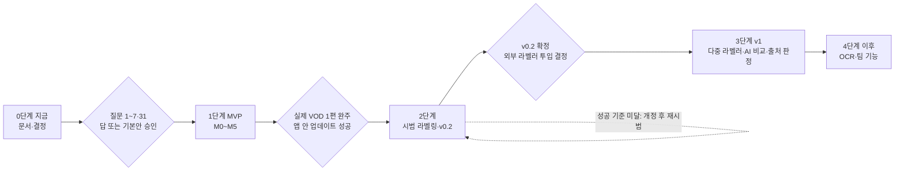
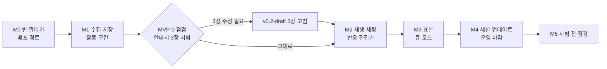

# StreamLabeler 로드맵 — 단계별 계획과 열린 질문

상태: 설계 초안 (2026-10-19) · 아직 구현되지 않음

## 0. 이 문서가 하는 일

- 무엇을 어떤 순서로 만들지, 각 단계가 언제 '끝났다' 고 볼지 정한다.
- 사용자가 정해야 할 것을 우선순위 순으로 모은다 (8장).
- 위험과 완화(9장), 지금까지의 결정(10장, ADR)을 짧게 남긴다.
- 기간은 모두 추정이다. 1인 개발, 집중 작업일 기준이다. 시범 뒤 다시 잰다.
- 이 문서의 기간·크기·성능 목표도 안내서의 숫자처럼 '시작값' 이다.
- 프로그램 이름 'StreamLabeler' 는 임시다 (질문 3).

| 문서 | 이 문서와의 관계 |
|---|---|
| [01 분석·아이디어](./01-analysis-and-ideas.md) | 기능 우선순위의 근거 |
| [02 아키텍처](./02-architecture.md) | 모듈·폴더. 이 문서는 '언제 만드나' 만 다룬다 |
| [03 데이터 모델](./03-data-model.md) | 저장 형식·버전·병합 규칙, 스키마 파일 |
| [04 업데이트·릴리스](./04-update-and-release.md) | 업데이터·서명의 상세 |
| [05 보안](./05-security.md) | S-xx 항목 원문. 이 문서 7장은 단계 배치만 |
| [06 평가·일치도](./06-evaluation-and-agreement.md) | 시범 지표·표본 추출의 계산 방법 |
| [안내서 v0.1](../labeling-guide/v0.1.md) · [검토 의견](../labeling-guide/v0.1-review.md) · [v0.2 초안](../labeling-guide/v0.2-draft.md) | 도구가 구현하는 기준 |
| [README](../../README.md) | 저장소 첫 화면 |

작업 흐름 이름(W0~W7)은 [01 문서](./01-analysis-and-ideas.md)를 따른다.

| 이름 | 뜻 | 안내서 |
|---|---|---|
| W0 | 프로젝트 준비 (채팅 수집·영상 연결·시간 정렬) | 2장 |
| W1 | 활동 구간 | 3장 |
| W2 | 채팅 반응 (발화 쪽에서 출발) + 이어짐 | 4장, 7-2 |
| W3 | 무작위 표본 (채팅 쪽에서 출발) | 2장 3단계 |
| W4 | 놓친 채팅 후보 | 6장 |
| W5 | 라벨 잠금·AI 결과 비교 | 1장 원칙 3, 7-3 |
| W6 | 재라벨·일치도 | 7-3 |
| W7 | 기준서 개정 | 0장, 8장 |

## 1. 한눈에 보기

| 단계 | 목적 | 핵심 산출물 | 끝났다의 기준 (요약) | 기간 (추정) |
|---|---|---|---|---|
| 0 지금 | 설계 확정, 사용자 결정 | 문서 9개, 질문 답, 저장소 | 질문 1~7·31 답 또는 기본안 승인 | 사용자 검토 시간 |
| 1 MVP | 시범 라벨링이 가능한 도구 | 앱 0.1.x, 테스트, 설치 안내 | 실제 VOD 1편 W0~W3 완주 + 앱 안 업데이트·되돌리기 성공 (서명은 v0.0.1 부터 필수, ADR-13) | 20~25 작업일 (달력 5~7주) |
| 2 시범·v0.2 | 안내서 검증, 시작값 조정 | 시범 보고서, v0.2.md, dev 라벨 | 성공 기준 충족 또는 재시범 결정, v0.2 확정 | 달력 3~4주, 개발 3~4 작업일 |
| 3 v1 | 현업 전체 흐름, 외부 라벨러, v1 보안 항목 | 앱 1.0, 라벨러 패키지, 비교 보고서 | 외부 라벨러 1회 왕복 + attestation + 업데이트 사고 재현 테스트 | 19~27 작업일 (+버전 폴더 전환 시 3~5) |
| 4 이후 | 자동화, 팀 기능 | 항목별 | 항목별 | 필요할 때 |

### 진행 원칙

1. **안내서 검증이 기능보다 앞선다.** 검토 의견의 결론('지금은 코드보다 안내서 검증')을 받아, MVP 를 M1 끝에서 한 번 멈추고 안내서 3장을 실제 방송으로 시험한다. 원하면 코드 전에 '도구 없는 시범'(2장)도 할 수 있다.
2. **MVP 범위를 고정한다.** W0~W3 + 내보내기 + 업데이트. 그 밖의 모듈(W4~W7, 출처 판정, AI 비교, ASR/OCR)은 저장소에 파일도 만들지 않는다. 이유: 범위 팽창이 가장 큰 일정 위험이다.
3. **시범 라벨은 개발용(dev)이다.** 기준을 조정하는 데 썼으므로 엔진 최종 평가의 정답에 넣지 않는다.
4. **업데이터를 고치면 ClipSlicer 에도 옮긴다** (질문 25). 이유: 같은 계열 코드에 같은 버그를 두 벌 남기지 않는다.
5. **앱 버전과 기준서 버전은 따로 센다.** 앱 0.1.0 이 기준서 v0.1 을 뜻하지 않는다. 상태바에 둘 다 표시한다 (ADR-19).
6. **새 요구는 백로그로 보낸다.** 단계 도중에 들어온 아이디어는 [01 문서](./01-analysis-and-ideas.md)의 우선순위 표에 적고, 현재 단계의 '끝났다' 기준을 바꾸지 않는다.

## 2. 0단계 — 지금: 문서 확정과 사용자 결정

### 할 일

| 할 일 | 누가 | 결과 |
|---|---|---|
| 문서 9개 완성, 서로의 링크 확인 | Claude | docs/design/01~07, v0.2-draft, README |
| 질문 1~7·31 답 (또는 기본안 승인) | 사용자 | 8장 표에 답 기록 |
| v0.2-draft 에서 '시범 전 반영' 범위 확정 (질문 7) | 사용자 | 시범용 기준서 동결 대상 |
| GitHub 저장소 생성 (이름·공개 여부 확정 뒤) | 사용자 | `vtubeadmirer/<이름>` |
| GitHub 계정·저장소 설정: 패스키/2FA, immutable releases, 태그 룰셋 `v*`, secret scanning·push protection, Actions 허용 목록 | 사용자 (계정 설정 변경) | 7장 0단계 항목 |
| (선택) 도구 없는 시범 | 사용자 | 3장의 애매한 사례, 소요 시간 메모 |

저장소를 만든 날 immutable releases 와 태그 룰셋을 켠다. 이유: 켜기 전에 게시한 릴리스에는 소급되지 않는다 (S-44).

### (선택) 도구 없는 시범

- 무엇: ClipSlicer 로 치지직 VOD 1편을 열고, 20~30분 창에서 활동 구간을 마커로 찍는다. 분류·확신도·근거 한 줄은 스프레드시트에 적는다.
- 왜: 검토 의견이 권한 '코드보다 안내서 검증' 을 가장 싸게 한다. 결과는 M1 화면 설계와 v0.2-draft 3장의 입력이 된다.
- 비용: 반나절 (추정).
- 적을 것: 경계를 정하기 어려웠던 순간과 이유, 30초·2분 시작값을 적용한 횟수, 영상 시간 대비 걸린 시간.
- 주의: 채팅 본문·닉네임이 든 스프레드시트는 저장소 폴더 밖에 둔다.

### 끝났다의 기준

- [ ] 문서 9개가 있고 서로의 링크가 깨지지 않는다.
- [ ] 각 문서의 '확인 필요' 중 사용자 답이 필요한 것은 모두 8장 질문 목록에 있다.
- [ ] 원문 문서(01·02·03·04·06)의 열린 질문 표에 이 문서의 질문 번호('07 질문 N')가 적혀 있다 (양방향 링크).
- [ ] 질문 1~7·31 에 답이 있거나 기본안이 승인됐다.
- [ ] 시범용 기준서의 범위가 정해졌다 (질문 7).

## 3. 1단계 — MVP: 시범 라벨링이 가능한 도구

목표: 안내서 8장의 시범 라벨링(이 문서 4장)을 도구로 돌릴 수 있게 한다. 그 이상은 하지 않는다.

| 넣는다 | 넣지 않는다 (언제) |
|---|---|
| W0 프로젝트 준비 | W4 놓친 채팅 후보 화면 (v1. 시범은 CSV 임시 절차) |
| W1 활동 구간 | 재라벨 블라인드·일치도·시범 패키지 (2단계 대기 기간에 최소판) |
| W2 채팅 반응 + 이어짐 + 7-2 재확인 | W5 AI 비교, W7 개정 대시보드 (v1) |
| W3 무작위 표본 + 큐 모드 | 출처 판정 (v1, 질문 9 선행) |
| JSONL/CSV 내보내기, 정답 세트 | ASR·OCR (v1 이후, ADR-18) |
| 앱 안 업데이트 (수정판), 서명 필수 검증 (v0.0.1 부터, ADR-13), '이전 버전으로 되돌리기' 메뉴 (M4) | artifact attestation, 이동식 드라이브 경고 (v1) |

### 3-1. 마일스톤

| | 이름 | 내용 | 끝났다의 기준 | 작업일 (추정) |
|---|---|---|---|---|
| M0 | 빈 껍데기와 배포 경로 | ClipSlicer 인프라 파일 복사(출처 주석), appspec, VERSION 단일 소스, build/release/ci, 매니페스트·아이콘, 한글 폴더 자체 점검, 서명 키 생성(K1·K2, 저장소·OneDrive 밖)·공개키 2개 내장·서명 필수 검증기(ADR-13), 초안 → 로컬 서명 → 게시(`sign_manifest.py`·`publish_release.py`), 빌드 입력 해시 고정, 빌드/게시 잡 분리, LICENSE·THIRD_PARTY_NOTICES (질문 31) | 빈 창 v0.0.1 을 받은 사본이 앱 안에서 서명된 v0.0.2 를 받아 실행된다 (한글 폴더, OneDrive 밖). 서명 없음·잘못된 서명·더 낮은 버전·발행 시각이 설치본 빌드 시각보다 이른 매니페스트를 거부하는 테스트 통과. 크기·시작 시간 첫 측정값 기록 | 3~3.5 (서명 경로 +1.5 포함) |
| M1 | 수집·저장·활동 구간 (MVP-0) | 채팅 수집·가명화, 영상 연결, 시간 정렬, 기준서·시작값 고정, store·골든 테스트, 활동 구간·타임라인 1차·파형·무음, CSV/JSONL 내보내기, 채팅 36만 행 합성 벤치 | 실제 VOD 1편 40~60분 창의 구간표를 끝까지 만들고 내보낸다. 재시작 뒤에도 그대로. 3장의 애매한 사례·소요 배율을 메모하고 v0.2-draft 3장을 고칠지 정한다 | 5~6 |
| M2 | 재생·채팅 패널·반응 편집기 | 시작 전 레이아웃 시안 1장. review_player, chat_panel, reaction_editor, continuation_editor, 규칙 함수 테스트, 단축키·되돌리기 | 3-2 의 W2 수용 기준 통과 | 5~6 |
| M3 | 표본과 큐 모드 | sampling, 큐 모드 화면 | 3-2 의 W3 수용 기준 통과 | 1.5~2 |
| M4 | 세션·업데이트·운영 마감 | 상태 머신(순서 강제, 경계 수정 뒤 되돌아가기 규칙), 업데이터 수정, 되돌리기(제안·'이전 버전으로 되돌리기' 메뉴), `min_supported`·`mandatory` 동작(질문 46), prerelease 내부 확인 단계(질문 45), 백업·보존·파기, 로그·crash.log, 경로 확인, docs/install.md | v0.1.0 을 받은 다른 폴더의 사본이 앱 안에서 v0.1.1 로 바뀌고, 메뉴로 v0.1.0 에 되돌아간다. 실패 경로(체크섬 없음·zip 이상·자체 점검 실패) 테스트 통과 | 4~5 (되돌리기 +0.5 포함) |
| M5 | 시범 전 점검 | 실제 VOD 1편으로 W0~W3 끝까지, 버그 수정 | 3-5 의 기준 | 1.5~2 |

M2 를 시작하기 전에 반응 편집기 레이아웃 시안을 먼저 그린다. 이유: 1080p 노트북에서 플레이어·타임라인·채팅·편집기를 한 화면에 두면 편집기 세로 공간이 모자란다. 큐 모드(3단계 표본 화면)를 같은 시안에서 함께 정한다.

### 3-2. 기능 목록과 수용 기준

모든 시간·개수는 안내서 시작값을 따르고, 프로젝트의 시작값 스냅샷에서만 읽는다.

**W0 프로젝트 준비**

| 기능 | 수용 기준 |
|---|---|
| 채팅 수집 | video_no 입력 → 전량 수집. 진행률·취소. API 원문 9개 필드를 보호 구역에 보존. 중복 제거·상한 없음. 종료 조건 3중(커서 증가·쪽수 상한·영상 길이). 고정 픽스처 테스트 통과. 페이지를 다르게 잘라도 chat_id 집합이 같다 (테스트) |
| 가명화 | messages.jsonl·내보내기·패키지에 userIdHash·원 닉네임·후원 금액이 0건 (골든 테스트). 익명 채팅은 따로 번호를 붙이고 '다른 시청자 수' 계산에서 뺀다 |
| 영상 연결 | 지문(크기 + 부분 해시)·ffprobe 기록. 파일을 옮겨도 다시 찾는다. 지문이 다르면 읽기 전용으로 열리고, '미디어 교체' 절차(사유·media_rev 증가·오프셋 다시 재기)를 거쳐야 라벨을 쓸 수 있다 |
| 시간 정렬 | 앵커 3개 이상으로 오프셋(중앙값)을 정한다. 상태바에 항상 표시. 확정 전에는 반응 탭이 잠긴다 (사유를 적고 건너뛸 수 있음). API 길이와 파일 길이 차가 2초(시작값)를 넘으면 경고 |
| 기준서·시작값 고정 | 프로젝트에 기준서 사본·해시·시작값 스냅샷. 라벨마다 guide_version·guide_sha12·thresholds_sha12 자동 기록 (이름은 [03 문서](./03-data-model.md) 6-3·8-4). 시작값은 타입·범위 검사, NaN 거부 |
| 라벨러·세션 | 라벨러는 코드(예: L01)로만 라벨에 남는다. 세션 ID 에 PC 구분자를 넣는다 |
| 경로 안전 | 설치·프로젝트 경로가 OneDrive·UNC 아래면 확인 대화상자(이동 권장 / 그래도 계속 — 선택을 기록). 외부에서 온 경로는 파일 시스템에 닿기 전에 문자열로 검사 |

**W1 활동 구간**

| 기능 | 수용 기준 |
|---|---|
| 구간 편집 | 방송 전체를 빈틈없이 나눈다 (테스트). 분류 5종·확신도 3종·근거 한 줄(현재 시각 삽입)·경계 신호 종류. 구간 ID 는 uuid. 실행 취소 |
| 완충·병합·침묵 | 경계 완충(10초)을 자동 표시. 30초 미만 구간은 병합을 '제안' 만 한다 (결정적 규칙). 긴 침묵(2분)은 '재검토' 마커만 — 분류를 자동으로 바꾸지 않는다 (테스트, 검토 의견 2) |
| 경계 수정 뒤 처리 | 이미 만든 반응 라벨이 완충 안·구간 밖이 되면 지우지 않고 표시해 정답 세트에서 사유와 함께 뺀다. 이어짐 절단을 다시 계산. 표본은 τ 를 내리지 않아(불감소) 구간 안에 남은 표본이 빠지지 않는다. 새 경계 밖·완충 안이 된 항목은 판정을 지우지 않고 표본 통계에서만 빼고 표시하며, 새로 key ≤ τ 가 된 채팅은 판정 큐에 넣고 sample_rev 를 올린 새 매니페스트를 쓴다 ([06 문서](./06-evaluation-and-agreement.md) 2-6, ADR-09). 표시 이름은 [03 문서](./03-data-model.md) 10-3·15-4 를 따른다 (이 문서는 따로 이름을 만들지 않는다) |
| 타임라인 | 구간(분류별 색)·완충 음영·채팅 밀도·침묵 마커·파형·재생 위치. 확대·프레임 눈금·자석은 ClipSlicer 와 같다 (확대 테스트 개작판 통과). 정적 트랙을 캐시해 프레임 이동 때 끊기지 않는다 |

**W2 채팅 반응**

| 기능 | 수용 기준 |
|---|---|
| 재생 | 7-2 확인 범위(채팅이 뜨기 10초 전 ~ 발화 끝 30초 뒤)를 버튼 하나로 반복 재생. 속도 0.5~2. 프레임 번호 표시, VFR 영상이면 ms 만 표시. '들은 범위' 기록 (음소거 아님, 2배속 이하) |
| 채팅 패널 | 모델/뷰만 쓴다 (QListWidget·QTableWidget·QSortFilterProxyModel 금지). 재생 위치 동기화, 필터, 닉네임 기본 가림(해제는 기록), 후원·구독·시스템 구분, 완충 안 채팅 흐리게. 필터를 바꿔도 선택·스크롤 위치 복원. 행 높이 고정 |
| 반응 편집기 | 후보 여럿(후보마다 발화 라벨(시작·끝·들은 내용)을 가리키고 증거 7항목 + 시각 메모를 따로 적는다. 불명확이면 후보 전부 — ADR-21), 반응 시각(원래 클릭 시각도 저장, 자석 기본 꺼짐), 등급·확신도·이어짐은 채팅에 하나, 등급 조건 충족 표시(규칙 함수, 등급을 미리 고르지 않음 — 질문 37 기본안)와 확정(조건을 넘는 등급은 막고, 조건과 다르게 고르면 사유), 조건 충족 상태와 고른 등급의 관계 기록, 확신도, 근거 한 줄, '반응 미확인', 처음 판단 자동 보존, '발화가 채팅보다 앞서는데 되풀이를 체크' 경고 |
| 재확인 | 직접 반응·연결 가능성 높음은 확인 기록 2건(처음·재확인)이 있어야 '완료'. 강제 수준은 질문 15. 소리를 듣지 않고 저장하면 경고하고 건수를 남긴다 |
| 이어짐 | 직접·높음에서만 켜진다. 구간 끝에서 자동 절단 + '잘림' 표시. 다른 채팅 3개 이상이면 '확장됨' 제안 |
| 규칙 함수 | 안내서 4-4 예시 4건이 테스트로 통과 |
| 단축키·되돌리기 | 등급·확신도 키는 텍스트 입력 밖에서만 동작하고 포커스 상태가 화면에 보인다. Esc 로 작업대로 돌아온다. Ctrl+Z 는 직전 라벨을 철회하는 레코드 1건을 추가한다. 한국어 입력기 조합 중 오동작 없음 (수동 확인) |

**W3 무작위 표본**

| 기능 | 수용 기준 |
|---|---|
| 표본 추출 | `sha256-tau-v1` ([06 문서](./06-evaluation-and-agreement.md) 2장, ADR-09). 적격 채팅 = 저스트채팅 구간 안 일반 채팅에서 후원·구독·시스템·경계 완충을 뺀 것(출처는 뽑기 조건이 아님). 순서 키 `sha256(sample_seed\|draw_no\|chat_id)`, τ = 적격 중 100번째 key, 표본 = key ≤ τ. 처음 뽑을 때 정확히 100개, 적격이 100개 이하면 전수. 경계가 바뀌면 τ 불감소 + sample_rev 를 올린 새 매니페스트. 매니페스트(seed_material·적격 해시·tau_key·알고리즘 이름·sample_rev). 라벨러의 다시 뽑기 없음(draw_no 는 검토자가 사유를 적을 때만). 다른 PC·다른 라벨러가 같은 100개를 받는다 (테스트) |
| 큐 모드 | 플레이어 + 현재 채팅 1건 + 반응 편집기. 들어가면 7-2 범위를 자동 반복·재생, 저장하면 다음 표본으로. '반응 미확인' 은 키 하나. 2단계 링크·출처 표시를 숨긴다. n/100 진행(분모는 표본 수. 완충 채팅은 적격이 아니라 분모에 없다)·적격 밖으로 뺀 건수 참고 표시. 상단에 '재현 검증' 버튼 |

**내보내기**

| 기능 | 수용 기준 |
|---|---|
| JSONL | 전체 / 현재 유효 / 기준서 버전별. zip + manifest(파일별 sha256, 앱·기준서 버전) |
| CSV | 보기용, 다시 가져오기 불가. UTF-8 BOM. `=` `+` `-` `@` 로 시작하는 셀 보호 |
| 정답 세트 | 엄격(확실함)·참고(아마도 포함) 따로, 제외 사유별 건수. 채팅 본문은 기본 제외 (질문 24) |
| 6장 시범용 CSV | 표본 안 '반응 미확인' 채팅 목록 + 보조값(노출 추정·채팅 속도) + 빈 열(조건 ①~④, 사유 코드, 점검 질문, 확신도, 근거). 열 정의는 [03 문서](./03-data-model.md) |

**운영**

| 기능 | 수용 기준 |
|---|---|
| 저장 | 라벨 1건 = 즉시 append + fsync. 끝이 잘린 줄은 따로 옮기고 경고. 중간 줄이 깨졌으면 읽기 전용 + 경고 (조용히 건너뛰지 않는다). 저장 실패는 화면에 드러난다. 골든 테스트: 대체 체인·순환·포크·잘린 줄·BOM |
| 단일 실행 | 앱 단일 인스턴스 + 프로젝트 단위 잠금(못 잡으면 읽기 전용) + project.json 판번호 비교 |
| 업데이트 | 확인 결과 3상태. 체크섬 없으면 거부. 서명이 없거나 맞지 않으면 거부 (v0.0.1 부터 fail-closed, ADR-13). 버전이 설치본보다 크고 발행 시각이 설치본 빌드 시각보다 늦어야 한다 ([04 문서](./04-update-and-release.md) 5-4). zip 검사(크기·항목 수·레이아웃·data/ 금지). 두 볼륨 여유 확인. 새 exe 자체 점검을 통과해야 교체. 교체 스크립트가 10초 안에 시작 표시를 남기지 않으면 앱을 닫지 않고 수동 절차 안내. 수집·분석 중이면 교체 금지 |
| 되돌리기 | '이전 버전으로 되돌리기' 메뉴와 중단된 업데이트·연속 충돌 때의 제안이 같은 함수를 쓴다. 백업 완료 기록(`backup_ok`)이 없으면 되돌리기를 권하지 않는다. 되돌린 버전은 건너뛰기에 넣는다 ([04 문서](./04-update-and-release.md) 6-10) |
| 백업·보존 | 앱 밖에 백업 (ADR-16), 모든 프로젝트, 보존 개수 순환. 프로젝트 보존 기한 표시. '프로젝트 파기' 명령과 파기 기록 |
| 로그·보고 | 파일 로그 기본 INFO. 채팅 본문·닉네임·userIdHash 를 로그에 쓰지 않는다. 공통 가림 패턴. 네이티브 크래시는 crash.log. 비정상 종료를 다음 시작 때 알린다 |
| 자체 점검 | CI 가 한글 폴더('테스트 문서')에서 `--selftest` 실행: libmpv(번들 경로에서 로드)·ffmpeg·설정·프로젝트 생성 → 라벨 추가 → 다시 읽기·기준서 해시·시작값 로드 |
| 설치 안내 | docs/install.md: 설치 위치(ADR-15), zip 차단 해제, SmartScreen '추가 정보 → 실행', Defender 오탐 제출 경로, OneDrive 밖 권장, 문제 보고 방법 |

### 3-3. 성능·크기 목표

모두 시작값이다. 첫 빌드와 실측에서 다시 정한다.

| 항목 | 목표 | 재는 법 |
|---|---|---|
| 창 표시 | SSD 2초 이하, HDD 4초 이하 | 시작 로그와 창 표시 로그의 시각 차 |
| 프로젝트 열기 | 채팅 36만 건에서 3초 이하 | 합성 픽스처 |
| 채팅 패널 | 재생 위치 하이라이트·검색·선택 각 100ms 이하 | pytest 벤치 (넘으면 실패 대신 경고) |
| 메모리 | 채팅 36만 건 데이터가 100MB 안쪽 | 벤치 |
| 설치 크기 | 약 400~430MB | 첫 빌드 |
| 전체 zip / 경량 zip | 약 165~185MB / 35~45MB | 첫 빌드 |

### 3-4. 기간

| 마일스톤 | 작업일 (추정) |
|---|---|
| M0 | 3~3.5 |
| M1 | 5~6 |
| M2 | 5~6 |
| M3 | 1.5~2 |
| M4 | 4~5 |
| M5 | 1.5~2 |
| 합계 | 20~25 (달력 5~7주) |

선정 설계의 원안은 11~14 작업일이었다. 이 로드맵은 다음을 더했다.

- 보안 검토에서 MVP 에 넣기로 한 항목 (7장의 M0~M4): 약 4~5일. [05 문서](./05-security.md) 7-2 의 순수 추가분 약 3일(05 도 확인 필요로 둠)과 7-1 의 빌드·저장소 작업 약 반나절을 넣고, 05 추정이 불확실한 몫으로 0.5~1.5일을 더 잡았다.
- 서명 경로를 M0 로 앞당긴 몫: 약 1.5일 ([04 문서](./04-update-and-release.md) 15장: 키 의식 반나절 + `sign_manifest.py`·`publish_release.py` 약 1일). 05 7-2 의 S-01 검증 코드 3시간·S-16 키 생성 1시간과 일부 겹칠 수 있으나 빼지 않았다 (확인 필요).
- 되돌리기(제안·메뉴)를 v1 에서 M4 로 앞당긴 몫: 약 0.5일 (04 15장).
- 반응 편집기 여유: 약 1일. 이유: 증거 7항목·사유·재확인 2회·처음 판단 보존을 한 화면에 담는 일은 원안 2.5일로 빠듯하다.
- M1 의 실제 방송 시험: 약 0.5~1일.

원안에 위 항목을 더하면 18.5~23일로, 마일스톤 표 합계(20~25일)보다 약 1.5~2일 적다. 이 차이는 마일스톤별로 따로 잡은 여유로 두고, M0 첫 측정 뒤 다시 맞춘다 (확인 필요). M4 의 `min_supported`·`mandatory`·prerelease 단계는 04 15장의 M4 항목이며 따로 추정하지 않았다 (확인 필요).

시범 라벨링 자체 시간(4장)은 넣지 않았다. ClipSlicer 의 개발 속도(6일·24릴리스)는 혼자 쓰는 도구였다는 점에서 그대로 기대하지 않는다.

### 3-5. MVP 끝났다의 기준

- [ ] 3-2 의 수용 기준을 모두 통과한다 (자동 테스트 + 수동 체크리스트).
- [ ] 3-3 의 목표를 측정해 기록했다. 못 미친 항목은 원인과 대책을 적었다.
- [ ] M0 의 서명 왕복과 M4 의 업데이트·되돌리기 왕복이 성공했다.
- [ ] M5 에서 실제 VOD 1편을 W0~W3 끝까지 라벨링했고, 내보낸 파일을 앱 없이 열어 확인했다. 소요 배율을 기록했다.
- [ ] 7장의 0단계·M0~M4 보안 항목을 마쳤다.
- [ ] 시범용 기준서(guide_version "0.2-draft")가 동결됐고 그 해시가 번들에 들어갔다.

## 4. 2단계 — 시범 라벨링과 안내서 v0.2 확정

목표: 안내서가 실제 방송에서 일관되게 적용되는지 확인하고, 시작값을 근거로 고쳐 v0.2 를 확정한다. 순서는 방법론 검토의 시범 계획을 따른다. 지표의 계산은 [06 문서](./06-evaluation-and-agreement.md).

### 4-1. 순서

| 순서 | 할 일 | 소요 (추정) | 비고 |
|---|---|---|---|
| 2-0 준비 | 시범용 기준서 동결(guide_version "0.2-draft" + 해시), 시작값 사전 등록, 방송 3편 선정, 방송마다 '시작 20분 뒤부터 연속 40~60분' 창 | 반나절 | 질문 8. 대기 화면을 빼려는 규칙 |
| 2-1 시간 정렬 | 방송마다 앵커 3개 이상으로 오프셋 측정 | 방송당 15분 | 방송 지연·파일 오프셋 값 자체가 시범 결과 |
| 2-2 활동 구간 | 3편 모두 먼저 | 영상 시간의 2~3배 | |
| 2-3 반응·표본 | 방송 ①② 우선. 10분 블록을 무작위 순서로. 2단계 → 3단계(큐 모드, 2단계 링크 숨김) → 6장(CSV 임시 절차) | 영상 시간의 5~8배 | 표본 크기는 질문 14 |
| 2-4 분포 점검 | 4-3 표의 자동 지표를 본다. 기준은 고치지 않고 기록만 한다 | 반나절 | |
| 대기 | 7일. 안내서는 3일이지만 시범에서는 7일로 비교한다 | 7일 | 질문 17. 이 동안 4-2 개발 |
| 2-5 재라벨 | 본인: 블록 2개(무작위 1 + 어려운 블록 1), 블라인드. 외부 라벨러 1명: 같은 블록 2개, 안내서만 보고 | 블록당 1~2시간 | 질문 2·8. 외부 라벨러에게 '이해 안 된 문장' 을 받는다 |
| 2-6 일치도 | 본인 재라벨(intra)·외부(inter)를 나란히. 불일치 원인을 '기준 흐림 / 단순 실수 / 진짜 모호' 로 나눈다 | 1일 | 1인 재라벨은 상한으로만 해석 |
| 2-7 조정·개정 | 조정 결과를 기록으로 남긴다. 시작값 변경은 원시값으로 재분류해 '바꾸면 라벨이 몇 % 달라지나' 를 본 뒤 정한다. v0.2 에 개정 이유·바뀐 항목·시범 수치를 적는다 | 1~2일 | 0장·8장 |
| 2-8 정리 | 시범 라벨을 dev 로 표시. v1 백로그 우선순위 갱신 | 반나절 | ADR-11 |

시범 시간이 가장 많이 드는 곳은 2-3 이다. 영상 2.5~3시간 × 5~8배 = 라벨링 15~25시간 (추정). 개발자가 라벨러를 겸하므로 이 시간을 개발 일정과 따로 잡는다.

### 4-2. 시범 중 개발 (대기 7일 동안, 3~4 작업일)

시범의 2-5·2-6 에 필요한 것만 최소판으로 만든다. v1 에서 완성한다.

| 최소판 | 내용 | 관련 |
|---|---|---|
| 재라벨 블라인드 | 재라벨 세션은 자기 세션 파일만 연다. 다른 세션 파일과 ai/ 는 디스크에서 열지 않는다. 블록 목록 파일로 범위를 제한하고 빈 마커로 시작한다 | ADR-17, S-11, S-33 |
| 일치도 | 등급 같음 / 한 단계 / 두 단계 이상 비율, 확신도 일치, 경계 차이, κ 점추정. 신뢰구간은 내보낸 파일로 외부 도구에서 | [06 문서](./06-evaluation-and-agreement.md) |
| 시범 패키지 | 허용 목록 zip(project.json · 기준서 · 가명 채팅 · 표본 매니페스트). 보호 구역·다른 세션·ai/ 제외. 가져오기는 파일명 = session_id 확인, 같은 이름 거부 정도만 | S-05, S-10 |
| 시범 1회차 버그 수정 | 2-2~2-4 에서 나온 것 | |

외부 라벨러에게는 영상 파일도 건네야 한다. 근거(스트리머 동의 범위)는 질문 8 에서 확인한다.

### 4-3. 무엇을 재서 무엇을 바꾸나

'바꾸는 판단' 의 숫자는 제안된 시작값이다. 최종 판단은 사람이 한다.

| 측정 | 어떻게 | 영향받는 기준 (시작값) | 바꾸는 판단 (제안) |
|---|---|---|---|
| 반응 지연: 채팅 시각 → 반응 발화 시작 | 자동 | 4-1 '20초 이내' | 직접 반응의 지연이 20초를 자주 넘으면 창 확대, 대부분 아주 짧으면 축소를 검토. 비율 기준은 확인 필요 |
| 노출 추정: 뒤로 N줄이 올라올 때까지 시간 | 자동 (N 시작값 15줄) | 6-② '10초 이상', '너무 빠름' | 채팅창이 화면에 보이는 방송에서 몇 건 대조해 N 을 맞춘다 |
| 구간 경계 차이 | 재라벨·외부 비교 | 3장 '경계 완충 10초' | 맞춘 경계 차이의 중앙값이 5초를 넘으면 완충 확대 검토 |
| 짧은 구간 병합 횟수, 애매한 경계 목록 | 자동 + 메모 | 3장 '30초' | 병합 제안을 자주 거절하면 값이나 규칙 검토 |
| 긴 침묵 마커 중 실제로 활동이 바뀐 비율 | 자동 + 라벨러 판단 | 3장 '2분', 검토 의견 2 | 비율이 낮으면 마커 임계를 올린다. 자동 분류 변경은 계속 금지 |
| 이어짐 길이·후속 채팅 수 | 자동 (원시값) | 4-3 '1분', '3개' | 원시값으로 재분류해 영향 크기를 먼저 본다 |
| 직접 반응 건수 / 영상 시간 | 자동 | 8장 '30건 안팎' | 30건에 필요한 영상 시간을 계산해 본 라벨링 분량을 정한다 |
| 판단 불가·불명확 비율 | 자동 | 8장 점검 | 너무 많으면 기준이 어렵고, 너무 적으면 억지로 고르는 중일 수 있다 |
| 등급 × 확신도 교차표 | 자동 | 5장 | 한 칸에 몰리면(예: 높음의 대부분이 '아마도') 예시 보강 |
| 표본 중 짧은 반응·이모티콘·명령어 비율 | 자동 | 2장 '구간당 100개' | 비율이 높으면 층화 표본을 v0.2 후보로 |
| 소요 배율 (작업 시간 / 영상 시간) | 세션 타이머 | 표본 수, 7-2 확인 범위 | 8배를 넘으면 표본 수·확인 범위 축소 검토 |
| 2단계 누락률: 표본에서 '반응 있음' 인데 2단계에 없던 비율 | 자동 | 2장 2단계 절차 | 높으면 2단계 훑는 방법 보강 |
| 파일↔VOD 오프셋, 방송 지연 | 앵커 | 시각 정렬 규칙 | 방송마다 차이가 크면 앵커 수 기본값을 올린다 |
| 들은 범위 경고 무시·재생 없이 저장 건수 | 세션 기록 | 7-2 강제 수준 | 많으면 경고를 차단으로 |
| 6장 사유 코드 분포 | CSV 임시 절차 | 6장 | G(판단 불가)가 많거나 C·E 경계가 흐리면 정의 보강 |
| 일치도 (intra / inter) | 06 문서 지표 | 전체 | 4-4 성공 기준 |

### 4-4. 성공 기준과 다음 행동

시작값이며 확인 필요. 상세는 [06 문서](./06-evaluation-and-agreement.md).

| 기준 | 시작값 | 못 미치면 |
|---|---|---|
| 외부 라벨러와의 구간 분류 κ | 0.8 이상 | v0.2 개정 후 시범 한 번 더 |
| 반응 있음/없음 κ | 0.7 이상 | 같음 |
| 등급 가중 κ | 0.6 이상 | 같음 |
| 소요 배율 | 영상 시간의 8배 이하 | 표본 수·확인 범위 축소 |

직접 반응이 30건 수준이면 κ 의 신뢰구간이 넓다. 결론이 애매하면 판단을 미루고 표본을 늘린다.

### 4-5. 끝났다의 기준

- [ ] 시범 보고서가 있다: 4-3 표의 값, 불일치 원인 분류, 소요 배율. 저장소에는 집계 수치와 익명화된 사례만 둔다.
- [ ] v0.2.md 가 확정됐다 (개정 이유·바뀐 항목·시범 수치). 새 시작값 기본값이 정해졌고 앱 번들에 들어갔다.
- [ ] 4-4 기준을 충족했거나, 못 미친 항목의 재시범 계획이 있다.
- [ ] 시범 라벨이 dev 로 표시됐다.
- [ ] v1 백로그 우선순위를 갱신했다.

## 5. 3단계 — v1: 현업 전체 흐름

### 5-1. 진입 조건

- 2단계가 끝났다 (v0.2 확정).
- 외부 라벨러를 투입하기로 했다 (질문 2).
- W5 를 하려면 질문 16, 출처 판정을 하려면 질문 9 에 답이 있다. 답이 없는 항목은 v1 에서 빼고 진행한다.

### 5-2. 범위

| 영역 | 내용 | 비고 |
|---|---|---|
| W4 놓친 채팅 후보 | 후보 화면, 조건 ① 자동, ② 보조값, 사유 코드 A~G, 확신도 필수 | 시범 CSV 결과로 화면 확정 |
| W5 잠금·AI 비교 | 세션 잠금(해시), ai/ 는 프로젝트 폴더 밖, 잠금 뒤에만 가져오기, 엄격/참고 점수, 제외 건수 | 질문 16 선행 |
| W6 재라벨·일치도 완성 | 10분 블록 계획(무작위 + 어려운 층), 간격 규칙, 비교 화면(나란히 보기, 유형 태그), 조정 기록 | 질문 17·19 |
| W7 기준서 개정 | guide_version 올림 흐름, 시작값 편집은 새 기준서 버전으로만 저장(이미 붙은 버전은 그대로, 기존 프로젝트에는 버전을 추가해 새 세션부터 적용 — [03 문서](./03-data-model.md) 9-2·9-3), 8장 점검 대시보드 | |
| 출처 판정 | 리뷰어 전용 세션, 생성 기록 가져오기·대조, 판별 불가 집계 | 질문 9 선행, 검토 의견 1 |
| 라벨러 패키지 완성 | 라벨러를 지정한 패키지, verify_project CLI, 가져오기 허용 목록·크기 상한 | |
| 업데이트·서명 | attestation, 이동식 드라이브 경고·'파일에서 업데이트' (후보), 업데이트 방식 재결정(5-3). 서명 필수·초안 → 서명 → 게시·발행 시각 하한(설치본 빌드 시각)은 M0, 되돌리기 메뉴는 M4 에서 이미 들어간다 | [04 문서](./04-update-and-release.md) 15장 |
| ASR (선택) | 개발 PC 전용 CLI 부터. 결과는 기본 숨김, 볼 때 기록 | 질문 21, ADR-18 |
| 운영 문서 | 라벨러 작업 기록 고지 화면, 외부 라벨러 계약 체크리스트, 서명 키 운영 문서 | S-16, S-24 |

### 5-3. 업데이트 방식 재결정

외부 라벨러 투입 전에 MVP 의 교체 방식을 유지할지 다시 정한다 (ADR-12).

| 안 | 내용 | 고르는 조건 (제안) |
|---|---|---|
| A 유지 | ClipSlicer robocopy 교체 수정판 | 라벨러 PC 조사(질문 23)에서 스크립트 차단이 없고, MVP~시범 동안 교체 실패가 없었다 |
| B 전환 | 런처 + 버전별 폴더 + 포인터 파일 1개 교체 | 외부 PC 1대라도 PowerShell 스크립트가 막히거나 반쯤 교체된 사례가 나왔다 |

B 로 가면 3~5 작업일이 더 든다 (확인 필요). 보안 검토에서 나온 B 의 함정을 처음부터 다룬다: 건강 신호의 경로가 data\ 폴백과 어긋나는 문제, 시간 기준 타임아웃, 포인터 파일이 비거나 깨진 경우, 런처 자체 갱신 실패. 상세는 [04 문서](./04-update-and-release.md).

### 5-4. 끝났다의 기준

- [ ] 외부 라벨러 1명 이상이 패키지 받기 → 라벨링 → 돌려보내기 → verify_project 통과 → 가져오기 → 일치도 보고서까지 1회 왕복했다.
- [ ] AI 결과 1건을 잠금 뒤 가져와 엄격/참고 점수와 제외 건수 보고서를 냈다.
- [ ] 릴리스에 attestation 이 붙고, 설치 안내의 검증 명령으로 확인된다. 서명 키 복원 시험을 한 번 했다.
- [ ] 업데이트 사고 재현 테스트(전원 차단 모사·디스크 가득·읽기 전용 폴더·한글 폴더·동시 실행)가 통과하고, 내부 시범 업데이트 3회 이상 사고가 없다.
- [ ] 7장의 v1 보안 항목을 마쳤다.
- [ ] v0.2 기준서로 새 방송 라벨링을 시작했다.

### 5-5. 기간

19~27 작업일 (추정). 원안 18~24 작업일에 v1 보안 항목 약 3~4일을 더하고, 4-2 로 앞당긴 3~4일, M0 로 앞당긴 서명 전환(약 0.5일), M4 로 앞당긴 되돌리기 메뉴(약 0.5일)를 뺐다. 업데이트 방식을 B 로 바꾸면 3~5일 더.

## 6. 4단계 이후

| 항목 | 시작 조건 | 비고 |
|---|---|---|
| OCR 자동화 (화면 채팅으로 노출 시간 보정, 가상 채팅 대조) | 가상 채팅 주입 경로 확정 + 채팅 오버레이가 있는 방송이 평가 대상 | Windows 내장 OCR 우선, RapidOCR 은 실측 뒤. 결과는 '증거 후보' 로만 보여 준다. OCR 결과는 보호 등급 (S-19) |
| VAD 발화 트랙·반응 지점 자석 | ASR/VAD 도구가 있음 | 자석 기본 꺼짐, 원래 클릭 시각과 함께 저장 (S-12) |
| ASR 라벨러 배포, GPU | 참고 자막 수요 확인 | 모델 해시를 코드에 고정 (S-40) |
| 팀 기능: 공유 드라이브 활동 표시, 조정 회의 화면, 여러 프로젝트 대시보드 | 라벨러 3명 이상 동시 운영 | 실시간 공동 편집은 하지 않는다 |
| SQLite 검색 색인 | 채팅 검색이 느리다는 실측 | `data\cache\<project_id>\` 에 두고 버릴 수 있게 (ADR-04) |
| 게임 구간의 채팅 반응 평가 | 사용자 결정 (질문 28) | 외부 타당성 보강 |
| 층화 표본, 표본 크기 계산기 | 시범에서 짧은 반응 비율이 높음 | v0.2 반영 시 |
| Authenticode 코드 서명 | 사업자·비용 결정 (질문 26) | 한국 거주 개인은 Azure Artifact Signing 대상이 아니다 |
| Velopack 검토 | 다운로드 크기·델타 업데이트가 필요해짐 | PoC 먼저 |
| ClipSlicer 와 공통 패키지 | 세 번째 포터블 앱, 또는 서명 검증 역이식 | ADR-02 |
| ClipSlicer 연계 (받은 VOD 와 video_no 를 넘겨 프로젝트 생성) | 질문 5 의 답이 'ClipSlicer 로 받기' | 영상 파일은 읽기만 한다 |

**범위 밖** — 이 로드맵은 다음을 하지 않는다.

- 영상 다운로드·녹화 (ClipSlicer 의 일).
- 라이브 방송 중 실시간 라벨링.
- AI 분석 엔진 자체의 개발.
- '시험 평가표' (가상 채팅이 방송에 도움이 되는지 — 안내서 0장의 별도 문서). 질문 29.
- 웹·클라우드 협업, macOS·Linux.

## 7. 보안 항목의 단계 배치

항목 번호와 내용은 [05 문서](./05-security.md)를 따른다. 여기서는 언제 하는지만 적는다.

| 단계 | 항목 |
|---|---|
| 0단계 (계정·저장소 설정) | S-01 계정 패스키/2FA·토큰 최소 권한 · S-03 Actions 허용 목록 · S-21 secret scanning·push protection · S-44 immutable releases·태그 룰셋 |
| M0 | S-01 공개키 2개 내장·서명 필수 검증(fail-closed)·초안 → 로컬 서명 → 게시·발행 시각 하한 · S-16 서명 키를 저장소·OneDrive 밖에서 생성, 예비 키 동시 생성, 백업 2곳 · S-03 빌드/게시 잡 분리·액션 커밋 고정 · S-04 ffmpeg·libmpv 해시 고정, pip 는 전이 의존성까지 버전 고정 · S-21 합성 픽스처·release.ps1 의 미추적 파일 중단·.gitignore 보강 · S-08 번들 안에서만 도구 찾기·libmpv 로드 경로 고정 · S-48 Qt 플러그인 경로 환경변수 정리 · S-17 upx 끄기 |
| M1 | S-05 API 원문·신원 보호 구역 · S-14 결정적 chat_id·재수집 차단 · S-28 수집 종료 조건·익명 처리 · S-29 엄격한 JSON 읽기·시작값 검사 · S-30 BOM·잘린 줄·append 규칙 · S-10 대체 체인 범위·순환·포크 · S-13 영상 지문 불일치 시 읽기 전용·media_rev · S-34 시각에 실제 시간대 기록, 순서는 일련번호로 · S-36 라벨에 기준서·시작값 해시 · S-26 외부 경로 문자열 검사·mpv/ffmpeg 옵션 · S-27 CSV 셀 보호 · S-45 정답 세트 본문 기본 제외 · S-49 폴더명 길이·저장 실패 표시 · S-24 라벨러는 코드로만 기록 |
| M2 | S-12 원래 클릭 시각·조건 충족 상태와 고른 등급의 관계 기록 |
| M3 | S-35 표본 재현·고정(`sha256-tau-v1`, τ 불감소, 불변 매니페스트 — ADR-09)·구간 ID uuid |
| M4 | S-06 백업 순환·보존 기한·파기 명령 · S-09 OneDrive·UNC 확인 대화상자·저장 재시도·충돌 사본 표시 · S-20 로그 정책·가림 패턴 · S-31 crash.log·비정상 종료 감지·_backup 삭제 시점 · S-32 프로젝트 잠금·판번호 비교 · S-38 세션 파일 검사·내보내기 매니페스트 · S-39 앱 밖 백업 · S-41 확인 성공 때만 시각 기록 · S-42 압축 해제 시점·두 볼륨 여유 · S-43 zip 검사 · S-17 교체 시작 확인 표시 · S-18 릴리스 노트는 서명된 latest.json 의 `notes_ko`(일반 텍스트 8KB 이하, 링크를 열지 않음)·주소는 앱이 만든 것만 열기 · S-04 pip 해시 잠금(`requirements.lock`, `--require-hashes`) |
| 2단계 (4-2 최소판) | S-11 다른 세션 파일을 열지 않기·패키지 허용 목록 · S-33 재라벨은 빈 마커로 |
| v1 | S-44 attestation · S-11 ai/ 를 프로젝트 밖으로 · S-19 OCR 보호 구역(썸네일은 앱 `data\cache\`) · S-23 ASR·썸네일 패키지 제외 · S-24 작업 기록 고지·계약 체크리스트 · S-25 출처 판정은 리뷰어 세션 · S-33 블록 단위 재라벨 계획 · S-37 라벨러 지정 패키지 · S-40 모델 해시 고정 · S-46 파일명 uuid·정션 건너뛰기 · S-47 가져오기 허용 목록·크기 상한 · S-16 키 운영 문서 |
| 반박·보류 | S-02, S-07, S-15, S-22 — 이유는 [05 문서](./05-security.md) |

S-01 의 단계는 ADR-13 을 따른다: 서명 필수·초안 흐름·발행 시각 하한은 모두 M0 에 넣는다.

## 8. 열린 질문

### 8-1. 사용자에게 묻는 질문 (우선순위 순)

답이 없으면 '기본안' 으로 진행한다. 기본안을 바꾸려면 해당 단계가 시작되기 전에 알려 주면 된다.

31번부터는 다른 문서의 열린 질문 중 사용자 답이 필요한 것을 옮겨 왔다. 다른 문서가 번호로 인용하므로 기존 번호는 바꾸지 않고, 시기에 맞는 묶음 끝에 붙였다. 질문 칸 끝의 괄호가 원문 위치다.

**가. 구현 시작 전 (0단계)**

| # | 질문 | 왜 필요한가 | 답이 없을 때 기본안 | 막는 단계 |
|---|---|---|---|---|
| 1 | 시범 라벨링을 언제까지 시작해야 하나? | 범위를 어디서 자를지 정한다 | 마감 없음. 이 로드맵 순서대로 | 1단계 |
| 2 | 라벨러는 몇 명이고 누구인가 (본인 / 내부 / 외부 업체)? 시범의 외부 라벨러 1명을 구할 수 있나? | 재라벨 방식, 위탁 계약·개인정보 고지, 개발자 편향 완화가 모두 여기에 달렸다 (서명 시점은 라벨러 수와 무관하게 v0.0.1 부터, ADR-13) | 시범까지 본인 + 외부 1명, v1 에서 늘린다 | 2·3단계 |
| 3 | 프로그램 이름을 'StreamLabeler' 로 확정하나? | 저장소·exe·자산 이름·data 폴더가 appspec 에 고정된다. 첫 공개 릴리스 뒤에 바꾸면 업데이터가 옛 이름을 따로 처리해야 한다 | StreamLabeler | M0 |
| 4 | 저장소를 공개로 하나? 안내서(라벨링 기준)·스키마도 공개해도 되나? | 비공개면 앱이 릴리스를 받으려고 토큰이 필요한데, 앱에 토큰을 넣을 수 없어 지금 업데이트 설계와 충돌한다. 공개 저장소는 Actions·attestation 이 무료 | 코드·안내서 공개, 데이터는 절대 올리지 않는다 | M0 |
| 5 | 라벨링할 영상은 어떻게 구하나? (ClipSlicer 로 받은 다시보기 / ClipSlicer 라이브 녹화본 / 다른 도구 / 원본 플레이어) | 채팅 시각과 파일 시각의 어긋남, 가변 프레임, 앞부분 잘림이 경로마다 다르다. 라이브 녹화본이면 정렬 방식이 달라질 수 있다 (확인 필요) | ClipSlicer 로 받은 다시보기 파일. StreamLabeler 는 다운로드하지 않는다 | M1 |
| 6 | 라벨·채팅을 어디에 얼마나 오래 두나? 법적 근거(예: 가명정보 연구 목적) 검토는 누가 하나? 외부 라벨러와는 무엇으로 주고받나? | 백업·파기·경로 경고의 기본값, 보존 기한 필드 | 라벨러 PC 로컬(OneDrive 밖), 보존 12개월(시작값), 주고받기는 패키지 zip. 법적 검토는 '확인 필요' 로 표시 | M1·M4 |
| 7 | v0.2-draft 에서 시범 전에 반영할 것은? 검토 의견 3항만인가, 방법론 검토의 조작적 정의(반응 시각 = 발화 첫 음절, 시간 근접은 문턱으로만, 완충은 경계 양쪽 각 10초, 짧은 구간 병합 규칙, 비언어 반응 표시)도 일부 넣나? **그중 증거 기록 단위(v0.2 초안 4-1 [제안]의 짝 단위 기록, [01](./01-analysis-and-ideas.md) G4)는 결정됨 (D2, 사용자 확정 전 — 반대하면 되돌림, ADR-21)**: 반응 라벨은 채팅 1건당 1건이고, 연결 후보 발화를 `candidates[]` 에 두어 후보마다 발화 시각·전사·강/중/약 증거 체크를 적는다. 등급·확신도·이어짐은 채팅 단위다. 불명확이면 후보 전부를 적는다 | 폼과 규칙 함수가 이 정의를 그대로 구현한다. 시범 도중에 바꾸면 라벨이 섞인다. 증거 단위는 기록 칸 모양을 정하므로 M2 전에 먼저 정했다 | 검토 의견 3항 + 도구가 값을 정하려면 꼭 필요한 정의만. 나머지는 시범 결과로 정한다. 증거 단위는 위 결정(D2) | M1 |
| 31 | 저장소 라이선스를 무엇으로 하나? 번들하는 ffmpeg(GPL)·libmpv(GPL/LGPL)·Qt(LGPL) 의 고지(THIRD_PARTY_NOTICES)와 소스 제공 방법은 누가 확인하나? ([README](../../README.md) '이름과 라이선스') | 공개 저장소에 첫 릴리스를 올리면 그때부터 배포다. 라이선스 파일이 없으면 남이 코드를 쓸 수 없고, GPL 바이너리 고지가 빠지면 배포 문제가 된다 (9장 위험 18). ClipSlicer 는 README 에 'MIT' 라고만 적혀 있고 LICENSE 파일은 없다 (2026-10-20 확인) | 앱 코드는 MIT (ClipSlicer 와 같게) + LICENSE 파일. THIRD_PARTY_NOTICES 초안은 M0 에 Claude 가 쓰고, 첫 공개 릴리스 전 확인은 사용자(배포자)가 한다. libmpv 를 불러 쓰는 앱 코드를 MIT 로 내도 되는지는 확인 필요 | M0 (첫 공개 릴리스 전) |

**나. MVP 진행 중 (시범 전까지)**

| # | 질문 | 왜 필요한가 | 답이 없을 때 기본안 | 막는 단계 |
|---|---|---|---|---|
| 8 | 시범 방송 3편은 어떤 스트리머의 어떤 방송인가? 스트리머 동의·계약에 분석 목적 복제와 외부 라벨러 열람이 들어 있나? 가상 채팅이 섞여 있나? 버튜버 방송이 있나? | 외부 라벨러에게 영상을 넘길 근거 (S-23), 출처 판정 필요 여부, 비언어 반응 비중 | 서로 다른 스트리머 3편(채팅 중심 / 게임+잡담 / 노래·기타 포함). 가상 채팅이 없는 방송을 우선 | 2단계 |
| 9 | 가상 채팅은 봇 계정으로 치지직 채팅에 실제로 보내나, 화면 오버레이에만 띄우나? 생성 기록 파일 형식과 시각 기준(벽시계 / 영상 시각)은? | 출처 판정 방법 전체가 갈린다. 계정 전송이면 거의 결정적으로 가리고, 오버레이면 OCR 이 필요하다 | v1 전까지 출처 판정 보류. 기록 형식은 [03 문서](./03-data-model.md) 초안을 제안 | v1 (시범 방송에 섞이면 2단계) |
| 10 | 채팅이 '화면에 처음 뜬 시각' 을 API 의 playerMessageTime 으로 두는 데 동의하나? | 20초 창·10초 노출의 기준점 | 동의 (ADR-06). OCR 보정은 4단계 | M1 |
| 11 | v0.0.1 부터 모든 릴리스에 서명하는 데 동의하나? (ADR-13. 릴리스마다 수동 약 10분) 개발 PC 에 gh CLI 를 설치해도 되나 (현재 없음)? | 서명 없이 나간 사본은 나중에도 서명 없이 다음 버전을 받으므로 시작 시점을 미룰 수 없다. 서명된 매니페스트를 초안 릴리스에 올리고 게시하려면 인증된 gh 가 필요하다 ([04](./04-update-and-release.md) 16장 질문 2·4) | 동의 (v0.0.1 부터 fail-closed), gh 설치 | M0 |
| 12 | 치지직 이용약관의 자동 수집 조항을 확인해 줄 수 있나? 19세 이상 다시보기도 대상인가? | 약관 원문을 확인하지 못했다 (확인 필요). 19세 이상은 로그인 쿠키가 필요할 수 있고, 쿠키 저장은 지금 범위 밖이다 | 19세 이상 제외. 수집은 방송당 1회 | M1 |
| 13 | StreamLabeler 를 OneDrive 밖(`%LOCALAPPDATA%\Programs\StreamLabeler`)에서 실행하는 데 동의하나? (지금 ClipSlicer 는 OneDrive\문서 아래에서 실행) | 동기화 충돌, 클라우드 업로드, 폴더 권한 상속 (S-08, S-09) | 동의. 개발 저장소 위치는 그대로 두되 서명 키는 반드시 밖 | M0 |
| 14 | 표본은 안내서대로 구간당 100개(적격 채팅이 100개 이하면 전수)인가, 시범에서 시간을 아끼려 줄이나? | 소요 시간과 비율 추정 정밀도 | 안내서대로. 소요 배율이 8배를 넘으면 그때 사용자가 축소를 정한다 | M3·2단계 |
| 15 | 직접 반응·연결 가능성 높음을 두 번 확인 없이 '저장 불가' 로 막을까, 경고만 할까? | 경고는 습관적으로 닫힌다. 7-2 는 '최소 두 번 본다' 고 정해 두었다 | 직접·높음은 '완료' 표시를 막고, 나머지는 경고 + 건수 기록 | M2 |
| 32 | ffmpeg 를 번들에 계속 넣나? (설치 약 420MB vs 약 225MB) ([02](./02-architecture.md) 14장) | 파형·무음 마커·썸네일 기능과 설치 크기의 맞바꿈 | 유지 | M0 |
| 33 | 서명 키 백업용 USB 두 개를 서로 다른 장소에 둘 수 있나? ([04](./04-update-and-release.md) 16장 질문 3) | 키를 잃으면 모든 사본의 자동 업데이트가 멈춘다 (9장 위험 17) | 예. 키는 저장소·OneDrive 밖에서 만든다 | M0 |
| 34 | 라벨러 PC 의 최소 해상도는? ([02](./02-architecture.md) 14장) | 작업대 배치와 큐 모드의 필요성. M2 레이아웃 시안의 기준 | 1920×1080 목표, 1366×768 최소 | M2 |
| 35 | 등급은 `Ctrl+숫자`, 확신도는 `Alt+숫자` 로 하나? ([02](./02-architecture.md) 14장) | 하루 수백 번 하는 입력. 한국어 입력기와 부딪히지 않아야 한다 | 이 방식 | M2 |
| 36 | '음량 고르게' 를 기본으로 켤까? ([02](./02-architecture.md) 14장) | 듣는 피로를 줄이지만 판단에 영향을 줄 수 있다 | 켬. 켠 상태를 라벨에 기록 | M2 |
| 37 | 등급을 미리 제안하지 않고 조건 충족만 보여 주는 방식에 동의하나? ([01](./01-analysis-and-ideas.md) 6장 질문 3) | 제안을 보면 그쪽으로 쏠린다 (원칙 3, S-12). 대신 입력이 조금 느릴 수 있다. 문서(02·03·05·이 문서 3-2 W2)와 label-event·export-row 스키마는 기본안(제안 없음, `eligible_grades`·`grade_vs_conditions`)으로 맞췄다. '제안' 으로 바꾸면 제안 등급·수용 여부 필드를 더해야 한다 | [01](./01-analysis-and-ideas.md) 3-1 방식 (조건 충족 표시, 미리 고르지 않음) | M2 |
| 38 | '강한 증거 없는 직접 반응' 을 사유를 적어도 고를 수 없게 막는 것(하드 차단)이 맞나? ([03](./03-data-model.md) 20장 질문 5) | 안내서 4-2 문구대로다. 증거 체크를 빠뜨렸을 때 라벨러가 막힐 수 있다 | 막는다 (안내서 4-2) | M2 |
| 39 | 가림 닉네임에 첫 글자를 보일까 (`first_char`), 전부 숨길까 (`hidden`)? ([03](./03-data-model.md) 20장 질문 1) | 소리로 들은 '○○님' 호명(강한 증거)과 채팅을 맞추는 정확도 vs 노출 | `first_char` (03 14-3 의 기본). 외부로 넘길 때는 `hidden` 을 고를 수 있다 | M1 |
| 40 | 가명 솔트를 프로젝트마다 둘까, 채널마다 둘까? ([03](./03-data-model.md) 20장 질문 2) | 채널마다 두면 같은 채널 방송끼리 같은 시청자를 이어 볼 수 있지만, 이어지는 정보가 는다 | 프로젝트마다 (최소 연결) | M1 |
| 41 | 클린봇 가림(`CBOTBLIND`)·삭제 채팅을 표본 모집단과 반응 판정에 넣을까? 스트리머 화면에는 어떻게 보였나? ([03](./03-data-model.md) 20장 질문 3, [06](./06-evaluation-and-agreement.md) 11장 질문 4) | 화면에 가림 문구만 보였다면 스트리머가 반응할 수 없었다 | 빼지 않고 판정한다. 표시하고 건수·점수를 따로 센다. v0.2 에서 다시 정한다 | M1·M3 |
| 42 | **결정됨 (D1, 사용자 확정 전 — 반대하면 되돌림, ADR-09).** 표본에서 경계 완충에 걸린 항목을 판정에서 빼기만 하고 다시 뽑지 않는 것(실제 판정 수 < 100, 옛 `sha256-sort-v1`)과 [06](./06-evaluation-and-agreement.md) 2장 방식(완충은 적격에서 빼고 임계 키 τ 로 처음에 정확히 100개, 시드 = `project.sample_seed`, `sha256-tau-v1`) 중 무엇으로 하나? → 06 2장 방식으로 정했다. `sha256-sort-v1` 은 폐기한다 ([03](./03-data-model.md) 20장 질문 4·12 도 이것으로 닫는다) | 뽑는 시점에 따라 표본이 달라지면 안 된다 (S-35). τ 방식은 순서 키가 경계와 무관하고, 경계가 바뀌어도 τ 가 내려가지 않아 이미 뽑힌 표본이 빠지지 않으며, 처음 판정 수가 정확히 100이다 | (결정) 순서 키 `sha256(sample_seed\|draw_no\|chat_id)`, 적격 = 구간 안 일반 채팅에서 경계 완충·후원·시스템을 뺀 것, τ = 적격 중 100번째 key, 표본 = key ≤ τ, 적격 100개 이하면 전수, 경계 변경은 τ 불감소 + sample_rev 새 매니페스트. 적격 밖으로 뺀 건수는 따로 보고 | M3 |
| 43 | 후원 금액을 파생 필드에 남기지 않고 보호 원문에만 두는 것이 괜찮나? ([03](./03-data-model.md) 20장 질문 10) | 후원 반응을 금액별로 분석하려면 바꿔야 한다 (S-45) | 남기지 않는다. 파생은 `is_donation` 만 | M1 |
| 44 | 프로젝트 폴더를 공유 드라이브에 두고 여러 PC 가 동시에 열 일이 있나? ([02](./02-architecture.md) 14장) | 잠금·충돌 처리의 범위 (S-32) | 쓰는 것은 한 PC, 나머지는 읽기 전용. 교환은 패키지(v1) | M4 |
| 45 | 게시할 때 'prerelease 로 먼저 올려 개발 PC 에서 업데이트해 본 뒤 latest 로' 하는 2단계를 습관으로 할 수 있나? (릴리스마다 5~10분) ([04](./04-update-and-release.md) 16장 질문 6) | 잘못된 버전이 모든 라벨러에게 바로 나가지 않게 한다 | 예 (M4 부터) | M4 |
| 46 | `min_supported` 로 구버전의 새 라벨 저장을 막는 것을 허용하나? ([04](./04-update-and-release.md) 16장 질문 7) | 앱 버전이 섞여 라벨 형식이 섞이는 것을 막는다. 대신 자동 교체가 막힌 PC 는 수동 업데이트가 필수가 된다 | 허용. 라벨 형식·기준서 호환이 깨질 때만 올린다 | M4 |

**다. v1 전**

| # | 질문 | 왜 필요한가 | 답이 없을 때 기본안 | 막는 단계 |
|---|---|---|---|---|
| 16 | AI 엔진은 무엇을 내나 (구간 / 반응 등급 / 반응 시각 / 놓친 후보)? 출력 JSON 형식은? 엔진이 쓰는 VAD·ASR 은? | W5 비교 지표 설계. 도구와 같은 전처리를 쓰면 상관 오류 경고가 필요하다 (S-12) | [03 문서](./03-data-model.md) 17장의 [ai-result 스키마](../../schemas/ai-result.schema.json) 초안을 엔진 쪽에 제안 | v1 |
| 17 | 재라벨은 같은 사람인가 두 번째 사람인가? 간격은 3일(안내서)인가 7일(시범 비교)인가? 미달 시 차단인가 경고인가? 단위는 구간 20~30% 인가 10분 블록인가? | W6 설계 | 10분 블록(무작위 15% + 어려운 층 10%), 경고 + 기록, 시범은 7일 | 2단계·v1 |
| 18 | 1차 라벨은 언제 잠그나 (세션 끝 / 프로젝트 전체 끝)? 잠근 뒤 수정은? | 블라인드와 AI 가져오기 시점 | 세션 단위 잠금. 수정은 새 세션의 대체 라벨로만 | v1 |
| 19 | 일치도 세부: 구간 경계 허용 오차, 등급 '한 단계' 순서에서 '불명확' 의 위치, 성공 기준 κ 시작값 | [06 문서](./06-evaluation-and-agreement.md)의 지표 | 06 문서의 제안값 (경계는 30초 창에서 짝짓고 10초 안 비율을 따로 냄, 불명확은 순서 밖, κ 0.8 / 0.7 / 0.6) | 2단계 |
| 20 | 가상 채팅은 표본·반응·후보에서 빼나, 넣고 집계만 나누나? 가상 채팅에 대한 스트리머 반응을 따로 셀까? | 모집단 정의, 보고서 | 넣고 표시로 집계를 나눈다 (ADR-09) | v1 |
| 21 | 음성 인식 참고 자막이 필요한가? 필요하면 모델 용량(약 0.8GB, 확인 필요)과 처리 시간(10시간 VOD 에 3~5시간, 확인 필요)을 감수하나? | 원칙 4 와 라벨러 편의의 균형 | v1 에 개발 PC 전용 CLI. 라벨러 배포는 수요 확인 뒤 | v1 |
| 22 | '10초 이상 보임' 을 로그로 추정(뒤로 15줄이 올라올 때까지, 시작값)하고 '너무 빠름' 을 직전 10초 20건 이상(시작값)으로 두는 데 동의하나? | W4 조건 ② 보조값 | 동의. 시범 CSV 로 조정 | 2단계·v1 |
| 23 | 라벨러 PC 환경은? Windows 버전, 회사 PC 정책(AppLocker, Smart App Control), 관리자 권한, 사무실 프록시(업데이트 확인 주소 `github.com`·`api.github.com` 차단 여부, [05](./05-security.md) 4-3), 같은 공인 IP 뒤 대수, OneDrive 문서 폴더 강제 여부 | 업데이트 방식 재결정 (5-3), 업데이트 확인 경로 | 조사 전까지 robocopy 수정판 유지 | v1 진입 전 |
| 24 | 정답 세트 내보내기에 채팅 본문을 넣나 (엔진 쪽이 같은 채팅 원문을 이미 갖고 있나)? 라벨러 작업 기록(작업 시간·경고 무시 수)을 어디까지 수집·보고하고 어떻게 고지하나? | S-24, S-45 | 본문 제외. 라벨러는 코드로만 표기. 작업 기록은 로컬에 두고 품질 지표만 보고 | v1 |
| 25 | StreamLabeler 에서 고친 업데이터 항목(체크섬 없으면 거부, 백업 결과 확인, 고유 임시 폴더, 강제 종료 제거 등)을 ClipSlicer 에 같은 날 옮기는 규칙에 동의하나? | ClipSlicer 저장소 변경이 따른다 | 동의하면 release.ps1 체크리스트에 추가 | M4 부터 |
| 47 | 4단계(놓친 채팅 후보)를 표본 안의 미연결 채팅으로 한정하나? ([01](./01-analysis-and-ideas.md) 6장 질문 5) | 안내서는 범위를 정하지 않았다. 전부를 보면 비율을 추정할 수 없고 눈에 띄는 것만 고르게 된다 | 표본 안으로 한정 (3-2 의 6장 시범용 CSV 도 이 범위) | 2단계·v1 |
| 48 | 엔진이 '불명확' 을 따로 낸다면 불명확끼리 맞춰 볼까? ([06](./06-evaluation-and-agreement.md) 11장 질문 2) | 엄격/참고 점수의 분모가 달라진다 | 점수에서 뺀다 (06 의 제안) | v1 |
| 49 | AI 결과를 재라벨이 모두 끝난 뒤에야 여는 데 동의하나? ([06](./06-evaluation-and-agreement.md) 11장 질문 7) | 재라벨 전에 AI 결과를 보면 재라벨이 그쪽으로 쏠린다. 1인 작업이면 비교가 최소 3일 늦어진다 | 동의 | v1 |

**라. 나중에**

| # | 질문 | 답이 없을 때 기본안 | 막는 단계 |
|---|---|---|---|
| 26 | 코드 서명에 비용을 쓸 의사가 있나? 사업자(법인·개인사업자)가 있나? (Azure Artifact Signing 은 조직만 가능) | 보류 | 4단계 |
| 27 | 숫자가 없는 기준('한두 문장', '같은 유형이 반복되면')을 설정값으로 만들까? | 서술로 두고 원시값만 저장 | v0.3 이후 |
| 28 | 게임 구간의 채팅 반응도 평가할까? (게임 중 채팅 읽기가 평가에서 빠진다) | 시범 뒤 결정. 지금은 '채팅 대화 활발' 표시만 | 4단계 |
| 29 | '시험 평가표' (가상 채팅이 방송에 도움이 되는지)는 이 도구의 범위인가? | 범위 밖 | — |
| 30 | 시범 라벨(dev)을 v0.2 로 다시 매겨 평가 세트에 넣을까? | 넣지 않는다 (ADR-11) | 2단계 끝 |
| 50 | 적격 채팅이 120개 이하면 전수로 할까 (지금은 100개 이하)? ([06](./06-evaluation-and-agreement.md) 11장 질문 10) | 안내서대로 100. v0.2 개정 때 시범 결과로 정한다 | 2단계 끝 (v0.2) |

### 8-2. 구현 중 확인할 것 (사용자 답이 필요 없음)

| 확인할 것 | 언제 | 방법 |
|---|---|---|
| 치지직 messageTypeCode 30(시스템)·삭제/블라인드 메시지의 표현 | M1 | 채널 3~5곳 VOD 전량 수집 후 값 분포 |
| 채팅 36만 건의 로드 시간·메모리·검색 시간 | M1 | 합성 픽스처 벤치 |
| 받은 VOD 의 가변 프레임 여부, 뒤로 프레임 이동 정확도 | M2 | ffprobe + 뒤로 30회 이동 |
| 한국어 입력기 조합 중 단축키 가로채기 | M2 | 수동 |
| opengl32sw.dll·Qt6Network 를 빼도 되는지 | M0 | 빌드 후 자체 점검 |
| 설치·zip 크기, 시작 시간 | M0 | 첫 빌드 |
| immutable releases 와 release.yml 게시 흐름이 맞는지 | M0 | v0.0.1 릴리스 |
| libmpv 가 번들 경로에서 로드되는지 | M0 | 자체 점검 항목 |
| Qt 환경변수·PYTHONPATH 가 번들 앱에 영향을 주는지 | M0 | 환경변수를 넣고 실행 |
| ClipSlicer 에 THIRD_PARTY_NOTICES 가 있는지 | M0 | 저장소 확인. 없으면 두 저장소 모두 추가 |
| 긴 경로(260자) 환경에서 저장 실패가 드러나는지 | M1 | 250자 경로 테스트 |
| 앱 안 업데이트로 풀린 exe 에 인터넷 다운로드 표시(MOTW)가 붙는지 | M4 | 실제 업데이트 후 확인 |
| OneDrive '공간 확보' 파일 속성 감지 | M4 | 실제 OneDrive 폴더 |
| 방송 지연·파일↔VOD 오프셋의 방송별 분포 | 2단계 | 앵커 측정 |

### 8-3. 이미 정한 것 (예전 질문)

| 예전 질문 | 정한 것 | 근거 |
|---|---|---|
| 저장 형식: SQLite 인가 JSON 인가 | JSONL 이 원본, SQLite 는 버릴 수 있는 색인 | ADR-04 |
| 치지직 API 에 메시지 고유 ID 가 있나 | 없다 (실측). 값으로 만든 결정적 ID | ADR-08 |
| 후원·시스템 메시지를 가릴 수 있나 | messageTypeCode 로 가린다 (1 일반·10 후원·11 구독 관측. 30 시스템은 미관측, 확인 필요) | [03 문서](./03-data-model.md) |
| 영상 다운로드를 넣나 | 넣지 않는다 | ADR-03 |
| 원 닉네임·userIdHash 보관 | 보호 구역에 분리, 내보내기 기본 제외 | ADR-07 |
| 여러 라벨러의 프로젝트 공유 | 세션 파일 분리 + 패키지 zip | ADR-04, [03 문서](./03-data-model.md) |
| 구간을 고친 뒤 표본 재배정 | τ 불감소로 기존 표본 유지(구간 안에 남은 표본은 빠지지 않음) + 새 경계 밖·완충 안 항목은 판정을 지우지 않고 표본 통계에서 빼고 표시 + 새로 key ≤ τ 가 된 채팅은 판정 큐에 추가 + sample_rev 를 올린 새 매니페스트 ([06 문서](./06-evaluation-and-agreement.md) 2-6. 표시 이름은 [03 문서](./03-data-model.md) 10-3·15-4) | ADR-09 |
| 표본 추출 방식 (질문 42) | `sha256-tau-v1`: seed = `project.sample_seed`, 경계 완충은 적격에서 제외, 임계 키 τ 로 처음 정확히 100개. `sha256-sort-v1` 폐기. 사용자 확정 전 — 반대하면 되돌림 | ADR-09 |
| 반응 증거의 기록 단위 (질문 7 의 일부) | 채팅 1건당 반응 라벨 1건, 후보 발화마다 증거(`candidates[]`), 등급·확신도·이어짐은 채팅 단위. 사용자 확정 전 — 반대하면 되돌림 | ADR-21 |
| 배포·업데이트 플랫폼 | GitHub Releases + 서명 매니페스트 | ADR-12, ADR-13 |

## 9. 위험과 완화

가능성·영향은 상/중/하.

| # | 위험 | 영향 | 가능성 | 완화 | 단계 |
|---|---|---|---|---|---|
| 1 | 범위 팽창 (모듈 25개, 방법론 제안 23개, 질문 50개) | 상: 시범이 몇 주 밀림 | 상 | MVP 범위 고정 (ADR-10), v1 모듈 파일 금지, M1 점검, 새 요구는 백로그로 | 1 |
| 2 | 반응 편집기 사용성: 세로 공간, 숫자키와 한국어 입력 충돌, 되돌리기 비용 | 상: 라벨 품질 저하, 수정 미루기 | 중 | M2 전 레이아웃 시안, 큐 모드, 포커스 규칙, Ctrl+Z 철회, M5 직접 라벨링 | 1 |
| 3 | 타임라인 개작이 사실상 다시 쓰기 | 중: M1·M2 지연 | 상 | 유지할 코드(좌표 변환·확대·눈금·자석·팝업, 약 250줄)만 가져온다고 선을 긋는다. 확대 테스트를 먼저 개작. 정적 트랙 캐시 | 1 |
| 4 | 치지직 비공식 API 변경·차단·약관 | 상: 수집 불가 | 중 | 원문 보존, 수집 기록, 방송당 1회 수집 후 불변, 약관 확인 (질문 12) | 1~ |
| 5 | 시간 오프셋 오류 | 상: 모든 라벨이 함께 틀림 | 중 | 앵커 잠금, 상태바 상시 표시, calibration_rev 로 재계산 (ADR-06) | 1 |
| 6 | '라벨이 사라졌다' (로드 로직 버그) | 상: 신뢰 상실, 재작업 | 중 | 골든 테스트, 저장 직후 되읽어 표시, 조용한 건너뛰기 금지, verify_project | 1 |
| 7 | robocopy 교체의 한계, 회사 PC 정책 차단 | 중: 업데이트 실패, 앱 버전 분산 | 중 (외부 PC 상) | 교체 전 자체 점검, 시작 확인 표시, 준비/전환 분리, v1 재결정 (5-3) | 1, 3 |
| 8 | GitHub 계정·토큰이 탈취되어 가짜 릴리스가 게시됨 | 상: 라벨러 PC 에서 코드 실행 | 하 | v0.0.1 부터 서명 필수 (ADR-13, 키는 GitHub 밖), 2FA, immutable releases | 0~ |
| 9 | 개인정보 유출 (원문·로그·픽스처·패키지·OneDrive) | 상: 법·신뢰 문제 | 중 | 보호 구역, 가림 패턴, 합성 픽스처, 경로 확인 대화상자 | 1 |
| 10 | OneDrive 습관 | 중: 충돌 사본, 저장 실패, 클라우드 업로드 | 상 | 권장 위치 (ADR-15), 경로 확인 대화상자, 설치 안내 | 0~1 |
| 11 | 채팅 36만 건 성능이 아직 미측정 | 중: 라벨러가 매번 기다림 | 중 | M1 합성 벤치, 모델/뷰 규칙 | 1 |
| 12 | 개발자 편향 (엔진 제작자 = 라벨러) | 상: 정답이 엔진 규칙 쪽으로 쏠림 | 상 | 외부 라벨러 1명, 시작값 사전 등록, 블라인드, 등급 제안 없음·조건과 다르게 고른 기록 | 2 |
| 13 | 시범 시간 비용 (표본 100개 × 40초 이상 확인 범위) | 중: 시범 지연 | 상 | 큐 모드, 속도 2배 이하 인정, '반응 미확인' 키 하나, 소요 배율 기준 | 2 |
| 14 | 개발과 라벨링을 한 사람이 함 | 중: 일정 이중 압박 | 상 | 시범 시간을 일정에 따로 잡음, 4-2 개발을 대기 기간에 | 2 |
| 15 | libmpv 환경 의존 (원격 데스크톱·가상 머신·구형 GPU) | 중: 첫 실행 문의 | 중 | 호환 모드, crash.log, 비정상 종료 안내 | 1 |
| 16 | 복사해 온 코드의 분기 (두 저장소 업데이터) | 중: 같은 이름 다른 버그 | 중 | 역이식 체크리스트 (질문 25) | 1~ |
| 17 | 서명 키 분실·유출 | 상: 업데이트 불가 또는 위조 | 하 | 예비 키, 백업 2곳, 저장소·OneDrive 밖 보관 | 0~ |
| 18 | 라이선스 고지 누락 (GPL ffmpeg, libmpv) | 중: 배포 문제 | 중 | 첫 공개 릴리스 전 THIRD_PARTY_NOTICES | M0 |

## 10. 결정 기록 (ADR)

다른 문서는 이 번호로 인용한다. 상태: '확정' = 설계 심사·보안 검토로 정함, '제안' = 사용자 확인 필요, '재검토 예정' = 정한 시점에 다시 본다, '결정됨 (사용자 확정 전)' = 문서 세트를 한 규칙으로 맞추려고 먼저 정하고 모든 문서·스키마에 반영함. 사용자가 반대하면 되돌린다.

| ID | 결정 | 이유 | 상태 | 자세히 |
|---|---|---|---|---|
| ADR-01 | Python 3.12 · PySide6 6.12 (Widgets) · python-mpv/libmpv · PyInstaller onedir. ClipSlicer 재사용 우선 | 첫날 '빌드 → 한글 폴더 점검 → 릴리스 → 앱 안 업데이트' 를 검증된 코드로 세운다. .NET 안은 시범이 2~4개월 늦다 | 확정 | [02](./02-architecture.md) |
| ADR-02 | 공통 패키지를 만들지 않고 복사 + 출처 주석 + app/appspec.py 단일 출처 | 사용처가 2곳뿐이고 업데이터가 가장 앱 종속적이다 | 확정. 재검토: 세 번째 앱 또는 서명 검증 역이식 때 | [02](./02-architecture.md) |
| ADR-03 | QtWebEngine·yt-dlp·브라우저 확장·로컬 HTTP 서버·유튜브/디스코드·전역 단축키·렌더링·pickle 캐시·영상 옆 사이드카를 가져오지 않는다 | 크기, 공격면, 과거 업데이트 사고의 원인 | 확정 | [02](./02-architecture.md) |
| ADR-04 | 원본 저장 = project.json + 세션별 append-only JSONL. SQLite 는 나중에 `data\cache\<project_id>\` 의 버릴 수 있는 색인으로만 | '라벨은 지우지 않는다' 와 맞고, 병합이 파일 합집합으로 끝나며, OneDrive 충돌을 피한다 | 확정 | [03](./03-data-model.md) |
| ADR-05 | 라벨에 원시값(증거·시각·지연·길이·후속 채팅 수)과 파생값(등급 등)을 함께 저장 | 시작값이 바뀌어도 재분류할 수 있다 | 확정 | [03](./03-data-model.md) |
| ADR-06 | 시각은 한 시계(채팅 시계, ms 정수)로 저장. 영상 시각에서 바꿀 때 쓴 calibration_rev·media_rev 를 함께 기록. 앵커 3개 미만이면 반응 라벨링 잠금 (사유 있는 건너뛰기 허용) | 오프셋 오류는 모든 라벨을 함께 틀리게 한다. 다시 재면 재계산할 수 있어야 한다 | 제안 (질문 10) | [03](./03-data-model.md) |
| ADR-07 | 가명화는 수집 때 끝낸다. API 원문·원 닉네임·userIdHash 는 보호 구역에만 둔다. 내보내기·패키지는 허용 목록 방식 | 원문이 가명 파일에 남으면 가명화가 무효다 (S-05) | 확정 | [03](./03-data-model.md), [05](./05-security.md) |
| ADR-08 | chat_id 는 메시지 값으로 만든 결정적 해시 (수집 순서와 무관). 라벨이 있는 프로젝트는 채팅 재수집 금지 | API 에 고유 ID 가 없다. 재수집으로 ID 가 바뀌면 라벨이 고아가 된다 (S-14) | 확정 | [03](./03-data-model.md) |
| ADR-09 | 표본 추출 = `sha256-tau-v1`. seed 는 project.json 의 `sample_seed`(16바이트 hex, 프로젝트를 만들 때 한 번. 구간·기준서 버전은 넣지 않음). 순서 키 `sha256(sample_seed\|draw_no\|chat_id)`. 적격 = 저스트채팅 구간 안 일반 채팅에서 경계 완충·후원·구독·시스템 메시지를 뺀 것([06](./06-evaluation-and-agreement.md) 2-2 표). τ = 적격 중 100번째(시작값 `sample.per_segment`) 작은 key, 표본 = key ≤ τ. 적격이 100개 이하면 전수. 처음 뽑을 때 판정 수는 정확히 100개. 경계가 바뀌어도 τ 는 내려가지 않고(불감소) sample_rev 를 올린 새 매니페스트를 쓴다. 출처는 뽑기 조건이 아니라 판정 뒤 집계에서 가른다. 옛 `sha256-sort-v1`(seed 에 구간·기준서 포함, 완충은 모집단에 넣고 표시만)은 폐기 | 라벨러·시점이 달라도 같은 표본, 다른 언어로도 재현 (S-35). 구간을 쪼개거나 기준서를 올려도 같은 채팅은 같은 순서에 서고, 경계를 고쳐도 뽑힌 표본이 빠지지 않으며, 판정 수가 안내서 '100개' 와 맞는다 | 결정됨 (D1, 사용자 확정 전 — 반대하면 되돌림. 질문 42) | [06](./06-evaluation-and-agreement.md) 2장·2-7, [03](./03-data-model.md) 15장 |
| ADR-10 | MVP 범위 = W0~W3 + 내보내기 + 업데이트. W4~W7·출처 판정·AI 비교·ASR/OCR 은 파일도 만들지 않는다. 시범의 6장은 CSV 임시 절차 | 범위 팽창이 가장 큰 일정 위험 | 확정 | 이 문서 3장 |
| ADR-11 | 시범 라벨은 dev 세트. 엔진 최종 평가 정답에 넣지 않는다 | 기준 조정에 쓴 데이터로 평가하면 과대평가된다 | 제안 (질문 30) | [06](./06-evaluation-and-agreement.md) |
| ADR-12 | MVP 업데이트 = ClipSlicer robocopy 교체 수정판 + 교체 전 새 exe 자체 점검 + 교체 시작 확인. 업데이터는 '준비' 와 '전환' 을 나눠 둔다 | 사고로 다져진 코드를 쓰되, 회사 PC 정책 차단에 대비한 퇴로를 남긴다 | 확정 · 재검토 예정 (v1 진입 전, 5-3) | [04](./04-update-and-release.md) |
| ADR-13 | 업데이트 출처 보증 = 개발 PC 오프라인 ed25519(minisign) 서명 매니페스트. **v0.0.1 부터 모든 릴리스에 서명하고, 업데이터는 처음부터 서명이 없거나 맞지 않으면 거부한다(fail-closed).** Authenticode 코드 서명은 보류 | 공개키는 처음 설치본에 들어 있어야 효력이 있고, '서명이 있으면 검증' 은 서명 파일을 지우기만 하면 우회된다. 한국 거주 개인은 Azure Artifact Signing 대상이 아니고, OV 인증서는 SmartScreen 경고를 바로 없애 주지 않는다 | 확정 (릴리스마다 수동 서명 약 10분·gh 설치 동의는 질문 11) | [04](./04-update-and-release.md), [05](./05-security.md) |
| ADR-14 | 버전 단일 소스 = 저장소 루트 VERSION. app/__init__.py 와 매니페스트는 release.ps1 이 만든다 | 버전 파일 2개 불일치 (ClipSlicer 2026-10-16 태그 사고) 재발 방지 | 확정 | [04](./04-update-and-release.md) |
| ADR-15 | 권장 설치 위치 = `%LOCALAPPDATA%\Programs\StreamLabeler` (OneDrive 밖). 선정 설계의 `C:\Tools` 권장을 대체 | C:\ 바로 아래 새 폴더는 '인증된 사용자' 수정 권한을 물려받는다 (S-08 실측). OneDrive 는 동기화 충돌 (S-09) | 제안 (질문 13) | [02](./02-architecture.md), [05](./05-security.md) |
| ADR-16 | 백업 = 앱 밖 `%LOCALAPPDATA%\StreamLabeler\backups` (쓸 수 없으면 data\backups), 모든 프로젝트, 보존 개수 순환 | 앱 폴더를 지우면 원본과 백업이 함께 사라진다 (S-39). '폴더째 복사' 원칙의 유일한 예외로 문서화 | 제안 | [03](./03-data-model.md), [05](./05-security.md) |
| ADR-17 | 블라인드 = 재라벨 세션은 다른 세션 파일과 ai/ 를 디스크에서 열지 않는다 (필터가 아니라) | 필터 누락 한 곳이 1차 라벨 노출이 된다 | 확정 (2단계 최소판, v1 완성) | [03](./03-data-model.md), [06](./06-evaluation-and-agreement.md) |
| ADR-18 | ASR·OCR 은 기본 zip 에 넣지 않는다. ASR 은 개발 PC 전용 CLI 부터, OCR 은 가상 채팅 주입 경로가 정해진 뒤 | 빌드 파이프라인이 세 벌이 되는 것을 막고, 원칙 4 (소리로 판단) 를 지킨다 | 확정 | [02](./02-architecture.md) |
| ADR-19 | 앱 버전과 기준서 버전은 독립. 앱: dev 0.0.x (prerelease) → MVP 0.1.x → v1 1.0.0. 기준서: 시범 "0.2-draft" (해시로 본문 고정) → 시범 뒤 "0.2" | 같은 숫자를 다른 뜻으로 읽는 혼동을 막는다 | 제안 | [03](./03-data-model.md) |
| ADR-20 | 업데이트 확인 = 하루 1회 + 수동. 결과는 '새 버전 / 최신 / 확인 실패' 3상태, 성공했을 때만 확인 시각을 기록 | 실패 한 번이 24시간 재시도를 막지 않게 한다 (S-41) | 확정 | [04](./04-update-and-release.md) |
| ADR-21 | 반응 증거의 기록 단위 = 채팅 1건당 반응 라벨 이벤트 1건을 유지하고, 연결 후보 발화를 `candidates[]` 배열로 둔다. 후보마다 발화 라벨 참조(`utterance_id` — 시각·들은 내용은 그 발화 라벨에 있고 후보 안에 복사하지 않는다)와 강/중/약 증거 체크를 적는다. 등급·확신도·이어짐은 채팅 단위(라벨 이벤트 최상위)다. '불명확' 이면 후보를 전부 적는다(안내서 4-2, 7-1). 기존 단일 증거 묶음은 `candidates[0]` 으로 흡수 | 한 채팅에 후보 발화가 여럿이면 후보별 증거가 남지 않아, 재라벨 비교와 '불명확' 의 근거를 다시 볼 수 없다. 짝마다 라벨을 따로 만들면 '반응 미확인' 같은 채팅 결과와 표본 1건 = 판정 1건이 깨진다 ([01](./01-analysis-and-ideas.md) G4, [v0.2 초안](../labeling-guide/v0.2-draft.md) 4-1 [제안]) | 결정됨 (D2, 사용자 확정 전 — 반대하면 되돌림. 질문 7 의 일부) | [03](./03-data-model.md) 6-7, [label-event 스키마](../../schemas/label-event.schema.json) |
